# Afinia · Auditoría total del sistema

**Sistema Multiplataforma para la Construcción del Perfil Estudiantil Dinámico**
Ingeniería en Sistemas Informáticos · Universidad Privada del Valle (Univalle) · Cochabamba, Bolivia

| Dato | Valor |
|---|---|
| Fecha de la auditoría | 13 de noviembre de 2026 |
| Rama y commit auditados | `feature/afinia-calidad-sonar` · `f98d54e` |
| Versión funcional | V7 (contratos V2 → V3.1 → V3.2 → V4/V4.1 → V5 → V6, rediseño visual V7) |
| Fuentes | Código fuente, esquema real de PostgreSQL, bases `afinia_capturas` (ejemplo sembrado) y `perfil_estudiantil` (desarrollo), evidencias de `pruebas/` |
| Cómo se generó | Partes I a III escritas a partir de la lectura del código; apéndices extraídos automáticamente (ver Apéndice I) |

Este documento explica **todo el sistema**: primero como lo vive cada persona que lo usa (Parte I), después cómo
está construido por dentro, pieza por pieza (Parte II), luego qué encontró la auditoría (Parte III) y, al final,
los inventarios completos sacados del código y de la base de datos (Apéndices): cada ruta de la API, cada tabla y
cada columna, cada tipo enumerado, cada migración, cada formulario que acepta la API, cada clase y cada método.

> Las cuentas de ejemplo y sus contraseñas están en el `README.md`. Este documento **no** reproduce
> contraseñas, secretos ni valores del `.env`.

### Cómo leer este documento

| Si quieres… | Lee |
|---|---|
| Entender qué es Afinia y para qué sirve | Capítulos 1 y 2 |
| Saber qué hace cada rol, pantalla por pantalla | Capítulos 3 a 8 |
| Ver cómo se encadenan las piezas con ejemplos reales | Capítulo 9 |
| Entender la arquitectura y la seguridad | Capítulos 10 a 14 |
| Conocer cada módulo del backend | Capítulo 15 |
| Entender cómo se calculan la afinidad, el respaldo, las recomendaciones, la validación y los puntos | Capítulos 16 a 23 |
| Ver los procesos automáticos, el correo, los archivos y la auditoría | Capítulos 24 y 25 |
| Conocer la web, el móvil y el paquete compartido por dentro | Capítulos 26 a 28 |
| Entender la base de datos y los datos | Capítulos 29 y 30, Apéndices B, C y D |
| Configurar, probar y desplegar | Capítulos 31 a 33, Apéndice H |
| Conocer los hallazgos de la auditoría | Capítulo 34 |
| Buscar una ruta, una tabla, una columna, una clase o un método concretos | Apéndices A a G |

### Cifras clave

| Elemento | Cantidad |
|---|---:|
| Roles | 5 |
| Rutas HTTP de la API | 294 (141 GET, 94 POST, 31 PATCH, 15 DELETE, 13 PUT) |
| Controladores | 33 |
| Módulos de negocio de NestJS | 30 |
| Clases del backend | 339 (1.305 métodos) |
| Entidades TypeORM | 86 |
| Tablas de PostgreSQL | 90 |
| Columnas | 799 |
| Claves foráneas | 177 |
| Índices | 293 |
| Tipos enumerados | 57 |
| Migraciones | 81 |
| Pantallas de la web | 52 |
| Pantallas de la app móvil | 17 (16 del estudiante + inicio de sesión) |
| Líneas de TypeScript de la API | 57.470 |
| Líneas de código (SonarQube, todo el repositorio) | 73.641 |
| Pruebas unitarias | 167 aprobadas de 167 |
| Verificaciones de regresión | 2.606 sin fallos |

### Índice

- [PARTE I · EL SISTEMA VISTO POR QUIEN LO USA](#parte-i--el-sistema-visto-por-quien-lo-usa)
- [1. Qué es Afinia, en una página](#1-qué-es-afinia-en-una-página)
  - [1.1 El problema que resuelve](#11-el-problema-que-resuelve)
  - [1.2 La idea central: «lo hecho y respaldado», no «lo declarado»](#12-la-idea-central-lo-hecho-y-respaldado-no-lo-declarado)
  - [1.3 Qué produce el sistema](#13-qué-produce-el-sistema)
  - [1.4 Lo que el sistema NO hace (a propósito)](#14-lo-que-el-sistema-no-hace-a-propósito)
  - [1.5 Los cinco roles](#15-los-cinco-roles)
- [2. Conceptos que hay que entender antes de usarlo](#2-conceptos-que-hay-que-entender-antes-de-usarlo)
  - [2.1 Área académica y tecnología (habilidad)](#21-área-académica-y-tecnología-habilidad)
  - [2.2 Afinidad](#22-afinidad)
  - [2.3 Respaldo](#23-respaldo)
  - [2.4 Niveles de respaldo de cada cosa](#24-niveles-de-respaldo-de-cada-cosa)
  - [2.5 Oportunidad interna y externa](#25-oportunidad-interna-y-externa)
  - [2.6 Interés, solicitud, admisión y asistencia: cuatro cosas distintas](#26-interés-solicitud-admisión-y-asistencia-cuatro-cosas-distintas)
  - [2.7 Proyecto, integrante, contribución](#27-proyecto-integrante-contribución)
  - [2.8 Evidencia, credencial, constancia y certificado institucional](#28-evidencia-credencial-constancia-y-certificado-institucional)
  - [2.9 Recomendación](#29-recomendación)
  - [2.10 Necesidad de equipo, equipo, postulación](#210-necesidad-de-equipo-equipo-postulación)
  - [2.11 Perfil compartible y QR](#211-perfil-compartible-y-qr)
  - [2.12 Puntos e insignias](#212-puntos-e-insignias)
  - [2.13 Los estados de cada cosa, dibujados](#213-los-estados-de-cada-cosa-dibujados)
- [3. Antes de entrar: la portada, las cuentas y el acceso](#3-antes-de-entrar-la-portada-las-cuentas-y-el-acceso)
  - [3.1 La portada pública (/)](#31-la-portada-pública-)
  - [3.2 No hay registro público: cómo nace una cuenta](#32-no-hay-registro-público-cómo-nace-una-cuenta)
  - [3.3 Activar la cuenta (/activar)](#33-activar-la-cuenta-activar)
  - [3.4 Recuperar la contraseña (/recuperar y /restablecer)](#34-recuperar-la-contraseña-recuperar-y-restablecer)
  - [3.5 Iniciar sesión (/login)](#35-iniciar-sesión-login)
  - [3.6 Cómo se mantiene la sesión](#36-cómo-se-mantiene-la-sesión)
  - [3.7 La app móvil es solo del Estudiante](#37-la-app-móvil-es-solo-del-estudiante)
  - [3.8 Ayuda (/ayuda)](#38-ayuda-ayuda)
- [4. El recorrido completo del Estudiante](#4-el-recorrido-completo-del-estudiante)
  - [4.1 La bienvenida obligatoria (/student/bienvenida)](#41-la-bienvenida-obligatoria-studentbienvenida)
  - [4.2 Inicio (/student)](#42-inicio-student)
  - [4.3 Mi perfil (/student/profile)](#43-mi-perfil-studentprofile)
  - [4.4 Actividades y oportunidades (/student/activities)](#44-actividades-y-oportunidades-studentactivities)
  - [4.5 Biblioteca (/student/library)](#45-biblioteca-studentlibrary)
  - [4.6 Proyectos (/student/projects)](#46-proyectos-studentprojects)
  - [4.7 Evidencias y credenciales (/student/evidences)](#47-evidencias-y-credenciales-studentevidences)
  - [4.8 Áreas de afinidad (/student/affinity)](#48-áreas-de-afinidad-studentaffinity)
  - [4.9 Colaboración (/student/collaboration)](#49-colaboración-studentcollaboration)
  - [4.10 Mi progreso (/student/progress)](#410-mi-progreso-studentprogress)
  - [4.11 Notificaciones (/notificaciones)](#411-notificaciones-notificaciones)
  - [4.12 La app móvil del estudiante](#412-la-app-móvil-del-estudiante)
- [5. El recorrido del Docente](#5-el-recorrido-del-docente)
  - [5.1 Inicio / Panel académico (/teacher)](#51-inicio--panel-académico-teacher)
  - [5.2 Mis actividades (/teacher/my-activities)](#52-mis-actividades-teachermy-activities)
  - [5.3 Puntos de estudiantes (/teacher/points)](#53-puntos-de-estudiantes-teacherpoints)
  - [5.4 Proponer recursos (/teacher/resources)](#54-proponer-recursos-teacherresources)
  - [5.5 Lo que el docente no puede hacer](#55-lo-que-el-docente-no-puede-hacer)
- [6. El recorrido de Dirección de carrera](#6-el-recorrido-de-dirección-de-carrera)
  - [6.1 Inicio (/director)](#61-inicio-director)
  - [6.2 Aprobaciones (/director/approvals)](#62-aprobaciones-directorapprovals)
  - [6.3 Autonomía docente (/director/autonomy)](#63-autonomía-docente-directorautonomy)
  - [6.4 Revisión de credenciales (/director/credential-reviews)](#64-revisión-de-credenciales-directorcredential-reviews)
  - [6.5 Actividades (/director/activities)](#65-actividades-directoractivities)
  - [6.6 Participaciones (/director/constancies)](#66-participaciones-directorconstancies)
  - [6.7 Recursos (/director/resources)](#67-recursos-directorresources)
  - [6.8 Analítica (/director/analytics)](#68-analítica-directoranalytics)
  - [6.9 Puntos y criterios (/director/points, /director/gamification)](#69-puntos-y-criterios-directorpoints-directorgamification)
- [7. El recorrido de la Sociedad científica](#7-el-recorrido-de-la-sociedad-científica)
- [8. El recorrido de Administración](#8-el-recorrido-de-administración)
- [9. Historias completas, de punta a punta](#9-historias-completas-de-punta-a-punta)
  - [9.1 Del taller propuesto a la afinidad del estudiante](#91-del-taller-propuesto-a-la-afinidad-del-estudiante)
  - [9.2 Del repositorio al proyecto revisado](#92-del-repositorio-al-proyecto-revisado)
  - [9.3 De un certificado de Cisco a una credencial corroborada](#93-de-un-certificado-de-cisco-a-una-credencial-corroborada)
  - [9.4 Formar un equipo](#94-formar-un-equipo)
  - [9.5 Preguntas frecuentes, respondidas con las reglas](#95-preguntas-frecuentes-respondidas-con-las-reglas)
- [PARTE II · CÓMO ESTÁ CONSTRUIDO](#parte-ii--cómo-está-construido)
- [10. Arquitectura general](#10-arquitectura-general)
  - [10.1 Puertos y entornos](#101-puertos-y-entornos)
  - [10.2 El camino de una petición](#102-el-camino-de-una-petición)
- [11. Tecnologías y por qué se eligieron](#11-tecnologías-y-por-qué-se-eligieron)
- [12. El repositorio, carpeta por carpeta](#12-el-repositorio-carpeta-por-carpeta)
  - [12.1 El backend en cifras](#121-el-backend-en-cifras)
- [13. El backend por dentro: arranque y tubería de cada petición](#13-el-backend-por-dentro-arranque-y-tubería-de-cada-petición)
  - [13.1 main.ts: el arranque](#131-maints-el-arranque)
  - [13.2 app.module.ts: el módulo raíz](#132-appmodulets-el-módulo-raíz)
  - [13.3 Forma uniforme de los errores](#133-forma-uniforme-de-los-errores)
  - [13.4 Convenciones del código](#134-convenciones-del-código)
- [14. Seguridad y control de acceso](#14-seguridad-y-control-de-acceso)
  - [14.1 Capas del control de acceso](#141-capas-del-control-de-acceso)
  - [14.2 Alcance docente: una sola fuente de verdad](#142-alcance-docente-una-sola-fuente-de-verdad)
  - [14.3 Contraseñas, tokens y códigos](#143-contraseñas-tokens-y-códigos)
  - [14.4 Archivos privados](#144-archivos-privados)
  - [14.5 Protección contra SSRF en los verificadores](#145-protección-contra-ssrf-en-los-verificadores)
  - [14.6 Privacidad por diseño](#146-privacidad-por-diseño)
  - [14.7 Auditoría](#147-auditoría)
  - [14.8 Matriz de permisos por rol y módulo](#148-matriz-de-permisos-por-rol-y-módulo)
- [15. Los módulos del backend, uno por uno](#15-los-módulos-del-backend-uno-por-uno)
  - [15.1 auth — inicio de sesión y sesiones (6 rutas)](#151-auth--inicio-de-sesión-y-sesiones-6-rutas)
  - [15.2 identity — activación, recuperación y sesiones revocables (5 rutas)](#152-identity--activación-recuperación-y-sesiones-revocables-5-rutas)
  - [15.3 users — cuentas (9 rutas, solo Administración)](#153-users--cuentas-9-rutas-solo-administración)
  - [15.4 roles — roles fijos (1 ruta)](#154-roles--roles-fijos-1-ruta)
  - [15.5 access — alcance docente y autonomía (6 rutas)](#155-access--alcance-docente-y-autonomía-6-rutas)
  - [15.6 profiles — perfil del estudiante y bienvenida (27 rutas)](#156-profiles--perfil-del-estudiante-y-bienvenida-27-rutas)
  - [15.7 onboarding — cuestionario de orientación (5 rutas)](#157-onboarding--cuestionario-de-orientación-5-rutas)
  - [15.8 catalogs — catálogos administrados (21 rutas)](#158-catalogs--catálogos-administrados-21-rutas)
  - [15.9 activities — actividades, inscripción y asistencia (27 rutas)](#159-activities--actividades-inscripción-y-asistencia-27-rutas)
  - [15.10 projects — proyectos (40 rutas)](#1510-projects--proyectos-40-rutas)
  - [15.11 project-feedback — retroalimentación docente (4 rutas)](#1511-project-feedback--retroalimentación-docente-4-rutas)
  - [15.12 evidences — evidencias sueltas (3 rutas)](#1512-evidences--evidencias-sueltas-3-rutas)
  - [15.13 certificates — credenciales externas (6 rutas)](#1513-certificates--credenciales-externas-6-rutas)
  - [15.14 validation — motor de validación (6 rutas)](#1514-validation--motor-de-validación-6-rutas)
  - [15.15 constancies — constancias y certificados institucionales (6 rutas)](#1515-constancies--constancias-y-certificados-institucionales-6-rutas)
  - [15.16 affinity-recalc — motor de afinidad (11 rutas)](#1516-affinity-recalc--motor-de-afinidad-11-rutas)
  - [15.17 trajectory — trayectoria y currículo (sin controlador propio)](#1517-trajectory--trayectoria-y-currículo-sin-controlador-propio)
  - [15.18 backed-skills — tecnologías respaldadas (sin rutas)](#1518-backed-skills--tecnologías-respaldadas-sin-rutas)
  - [15.19 recommendations — motor de recomendaciones (5 rutas)](#1519-recommendations--motor-de-recomendaciones-5-rutas)
  - [15.20 library — Biblioteca (3 rutas)](#1520-library--biblioteca-3-rutas)
  - [15.21 collaboration — colaboración entre estudiantes (35 rutas)](#1521-collaboration--colaboración-entre-estudiantes-35-rutas)
  - [15.22 gamification — puntos, insignias y propuestas (23 rutas)](#1522-gamification--puntos-insignias-y-propuestas-23-rutas)
  - [15.23 notifications — centro de avisos (5 rutas)](#1523-notifications--centro-de-avisos-5-rutas)
  - [15.24 reports — paneles y analítica (15 rutas)](#1524-reports--paneles-y-analítica-15-rutas)
  - [15.25 storage — archivos (3 rutas)](#1525-storage--archivos-3-rutas)
  - [15.26 mail — salida de correo (3 rutas, ocultas en producción)](#1526-mail--salida-de-correo-3-rutas-ocultas-en-producción)
  - [15.27 imports — padrón (10 rutas)](#1527-imports--padrón-10-rutas)
  - [15.28 audit — auditoría (3 rutas)](#1528-audit--auditoría-3-rutas)
  - [15.29 ai — asistente de IA (4 rutas)](#1529-ai--asistente-de-ia-4-rutas)
  - [15.30 health y help (1 ruta cada uno)](#1530-health-y-help-1-ruta-cada-uno)
- [16. El motor de afinidad y respaldo, por dentro](#16-el-motor-de-afinidad-y-respaldo-por-dentro)
  - [16.1 Principios](#161-principios)
  - [16.2 De dónde salen las señales](#162-de-dónde-salen-las-señales)
  - [16.3 Puntuación por área (puntuar)](#163-puntuación-por-área-puntuar)
  - [16.4 Ejemplo numérico completo](#164-ejemplo-numérico-completo)
  - [16.5 Qué se guarda (persist, en una sola transacción)](#165-qué-se-guarda-persist-en-una-sola-transacción)
  - [16.6 Cuándo se recalcula](#166-cuándo-se-recalcula)
  - [16.7 Lo que la pantalla explica](#167-lo-que-la-pantalla-explica)
- [17. El motor de recomendaciones, por dentro](#17-el-motor-de-recomendaciones-por-dentro)
  - [17.1 Cuándo se genera](#171-cuándo-se-genera)
  - [17.2 Cómo se puntúa un elemento](#172-cómo-se-puntúa-un-elemento)
  - [17.3 Qué se recomienda y con qué filtros](#173-qué-se-recomienda-y-con-qué-filtros)
  - [17.4 La decisión del estudiante](#174-la-decisión-del-estudiante)
- [18. El motor de validación de credenciales, por dentro](#18-el-motor-de-validación-de-credenciales-por-dentro)
  - [18.1 La cola](#181-la-cola)
  - [18.2 El proceso de una credencial](#182-el-proceso-de-una-credencial)
  - [18.3 La revisión manual excepcional](#183-la-revisión-manual-excepcional)
- [19. Respaldo de proyectos e inspección de repositorios](#19-respaldo-de-proyectos-e-inspección-de-repositorios)
  - [19.1 Reglas (project-backing.rules.ts)](#191-reglas-project-backingrulests)
  - [19.2 La inspección de GitHub (RepositoryInspectorService)](#192-la-inspección-de-github-repositoryinspectorservice)
- [20. Gamificación: puntos, insignias y propuestas](#20-gamificación-puntos-insignias-y-propuestas)
- [21. Trayectoria y currículo](#21-trayectoria-y-currículo)
- [22. Colaboración: sugerencia de integrantes y moderación de nombres](#22-colaboración-sugerencia-de-integrantes-y-moderación-de-nombres)
  - [22.1 Sugerencia de integrantes para una necesidad (TeamsService.suggestions)](#221-sugerencia-de-integrantes-para-una-necesidad-teamsservicesuggestions)
  - [22.2 Elegibilidad por semestre](#222-elegibilidad-por-semestre)
  - [22.3 Moderación de nombres de equipo (team-name.rules.ts)](#223-moderación-de-nombres-de-equipo-team-namerulests)
- [23. El asistente de IA](#23-el-asistente-de-ia)
- [24. Procesos en segundo plano](#24-procesos-en-segundo-plano)
- [25. Archivos, correo, notificaciones y auditoría](#25-archivos-correo-notificaciones-y-auditoría)
  - [25.1 Archivos](#251-archivos)
  - [25.2 Correo](#252-correo)
  - [25.3 Notificaciones](#253-notificaciones)
  - [25.4 Auditoría](#254-auditoría)
- [26. La aplicación web por dentro](#26-la-aplicación-web-por-dentro)
  - [26.1 Estructura](#261-estructura)
  - [26.2 Rutas de la web](#262-rutas-de-la-web)
  - [26.3 Experiencia y accesibilidad](#263-experiencia-y-accesibilidad)
- [27. La aplicación móvil por dentro](#27-la-aplicación-móvil-por-dentro)
- [28. El paquete compartido (shared/)](#28-el-paquete-compartido-shared)
- [29. La base de datos: visión general](#29-la-base-de-datos-visión-general)
  - [29.1 Cifras (esquema real, 13/11/2026)](#291-cifras-esquema-real-13112026)
  - [29.2 Convenciones y decisiones de diseño](#292-convenciones-y-decisiones-de-diseño)
  - [29.3 Los grupos de tablas](#293-los-grupos-de-tablas)
  - [29.4 Diagramas de relaciones por grupo](#294-diagramas-de-relaciones-por-grupo)
- [30. Los datos](#30-los-datos)
  - [30.1 Qué datos produce cada actor](#301-qué-datos-produce-cada-actor)
  - [30.2 Datos sembrados](#302-datos-sembrados)
  - [30.3 Volumen de datos](#303-volumen-de-datos)
- [31. Configuración: variables de entorno](#31-configuración-variables-de-entorno)
- [32. Pruebas y calidad](#32-pruebas-y-calidad)
  - [32.1 Resultados vigentes](#321-resultados-vigentes)
  - [32.2 Cómo se organizan](#322-cómo-se-organizan)
  - [32.3 Integración continua](#323-integración-continua)
- [33. Despliegue y operación](#33-despliegue-y-operación)
  - [33.1 Producción prevista](#331-producción-prevista)
  - [33.2 Operación local](#332-operación-local)
  - [33.3 Los scripts del repositorio](#333-los-scripts-del-repositorio)
- [PARTE III · AUDITORÍA](#parte-iii--auditoría)
- [34. Auditoría: hallazgos, riesgos y recomendaciones](#34-auditoría-hallazgos-riesgos-y-recomendaciones)
  - [34.1 Alcance y método](#341-alcance-y-método)
  - [34.2 Resumen](#342-resumen)
  - [34.3 Hallazgos en detalle](#343-hallazgos-en-detalle)
  - [34.4 Fortalezas verificadas](#344-fortalezas-verificadas)
  - [34.5 Recomendaciones priorizadas](#345-recomendaciones-priorizadas)
  - [34.6 Conclusión](#346-conclusión)
- [APÉNDICES · INVENTARIOS EXTRAÍDOS DEL CÓDIGO Y DE LA BASE](#apéndices--inventarios-extraídos-del-código-y-de-la-base)
- [Apéndice A · Catálogo completo de rutas de la API](#apéndice-a--catálogo-completo-de-rutas-de-la-api)
- [Apéndice B · Diccionario de datos completo](#apéndice-b--diccionario-de-datos-completo)
- [Apéndice C · Tipos enumerados de la base](#apéndice-c--tipos-enumerados-de-la-base)
- [Apéndice D · Historia de las migraciones](#apéndice-d--historia-de-las-migraciones)
- [Apéndice E · Lo que acepta cada petición (DTO)](#apéndice-e--lo-que-acepta-cada-petición-dto)
- [Apéndice F · Inventario de clases y funciones del backend](#apéndice-f--inventario-de-clases-y-funciones-del-backend)
- [Apéndice G · Inventario de la web, el móvil y el paquete compartido](#apéndice-g--inventario-de-la-web-el-móvil-y-el-paquete-compartido)
- [Apéndice H · Archivos versionados por carpeta](#apéndice-h--archivos-versionados-por-carpeta)
- [Apéndice I · Cómo se generó este documento](#apéndice-i--cómo-se-generó-este-documento)

## PARTE I · EL SISTEMA VISTO POR QUIEN LO USA

Esta parte cuenta el sistema como lo vive cada persona: qué ve al entrar, qué puede hacer, qué pasa cuando
pulsa cada botón y qué consecuencias tiene. No hace falta saber programar para leerla. Cuando algo depende
de una regla técnica, se dice en palabras simples y se indica en qué parte de la Parte II está explicado
por dentro.

## 1. Qué es Afinia, en una página

**Afinia** es el nombre del *Sistema Multiplataforma para la Construcción del Perfil Estudiantil Dinámico*
de la carrera de Ingeniería en Sistemas Informáticos de la Universidad Privada del Valle (Univalle,
Cochabamba, Bolivia). Tiene tres caras que usan una sola API central:

| Cara | Para quién | Dónde corre |
|---|---|---|
| **Aplicación web** | Los cinco roles: Estudiante, Docente, Dirección de carrera, Sociedad científica y Administración | Navegador (escritorio y teléfono). En desarrollo, `http://localhost:5173` |
| **Aplicación móvil** | Solo el Estudiante | Android (APK propio o Expo Go para SDK 54). iOS no se compiló |
| **API central** | La usan la web y el móvil; nunca una persona directamente | NestJS. En desarrollo, `http://localhost:3010/api` |

### 1.1 El problema que resuelve

En la carrera, lo que un estudiante realmente hizo queda disperso:

- un proyecto vive en un repositorio de GitHub que nadie de la carrera mira;
- un taller al que asistió queda en una lista de asistencia en papel o en un Excel del docente;
- un certificado de un curso en línea (Cisco, IBM, Coursera) queda en su correo personal;
- su interés por un área (por ejemplo, ciberseguridad) no lo conoce ningún docente.

Ni el estudiante ni sus docentes tienen una vista de conjunto. Afinia construye esa vista.

### 1.2 La idea central: «lo hecho y respaldado», no «lo declarado»

Toda la lógica del sistema descansa en una distinción:

| Lo que el estudiante **declara** | Lo que el estudiante **hizo y está respaldado** |
|---|---|
| Áreas que le interesan, áreas que quiere mejorar, tecnologías que le gustan, disponibilidad para colaborar, resultado del cuestionario de orientación | Participación en actividades **confirmada por el responsable**, proyectos con repositorio público **corroborado**, credenciales externas **verificadas contra la fuente oficial**, retroalimentación de un docente |
| **Orienta** las recomendaciones («qué te conviene hacer ahora») | **Construye** la afinidad y el respaldo («dónde está tu trayectoria demostrable») |
| Nunca suma afinidad | Es lo único que suma afinidad |

Esto evita el problema clásico de los perfiles autodeclarados: cualquiera puede escribir «soy experto en React».
En Afinia, decir «me interesa React» sirve para que el sistema te recomiende talleres de React; pero solo un
proyecto donde confirmaste haber usado React, con un repositorio que GitHub muestra con React, hace que tu
afinidad con Desarrollo Web suba.

### 1.3 Qué produce el sistema

1. **Perfil dinámico** del estudiante: datos, intereses, tecnologías, disponibilidad, privacidad.
2. **Afinidad por área** (0 a 100): cuánto se relaciona la trayectoria respaldada con cada área de la carrera.
3. **Respaldo por área** (0 a 100): cuánto de esa trayectoria está demostrado, y con cuántos tipos de prueba distintos.
4. **Trayectoria**: el histórico completo con el nivel de cada cosa (declarado, con respaldo, corroborado, revisado, inconcluso).
5. **Resumen de trayectoria / currículo en PDF**: el estudiante elige secciones e ítems; solo entra lo verificable.
6. **Recomendaciones «Para ti»**: actividades, oportunidades, cursos, recursos, áreas a fortalecer y compañeros, cada una con su motivo.
7. **Colaboración sin chat**: perfil compartible con QR, contactos por solicitud aceptada, equipos que nacen de una necesidad.
8. **Puntos e insignias**: reconocimiento de hechos concretos, separado por completo de la afinidad.
9. **Analítica institucional**: agregados por área y semestre, con umbral de privacidad para grupos pequeños.

### 1.4 Lo que el sistema NO hace (a propósito)

- No reemplaza al SIU (sistema académico), a Microsoft Teams, a las notas ni a los certificados oficiales: es **complementario**.
- No evalúa ni predice: no hay notas, ni predicción de rendimiento, ni de abandono, ni de éxito profesional.
- No acredita competencias ni emite certificados: registra participación y consulta a proveedores; dice qué pudo comprobar.
- No tiene registro público: toda cuenta la crea la institución y la activa su titular.
- No tiene chat: los estudiantes comparten, si quieren, sus propios canales (Teams, WhatsApp, LinkedIn, correo, enlace).
- La inteligencia artificial, si se configura, **solo sugiere**: nunca decide afinidad, respaldo, aprobaciones, participación ni constancias.
- No infiere tecnologías leyendo capturas con OCR ni recorriendo demos; no da un «puntaje de dominio» por tecnología.

### 1.5 Los cinco roles

| Rol (código interno) | Quién es | Dónde trabaja | Qué hace, en una línea |
|---|---|---|---|
| **Estudiante** (`STUDENT`) | Estudiante de la carrera | Web y móvil | Construye su perfil y su trayectoria; se inscribe, registra proyectos y credenciales, colabora |
| **Docente** (`TEACHER`) | Docente con semestres habilitados | Web | Propone actividades, mira y orienta a los estudiantes **de sus semestres**, revisa proyectos |
| **Dirección de carrera** (`CAREER_DIRECTOR`) | Director o directora de carrera | Web | Aprueba o rechaza lo que proponen otros; revisa credenciales excepcionales; ve la analítica |
| **Sociedad científica** (`SCIENTIFIC_SOCIETY`) | Estudiantes que organizan la sociedad | Web | Propone actividades extracurriculares; ve participantes y métricas de lo suyo |
| **Administración** (`ADMIN`) | Personal técnico-administrativo | Web | Cuentas, padrón, catálogos, criterios de puntos, auditoría; soporte de todo |

La regla «quién puede qué» está en dos capas: el **rol** abre la puerta a una ruta de la API, y el **servicio**
decide si esa persona concreta alcanza ese registro concreto (por ejemplo, si un estudiante pertenece a los
semestres de un docente). Tener el rol no basta. La Parte II, capítulo 14, lo explica por dentro.

## 2. Conceptos que hay que entender antes de usarlo

Este glosario es la llave de todo el documento. Cada término aparece igual en las pantallas.

### 2.1 Área académica y tecnología (habilidad)

- **Área académica**: una de las grandes áreas de la carrera. En la base de ejemplo hay 9: Bases de Datos,
  Ciberseguridad, Computación en la nube, Desarrollo Móvil, Desarrollo Web, Gestión de Proyectos, Ingeniería de
  Software, Inteligencia Artificial y Redes. Las administra Administración.
- **Tecnología o habilidad** (*skill*): algo concreto que se usa (React, PostgreSQL, Docker, Scrum…). Cada una
  pertenece a un **área principal** y puede tener **áreas secundarias** y **alias** (otros nombres: «JS» para
  JavaScript). La base de ejemplo trae 32.
- Una tecnología se usa **en un área concreta** en cada experiencia: Python en un proyecto de Inteligencia
  Artificial cuenta para IA; el mismo Python en un script de redes cuenta para Redes. El estudiante elige ese
  contexto; el sistema nunca lo adivina por el texto.

### 2.2 Afinidad

- Un número de **0 a 100 por área**: cuánto se relaciona tu trayectoria **respaldada** con esa área.
- Niveles: **bajo** (0–24), **medio** (25–59), **alto** (60–100).
- Solo suman: participación confirmada (10 puntos cada una, con rendimiento decreciente, tope 25), proyectos
  corroborados (18) o revisados (22) (tope 50) y credenciales corroboradas (15) (tope 25). 25 + 50 + 25 = 100.
- No se compara contra tu área más fuerte: es una escala absoluta, comparable en el tiempo.
- **No es una nota**. No mide rendimiento ni sirve para decisiones académicas formales.

### 2.3 Respaldo

- Otro número de **0 a 100 por área**: cuánto de tu trayectoria en esa área está demostrado y con qué variedad.
- Topes por familia: actividades 20, proyectos 45, credenciales 25, otras señales 10 (suman 100).
- **Regla de diversidad**: un respaldo «alto» exige al menos **dos familias independientes** de prueba
  (actividades, proyectos, credenciales externas, revisión académica). Si todo sale de una sola familia, el
  nivel se queda en «medio» aunque el número sea alto.

### 2.4 Niveles de respaldo de cada cosa

Son los mismos en la trayectoria, en los proyectos y en las credenciales:

| Nivel | Qué significa | Ejemplo |
|---|---|---|
| **Declarado** | Lo registraste; todavía nada lo respalda | Un proyecto sin repositorio |
| **Con respaldo** | Hay una fuente que lo apoya, sin verificación individual concluyente | El PDF se leyó y coincide; el repositorio existe |
| **Corroborado** | Una fuente independiente lo confirma según las reglas | El emisor oficial identificó la credencial; el repositorio muestra la tecnología y otra persona confirmó |
| **Revisado** | Un docente lo revisó y dejó constancia | Retroalimentación docente en un proyecto con respaldo |
| **Inconcluso** | No se pudo determinar (el emisor no respondió, el documento no se leyó) | No es sospecha de fraude |
| **Observado / señalado** (*flagged*) | Algo no coincide; tiene un motivo y se puede corregir | El certificado nombra a otra persona |

### 2.5 Oportunidad interna y externa

- **Actividad interna**: la organiza la carrera (taller, seminario, clase espejo, hackathon, tutoría…). Tiene
  responsable(s), fechas, modalidad, cupo, semestres destinatarios.
- **Oportunidad externa**: la ofrece un proveedor (Cisco, IBM, Coursera…). El estudiante postula fuera de
  Afinia; el responsable registra si el proveedor lo aceptó; al terminar, el estudiante adjunta su credencial.
- **Tipo**: académica (la gestionan Dirección y docentes) o extracurricular (la gestiona la Sociedad científica).
- **Política de resultado**: qué deja la actividad al terminar: nada, solo participación, constancia interna
  (histórica), certificado emitido por la institución o credencial externa esperada.

### 2.6 Interés, solicitud, admisión y asistencia: cuatro cosas distintas

| Estado | Significado | ¿Cuenta como experiencia? |
|---|---|---|
| **Me interesa** (`interested`) | Recordatorio personal; se puede marcar aunque la actividad ya cerró | No |
| **Solicitó** (`registered`) | Pidió un lugar | No |
| **Admitido** (`accepted`) | Tiene plaza. En una externa: el proveedor lo aceptó | No |
| **No admitido** (`rejected`) | La solicitud no se admitió, con motivo | No |
| **Asistió** (`confirmed`) | El responsable registró su asistencia | **Sí: es lo único que suma** |
| **Ausente** (`absent`) | Admitido que no asistió | No |
| **Dado de baja** (`cancelled`) | El estudiante se retiró antes | No |

### 2.7 Proyecto, integrante, contribución

- Un **proyecto** nace en **borrador**; pasa a **activo** cuando cumple lo mínimo (título, áreas, tecnologías,
  repositorio público válido, integrantes confirmados, contribución propia confirmada, una evidencia o demo).
- El **responsable** (quien lo creó) es integrante desde el inicio; invita a otros, que pasan a ser integrantes
  **solo cuando aceptan**.
- Cada integrante **confirma su propia contribución y las tecnologías que usó**: eso es lo que le atribuye
  experiencia. Un rol («Backend», «QA») describe, nunca prueba nada.

### 2.8 Evidencia, credencial, constancia y certificado institucional

- **Evidencia de proyecto**: captura, documento o enlace que muestra que el proyecto funciona. Mejora el respaldo del proyecto; no crea otro proyecto.
- **Credencial externa**: certificado de un tercero. Se valida automáticamente contra la fuente oficial cuando se puede.
- **Constancia interna**: documento histórico que la carrera emitía por participación. Desde V5, Afinia **no emite constancias nuevas**; conserva las anteriores.
- **Certificado emitido por la institución**: lo emite Univalle u otro actor real; el responsable de la actividad lo entrega en Afinia (sube el archivo) y el sistema guarda quién es el emisor real.

### 2.9 Recomendación

Una sugerencia con **motivos visibles**: el puntaje de cada recomendación es exactamente la suma de sus motivos.
Se ordenan por lo que el estudiante **quiere explorar o mejorar**, no por lo que ya sabe. Son opcionales: el
estudiante decide guardarlas, ignorarlas o descartarlas.

### 2.10 Necesidad de equipo, equipo, postulación

- **Necesidad**: un estudiante declara qué le falta a su equipo (tecnologías, áreas, disponibilidad, tamaño).
- **Postulación**: otro estudiante del mismo semestre se ofrece; el dueño de la necesidad acepta o rechaza con un motivo predefinido.
- **Invitación**: el dueño invita directamente a alguien sugerido. Invitar es siempre decisión de una persona, nunca del motor.
- **Equipo**: nace de una necesidad; su nombre pasa por una moderación de reglas (y de IA, si está configurada).

### 2.11 Perfil compartible y QR

Un enlace público opaco (`/p/<identificador de 12 caracteres>`) que el estudiante activa si quiere, eligiendo
qué campos mostrar (por omisión, ninguno). El QR lleva **solo ese enlace**. El identificador se puede cambiar,
y cambiarlo invalida los QR impresos antes.

### 2.12 Puntos e insignias

Reconocen **hechos**: participación confirmada, proyecto reconocido por un docente (con aprobación de Dirección),
recurso completado atestiguado por un docente. Son independientes de la afinidad: tener muchos puntos no sube
ninguna afinidad, y el motor de afinidad no lee los puntos por ningún camino.

### 2.13 Los estados de cada cosa, dibujados

Cada registro importante del sistema tiene un ciclo de vida. Estos diagramas muestran los estados reales (los
mismos valores que guarda la base) y quién provoca cada paso.

**Cuenta de usuario** (`users.status`)

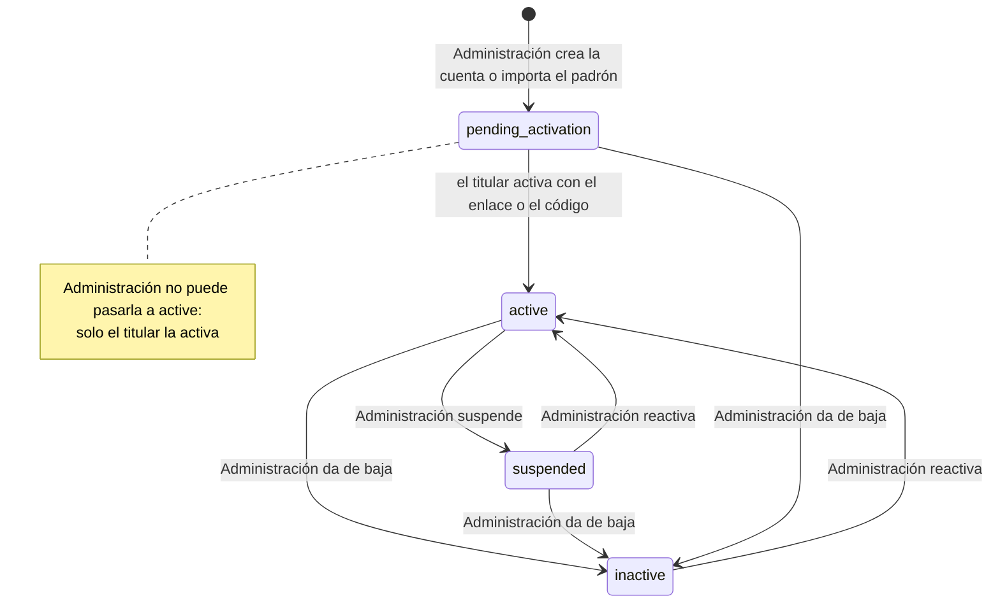

Toda salida de `active` revoca las sesiones y los tokens de la cuenta en el mismo momento.

**Actividad: ciclo de vida** (`activities.status`, máquina de estados de `shared`)

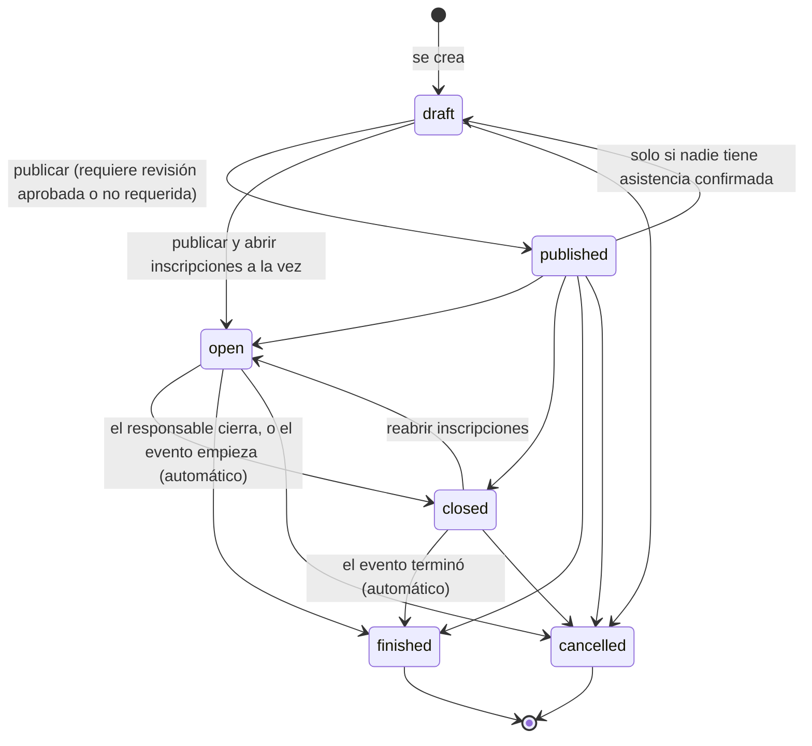

**Actividad: revisión institucional** (`activities.review_status`, eje aparte del ciclo de vida)

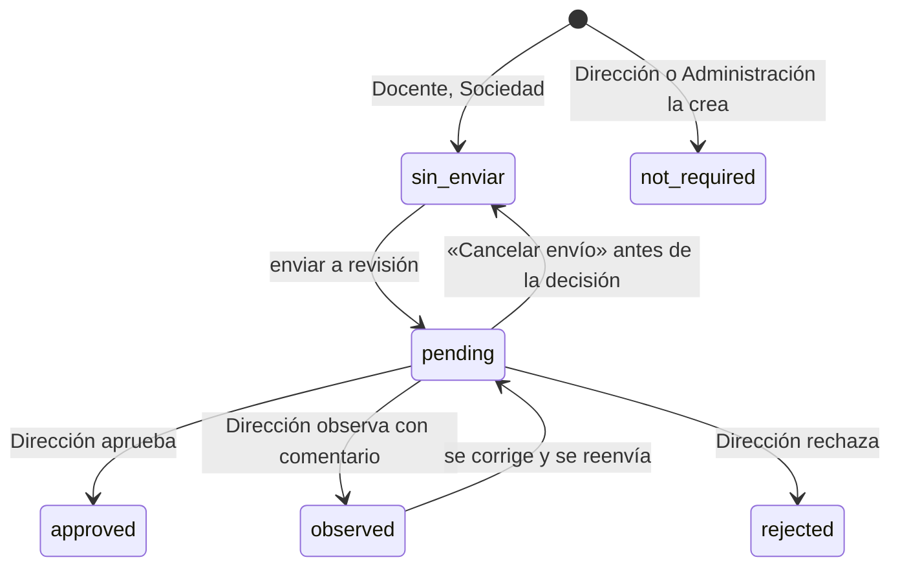

Una actividad **aprobada** queda con el contenido bloqueado para quien la propuso (`ACTIVITY_APPROVED_LOCKED`:
«Pide a Dirección los ajustes»); sigue operando inscripciones y asistencia. Una **rechazada** no se reutiliza: solo
se puede cancelar o crear otra. Mientras está **en revisión**, nadie cambia su contenido.

**Inscripción a una actividad** (`activity_registrations.status`)

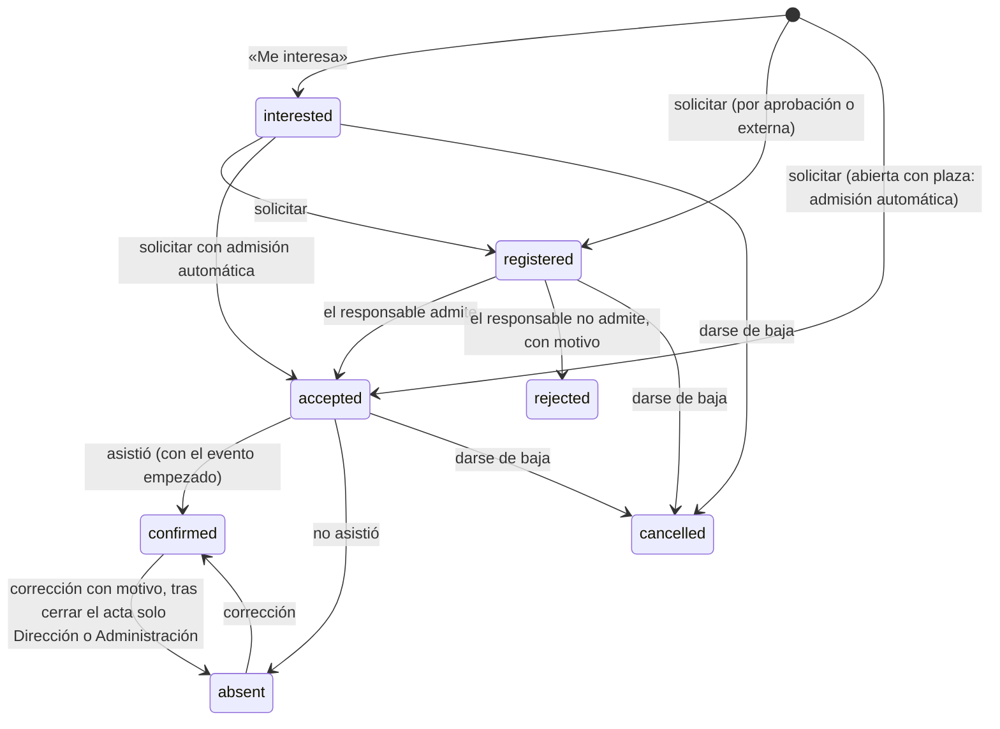

Solo `confirmed` es experiencia: alimenta la trayectoria, la afinidad, el respaldo y los puntos.

**Proyecto** (`projects.status`) y su **nivel de respaldo** (`projects.backing_tier`)

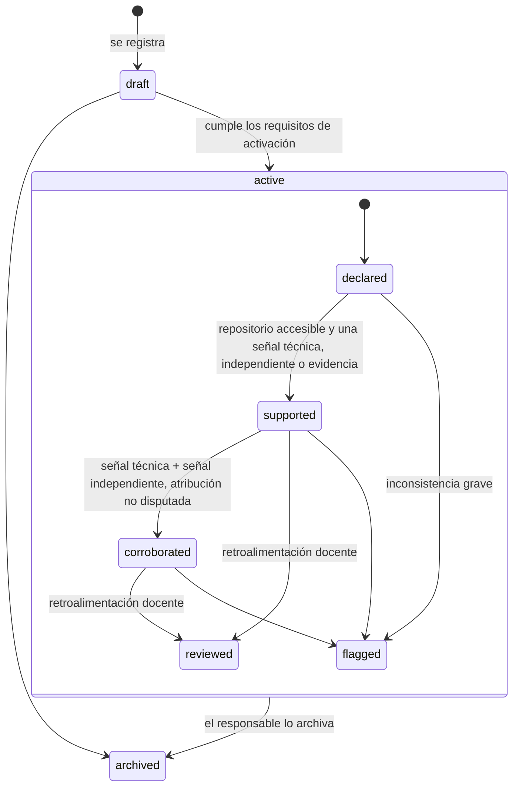

El nivel nunca se fija a mano: se recalcula con cada señal nueva (comprobación del repositorio, demo,
confirmación de un integrante, evidencia, retroalimentación).

**Trabajo de validación** (`validation_records.status`)

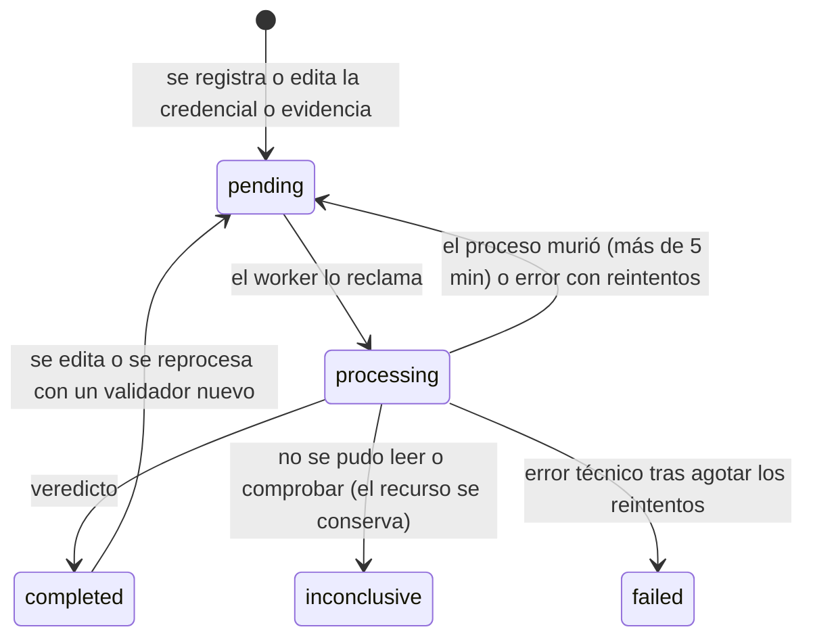

**Correo de cuenta** (`mail_jobs.status`)

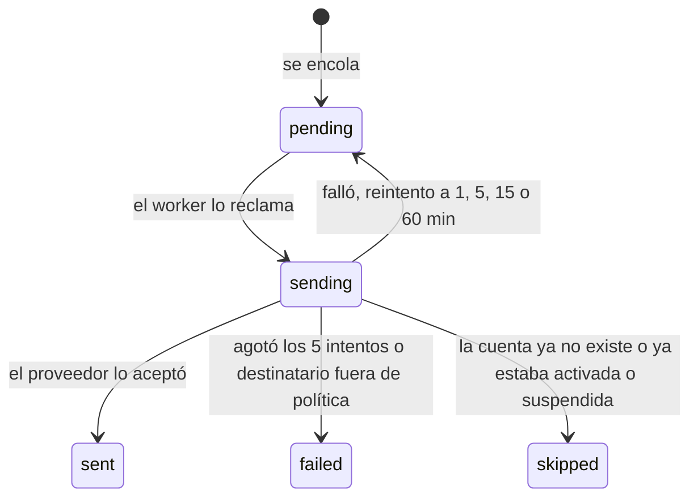

**Lote de importación** (`import_batches.status`)

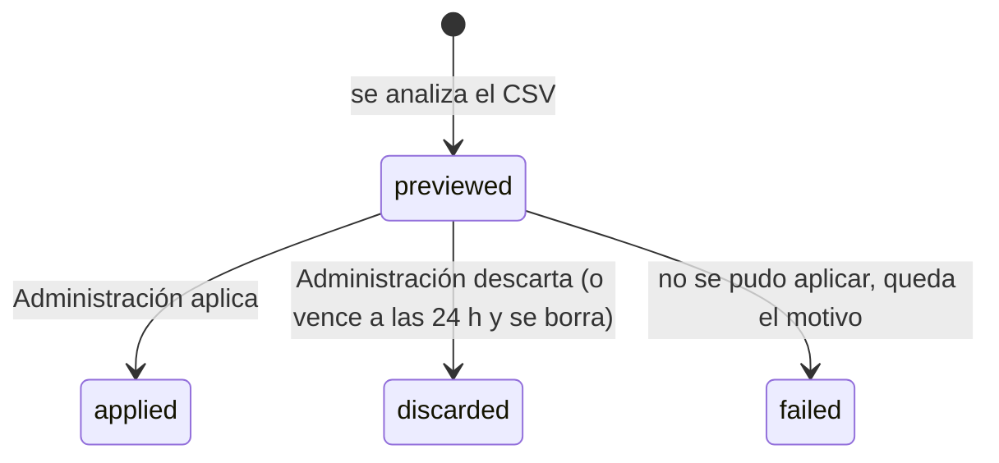

**Solicitud de contacto, postulación e invitación a equipo**

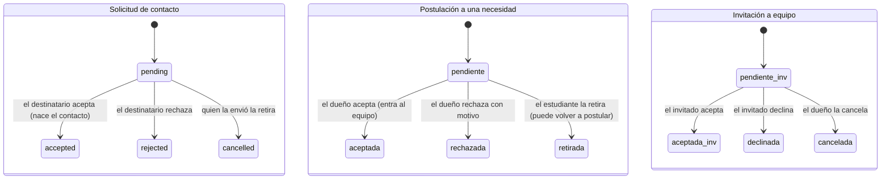

**Recomendación** (`recommendations.status`)

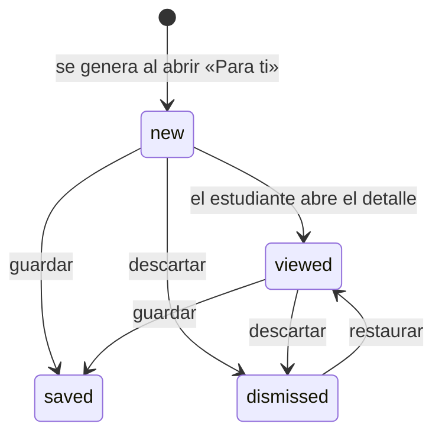

**Propuesta de puntos** (`gamification_proposals.status`)

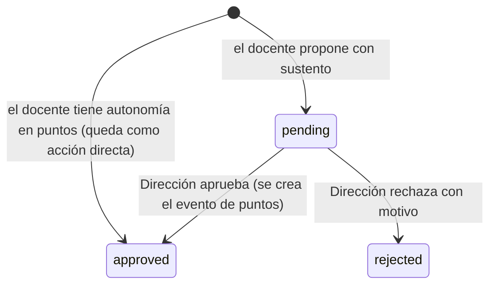

## 3. Antes de entrar: la portada, las cuentas y el acceso

### 3.1 La portada pública (`/`)

Quien abre la web sin sesión ve una **landing animada** con secciones: «¿Qué problema resuelve?», «Todo lo que
necesitas para mostrar tu valor», «Cada persona ve lo que necesita», «Tu camino en 5 pasos», «Complementa las
herramientas institucionales», preguntas frecuentes y el llamado «Potencia tu perfil. Conecta con
oportunidades.». El botón «Conocer la plataforma» baja a las funciones; «Ingresar» lleva a `/login`.

Las únicas pantallas sin sesión son: la portada, el inicio de sesión, la activación y recuperación de cuenta,
el **perfil compartible** (`/p/:slug`) y el **proyecto compartido por enlace** (`/proyecto/:token`). Todo lo
demás exige iniciar sesión.

### 3.2 No hay registro público: cómo nace una cuenta

1. **Administración** crea la cuenta (pantalla «Usuarios») o la importa desde el **padrón** en CSV.
2. Toda cuenta lleva un **código universitario** con el formato `PREFIJO-XXXXXXX`:
   `EST-` para Estudiante y Sociedad científica, `DOC-` para Docente, `DIR-` para Dirección, `ADM-` para
   Administración, seguido de 7 letras o números en mayúscula (por ejemplo `EST-38DJ1HA`). Es único.
3. Estudiantes y Sociedad científica llevan además su **semestre** (y, los estudiantes, semestres de
   **arrastre o repetición**, que también cuentan para el alcance docente).
4. El correo debe pertenecer a un **dominio institucional** autorizado (`INSTITUTIONAL_EMAIL_DOMAINS`, por
   ejemplo `univalle.edu,est.univalle.edu`). En producción esta lista es obligatoria.
5. La cuenta nace en estado **pendiente de activación** y el sistema encola un **correo de activación**.

### 3.3 Activar la cuenta (`/activar`)

El correo trae dos caminos equivalentes:

- un **botón con enlace** que abre `/activar?token=…`;
- un **código de 6 dígitos** (se muestra como «482 913») para escribir junto con el correo, útil si el enlace no abre.

Al abrir la pantalla, la web primero **comprueba el enlace** y explica su estado en palabras («El enlace ya se
usó», «El enlace venció, pide otro», «Tu cuenta ya está activa, inicia sesión»). Luego pide la contraseña.

Reglas:

- El enlace y el código valen **48 horas** (`ACTIVATION_TOKEN_TTL_HOURS`).
- El código admite **10 intentos**; al décimo error se anula y hay que pedir otro.
- Pedir otro correo tiene una **espera de 120 segundos** y un **tope de 5 por día** por cuenta.
- Emitir un enlace nuevo **revoca** los anteriores del mismo tipo: solo sirve el último.
- Una cuenta ya activa **no** recibe otra activación: la pantalla orienta a iniciar sesión.
- En producción puede habilitarse una pestaña para **pegar el enlace** completo (`VITE_ACTIVATION_PASTE_LINK`).

**Política de contraseña** (la misma en la API, la web y el móvil):

- entre **12 y 128 caracteres**;
- al menos una **minúscula**, una **mayúscula**, un **número** y un **símbolo**; sin espacios;
- no puede ser el propio correo ni contener el código universitario.

Activar deja la cuenta en estado **activa**, consume el token (sirve una sola vez) y queda en la auditoría.

### 3.4 Recuperar la contraseña (`/recuperar` y `/restablecer`)

- Se pide con el correo. La respuesta es **idéntica exista o no la cuenta**: así la pantalla no sirve para
  averiguar qué correos están registrados.
- El enlace y el código valen **30 minutos**.
- Restablecer la contraseña **cierra todas las sesiones** abiertas de esa cuenta.

### 3.5 Iniciar sesión (`/login`)

- Se entra con **correo institucional y contraseña**.
- Si el correo no existe o la contraseña es incorrecta, el mensaje es el mismo: «Credenciales inválidas».
- Solo **después** de acreditar la contraseña se explica el estado de la cuenta: «aún no está activada»,
  «está suspendida», «está inactiva».
- El login tiene un límite propio de **10 intentos por minuto por IP** en producción (fuerza bruta).
- Al entrar, cada rol va a su inicio: Estudiante `/student`, Docente `/teacher`, Dirección `/director`,
  Sociedad `/society`, Administración `/admin`.

### 3.6 Cómo se mantiene la sesión

- La web guarda el **token de acceso solo en memoria**: dura **15 minutos** y una recarga lo pierde a propósito.
- La sesión larga es un **token de renovación** (refresh) de **7 días**, que en la web vive en una **cookie
  HttpOnly** que JavaScript no puede leer y que solo viaja a `/api/auth`. En el móvil se guarda en el
  almacenamiento seguro del teléfono (Expo SecureStore).
- Cada renovación **rota** el token: el viejo deja de servir. Si alguien roba uno y lo usa, el titular ve su
  sesión cortada (o viceversa), así que el robo se vuelve visible.
- Hay una **gracia de 60 segundos** para el token recién reemplazado: cubre la recarga (F5) justo en medio de una renovación.
- El usuario puede ver sus **sesiones abiertas** y **cerrar todas**.
- Si Administración suspende la cuenta o cambia su rol, el efecto es **inmediato**: el rol y el estado se leen de la base en cada petición, no del token.

### 3.7 La app móvil es solo del Estudiante

La app se identifica con una cabecera (`X-Afinia-Client: mobile`). Si un docente, Dirección, Sociedad o
Administración intenta entrar desde el móvil, la API responde **403** con el mensaje «La aplicación móvil es
para estudiantes. Entra a Afinia desde la web.» **antes** de crear ninguna sesión. Si alguien ya tenía una
sesión vieja, la app le muestra una pantalla amable que explica qué encontrará en la web según su rol.

### 3.8 Ayuda (`/ayuda`)

Todos los roles tienen el **centro de ayuda**: video explicativo opcional (`HELP_VIDEO_URL`), preguntas
frecuentes y «Lo que puedes hacer». La ayuda es pública en la API para que se pueda abrir antes de activar la
cuenta. La web incluye además un **tutorial** de primera visita (pasos con «Anterior», «Siguiente», «Omitir»).

## 4. El recorrido completo del Estudiante

El estudiante es el centro del sistema: todo lo demás existe para construir, respaldar y orientar su
trayectoria. Esta sección recorre la web; al final se explica qué cambia en la app móvil.

### 4.1 La bienvenida obligatoria (`/student/bienvenida`)

La primera vez que entra, el estudiante **no ve el menú**: la bienvenida ocupa la pantalla completa y una
guarda (`OnboardingGate`) lo devuelve a ella mientras no la termine. Son cinco pasos; cuatro son obligatorios
y el servidor los exige (no solo la pantalla):

| Paso | Pantalla | ¿Obligatorio? | Qué se guarda |
|---|---|---|---|
| 1 | **«¿Son correctos tus datos?»** Muestra nombre, código universitario y semestre | Sí | `institutional_confirmed_at`. No puede cambiarlos: si están mal, los corrige Administración |
| 2 | **«¿Qué te interesa?»** Áreas con prioridad (hasta 5) y tecnologías «Me interesa» | Sí, junto con el paso 3 (al menos uno de los dos) | `student_interests` (con prioridad), `student_skill_interests` (kind = interest) |
| 3 | **«¿Qué quieres mejorar?»** Áreas y tecnologías «Quiero mejorar» | Ver paso 2 | `student_profiles.improvement_area_ids`, `student_skill_interests` (kind = improve) |
| 4 | **«Colaboración y privacidad»** Disponibilidad (Busco equipo · Escucho propuestas · Sin tiempo ahora · Prefiero no decirlo), si aparece como posible compañero en sugerencias de otros y si activa su perfil compartible | Sí | `availability`, `availability_decided_at`, `peer_discoverable`, `public_profile_enabled`, `privacy_reviewed_at` |
| 5 | **«Orientación académica, si quieres»** Cuestionario de 12 preguntas | No | `onboarding_runs`, `onboarding_answers` |

La bienvenida guarda **en qué paso va** (`onboarding_step`), así que se puede cerrar y retomar. Al terminar se
ve «¡Bienvenido a Afinia!», se registra el evento `ONBOARDING_COMPLETED` en la auditoría y se abre el inicio.

**Nadie declara un nivel de habilidad.** La antigua autoevaluación (básico/intermedio/avanzado) se retiró en la
V2: la API responde **410 Gone** a esas rutas. Lo que se declara es interés o deseo de mejorar, que orienta
recomendaciones y nunca suma afinidad.

**El cuestionario de orientación** (versión 2): 12 preguntas sobre gustos y formas de trabajar (nunca de
conocimiento técnico; por ejemplo «De lo que usas a diario, ¿qué te da más curiosidad por dentro?»). Cada
opción reparte pesos sobre etiquetas de área (`desarrollo-web`, `ciberseguridad`, `videojuegos`…), que se
traducen a las áreas del catálogo. Acepta respuestas parciales desde 6 contestadas, se adapta a las áreas que
el estudiante ya declaró (preguntas de profundización) y se puede repetir: las pasadas anteriores quedan como
`superseded`. El resultado son **sugerencias** que el estudiante confirma: solo lo que confirma se incorpora
como interés (con procedencia «orientación»).

### 4.2 Inicio (`/student`)

Un tablero de bienvenida con:

- **Tus áreas fuertes**: las áreas con mayor afinidad, con su nivel.
- **«¿Qué quieres hacer?»**: accesos grandes a Para ti («Oportunidades que encajan con lo que quieres explorar»),
  Actividades, Mis proyectos, Certificados y evidencias, Compañeros y equipos, Mi progreso.
- **Próximos pasos** según lo que le falta: «Registra tu primer proyecto», «Inscríbete en una actividad»
  («Cuando el organizador confirme que participaste, quedará en tu trayectoria»), «Sube un certificado o una
  evidencia», «Mira lo que te recomendamos».
- Tarjetas **Tus actividades** y **Tus proyectos** con lo último.

En la barra superior está la **campana de avisos** con el contador de no leídos y el menú de usuario
(perfil, ayuda, cerrar sesión). En el teléfono, la web muestra una **barra inferior** tipo app con Inicio,
Actividades, Proyectos, Perfil y «Más».

### 4.3 Mi perfil (`/student/profile`)

Cuatro pestañas:

1. **Sobre mí**: avatar de catálogo (12 ilustraciones: code, cpu, database, globe, shield, smartphone,
   terminal, layers, zap, book, compass, star) o **foto propia** (PNG, JPG o WEBP, hasta 5 MB). La foto no es
   pública por defecto. También la presentación (*bio*), una tarjeta «Tu perfil va así» con el porcentaje de
   completitud y «Así verán mi perfil».
2. **Intereses y objetivos**: «¿Qué áreas te interesan?» (con prioridad), «¿En qué áreas quieres mejorar?»,
   «Tecnologías que te interesan o quieres mejorar», **intereses en texto libre** (temas con palabras propias,
   por ejemplo «robótica educativa»), «Tecnologías respaldadas por tu trayectoria» (solo lectura: lo que el
   sistema comprobó) y el «Cuestionario de orientación (opcional)».
3. **Disponibilidad**: «Cómo te gusta trabajar»: disponibilidad, modos (remoto, presencial, híbrido), tipos de
   colaboración que le interesan (proyectos, investigación, competencias, grupos de estudio, voluntariado),
   horas por semana y notas.
4. **Visibilidad**: el **perfil compartible** (activar o no, qué campos mostrar entre presentación, áreas,
   afinidades, nivel de respaldo, proyectos, tecnologías, disponibilidad, trayectoria y foto), el enlace y el QR,
   y «Lo que nunca se comparte» (correo institucional, archivos privados, identificadores internos: no existe
   ninguna configuración capaz de exponerlos).

Cada cambio relevante del perfil **pide un recálculo** de afinidad (el motor decide si algo cambia de verdad) y
actualiza el porcentaje de completitud.

### 4.4 Actividades y oportunidades (`/student/activities`)

La pantalla más usada. Pestañas:

| Pestaña | Qué muestra |
|---|---|
| **Para ti** | Recomendaciones de tipo actividad, oportunidad y curso externo, cada tarjeta con «por qué aparece». Un botón «Guardar» las deja como favoritas de acceso rápido (no cambia el orden) |
| **Todas** | La oferta de la carrera, paginada, con búsqueda por texto y filtros: tipo (académicas internas, extracurriculares internas, oportunidades externas), categoría, área, modalidad, fechas, responsable |
| **Inscritas** | Las actividades donde tiene una inscripción vigente o marcó interés |
| **Guardadas** | Sus favoritas |
| **Historial** | Lo pasado, con el estado en que quedó cada una («Tu historial») |

**El estudiante nunca ve borradores**, y en «Para ti» nunca aparece una actividad dirigida a otros semestres. El listado
pone primero lo próximo (fecha futura más cercana), después lo pasado y al final lo que no tiene fecha.

**El detalle de una actividad** («Ver detalle») muestra: título, tipo y estado, categoría, áreas (la primera es
la principal), tecnologías que se trabajan, descripción, fechas de inicio y fin, modalidad con aula o enlace
(una virtual no muestra aula; una presencial no lleva enlace), cupo y plazas, semestres destinatarios,
requisitos, **responsables** y **contactos** (con nombre, rol y el correo de los contactos para escribirles),
imágenes (la primera es la portada), enlaces y recursos, la **política de resultado** («Sin resultado», «Solo
participación», «Certificado emitido por la institución», «Credencial externa esperada»), las **reglas de
puntos** si las tiene y, sobre todo, **su propio estado** con lo que puede hacer ahora.

**Botones del estudiante y lo que provocan:**

- **Me interesa**: guarda un recordatorio personal. Se puede marcar aunque la actividad ya cerró o terminó.
  Genera un único aviso de recordatorio antes del inicio. No es inscribirse y no suma nada.
- **Inscribirme → «Solicitar inscripción»**: abre una confirmación que explica cómo se admite:
  - actividad interna **abierta y sin cupo**: «Admisión abierta: quedarás admitido al instante»;
  - interna **abierta con cupo**: «Admisión abierta con N plazas: se asignan por orden de solicitud; si quedan,
    tienes la tuya al instante» (la plaza se toma de forma atómica: dos solicitudes simultáneas nunca se llevan
    la misma última plaza);
  - interna **por aprobación**, o externa: «Inscripción sujeta a aprobación: el responsable decide si te admite».
  El aviso posterior dice exactamente lo que pasó: «Inscripción admitida» o «Solicitud enviada».
- **Darme de baja**: pasa la inscripción a «dado de baja». Solo antes de la actividad.
- **Guardar / Quitar de favoritas**: marcador personal; no reserva lugar ni cambia recomendaciones.

**Por qué una actividad puede no admitir inscripciones** (la pantalla lo dice y deshabilita el botón): todavía
es un borrador, fue cancelada, sus inscripciones están cerradas, ya finalizó, no está abierta para registro, su
fecha ya pasó, se llenó el cupo, o ya hay una solicitud resuelta por el responsable. Los **semestres
destinatarios** no bloquean la inscripción: funcionan como filtro duro de las recomendaciones y como alcance de
los docentes (ver el hallazgo H-05 del capítulo 34).

**Qué pasa después**: el responsable admite o no admite (con motivo), y cuando el evento ya empezó registra la
asistencia. Solo **«Asistió»** alimenta la trayectoria, la afinidad, el respaldo y los puntos. Cada decisión
le llega como aviso («Tu inscripción fue admitida», «Tu participación quedó registrada»…).

### 4.5 Biblioteca (`/student/library`)

El catálogo **controlado** de recursos de aprendizaje: nada de enlaces sacados automáticamente de Internet;
cada recurso lo cargó o aprobó alguien de la carrera. Tres pestañas: **Todos los recursos**, **Para ti** (los
que coinciden con lo que declaró que le interesa o quiere mejorar, con el motivo en palabras) y **Mis favoritos**.

Filtros por área, tecnología y tipo (curso de autoaprendizaje sin acreditación automática, práctica o reto,
herramienta, guía o tutorial, documentación, video, libro). Cada tarjeta muestra imagen, áreas y tecnologías,
enlace o archivo (PDF o imagen subidos). Guardar como favorito es idempotente y **no aporta afinidad**.
Completar un recurso solo da puntos si un **docente lo atestigua** con sustento y Dirección lo aprueba.

### 4.6 Proyectos (`/student/projects`)

El portafolio: «Mis proyectos» (propios y donde es integrante aceptado), las invitaciones recibidas y el
detalle de cada proyecto.

**Crear un proyecto** (nace en **borrador**, se puede guardar incompleto):

1. Título, descripción, áreas (la primera es la principal) y **tecnologías del catálogo**, cada una con el
   **área en la que se usó** (el selector `AreaSkillPicker` obliga a que cada área elegida tenga al menos una
   tecnología suya).
2. Repositorio público (GitHub, GitLab o Bitbucket con forma `usuario/repositorio`). Una URL con `/tree/rama`,
   `/blob/…`, `.git` o barra final se guarda como la raíz del repositorio.
3. Opcional: **«Analizar repositorio»** antes de guardar. Consulta GitHub (lenguajes y manifiestos) y devuelve lo
   detectado cotejado con el catálogo, sin guardar nada.
4. Demo pública (solo `https://` y sin credenciales en la URL).
5. Visibilidad (de más cerrada a más abierta): **Solo yo y los integrantes** · **También mi equipo** ·
   **También docentes autorizados** · **Toda la comunidad Afinia** · **Público por enlace**.
6. Equipo de colaboración vinculado (opcional): «usar uno de mis equipos» invita a sus integrantes.

**Integrantes**: el responsable busca compañeros por nombre e invita con un rol propuesto (catálogo: Responsable,
Frontend, Backend, Base de Datos, Mobile, QA, UX/UI, DevOps, Datos/IA, Documentación, Otro; varios por persona).
El invitado **acepta o rechaza**; solo al aceptar es integrante. El responsable puede cancelar invitaciones
pendientes, **proponer** la contribución de cada uno y **excluir** a un integrante con motivo (queda en la
bitácora y el excluido recibe un aviso respetuoso que no expone el motivo como acusación).

**Mi contribución**: cada integrante escribe y **confirma** qué hizo y **qué tecnologías del proyecto usó**
(solo puede elegir entre las del proyecto). Si no está de acuerdo con lo que le propusieron, **pide una
corrección**: su contribución queda sin confirmar y el proyecto no puede activarse con información disputada.
Si el responsable quita una tecnología que alguien había confirmado, a esa persona se le pide **reconfirmar**.

**Activar el proyecto** («Para activarlo» / «Activar proyecto»): el sistema muestra la lista exacta de lo que
falta, con mensajes como «Elige al menos un área», «Cada área del proyecto necesita al menos una tecnología usada
en ella», «El repositorio no existe o no es público», «Hay invitaciones sin responder», «Todos los integrantes
deben confirmar su contribución», «Confirma tu propia contribución», «Agrega una evidencia del funcionamiento
(captura, documentación o presentación) o una demo accesible». Si GitHub no responde (cuota, caída), no se
inventa que el repositorio no existe: queda un aviso y se reintenta.

**Comprobación técnica** (`ProjectTechnicalCheck`): muestra el nivel de respaldo y el estado de repositorio y
demo. Las tecnologías que GitHub vio y el estudiante **no declaró** aparecen como **sugerencias**: «La usé»
(eligiendo el área) la incorpora como afirmación suya con su procedencia; «Descartar» no la vuelve a proponer;
si no está en el catálogo, «Pedir que la evalúen» crea un **pedido de tecnología** para Administración. «Volver
a comprobar» repite la consulta a GitHub (con caché y ETag).

**Evidencias**: capturas, documentación o presentación (archivo o enlace). Son un registro privado de
funcionamiento y procedencia: mejoran el respaldo del proyecto, no crean otro proyecto.

**Imágenes de muestra**: hasta 5 (PNG, JPG o WEBP); la primera es la portada; se reordenan.

**Galería «Proyectos de la carrera»** (`/proyectos`): solo proyectos **activos** visibles para quien consulta,
6 por página, con búsqueda y filtros por área y tecnología. Cada integrante decide, desde su sesión, si se le
nombra en la galería (`show_in_gallery`).

**Enlace público** (`/proyecto/:token`): solo existe mientras la visibilidad es «Público por enlace»; muestra un
resumen, nunca la bitácora, la auditoría ni datos privados.

**Bitácora** (`timeline`): cada hecho del proyecto (creado, invitado, aceptado, contribución confirmada,
evidencia, repositorio comprobado, retroalimentación, cambio de visibilidad, activación, cambio de nivel de
respaldo…) con su actor y fecha.

**Retroalimentación docente**: los docentes con el proyecto visible y dentro de su alcance escriben
comentarios; el equipo recibe el aviso «Retroalimentación docente». Con retroalimentación, un proyecto con
respaldo pasa a **Revisado**. Un docente también puede **confirmar una tecnología** con un comentario
específico (queda «corroborada por revisión académica»).

**Puntos del proyecto**: un docente puede **proponer** puntos por un proyecto (reconocimiento motivado); los
aprueba Dirección. El proyecto muestra qué puntos dio, con criterio, quién los otorgó y quién los aprobó.

### 4.7 Evidencias y credenciales (`/student/evidences`)

Dos pestañas:

- **Evidencias de proyectos**: las «Evidencias registradas antes» (de versiones anteriores, sueltas o asociadas
  a un área/actividad). Hoy las evidencias nuevas se agregan desde cada proyecto.
- **Credenciales externas**:
  - «Registrar credencial histórica o acreditar una oportunidad externa finalizada»: emisor, nombre del curso,
    fecha de emisión (no futura), URL de verificación, código de la credencial, áreas y tecnologías (cada una con
    su área), archivo (PDF, PNG, JPG o WEBP, hasta 10 MB) o solo el enlace.
  - Si viene de una oportunidad de Afinia, solo puede adjuntarla cuando es **elegible**: fue **admitido** en
    una externa que ya terminó, o **asistió** a una interna que espera una credencial de un tercero. El sistema
    le avisa «Ya puedes adjuntar tu credencial».
  - «Mis credenciales y su validación»: cada una con su **estado de validación** («En comprobación», «Verificada
    por la fuente oficial», «Necesita revisión», «Verificada por Dirección con prueba externa», «Inconclusa: no
    se pudo verificar», «Rechazada: la fuente oficial la contradice») y su **nivel de respaldo**.
  - **«Pedir revisión»**: solo para credenciales **históricas** sin verificador digital que concluya y sin
    contradicciones. La revisa Dirección (ver 6.4).
  - «Certificados institucionales recibidos»: los que el responsable de una actividad entregó.

Editar una credencial la **vuelve a validar**. Eliminarla borra también su archivo.

### 4.8 Áreas de afinidad (`/student/affinity`)

Tres pestañas:

1. **Áreas**: «Ranking y desglose». Cada área con su afinidad y su respaldo, nivel y familias de prueba. Al
   abrir un área, el **desglose línea por línea**: cada contribución con su puntaje base, el multiplicador de
   rendimiento decreciente que le tocó, los puntos finales, si alcanzó el tope del área, y un enlace a la
   actividad, proyecto o credencial real que la originó. También se listan **las cosas que se tuvieron en cuenta
   y no sumaron**, con el motivo («Interés declarado: orienta tus recomendaciones, pero no suma afinidad»,
   «Inscripción sin participación confirmada…», «Confirma en el proyecto las tecnologías que usaste…»). La
   suma de las líneas es exactamente el total. Además, «Habilidades respaldadas» por área, sin porcentajes de dominio.
2. **Evolución**: «Evolución de tus afinidades» a partir de las instantáneas (se conservan las 30 últimas).
3. **Cómo se calcula**: «Ponderaciones del motor», las reglas vigentes tal cual (puntos base de la base de
   datos y topes del motor), con buscador.

El botón **«Recalcular afinidad»** fuerza un cálculo (normalmente ocurre solo cuando cambia algo).

### 4.9 Colaboración (`/student/collaboration`)

**Pestaña Contactos:**

- «Tu perfil compartible»: enlace, QR (generado por la propia API, sin servicios externos), botón para
  **cambiar el identificador** (invalida los QR viejos).
- «Cómo contactarte»: **canales** que comparte: Microsoft Teams (correo o enlace de teams.microsoft.com),
  WhatsApp (número con código de país), LinkedIn (`linkedin.com/in/…`), correo de contacto u otro enlace https.
  Cada uno se valida y se normaliza; se marca cuáles son públicos.
- «Buscar a alguien»: por nombre o identificador, **solo entre quienes aceptaron ser encontrados** y tienen su
  perfil compartido activo.
- «Solicitar contacto» con un mensaje. «Solicitudes recibidas» (aceptar o rechazar) y «Enviadas y sin
  responder» (se pueden retirar).
- «Mis contactos»: con una **nota privada** por contacto (alias, contexto, canal preferido) y «Deshacer».
  Un QR **no crea** un contacto: crea la posibilidad de pedirlo.

**Pestaña Equipos:**

- «Invitaciones a equipos»: aceptar o declinar.
- «Para ti»: necesidades abiertas que encajan con lo que declaró (su semestre, con lugar, que no son suyas), con el porqué.
- «Todas las necesidades abiertas de tu semestre» y «Mis postulaciones» (retirar una pendiente).
- «¿Qué le falta a tu equipo?»: publicar una **necesidad** (propósito, descripción, tecnologías y áreas que
  faltan, disponibilidad requerida —cualquiera, abierto o buscando, solo buscando—, tamaño máximo de 2 a 20).
- «Mis necesidades»: ver postulaciones (quién, su semestre, su disponibilidad y cuáles de las habilidades que
  faltan tiene **respaldadas**; sin puntajes), aceptar o rechazar con motivo predefinido («Buscamos otras
  habilidades», «El equipo ya está completo», «La disponibilidad no coincide», «Elegimos otro perfil para este
  cupo», «Otro motivo» con comentario obligatorio), ver **candidatos sugeridos** con su motivo e invitarlos.
- «Mis equipos»: crear el equipo de una necesidad con un **nombre moderado**, renombrarlo, ver lo cubierto y lo
  que falta.

**No hay chat.** Las rutas de mensajería antiguas responden **410 Gone** con un motivo claro.

### 4.10 Mi progreso (`/student/progress`)

Tres pestañas:

1. **Mi trayectoria**: «Cómo leer tu trayectoria», el **histórico completo** con el nivel de cada cosa en
   lenguaje natural (incluye lo que no entra al currículo y por qué) y la «Evolución por área».
2. **Puntos e insignias**: total de puntos, insignias obtenidas, «Qué se reconoce» y el historial («Todavía no
   hay nada reconocido. Participa en una actividad o consigue respaldo para un proyecto.»).
3. **Resumen de trayectoria**: el **currículo**:
   - **Plantilla**: Clásica (sobria, blanco y negro), Moderna (títulos en el color de la carrera) o Compacta
     (serifa, más contenido por página). Cambian la tipografía y el color, nunca lo que se afirma.
   - **Paso 1 · Qué secciones incluir**: Perfil/resumen, Proyectos y aportes individuales (con nivel de
     respaldo), Participaciones académicas registradas, Participaciones extracurriculares registradas,
     Credenciales externas, Certificados institucionales recibidos, Habilidades respaldadas, Insignias, Contacto.
   - **Paso 2 · Qué ítems de cada sección**: solo los **elegibles** (un proyecto activo y corroborado o revisado;
     una actividad interna con asistencia confirmada; una credencial externa corroborada). Para cada sección
     dice cuántos quedan fuera y por qué.
   - **Presentación**: texto propio de hasta 1200 caracteres; con IA configurada, una ayuda de redacción
     (mejorar, resumir, reorganizar, alternativas) que solo se exporta si el autor la aprobó.
   - **Vista previa** y descarga en **PDF** (generado por la propia API, sin librerías externas). El PDF lleva
     siempre el descargo: «Resumen de trayectoria estudiantil — selección de experiencias registradas en
     Afinia… No constituye certificación institucional ni acreditación profesional», y la nota de fuentes.

### 4.11 Notificaciones (`/notificaciones`)

La bandeja propia (cada actor solo ve las suyas) con pestañas **Todas** y **Sin leer**, marcar como leída y
«marcar todas». Ejemplos de avisos que recibe el estudiante: recordatorio de una actividad que empieza
(el día antes y unas horas antes si está inscrito; uno solo si marcó interés), inscripción admitida o no
admitida, participación registrada, credencial ya adjuntable, credencial señalada, revisión manual resuelta,
invitación a proyecto, contribución cambiada o corrección pedida, exclusión de un proyecto, retroalimentación
docente, solicitud de contacto, postulación aceptada o rechazada, invitación a equipo, pedido de tecnología
resuelto, certificado institucional entregado. Un mismo hecho nunca se avisa dos veces (clave de deduplicación).

### 4.12 La app móvil del estudiante

La app (Expo SDK 54, React Native 0.81, paquete Android `com.afinia.app`) cubre lo esencial del estudiante:

| Pestaña inferior | Pantallas |
|---|---|
| **Inicio** | Tus áreas fuertes, «Lo que ya cargaste», accesos rápidos |
| **Perfil** | Completar perfil; desde aquí: Intereses (áreas con prioridad), Tecnologías («Me interesa» / «Quiero mejorar» y «Con respaldo en tu trayectoria»), Credenciales y constancias, Colaboración (canales, perfil compartible, solicitudes, contactos, invitaciones y necesidades de equipo), Mi progreso (puntos, insignias, historial) y Mi trayectoria |
| **Actividades** | Para ti, Todas, Inscritas, Guardadas, Historial, con filtros por tipo y modalidad; Mis actividades; Biblioteca |
| **Proyectos** | Portafolio, nuevo proyecto, detalle con edición, mi contribución, integrantes, invitaciones, evidencias, «Para activarlo» y retroalimentación docente |
| **Afinidad** | «Mis afinidades»: áreas, desglose y evolución |
| **Avisos** | Centro de notificaciones, con contador que se refresca cada minuto |

Igual que en la web, la app empieza por la **bienvenida** de 4 pasos si no está completa. El botón «Salir»
está en la cabecera. Lo que **solo está en la web**: el currículo en PDF, la galería «Proyectos de la carrera»
y algunos detalles de gestión de equipos. La dirección de la API se deduce del equipo que sirvió la app en
desarrollo, o queda fija dentro del APK al compilarlo (`npm run mobile:apk -- <url>`).

## 5. El recorrido del Docente

El docente trabaja solo en la web. Todo lo que ve de los estudiantes está limitado a **sus semestres
habilitados** (los asigna Administración, del 1 al 8). Un estudiante entra en su alcance si su semestre actual
**o uno de arrastre o repetición** está entre los habilitados. Un docente sin semestres asignados ve paneles
vacíos, no «toda la carrera».

### 5.1 Inicio / Panel académico (`/teacher`)

Un solo panel con pestañas, cada una también enlazada desde el menú:

| Pestaña | Qué muestra |
|---|---|
| **Resumen** | Estudiantes en su alcance, perfiles activos, participaciones confirmadas, «Intereses predominantes», «Tecnologías más usadas» y la lista **nominal** de estudiantes con el perfil incompleto (para orientarlos) |
| **Por semestre** | Para cada semestre de su alcance: estudiantes, perfiles activos, participaciones confirmadas, proyectos, áreas de afinidad del grupo y respaldo agregado |
| **Estudiantes** | «Estudiantes a su cargo», con búsqueda. Al abrir uno, la **vista permitida** de su perfil: intereses, tecnologías respaldadas, afinidad con desglose, evolución, proyectos visibles para docentes y constancias. Nunca su contraseña ni su correo si no corresponde |
| **Proyectos visibles** | «Proyectos estudiantiles» de su alcance con visibilidad «También docentes autorizados» o más abierta. Búsqueda; detalle con integrantes, contribuciones, evidencias, comprobación técnica, bitácora, **retroalimentación**, **confirmar una tecnología** con comentario y **proponer puntos** |
| **Actividades de la carrera** | La oferta publicada (Todas, Académicas, Extracurriculares, Externas) con filtros |
| **Necesidades/equipos** | Necesidades de equipo abiertas de estudiantes de su alcance, **solo lectura**: para orientar, no para invitar |

### 5.2 Mis actividades (`/teacher/my-activities`)

El gestor de actividades (`ActivityManager`), común a Docente, Dirección, Sociedad y Administración:

1. **Crear** una actividad **académica** (el docente no crea extracurriculares). Campos: título, descripción,
   origen (interna u oportunidad externa con proveedor y enlace oficial), categoría (del catálogo vigente que
   admite ese tipo), áreas y tecnologías (cada tecnología con su área), modalidad con lugar o enlace de reunión,
   fecha y hora de inicio y fin (zona America/La_Paz), cupo, modo de inscripción (abierta o por aprobación),
   **semestres destinatarios** (solo los suyos), requisitos, etiquetas, imágenes (la primera es portada),
   **contactos** visibles para el estudiante, **política de resultado** y criterio de puntos por participación.
2. El borrador es **privado**: lo ven su creador y sus responsables; Dirección solo desde que se envía a
   revisión. Puede borrarse si nunca se envió ni publicó y no tiene historia.
3. **Enviar a revisión**: la API exige que esté completa (errores por campo) y que tenga semestres (un docente
   no publica «para toda la carrera»). Dirección recibe el aviso. Mientras Dirección no decida, el docente puede
   **«Cancelar envío»** para corregirla.
4. Dirección **aprueba**, **observa** (pide cambios con comentario) o **rechaza**. Con «observada» se edita y se
   reenvía. Solo una aprobada se puede **publicar** o **abrir inscripciones** (la API responde 409 si no).
5. Lo que Dirección aprobó **no puede cambiar de contenido** a sus espaldas: una vez aprobada, quien la propuso ya
   no cambia qué es la actividad (título, descripción, áreas, tecnologías…) y debe pedir los ajustes a Dirección
   (`ACTIVITY_APPROVED_LOCKED`). Fechas, lugar o cupo son operación y sí se editan. Una actividad **rechazada** no
   se reutiliza: se cancela o se crea otra.
6. **Operar**: abrir o cerrar inscripciones, ver **participantes**, **admitir o no admitir** solicitudes (con
   motivo), registrar **asistencia** («Asistió» o «Registrar ausencia») cuando el evento ya empezó y hasta **7
   días** después de su fin, y **cerrar el acta de asistencia** («Cerrar asistencia») cuando terminó. Con el acta
   cerrada ya no se editan filas: solo Dirección o Administración corrigen, con motivo.
7. **Duplicar** una actividad como borrador nuevo (sin fechas ni participantes). **Cancelar** una actividad
   exige un motivo que los inscritos verán.

Un docente **que fue asignado responsable por una autoridad** solo **opera** la actividad (inscripciones,
asistencia), no cambia su contenido. En una actividad con varios responsables, cada docente opera **solo los
estudiantes de los semestres que tiene asignados en esa actividad**.

### 5.3 Puntos de estudiantes (`/teacher/points`)

- «Puntos por estudiante» de su alcance, por periodo (semana desde el lunes, mes…), con búsqueda.
- **Proponer puntos** por un **proyecto** de un estudiante de su alcance (reconocimiento motivado) o por un
  **recurso completado** que atestigua con sustento. La propuesta queda **pendiente** y la decide Dirección;
  con autonomía concedida en el módulo de puntos, el docente otorga directamente y queda en el historial de
  acciones directas. Un mismo hecho no se premia dos veces.
- «Tus propuestas» con su estado; historial de puntos de cada estudiante (fecha, ±puntos, criterio, origen,
  quién otorgó, quién aprobó, motivo y estado).

### 5.4 Proponer recursos (`/teacher/resources`)

El docente propone recursos para la Biblioteca **para sus semestres**. Quedan pendientes de Dirección; si
Dirección los **observa**, el docente los corrige y vuelven a revisión. Con autonomía concedida en el módulo de
recursos, publica directamente.

### 5.5 Lo que el docente no puede hacer

Ver estudiantes fuera de sus semestres (la API responde 403 o 404), crear actividades extracurriculares,
publicar sin aprobación, reasignar responsables de una actividad (solo suma contactos), escribir
retroalimentación sobre proyectos que no son visibles para docentes, ni ver la analítica global de Dirección.

## 6. El recorrido de Dirección de carrera

### 6.1 Inicio (`/director`)

«Lo que espera tu decisión»: actividades por aprobar, recursos propuestos, propuestas de puntos, credenciales
en revisión manual y participaciones o entregas pendientes, más un acceso a la **Analítica**.

### 6.2 Aprobaciones (`/director/approvals`)

Tres pestañas: **Pendientes — Actividades** (aprobar, observar con comentario, rechazar; con historia de la
revisión), **Pendientes — Recursos** (los «Recursos propuestos por docentes») y **Pendientes — Gamificación**
(propuestas de puntos con origen, estudiante, criterio, motivo y respaldo). Cada decisión queda en la
auditoría. Las decisiones sobre **actividades** le llegan como aviso a quien propuso («Actividad aprobada»,
«Actividad observada», «Actividad rechazada»); las de recursos y puntos se ven en la pantalla del docente, sin aviso.

### 6.3 Autonomía docente (`/director/autonomy`)

Por defecto, todo lo que propone un docente **requiere revisión**. Dirección puede **conceder** a un docente
concreto una excepción por módulo, con justificación:

- **Recursos**: el docente publica recursos sin revisión previa.
- **Puntos**: el docente otorga puntos sin revisión previa.
- **Actividades**: **no se puede conceder**; la API responde «Las actividades siguen con revisión obligatoria:
  la excepción necesita una decisión institucional que todavía no está tomada».

La excepción se **revoca** con motivo y afecta lo que venga, no lo ya hecho. El «Historial de acciones directas»
muestra lo publicado u otorgado con una excepción.

### 6.4 Revisión de credenciales (`/director/credential-reviews`)

La **revisión manual excepcional**: solo para credenciales **históricas** (obtenidas fuera de Afinia) que no
tienen verificador digital que concluya y no tienen contradicciones. Dirección elige **cómo comprobó**:

| Método | ¿Es prueba externa independiente? |
|---|---|
| «Consulté la página o el registro individual del emisor» | Sí |
| «El emisor lo confirmó por un canal propio (correo, nota oficial)» | Sí |
| «Lo respalda un registro institucional (acta, sistema académico)» | Sí |
| «Solo revisé el documento aportado» | **No**: no verifica |

Decisiones posibles: **verificada** (exige un método independiente y una prueba externa distinta de la URL del
propio certificado; la credencial pasa a **Corroborado**), **inconclusa** (revisada sin fuente externa) o
**rechazada** (contradicción fuerte documentada, por ejemplo credencial de otra persona). El estudiante recibe
el aviso con el resultado.

### 6.5 Actividades (`/director/activities`)

Todas las actividades de la carrera. Dirección crea académicas **sin revisión** (su estado de revisión es «No
requiere revisión»), asigna **responsables** (docentes, Sociedad o Dirección) y, desde V6, **qué semestres de
la audiencia cubre cada responsable**: cada semestre destinatario debe quedar cubierto por al menos uno.

### 6.6 Participaciones (`/director/constancies`)

«Participaciones confirmadas»: elegir una actividad, ver la «Asistencia confirmada» y los «Documentos
registrados». Desde V5 Afinia **no emite constancias nuevas** (la API responde 403 con
`CONSTANCY_ISSUANCE_DISABLED`); conserva las anteriores. Para actividades con política «Certificado emitido por
la institución», el responsable **entrega** el certificado real (archivo que él mismo subió) a los
participantes confirmados, y queda registrado el emisor real.

### 6.7 Recursos (`/director/resources`)

Catálogo de la Biblioteca: crear, editar, retirar recursos (enlace o archivo PDF/imagen, imagen de portada,
áreas, tecnologías, tipo, semestres, criterio de «recurso completado» para puntos) y revisar propuestas.

### 6.8 Analítica (`/director/analytics`)

Cinco pestañas, todas **descriptivas** (nada predice nada):

| Pestaña | Contenido |
|---|---|
| **Panorama** | Áreas con mayor interés, habilidades más presentes, estado de los perfiles |
| **Afinidad** | Mapa de áreas de la carrera con afinidad y respaldo agregados, filtrable por semestre |
| **Participación** | Por semestre: interés, inscritos, confirmados y ausentes; por mes |
| **Demanda** | Actividades que más atraen, recursos más consultados (cuenta personas, no clics) |
| **Evolución** | Interés declarado por área, tecnologías en los proyectos, afinidad y respaldo promedio por área mes a mes, áreas predominantes por semestre |

**Umbral de privacidad**: un grupo con menos de **5** estudiantes (`ANALYTICS_MIN_GROUP_SIZE`) se publica con su
tamaño pero **sin desglose**: «el 100 % de octavo semestre tiene afinidad baja con Redes» es una estadística si
son cuarenta y una ficha personal si son dos.

### 6.9 Puntos y criterios (`/director/points`, `/director/gamification`)

Ver los puntos de cualquier estudiante con su historial, decidir propuestas, y configurar los **criterios de
puntos** («Puntos por cada hecho», «Extras por área», «Extras de temporada» con vigencia).

## 7. El recorrido de la Sociedad científica

| Pantalla | Qué hace |
|---|---|
| **Inicio** (`/society`) | «Próximas» actividades suyas y un resumen de métricas |
| **Mis actividades** (`/society/activities`) | Crear y operar actividades **extracurriculares** (reto, hackathon, convocatoria, club de estudio, integración, responsabilidad social…). Proponen y **Dirección aprueba**. Pueden designar como responsables a otros integrantes activos de la Sociedad |
| **Participantes** (`/society/participants`) | «Por actividad»: inscritos, admitidos, asistencia |
| **Métricas** (`/society/metrics`) | «Métricas de mis actividades» con filtros, «Por categoría» y «Actividad por actividad», con **comparación entre periodos**. Solo de lo suyo: nunca datos de actividades ajenas |

Una cuenta de Sociedad usa código `EST-` (son estudiantes) y tiene semestre, pero trabaja desde la web.

## 8. El recorrido de Administración

| Pantalla | Qué hace |
|---|---|
| **Inicio** (`/admin`) | «Cuentas por rol», estado del «Padrón», últimos eventos de «Auditoría» y estado del «Correo» |
| **Usuarios** (`/admin/users`) | «Crear una cuenta» de cualquier rol: nombres, **primer y segundo apellido**, correo institucional, código universitario con el prefijo del rol, semestre (y arrastre) si corresponde → «Crear cuenta y enviar invitación». La pantalla espera unos segundos al envío y dice en qué quedó. «Usuarios registrados» con búsqueda y filtro por rol; para cada cuenta: editar datos y rol (cambiar el rol obliga a cambiar el prefijo del código), cambiar estado (activa, suspendida, inactiva), **reenviar invitación** (con el vencimiento del último enlace a la vista) y, para docentes, **«Configurar» semestres habilitados** |
| **Importar padrón** (`/admin/imports`) | CSV de **estudiantes** o de **docentes**. «Descargar plantilla», subir, **previsualizar** (cada fila: nueva, actualiza, sin cambios, **conflicto** —el mismo correo con otro código o al revés— o **inválida**), «Aplicar la importación» o «Descartar». Detecta el separador, respeta comillas, rechaza filas con distinta cantidad de columnas y archivos que no son UTF-8. Una previsualización no aplicada se borra a las 24 h. Historial con el detalle fila por fila |
| **Áreas y habilidades** (`/admin/areas`) | Pestañas «Áreas académicas» (crear, editar, etiquetas con **análisis de riesgos** antes de guardar, dar de baja) y «Habilidades» (crear con área principal, áreas secundarias y alias; un **clasificador** sugiere el área y advierte si el nombre ya es alias de otra; dar de baja: «Dejará de ofrecerse al declarar habilidades. Quien ya la tiene declarada la conserva») |
| **Pedidos de tecnologías** (`/admin/skill-requests`) | Lo que los estudiantes pidieron desde sus proyectos. Tres decisiones: **alias** de una tecnología existente, **tecnología nueva** con sus áreas, o **rechazo** con explicación. El estudiante recibe el aviso de lo que de verdad pasó |
| **Categorías** (`/admin/activity-categories`) | Categorías de actividad (código, nombre, a qué tipo aplican); al dar de baja muestra cuántas actividades la usan |
| **Actividades / oportunidades** (`/admin/activities`) | Soporte sobre todas; Administración publica sin revisión e indica responsables |
| **Recursos** (`/admin/resources`) | Igual que Dirección |
| **Gamificación** (`/admin/gamification`) | Criterios de puntos |
| **Puntos de estudiantes** (`/admin/points`) | Consulta y soporte |
| **Revisión de credenciales** (`/admin/credential-reviews`) | Soporte excepcional y auditado |
| **Auditoría** (`/admin/audit`) | «Eventos» legibles: **actor, módulo, acción, fecha y resultado**, con filtros por módulo, acción, actor, fechas y resultado, de 10 en 10 |
| **Correo** (`/admin/mail`) | **Fuera del menú.** Solo por URL, solo Administración y solo en desarrollo o con el modo técnico explícito: estado del envío, «Comprobar conexión», «Enviar prueba». Nunca devuelve la contraseña |

**Dar de baja vs. borrar**: «borrar» un usuario lo **da de baja** (estado inactivo: conserva proyectos,
evidencias y trayectoria y cierra su acceso). Borrarlo de verdad (`?hard=true`) solo funciona en cuentas **sin
perfil estudiantil**; si lo tiene, la API lo niega y explica por qué.

Administración **no** puede ver contraseñas ni códigos de activación, ni otorgar constancias.

## 9. Historias completas, de punta a punta

Estas historias muestran cómo se encadenan las piezas. Cada paso dice qué registro se crea o cambia.

### 9.1 Del taller propuesto a la afinidad del estudiante

1. La docente María (semestres 5–8) crea el borrador «Taller de APIs con NestJS»: académica, categoría «Taller
   académico», área Desarrollo Web con las tecnologías Node.js y TypeScript, semestres 5 y 6, cupo 30, abierta,
   política «Solo participación». → `activities` (estado `draft`, revisión nula), `activity_areas`,
   `activity_skills`, `activity_responsibles`.
2. La envía a revisión. → revisión `pending`, `activity_reviews` (acción `submitted`), aviso a Dirección,
   auditoría `ACTIVITY_SUBMITTED`.
3. Dirección la aprueba. → revisión `approved`, `activity_reviews` (`approved`), aviso a María.
4. María abre inscripciones. → estado `open`, auditoría `ACTIVITY_STATUS_CHANGED`. Las palabras clave de búsqueda
   se recalculan solas a partir de áreas y tecnologías.
5. Ana (semestre 5) la ve en «Para ti» con el motivo «Coincide con tus intereses: Desarrollo Web» y solicita
   inscripción. Al ser abierta con cupo y quedar plazas, queda **admitida al instante**. →
   `activity_registrations` (`accepted`), aviso «Inscripción admitida».
6. El día antes y unas horas antes, Ana recibe recordatorios (`ACTIVITY_STARTING`), sin duplicados.
7. Al empezar el evento, el ciclo de vida automático **cierra inscripciones** (`closed`); al terminar, la deja
   **finalizada** (`finished`).
8. María registra que Ana **asistió**. → inscripción `confirmed`, aviso «Participación registrada», auditoría
   `PARTICIPATION_CONFIRMED` y **10 puntos** (`gamification_events`). Desde V6, asistir **no** otorga
   insignias (las obtenidas antes se conservan).
9. El motor de afinidad recalcula a Ana: suma **10 puntos de afinidad** en Desarrollo Web (primera actividad, factor 1)
   y **8 de respaldo** en la familia actividades. → `affinity_results`, `affinity_contributions`,
   `affinity_snapshots`. Ana ve la línea «Participación confirmada: Taller de APIs con NestJS».
10. María cierra el acta de asistencia. Si hubiera un error, solo Dirección o Administración lo corrigen con
    motivo; si la corrección quita la asistencia, se agrega un **reverso** de puntos.

### 9.2 Del repositorio al proyecto revisado

1. Luis crea el proyecto «Sistema de inventario» en borrador con áreas Desarrollo Web y Bases de Datos,
   tecnologías React (Web) y PostgreSQL (BD), repositorio `github.com/luis/inventario`.
2. La API consulta GitHub (lenguajes y manifiestos `package.json`, etc.), guarda la comprobación
   (`project_repository_checks`) y cruza lo declarado con lo detectado: React aparece en el `package.json`
   (**corroborada por manifiesto**); PostgreSQL no aparece (queda **declarada**, sin ser falsa).
3. Luis invita a Camila como Backend. Ella acepta y **confirma su contribución** y las tecnologías que usó.
4. Luis confirma la suya, sube una captura como evidencia y **activa** el proyecto. → `projects.status = active`,
   evento `PROJECT_ACTIVATED`.
5. Respaldo: repositorio accesible + una corroboración técnica + una persona independiente que confirmó →
   **Corroborado**. Afinidad y respaldo de Luis: +18 de afinidad y +15 de respaldo en Desarrollo Web, el área
   donde usó una tecnología confirmada **y** corroborada (React). En Bases de Datos el proyecto no suma nada
   mientras PostgreSQL no quede corroborada (por el repositorio o por un docente): el motor solo atribuye el
   proyecto a las áreas de las tecnologías que ese integrante confirmó y que tienen respaldo técnico.
6. Pone la visibilidad «También docentes autorizados». El docente Carlos no lo ve (Luis está en 7.º semestre,
   fuera de sus semestres 1–4); María sí. María escribe una retroalimentación. → `project_feedback`, aviso al
   equipo, el proyecto pasa a **Revisado** (+22 en vez de +18).
7. María propone 20 puntos por el proyecto; Dirección los aprueba. → `gamification_proposals` (`approved`),
   `gamification_events`.

### 9.3 De un certificado de Cisco a una credencial corroborada

1. Ana registra una credencial histórica: emisor Cisco, curso «Introduction to Cybersecurity», área
   Ciberseguridad, PDF del certificado y URL de verificación de Credly.
2. Se encola un trabajo de validación (`validation_records`, `pending`). El worker lo reclama, extrae el texto
   del PDF, busca QR e insignias, lee la URL oficial (con protecciones: nunca direcciones internas) y compara
   titular, curso, emisor y código.
3. Ningún verificador de proveedor está integrado (Credly/IBM, Cisco y Huawei se reconocen, pero su acceso real
   no se pudo comprobar), así que actúa el **verificador genérico**: el dominio de la URL debe ser oficial
   (credly.com es una plataforma de insignias aceptada) y la página debe **nombrar a Ana** y mostrar **el código o
   el curso**. Si es así → `verified_match` → **Corroborado** y estado «Verificada por la fuente oficial».
   Afinidad +15 en Ciberseguridad, respaldo +15 en credenciales.
4. Si la página responde pero no expone una prueba legible (por ejemplo, necesita JavaScript) →
   `reachable_no_structured_proof`: el PDF legible y coherente da **Con respaldo** (suma respaldo, no afinidad).
   Si la página nombra a otra persona → **Señalado** (no suma) y aviso a Ana. Si el emisor no responde →
   «Inconclusa» (no es sospecha de fraude) y, por ser histórica, Ana puede **pedir revisión** a Dirección.

### 9.4 Formar un equipo

1. Diego publica una necesidad: «App móvil para el hackathon», falta Flutter y diseño UX, disponibilidad «abierto
   o buscando», máximo 4.
2. Ve **candidatos sugeridos** con su motivo (cubre habilidades que faltan 50 %, afinidad con el área 20 %,
   disponibilidad 15 %, respaldo 15 %) y a Valeria, que postuló con un mensaje, con las habilidades que tiene
   **respaldadas**.
3. Acepta a Valeria; crea el equipo «Los del hackathon» (moderado por reglas: longitud 3–60, sin enlaces ni
   correos, sin términos prohibidos aun con números o letras separadas).
4. Valeria aparece en «Mis equipos». Si crean un proyecto, «usar uno de mis equipos» invita a sus integrantes.

### 9.5 Preguntas frecuentes, respondidas con las reglas

**«Me inscribí en tres talleres y mi afinidad no subió.»** Inscribirse no es experiencia. Solo suma cuando el
responsable registra que **asististe**. En «Áreas de afinidad → desglose» verás esas inscripciones con el motivo
«Inscripción sin participación confirmada».

**«Marqué muchas áreas como intereses y siguen en cero.»** Es a propósito: lo declarado **orienta** tus
recomendaciones («Para ti», Biblioteca, equipos), pero nunca suma afinidad.

**«Mi proyecto está activo pero no suma afinidad.»** Suma solo si su respaldo es **corroborado** o **revisado** y
solo en las áreas de las tecnologías que **tú confirmaste** haber usado y que tienen respaldo técnico (el
repositorio las muestra o un docente las confirmó). Revisa «Mi contribución» y la «Comprobación técnica».

**«No puedo activar mi proyecto.»** La pantalla «Para activarlo» dice exactamente qué falta: título, área,
tecnología por cada área, repositorio público válido, invitaciones respondidas, contribuciones confirmadas de todos
y una evidencia o una demo accesible.

**«GitHub detectó tecnologías que no declaré.»** Aparecen como sugerencias: «La usé» (eligiendo el área) las
incorpora como tuyas; «Descartar» no las vuelve a proponer; si no existen en el catálogo, «Pedir que la evalúen».

**«Mi credencial quedó inconclusa.»** El sistema no pudo comprobarla (el emisor no respondió, la página necesita
JavaScript o el documento es una imagen sin OCR). No es una sospecha de fraude. Si es **histórica**, puedes «Pedir
revisión» a Dirección.

**«Mi credencial quedó señalada.»** Algo no coincide con lo que declaraste (titular, curso, emisor, código). Corrige
los datos o el archivo: editarla la vuelve a validar.

**«No veo la oportunidad para adjuntar mi credencial.»** Solo aparece cuando fuiste **admitido** en una externa que
ya terminó, o **asististe** a una interna que espera una credencial de un tercero.

**«Me llegó el aviso de la actividad dos veces.»** No debería: cada aviso tiene una clave de deduplicación. Si son
dos avisos distintos, es el recordatorio del día antes y el de unas horas antes.

**«No me llegó el correo de activación.»** Puedes pedir otro (espera 2 minutos entre pedidos, máximo 5 por día) o
escribir el código de 6 dígitos del último correo. Administración ve en qué quedó el envío y puede reenviarlo. En
desarrollo, sin servidor de correo, los correos se simulan.

**(Docente) «No encuentro a un estudiante.»** Solo ves a los estudiantes de tus semestres habilitados (el actual o
uno de arrastre). Si el estudiante no tiene semestre registrado, no entra en el alcance de ningún docente.

**(Docente) «No puedo cambiar el título de mi actividad aprobada.»** Una vez aprobada, el contenido se bloquea para
quien la propuso: pide el ajuste a Dirección. Fechas, lugar y cupo sí los cambias.

**(Docente) «No puedo registrar la asistencia.»** Solo con el evento ya empezado, hasta 7 días después de su fin y
con el acta abierta. Después, la corrección es de Dirección o Administración, con motivo.

**(Dirección) «Quiero dar autonomía a un docente para publicar actividades.»** No se puede: las actividades siguen
con revisión obligatoria. La autonomía existe para recursos y para puntos.

**(Dirección) «La analítica de un semestre no muestra el desglose.»** El grupo tiene menos de 5 estudiantes: se
muestra su tamaño, pero no su desglose, para no convertir un agregado en una ficha personal.

**(Administración) «No puedo borrar una cuenta.»** Si tiene perfil estudiantil, tiene historial: se **da de baja**
(queda inactiva y conserva su trayectoria). Solo una cuenta sin perfil se borra de verdad.

**(Administración) «La importación marcó filas en conflicto.»** El correo y el código de esa fila apuntan a cuentas
distintas. No se resuelve solo: corrige el dato en el padrón y vuelve a importar ese archivo. Las demás filas se
aplican igual.

**«¿La IA decide algo?»** No. Si está configurada, sugiere etiquetas, resúmenes, redacción o narrativas; nada cambia
hasta que una persona acepta la sugerencia y la guarda.

## PARTE II · CÓMO ESTÁ CONSTRUIDO

Esta parte es técnica. Explica cada pieza, para qué existe y por qué se hizo así. Las cifras de esta parte
salen del código y de la base de datos real, extraídas el 13/11/2026 con los scripts descritos en el
Apéndice I.

## 10. Arquitectura general

Afinia es un **monolito modular**: una sola API (NestJS) con 30 módulos de negocio y 33 controladores, una sola base de datos
PostgreSQL y tres clientes (web, móvil y, para pruebas, scripts HTTP). No hay microservicios ni colas externas:
las colas de correo y de validación son **tablas** de la propia base, atendidas por temporizadores dentro del
proceso de la API.

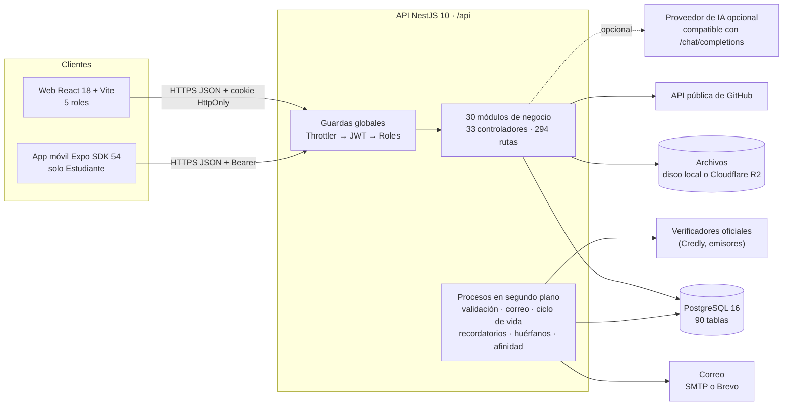

### 10.1 Puertos y entornos

| Elemento | Desarrollo | Entorno de pruebas aislado | Producción prevista |
|---|---|---|---|
| API | `:3010` (`API_PORT`) | `:3020` | `PORT` que asigna Railway |
| Web | `:5173` (Vite) | `:5180` (build propio) | Cloudflare Pages |
| Base | `perfil_estudiantil` en Docker | `afinia_test` | PostgreSQL de Railway (`DATABASE_URL`) |
| Archivos | `api/uploads` | carpeta temporal | Cloudflare R2 (bucket privado) |
| Correo | simulado (consola y `api/.mail-outbox`) o Mailpit | `MAIL_TRANSPORT=console` | Brevo por API HTTPS |
| Swagger | `/api/docs` | `/api/docs` | apagado salvo `SWAGGER_ENABLED=true` |

### 10.2 El camino de una petición

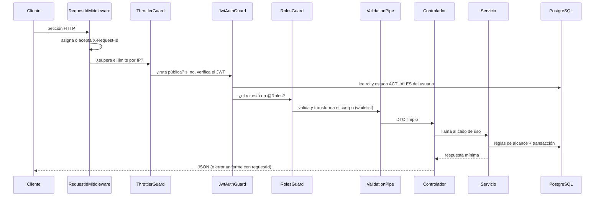

## 11. Tecnologías y por qué se eligieron

| Capa | Tecnología | Versión | Por qué |
|---|---|---|---|
| Lenguaje | TypeScript | 5.5 (API, web), 5.9 (móvil) | Un solo lenguaje en las tres capas; tipos compartidos en `shared/` |
| API | NestJS | 10.4 | Módulos, inyección de dependencias, guardas y pipes: el control de acceso y la validación quedan en un solo sitio |
| ORM | TypeORM | 0.3 | Entidades con decoradores; **solo migraciones** (`synchronize: false`) |
| Base de datos | PostgreSQL | 16 (alpine, en Docker) | Arreglos (`uuid[]`, `text[]`), `jsonb`, tipos enumerados, restricciones `CHECK`, transacciones con bloqueo de fila |
| Autenticación | passport-jwt + bcryptjs | 4.0 / 2.4 | JWT corto + refresh opaco rotatorio en base; contraseñas con bcrypt |
| Validación | class-validator + class-transformer | 0.14 / 0.5 | DTO declarativos; `whitelist` y `forbidNonWhitelisted` rechazan propiedades no declaradas |
| Seguridad HTTP | helmet, @nestjs/throttler, compression | 8.3 / 6.7 / 1.8 | Cabeceras, límite de peticiones, compresión desde 1 KB |
| Documentación de API | @nestjs/swagger | 7.4 | `/api/docs`, desactivable en producción |
| Correo | nodemailer (SMTP) y Brevo (HTTPS) | 10.0 | Railway bloquea SMTP en planes básicos: por eso existe la vía HTTPS |
| Archivos | disco local o @aws-sdk/client-s3 contra Cloudflare R2 | 3.x | El mismo puerto (`StoragePort`) con dos drivers |
| Lectura de QR | jsqr + pngjs + jpeg-js | 1.4 / 7.0 / 0.4 | Leer QR de certificados sin servicios externos |
| OCR | tesseract.js (opcional, no instalado por omisión) | — | Documentos escaneados; sin él quedan «inconclusos» |
| Web | React 18 + Vite 5 + React Router 6 | 18.3 / 5.4 / 6.26 | SPA rápida; rutas por rol |
| Gráficos web | Recharts | 2.12 | Analítica |
| Animación web | framer-motion | 11.5 | Respeta «reducir movimiento» del sistema |
| Cliente HTTP | axios | 1.7 | Interceptores para token, renovación y barra de progreso |
| Móvil | React Native 0.81 + Expo SDK 54 | 0.81.5 / 54 | Una base de código; APK propio sin depender de la versión de Expo Go |
| Navegación móvil | React Navigation 6 | 6.x | Pestañas inferiores + pilas |
| Almacenamiento seguro móvil | expo-secure-store | 15 | Refresh token cifrado por el sistema operativo |
| PDF | Escritor propio (`pdf-writer.ts`) | — | Sin dependencias: compone el PDF del currículo a mano |
| QR | Codificador propio (`qr-encoder.ts`, 611 líneas) | — | Genera el QR del perfil sin librerías ni servicios externos |
| Pruebas | node:test, Jest + SuperTest, Playwright, Newman, k6, OWASP ZAP, SonarQube, Maestro | — | Ver capítulo 32 |

## 12. El repositorio, carpeta por carpeta

```
.
├── api/                 API central NestJS (la usan la web y el móvil)
│   ├── src/             Código: 35 carpetas de módulo + main.ts y app.module.ts
│   │   ├── entities/    60 archivos, 86 entidades TypeORM (una por tabla)
│   │   └── database/    data-source.ts, 81 migraciones y semillas
│   └── test/            Pruebas unitarias (node:test) y de API (Jest + SuperTest)
├── web/                 Frontend React (todos los roles)
│   └── src/             pages/ por rol, components/, services/, api/, auth/, hooks/, lib/
├── mobile/              App React Native + Expo (solo Estudiante)
│   ├── src/             screens/student, navigation/, services/, components/
│   ├── .maestro/        Borrador de flujo Maestro
│   └── apk/             APK generados (no se versionan)
├── shared/              Tipos, enumeraciones, escalas y reglas compartidas (paquete @perfil/shared)
├── docker/              docker-compose: PostgreSQL 16 y Mailpit opcional
├── scripts/             Suites de verificación HTTP/navegador, k6, ZAP, APK, entorno de pruebas
├── pruebas/             Evidencias de pruebas por herramienta (01 a 10) e INFORME.md
├── pruebas-e2e/         Especificaciones de Playwright (5 archivos)
├── docs/                Documentación: contratos por versión, auditorías GAP, QA, trazabilidad
├── backups/             Respaldos SQL locales (no versionados)
├── .github/workflows/   ci.yml: compilar y probar en cada push y PR
├── Dockerfile           Imagen de producción de la API (Node 22, usuario no root)
├── railway.json         Despliegue en Railway: migraciones antes de publicar, healthcheck /api/health
├── sonar-project.properties  Configuración del análisis de SonarQube
├── playwright.config.ts Configuración de Playwright (Chromium, Firefox, WebKit)
├── package.json         Workspaces (shared + api) y todos los scripts npm
├── .env.example         Las 85 variables de desarrollo, comentadas
└── .env.production.example  Lista de variables de producción (sin valores)
```

### 12.1 El backend en cifras

| Carpeta de `api/src` | Archivos `.ts` | Líneas | Para qué |
|---|---:|---:|---|
| `access/` | 4 | 435 | Alcance docente por semestre y autonomía docente |
| `activities/` | 14 | 4.696 | Actividades, inscripción, admisión, asistencia, ciclo de vida |
| `affinity-recalc/` | 4 | 2.074 | Motor de afinidad y respaldo |
| `ai/` | 8 | 768 | Asistente de IA opcional (puerto y adaptadores) |
| `audit/` | 4 | 576 | Bitácora de auditoría y su versión legible |
| `auth/` | 13 | 558 | Login, refresh, guardas, estrategia JWT |
| `backed-skills/` | 2 | 129 | «Tecnologías respaldadas», una sola fuente para todos |
| `catalogs/` | 12 | 2.226 | Áreas, habilidades, categorías, recursos, criterios de puntos |
| `certificates/` | 5 | 544 | Credenciales externas |
| `collaboration/` | 11 | 3.688 | Perfil compartible, QR, contactos, canales, necesidades, equipos |
| `common/` | 6 | 1.040 | Filtro de errores, mensajes en español, validadores, texto |
| `config/` | 5 | 416 | Conexión, seguridad, identidad, chequeo de entorno |
| `constancies/` | 4 | 554 | Constancias y certificados institucionales |
| `database/` | 89 | 7.299 | Migraciones y semillas |
| `entities/` | 60 | 5.815 | Entidades TypeORM |
| `evidences/` | 4 | 353 | Evidencias sueltas (histórico) |
| `gamification/` | 6 | 1.814 | Puntos, insignias, propuestas, CV |
| `health/` | 1 | 30 | Estado de la API y de la base |
| `help/` | 3 | 62 | Centro de ayuda |
| `identity/` | 7 | 1.321 | Activación, recuperación, sesiones, cola de correo de cuenta |
| `imports/` | 5 | 1.390 | Importación de padrón (estudiantes y docentes) |
| `library/` | 3 | 314 | Biblioteca de recursos |
| `mail/` | 8 | 1.241 | Envío de correo (SMTP, Brevo, consola) y plantillas |
| `notifications/` | 5 | 334 | Centro de avisos y recordatorios |
| `onboarding/` | 5 | 1.067 | Cuestionario de orientación |
| `profiles/` | 12 | 1.813 | Perfil, bienvenida, intereses, visibilidad |
| `project-feedback/` | 4 | 331 | Retroalimentación docente |
| `projects/` | 21 | 5.079 | Proyectos, integrantes, respaldo, GitHub, galería |
| `recommendations/` | 7 | 2.069 | Motor de recomendaciones |
| `reports/` | 6 | 1.672 | Paneles y analítica |
| `roles/` | 3 | 57 | Roles fijos |
| `storage/` | 12 | 1.338 | Subidas, descarga autorizada, drivers, huérfanos |
| `trajectory/` | 6 | 1.382 | Trayectoria, currículo y PDF |
| `users/` | 9 | 1.229 | Cuentas |
| `validation/` | 12 | 3.522 | Motor de validación de credenciales |
| **Total** | **383** | **57.470** | |

La web suma 99 archivos (unas 31.600 líneas con CSS); el móvil, 36 archivos (8.231 líneas); `shared`, 24
archivos (2.168 líneas). SonarQube cuenta **73.641 líneas de código** sin comentarios en todo el repositorio.

## 13. El backend por dentro: arranque y tubería de cada petición

### 13.1 `main.ts`: el arranque

En orden:

1. **`load-env.ts`** carga el `.env` *antes* de importar la aplicación. Es necesario porque los límites de
   `@Throttle` se evalúan al importar los controladores, antes de que exista el contenedor de Nest. Prueba
   `.env` y `../.env` porque el proceso puede arrancar desde la raíz o desde `api/`.
2. **`assertEnvironment`** valida el entorno: en producción, cualquier ausencia detiene el arranque («mejor no
   arrancar que arrancar mal»); en desarrollo solo avisa. Revisa base de datos, `WEB_ORIGINS`,
   `INSTITUTIONAL_EMAIL_DOMAINS`, correo (SMTP o Brevo; prohíbe `console` en producción), `WEB_APP_URL` con
   https, `STORAGE_DRIVER=local` (aviso), `MAX_UPLOAD_MB` entre 1 y 100, IA y video de ayuda.
3. Prefijo global **`/api`**.
4. **helmet** (sin CSP, porque la API no sirve HTML; la CSP es del host de la web).
5. **compression** desde 1 KB (la prueba de carga mostró listados de varios MB en JSON).
6. Límite del cuerpo JSON y urlencoded a **256 KB** (las subidas van por multipart con su propio tope).
7. **ValidationPipe global** con `whitelist`, `forbidNonWhitelisted` y `transform`; los mensajes de
   class-validator se traducen al español en un solo sitio (`mensajesDeValidacion`).
8. **HttpExceptionFilter** global: una sola forma de error para toda la API y registro sin secretos.
9. **RequestLoggingInterceptor**: registro estructurado de cada petición (sin cuerpos ni cabeceras).
10. **CORS** según `WEB_ORIGINS` (en desarrollo, sin lista, cualquier origen sin credenciales y con aviso; en
    producción, sin lista, no arranca; un `*` explícito nunca va con credenciales).
11. `trust proxy` = `TRUST_PROXY_HOPS` (1, o 2 detrás del proxy de Cloudflare): la IP real para el límite de
    peticiones y el registro de sesiones.
12. **Swagger** en `/api/docs` si no es producción o si `SWAGGER_ENABLED=true`.
13. Puerto: `API_PORT` en local, `PORT` en producción; en producción, `enableShutdownHooks` para que los
    trabajos en curso cierren bien al recibir SIGTERM.

### 13.2 `app.module.ts`: el módulo raíz

Importa `ConfigModule` (global), `TypeOrmModule` (configurado por `buildDatabaseConfig`), `ThrottlerModule`
(un solo limitador `default`: 60 s y `RATE_LIMIT_GLOBAL_PER_MINUTE`, 300 por omisión) y 27 de los 30 módulos
de negocio; los otros tres (`AccessModule`, `AffinityRecalcModule` y `TrajectoryModule`) entran a través de los
módulos que los usan. Registra **tres guardas globales en este orden**: `ThrottlerGuard` (primero se descarta el abuso),
`JwtAuthGuard` (luego se identifica) y `RolesGuard` (por último se autoriza). Aplica el `RequestIdMiddleware` a
todas las rutas: va como middleware y no como interceptor porque un error en una guarda ocurre antes de los
interceptores, y sin identificador ese error no se podría rastrear.

### 13.3 Forma uniforme de los errores

`HttpExceptionFilter` traduce cualquier excepción a un JSON con `statusCode`, `message`, `code` opcional
(por ejemplo `MOBILE_STUDENT_ONLY`, `ACTIVITY_FULL`, `CONSTANCY_ISSUANCE_DISABLED`), `fields` (mapa campo →
mensajes, para que el formulario ponga el error debajo de la casilla correcta) y `requestId`. En producción
nunca devuelve la pila ni detalles internos; los errores 500 se registran con su identificador.

### 13.4 Convenciones del código

- **Puertos y adaptadores** donde algo puede cambiar: almacenamiento (`StoragePort`: local o R2), IA
  (`AiAssistancePort`: none u openai_compatible), OCR (`OcrPort`), notificaciones (`NOTIFICATION_EMITTER`),
  recálculo de trayectoria (`TrajectoryRecalculationPort`), correo (`MailPort`).
- **Reglas puras** en archivos `*.rules.ts` (sin base de datos), probadas por las pruebas unitarias:
  `registration.rules`, `credential-eligibility.rules`, `project-backing.rules`, `project-readiness.rules`,
  `credential-check.rules`, `recommendation.rules`, `cv-eligibility.rules`, `contact-channel.rules`,
  `team-name.rules`, `team-need.rules`.
- **Las notificaciones nunca deshacen una operación**: cada servicio envuelve el aviso en un `try` propio.
- **Transacciones** para todo lo que escribe varias tablas (bienvenida, activación, inscripción con cupo, cálculo de afinidad).
- **Bloqueo de fila** (`SELECT … FOR UPDATE`) donde hay carreras reales: la última plaza de una actividad, el
  canje de puntos, el reclamo de trabajos de las colas.
- Comentarios y mensajes en español, con la referencia a la sección del contrato que los motivó (`§`, `V3`, `V5-06`…).

## 14. Seguridad y control de acceso

### 14.1 Capas del control de acceso

```
petición → ThrottlerGuard → JwtAuthGuard → RolesGuard → regla del recurso en el servicio → respuesta mínima
```

1. **Límite de peticiones**: 300/min/IP global; 10/min en login; 60/min en renovación; 5/min en activación y
   recuperación (que además evita el envío masivo de correo). Los valores se elevan por entorno para las suites.
2. **Identificación**: `JwtAuthGuard` deja pasar las rutas marcadas `@Public()` (13 rutas: login, logout,
   refresh, las 5 de activación y recuperación, salud, ayuda, perfil compartible y su foto, proyecto público).
   Para las demás, `JwtStrategy` verifica la firma y **lee de la base el rol y el estado actuales**: un usuario
   suspendido pierde el acceso al instante y un rol manipulado en el token no tiene efecto.
3. **Rol**: `RolesGuard` compara con `@Roles(...)` del método o de la clase. 19 rutas no declaran rol: basta
   tener sesión (por ejemplo `/auth/me`, catálogos de áreas y habilidades, detalle de actividad, favoritos, IA).
4. **Regla del recurso**: el servicio decide si esa persona alcanza ese registro. Ejemplos: un docente y un
   estudiante fuera de sus semestres (`TeacherScopeService`); un borrador ajeno «no existe» para quien no puede
   verlo; un estudiante solo ve sus propias credenciales y validaciones; un archivo se descarga solo si quien lo
   pide alcanza la entidad que lo contiene.
5. **Respuesta mínima**: `toPublicUser` nunca incluye el hash; el estudiante recibe de cada actividad solo lo que
   necesita (`vistaEstudiante`); el correo institucional no se expone en vistas públicas ni de compañeros.

### 14.2 Alcance docente: una sola fuente de verdad

`TeacherScopeService` es el único lugar que decide qué estudiantes alcanza un docente. Lo usan perfiles,
afinidad, proyectos, constancias, reportes, puntos, archivos y la IA. Funciones clave:

- `scopeFor(user)`: semestres que puede consultar; `null` = sin restricción (Dirección y Administración).
- `effectiveSemesters(perfil)`: el semestre actual **más** los de arrastre o repetición (`academic_scope_semesters`).
- `scopeSql(param)`: la misma regla en SQL para los listados.
- `assertCanAccessProfile(user, perfil)`: un perfil sin semestre declarado no entra en el alcance de ningún docente.

### 14.3 Contraseñas, tokens y códigos

- **Contraseñas**: bcrypt; política de 12–128 caracteres con cuatro clases y sin el correo ni el código.
- **Token de activación o recuperación**: aleatorio, se guarda solo su **SHA-256** (tiene entropía suficiente,
  no necesita sal). Un uso, con vencimiento, revocable.
- **Código de 6 dígitos**: se guarda un **HMAC** atado al usuario y al propósito, y se compara en tiempo
  constante. Máximo 10 intentos.
- **Refresh token**: 48 bytes aleatorios (`base64url`); en la base solo su SHA-256 y el del anterior (para la
  gracia de 60 s). Rotación condicional: si el mismo token llega dos veces, solo el primero encuentra la sesión.
- **JWT de acceso**: firmado con `JWT_ACCESS_SECRET` (≥ 16 caracteres, obligatorio en producción). El secreto
  del refresh debe ser **distinto** del de acceso. En desarrollo hay valores de respaldo con aviso por consola.

### 14.4 Archivos privados

Los archivos **no se sirven como estáticos**. La descarga pasa por `GET /api/files/:key`, que exige sesión y
resuelve a qué entidad pertenece la clave (evidencia, credencial, muestra de oportunidad, recurso de biblioteca,
certificado entregado, imagen de actividad o de proyecto) y si quien pide la alcanza. La clave se sanea: se
rechaza cualquier separador o recorrido de rutas. El tipo real del archivo se detecta por su **firma** (bytes
iniciales), no por lo que declare el cliente: solo PDF, PNG, JPG y WEBP, hasta 10 MB. La subida devuelve un
**identificador**, no una URL, y adjuntar exige ser el dueño del archivo.

### 14.5 Protección contra SSRF en los verificadores

`LinkCheckerService` consulta enlaces externos (demos, URLs de verificación) sin convertirse en un escáner de la
red interna: resuelve el DNS y **rechaza** direcciones privadas, reservadas, de bucle local, enlace-local,
multidifusión e IPv6 equivalentes, y el servicio de metadata de la nube; no sigue redirecciones solo (revisa
cada salto); limita el tiempo (`LINK_CHECK_TIMEOUT_MS`, 8 s) y el cuerpo (256 KB, que no se guarda). Un enlace
que el sistema se niega a consultar queda `blocked`, distinto de uno que no respondió (`unavailable`).

### 14.6 Privacidad por diseño

- Perfil compartible **apagado por omisión** y con todos los campos ocultos por omisión.
- Lo que nunca es publicable no tiene clave en la configuración: no hay forma de exponerlo.
- El identificador público es opaco (12 caracteres de un alfabeto sin vocales ni caracteres confusos), no el
  correo, el código ni el UUID, y se puede rotar.
- Analítica con umbral de 5 personas.
- La IA recibe texto **saneado** (sin correos, teléfonos, tokens ni parámetros de URL) y de la entrada solo se
  guarda una **huella**.
- La auditoría y la bitácora de proyectos **sanean** sus metadatos (retiran claves sensibles y recortan valores largos).

### 14.7 Auditoría

`AuditService.record` registra 76 tipos de evento (alta de cuenta, cambio de rol, activación, sesiones,
importaciones, decisiones de Dirección, inscripciones, asistencia, credenciales, proyectos, IA, exportación del
currículo…). La pantalla de Administración los traduce a **actor, módulo, acción, fecha y resultado** (14
módulos legibles). Ver el capítulo 25.

### 14.8 Matriz de permisos por rol y módulo

Cuántas rutas de cada módulo puede invocar cada rol según las guardas (las rutas públicas y las de «cualquier
sesión» cuentan para todos). Que un rol pueda invocar una ruta no significa que alcance cualquier registro: el
servicio aplica después las reglas de propiedad y de alcance (14.1). El detalle ruta por ruta está en el Apéndice A.

| Módulo | Rutas | Públicas | Cualquier sesión | Estudiante | Docente | Dirección | Sociedad | Administración |
|---|---:|---:|---:|---:|---:|---:|---:|---:|
| `access` | 6 | 0 | 0 | 0 | 1 | 5 | 0 | 3 |
| `activities` | 27 | 0 | 5 | 9 | 20 | 20 | 19 | 20 |
| `affinity-recalc` | 11 | 0 | 1 | 6 | 5 | 5 | 1 | 6 |
| `ai` | 4 | 0 | 3 | 3 | 3 | 3 | 3 | 4 |
| `audit` | 3 | 0 | 0 | 0 | 0 | 0 | 0 | 3 |
| `auth` | 6 | 3 | 3 | 6 | 6 | 6 | 6 | 6 |
| `catalogs` | 21 | 0 | 4 | 4 | 7 | 12 | 5 | 21 |
| `certificates` | 6 | 0 | 0 | 6 | 0 | 0 | 0 | 0 |
| `collaboration` | 35 | 2 | 0 | 35 | 2 | 2 | 2 | 2 |
| `constancies` | 6 | 0 | 0 | 1 | 4 | 5 | 3 | 3 |
| `evidences` | 3 | 0 | 0 | 3 | 0 | 0 | 0 | 3 |
| `gamification` | 23 | 0 | 0 | 10 | 13 | 13 | 0 | 13 |
| `health` | 1 | 1 | 0 | 1 | 1 | 1 | 1 | 1 |
| `help` | 1 | 1 | 0 | 1 | 1 | 1 | 1 | 1 |
| `identity` | 5 | 5 | 0 | 5 | 5 | 5 | 5 | 5 |
| `imports` | 10 | 0 | 0 | 0 | 0 | 0 | 0 | 10 |
| `library` | 3 | 0 | 1 | 3 | 1 | 1 | 1 | 1 |
| `mail` | 3 | 0 | 0 | 0 | 0 | 0 | 0 | 3 |
| `notifications` | 5 | 0 | 0 | 4 | 4 | 4 | 4 | 5 |
| `onboarding` | 5 | 0 | 0 | 5 | 0 | 0 | 0 | 0 |
| `profiles` | 27 | 0 | 0 | 24 | 2 | 2 | 0 | 3 |
| `project-feedback` | 4 | 0 | 0 | 1 | 4 | 0 | 0 | 1 |
| `projects` | 40 | 1 | 0 | 35 | 10 | 6 | 3 | 24 |
| `recommendations` | 5 | 0 | 1 | 5 | 1 | 1 | 1 | 1 |
| `reports` | 15 | 0 | 0 | 1 | 6 | 7 | 1 | 13 |
| `roles` | 1 | 0 | 0 | 0 | 0 | 0 | 0 | 1 |
| `storage` | 3 | 0 | 1 | 2 | 2 | 2 | 2 | 3 |
| `users` | 9 | 0 | 0 | 0 | 0 | 0 | 0 | 9 |
| `validation` | 6 | 0 | 0 | 1 | 0 | 2 | 0 | 6 |
| **Total** | **294** | **13** | **19** | **171** | **98** | **103** | **58** | **171** |

Lecturas de la matriz:

- **Estudiante y Administración** son los que más rutas usan (171 cada uno): el primero, porque todo el perfil, los
  proyectos y la colaboración son suyos; la segunda, porque da soporte a casi todo.
- **Colaboración** es exclusiva del Estudiante (salvo el perfil compartible y su foto, que son públicos): el personal
  no ve contactos, equipos ni postulaciones; el docente ve las necesidades de equipo de su alcance desde `reports`.
- **Dirección no abre el detalle de un proyecto** (`GET /projects/:id`) ni su retroalimentación: ve los proyectos en
  «Proyectos de la carrera», sus integrantes detallados, su bitácora, sus comprobaciones y los agregados de la
  analítica. La retroalimentación es del Docente.
- **Credenciales, cuestionario y onboarding** son solo del Estudiante; Dirección interviene en la validación solo por
  la revisión manual excepcional.

## 15. Los módulos del backend, uno por uno

Cada módulo de NestJS agrupa un controlador (las rutas), uno o más servicios (la lógica), las entidades que usa
y, a veces, un worker. La lista completa de rutas está en el **Apéndice A**, la de clases y métodos en el
**Apéndice F** y la de DTO (lo que acepta cada petición) en el **Apéndice E**.

### 15.1 `auth` — inicio de sesión y sesiones (6 rutas)

- **Para qué**: login, renovación, cierre de sesión, «cerrar todas», listar sesiones y `/auth/me`.
- **Piezas**: `AuthController`, `AuthService`, `JwtStrategy`, `JwtAuthGuard`, `RolesGuard`, decoradores
  `@Public()`, `@Roles()`, `@CurrentUser()`, `refresh-cookie.ts`.
- **Reglas**: mensaje idéntico para correo inexistente y contraseña incorrecta; el estado de la cuenta se
  explica solo tras acreditar la contraseña; `assertClientAllowsRole` impide sesiones de personal desde el
  móvil; con `X-Session-Transport: cookie` (la web) el refresh va a una cookie HttpOnly con `path=/api/auth`,
  `SameSite` configurable y `Secure` en producción; sin esa cabecera (el móvil) va en el cuerpo.
- **Tablas**: usa `auth_sessions` y `users` a través de `identity` y `users`.

### 15.2 `identity` — activación, recuperación y sesiones revocables (5 rutas)

- **Piezas**: `ActivationController` (`/activation/*`, todas públicas), `ActivationService`,
  `AccountTokensService`, `AuthSessionsService`, `AccountMailService` (cola y worker de los correos de cuenta).
- **Tablas**: `account_tokens`, `auth_sessions`, `mail_jobs`, `users`, `student_profiles`.
- **Reglas**: respuesta genérica exista o no la cuenta; dominio institucional obligatorio; espera de 120 s
  entre envíos (por correo y también en memoria por proceso) y tope diario; emitir revoca los anteriores; el
  código se compara por HMAC en tiempo constante; activar y restablecer son transacciones; restablecer cierra
  todas las sesiones.
- **Cola de correo**: `enqueue` crea un `mail_job` y despierta al worker; el worker reclama de forma atómica
  (dos procesos no se llevan el mismo envío), envía, reintenta con espera creciente y marca `sent`, `failed` o
  `skipped`. El alta de un usuario espera unos segundos a que el envío termine para decirle a Administración en
  qué quedó («Invitación generada», «Todavía no», «No se pudo reenviar»).

### 15.3 `users` — cuentas (9 rutas, solo Administración)

- **Piezas**: `UsersController`, `UsersService`, `surnames.ts`, `public-user.ts`.
- **Tablas**: `users`, `teacher_semester_access` (y `student_profiles` al sincronizar).
- **Reglas**: código universitario `PREFIJO-XXXXXXX` con el prefijo del rol, único; cambiar el rol obliga a
  cambiar el prefijo; el semestre es obligatorio solo en Estudiante y Sociedad; los semestres de arrastre solo
  en Estudiante, normalizados (sin repetidos, ordenados, sin el actual); los dos apellidos mandan (V5); el perfil
  del estudiante guarda una copia de su semestre y su código; cambiar el estado revoca tokens y sesiones según
  corresponda; «borrar» da de baja; borrar de verdad solo sin perfil estudiantil.
- **Lecturas en lote** para el listado: semestres de los docentes y estado de la última invitación de cada cuenta
  sin consultas dentro de un bucle.

### 15.4 `roles` — roles fijos (1 ruta)

Lista los 5 roles. Son fijos: la tabla `roles` se siembra y no se edita desde la interfaz.

### 15.5 `access` — alcance docente y autonomía (6 rutas)

- **`TeacherScopeService`**: la única fuente del alcance por semestre (ver 14.2).
- **`ApprovalPoliciesService`** y su controlador: autonomía docente por módulo (`RESOURCE`, `GAMIFICATION`;
  `ACTIVITY` existe en el modelo pero no se puede conceder), con justificación, revocación con motivo e
  historial de acciones directas.
- **Tablas**: `approval_policies`, `teacher_semester_access`, `users`, `student_profiles`.

### 15.6 `profiles` — perfil del estudiante y bienvenida (27 rutas)

- **Piezas**: `ProfilesController`, `ProfilesService` (1.063 líneas).
- **Tablas**: `student_profiles`, `student_interests`, `student_free_interests`, `student_skill_interests`,
  `student_skills` (histórico) y lecturas de proyectos, actividades, credenciales y afinidad para el resumen.
- **Qué hace**: estado de la bienvenida y sus pasos (confirmación institucional, privacidad, completar);
  edición del perfil; áreas de preferencia con prioridad (`PUT` reemplaza el conjunto completo: quitar una es no
  enviarla); intereses en texto libre; tecnologías de interés o de mejora; visibilidad del perfil compartible;
  directorio de estudiantes para el personal (con alcance); búsqueda de compañeros para invitar a proyectos;
  **vista permitida** de un perfil para roles institucionales; resumen del perfil dinámico; porcentaje de
  completitud; tras cada cambio relevante, pide el recálculo de afinidad.
- **Retirado**: el nivel autodeclarado de habilidad responde **410 Gone**.

### 15.7 `onboarding` — cuestionario de orientación (5 rutas)

- **Piezas**: `OnboardingController`, `OnboardingService`, `questionnaire.ts` (banco de preguntas versionado en código).
- **Tablas**: `onboarding_runs`, `onboarding_answers`, `student_interests`.
- **Reglas**: versión 2; 12 preguntas de preferencia (nunca de conocimiento); preguntas de profundización según
  lo que el estudiante ya declaró; mínimo 6 respuestas; cada opción suma pesos sobre etiquetas que se traducen a
  áreas del catálogo; el resultado son sugerencias; confirmar incorpora solo las áreas elegidas como intereses
  con procedencia «orientación»; repetir deja la pasada anterior como `superseded`.

### 15.8 `catalogs` — catálogos administrados (21 rutas)

- **Piezas**: `CatalogsController`, `CatalogsService` (937 líneas), `skill-classification.ts`, `area-skill.guard.ts`.
- **Tablas**: `academic_areas`, `skills`, `skill_area_relations`, `activity_categories`, `learning_resources`,
  `learning_resource_areas`, `learning_resource_skills`, `gamification_criteria`.
- **Áreas**: nombre único normalizado, código sugerido libre («redes», «redes_2»…), etiquetas con **análisis de
  riesgos** antes de guardar (choques con otras áreas, etiquetas que son tecnologías…), baja lógica.
- **Habilidades**: área principal, **áreas secundarias** (`skill_area_relations`), **alias** (un alias no puede
  ser nombre o alias de otra; un nombre que ya es alias de otra es la misma habilidad), **clasificador** que
  sugiere el área contra el catálogo vigente por palabras completas (nunca por subcadena), registro de cuándo
  Administración se aparta de la sugerencia (`SKILL_CLASSIFICATION_OVERRIDE`).
- **Coherencia área → habilidades** (`assertSkillsBelongToAreas`, `resolveSkillContexts`): en actividades,
  proyectos, credenciales y recursos, cada tecnología se registra con el área en que se usó, y esa área debe ser
  una de las suyas.
- **Recursos de la Biblioteca**: catálogo controlado; un docente propone para sus semestres y Dirección aprueba,
  observa o rechaza; el recurso tiene enlace y/o archivo (PDF o imagen detectados por su contenido), imagen
  (PNG, JPG o WEBP), áreas (la principal primero), habilidades, semestres y un criterio de «recurso completado».
- **Criterios de puntos**: por hecho, por área («extras por área») y por temporada (vigencia); validados contra
  las tres familias vigentes.

### 15.9 `activities` — actividades, inscripción y asistencia (27 rutas)

El módulo más grande: `ActivitiesService` tiene **3.259 líneas**.

- **Piezas**: `ActivitiesController`, `ActivitiesService`, `ActivityLifecycleWorker`,
  `CredentialEligibilityService`, `registration.rules.ts`, `credential-eligibility.rules.ts`,
  `credential-pattern.ts`.
- **Tablas**: `activities`, `activity_areas`, `activity_skills`, `activity_categories`, `activity_reviews`,
  `activity_registrations`, `activity_responsibles`, `activity_contacts`, `activity_images`,
  `activity_favorites` (SQL directo), `activity_gamification_rules`, `external_opportunity_validation_references`,
  `internal_constancies`.
- **Máquina de estados** (declarada como tabla en `shared`): borrador → publicada/abierta/cancelada;
  publicada → borrador (solo si nadie tiene asistencia), abierta, cerrada, finalizada, cancelada; abierta →
  cerrada, finalizada, cancelada; cerrada → abierta, finalizada, cancelada; finalizada y cancelada son finales.
- **Revisión institucional** (eje aparte del estado): `null` (sin enviar), `pending`, `observed`, `approved`,
  `rejected`, `not_required` (Dirección y Administración). Solo `approved` o `not_required` permiten publicar.
- **Quién crea qué**: académicas, Dirección y docentes (dentro de su alcance); extracurriculares, Sociedad;
  Administración, ambas. **Responsables** según quién asigna (V3.2 §17) y, desde V6, la **cobertura por
  semestre** de cada responsable.
- **Completitud** al publicar o enviar: errores por campo; modalidad coherente (virtual sin aula, presencial
  sin enlace); inicio no pasado al publicar (al minuto, con tolerancia de 2 min); fin posterior al inicio.
- **Inscripción**: `registration.rules.admisionAutomatica` decide admisión automática (abierta sin cupo: todos;
  abierta con cupo: por orden hasta llenar) o manual (por aprobación); `guardarConCupo` bloquea la fila de la
  actividad para contar el cupo dentro de la transacción.
- **Asistencia**: solo con el evento empezado, hasta `ATTENDANCE_WINDOW_DAYS` (7) después del fin y con el acta
  abierta; corrección excepcional por Dirección o Administración con motivo y **reconciliación de puntos**
  (reverso si deja de estar confirmada, nuevo evento si vuelve a confirmarse).
- **Búsqueda**: palabras clave derivadas de áreas (nombre y etiquetas) y habilidades (nombre y alias), que nadie
  escribe a mano; listado paginado con `{ items, total, limit, offset }`.
- **Efectos de confirmar asistencia**: recálculo de afinidad del estudiante, puntos por participación, insignias,
  constancia histórica si correspondía, y elegibilidad de credencial si la actividad la espera.

### 15.10 `projects` — proyectos (40 rutas)

- **Piezas**: `ProjectsController`, `ProjectGalleryController`, `ProjectsAdminController`, `ProjectsService`
  (1.809 líneas), `ProjectMembersService`, `ProjectBackingService`, `ProjectEventsService`,
  `ProjectGalleryService`, `RepositoryInspectorService`, `dependency-map.ts`, `manifiestos.ts`,
  `project-backing.rules.ts`, `project-readiness.rules.ts`.
- **Tablas**: `projects`, `project_areas`, `project_skills`, `project_members`, `project_member_skills`,
  `project_invitations`, `project_evidences`, `project_feedback`, `project_events`, `project_images`,
  `project_repository_checks`, `project_link_checks`, `github_api_cache`, `skill_requests`, `teams`, `team_members`.
- **Ciclo**: borrador → activo (con requisitos, ver 4.6) → archivado.
- **Integrantes**: invitación → aceptación; contribución propuesta por el responsable y **confirmada** por el
  integrante; varios roles por integrante (el primero es el principal); exclusión con motivo; reconfirmación si
  se quitan tecnologías.
- **Tecnologías**: reemplazo sin perder el respaldo de las que se quedan; estado de evidencia de cada una
  (`declared`, `corroborated_by_github_language`, `corroborated_by_manifest`, `corroborated_by_academic_review`).
- **Respaldo**: ver el capítulo 19.
- **Pedidos de tecnologías**: desde las sugerencias del repositorio; Administración resuelve como alias,
  tecnología nueva o rechazo.
- **Galería**: hasta 5 imágenes, portada, orden; «Proyectos de la carrera» con 6 por página; consentimiento por
  integrante para aparecer nombrado.
- **Recálculo auditado** del respaldo de todos los proyectos con informe antes/después (`apply` opcional).

### 15.11 `project-feedback` — retroalimentación docente (4 rutas)

Solo el Docente escribe; sobre proyectos visibles para docentes y de estudiantes de su alcance; corrige solo
lo propio. Confirmar una tecnología deja `corroborated_by_academic_review` si el repositorio no la respalda. Avisa
al equipo (`TEACHER_FEEDBACK_RECEIVED`) y dispara el recálculo del respaldo.

### 15.12 `evidences` — evidencias sueltas (3 rutas)

Histórico de la V1/V2: evidencias asociadas a un proyecto, una actividad o un área. Hoy las evidencias nuevas se
agregan desde cada proyecto. Al eliminar una evidencia de archivo se borra también el archivo.

### 15.13 `certificates` — credenciales externas (6 rutas)

Registrar, listar, editar (vuelve a validar), pedir revisión manual y eliminar credenciales; oportunidades
elegibles para adjuntar. Tablas: `external_certificates`, `external_certificate_areas`,
`external_certificate_skills`. Solo tecnologías activas del catálogo, cada una con su área. Al crear o editar,
encola la validación.

### 15.14 `validation` — motor de validación (6 rutas)

Cola, worker, extracción documental, verificación oficial, revisión manual. Ver el capítulo 18.
Tablas: `validation_records`, más lecturas de credenciales, evidencias y archivos.

### 15.15 `constancies` — constancias y certificados institucionales (6 rutas)

Desde V5, **no se emiten constancias nuevas** (`POST /constancies/internal` devuelve la ya emitida o 403).
Se consultan las históricas (propias, por estudiante con alcance, por actividad). Para la política «Certificado
emitido por la institución», el responsable **entrega** a participantes confirmados el archivo que él mismo
subió; se guarda el emisor real y el estudiante recibe `CERTIFICATE_DELIVERED`.

### 15.16 `affinity-recalc` — motor de afinidad (11 rutas)

`AffinityEngineService` (1.711 líneas), `AffinityBackfillService` y `AffinityController`. Ver el capítulo 16.

### 15.17 `trajectory` — trayectoria y currículo (sin controlador propio)

`TrajectoryRecalculationService` centraliza el recálculo (afinidad + puntos) ante cualquier señal;
`TrajectorySummaryService` arma el histórico, los ítems elegibles y el currículo; `PdfWriter` compone el PDF.
Sus rutas están en el controlador de gamificación (`/trajectory/me`, `/trajectory-summary/*`). Ver el capítulo 21.

### 15.18 `backed-skills` — tecnologías respaldadas (sin rutas)

Módulo global con una sola responsabilidad: responder «qué tecnologías tiene respaldadas este perfil». Lo usan
el perfil compartible, los equipos, las recomendaciones, los reportes y el currículo, para que ninguno lo
calcule por su cuenta.

### 15.19 `recommendations` — motor de recomendaciones (5 rutas)

`RecommendationsEngine` (1.147 líneas), `RecommendationsService`, `recommendation.rules.ts`. Ver el capítulo 17.

### 15.20 `library` — Biblioteca (3 rutas)

Listado con búsqueda, filtros (área, habilidad, tipo), facetas (solo áreas y habilidades con recursos vigentes,
las más usadas primero), «Para ti» por intereses y mejora, y favoritos idempotentes (`learning_resource_favorites`).

### 15.21 `collaboration` — colaboración entre estudiantes (35 rutas)

- **Piezas**: `CollaborationController` (513 líneas), `PublicProfileService`, `ContactsService`,
  `TeamsService` (854 líneas), `TeamApplicationsService`, `qr-encoder.ts`, `contact-channel.rules.ts`,
  `team-name.rules.ts`, `team-need.rules.ts`.
- **Tablas**: `contacts`, `contact_requests`, `contact_notes`, `student_contact_channels`, `team_needs`,
  `team_need_areas`, `team_need_skills`, `teams`, `team_members`, `team_invitations`, `team_applications`, y las
  históricas `conversations`, `conversation_members`, `messages`.
- **Perfil compartible**: enlace, QR en SVG generado por la API, rotación del identificador, foto pública solo si
  su dueño la activó (si no, 404 sin revelar si existe).
- **Contactos**: solicitud → aceptación; la pareja se guarda en orden canónico (un solo registro por pareja);
  búsqueda solo entre quienes aceptaron ser encontrados; nota privada; deshacer por cualquiera de los dos.
- **Canales**: validación y normalización por tipo; los públicos aparecen en el perfil compartible.
- **Necesidades, postulaciones, equipos e invitaciones**: ver 4.9 y el capítulo 22.
- **Chat retirado**: las rutas antiguas responden 410.

### 15.22 `gamification` — puntos, insignias y propuestas (23 rutas)

- **Piezas**: `GamificationController` (progreso y currículo), `GamificationExtrasController` (retos,
  recompensas, propuestas, puntos por periodo), `GamificationService`, `GamificationExtrasService`,
  `GamificationProposalsService`.
- **Tablas**: `gamification_events`, `student_points`, `badges`, `student_badges`, `gamification_criteria`,
  `gamification_proposals`, y las históricas `gamification_challenges`, `gamification_rewards`, `reward_redemptions`.
- **Retirado en V4.1**: crear retos o recompensas y canjear responden **410**; los históricos se conservan.
- Ver el capítulo 20.

### 15.23 `notifications` — centro de avisos (5 rutas)

`PersistentNotificationEmitter` (implementa `NOTIFICATION_EMITTER`, global: cualquier servicio emite sin
importar el módulo), `NotificationsService` (bandeja propia, no leídas, marcar), `ActivityRemindersService`
(recordatorios periódicos). Tabla: `notifications`. Ver el capítulo 25.

### 15.24 `reports` — paneles y analítica (15 rutas)

`ReportsService` (paneles de docente y Dirección), `AnalyticsService` (evolución, tendencias, mapa de afinidad,
métricas de Sociedad, respaldo del grupo docente), `AnalyticsPrivacyService` (umbral de 5) y
`HomeOverviewService` (inicios de Administración y Dirección). Todo es **agregado y descriptivo**; la única
lista nominal es la de estudiantes con perfil incompleto del docente, para orientarlos.

### 15.25 `storage` — archivos (3 rutas)

`UploadsController` (subir; limpieza de huérfanos), `FilesController` (descarga autorizada), `UploadsService`,
`FileAccessService` (autorización por tipo de entidad), `OrphanFilesService`, `LocalStorageDriver`,
`R2StorageDriver`, `storageDriverFactory`, `file-signature.ts`, `storage-names.ts`. Tabla: `stored_files`. Ver el capítulo 25.

### 15.26 `mail` — salida de correo (3 rutas, ocultas en producción)

`MailService` (SMTP con nodemailer, Brevo por HTTPS o consola), `mail.settings.ts` (lee y valida la
configuración), `templates.ts` (activación, recuperación, prueba), `MailCapture` (copia local fuera de
producción), `mail-test.cli.ts` (`npm run mail:test`), `MailController` con `MailDiagnosticsGuard`.

### 15.27 `imports` — padrón (10 rutas)

`ImportsService` (estudiantes), `TeacherImportService` (docentes, con semestres autorizados `1;5`, `1|5`, `1 5`
o `"1,5"`), `csv.parser.ts`. Tablas: `import_batches`, `import_batch_rows`, `users`, `student_profiles`,
`teacher_semester_access`. Previsualizar no escribe cuentas; aplicar es idempotente; las filas con conflicto o
inválidas no bloquean a las demás; un lote que falla queda `failed` con su motivo; previsualizaciones no
aplicadas se borran tras `IMPORT_PREVIEW_TTL_HOURS`.

### 15.28 `audit` — auditoría (3 rutas)

`AuditService` (registrar con metadatos saneados, listar técnico, listar legible), `audit-labels.ts`
(módulo, acción y resultado en español para cada tipo de evento). Tabla: `audit_events`.

### 15.29 `ai` — asistente de IA (4 rutas)

`AiService`, `aiAdapterFactory`, `NoneAiAdapter`, `OpenAiCompatibleAdapter`, `ai-text.ts`. Tabla:
`ai_assistance_runs`. Ver el capítulo 23.

### 15.30 `health` y `help` (1 ruta cada uno)

`GET /api/health` responde el estado de la API y hace un `SELECT 1` a la base: lo usa Railway como
*healthcheck*. `GET /api/help` devuelve la configuración pública del centro de ayuda (el video, si es un enlace
https válido).

## 16. El motor de afinidad y respaldo, por dentro

Archivo principal: `api/src/affinity-recalc/affinity.engine.ts` (`AffinityEngineService`, 1.711 líneas).
Reglas compartidas: `shared/src/enums/affinity-engine.ts`. Versión vigente del motor: **5**.

### 16.1 Principios

- **Determinista y explicable**: no usa aprendizaje automático; dos ejecuciones con los mismos datos dan el mismo
  resultado. Las señales se ordenan de mayor a menor puntaje antes de aplicar los rendimientos decrecientes, para
  que el resultado no dependa del orden de inserción.
- **Dos sitios para las reglas**: los **puntos base** de cada señal viven en la tabla `affinity_weights` (auditables,
  ajustables sin desplegar); la **estructura** (topes, rendimientos, umbrales) vive en el código de `shared`,
  porque cambiarla cambia el significado del número y debe pasar por una versión del motor.
- **El área de cada experiencia sale de su contexto explícito** (área + tecnología elegidas por quien registra),
  nunca de etiquetas ni de coincidencias de texto (versión 5).

### 16.2 De dónde salen las señales

`recalculate(studentProfileId)` reúne señales de seis fuentes, cada una en su función:

| Función | Fuente | Qué suma |
|---|---|---|
| `senalesDePreferencias` | Intereses por prioridad, áreas de mejora | **Nada** (se registran para explicar que no suman) |
| `senalesDeActividades` | `activity_registrations` del estudiante, en **todas** las áreas configuradas de cada actividad | Solo `confirmed`: afinidad 10 (familia actividades) y respaldo 8. Interés, solicitud y admisión se listan como «no suma» |
| `senalesDeProyectos` | Proyectos propios o donde es integrante con **contribución confirmada**, que no estén en borrador | Por cada área de las tecnologías que **ese integrante confirmó** y que están **corroboradas** en el proyecto: afinidad según el nivel del proyecto (corroborado 18, revisado 22) y respaldo (con respaldo 8, corroborado 15, revisado 20) |
| `senalesDeEvidencias` | Evidencias de proyectos y de actividades | Mejoran el respaldo del proyecto (o 3 puntos de «otras señales» por evidencia de actividad); nunca crean otra experiencia |
| `senalesDeCertificados` | Credenciales externas en sus áreas explícitas | Afinidad 15 si está corroborada; respaldo 8 (con respaldo) o 15 (corroborada); 0 si está señalada; un archivo repetido no vuelve a respaldar |
| `senalesDeConstancias` | Constancias internas | Refuerzan el respaldo del **mismo** evento (+4) sin volver a contarlo; una constancia sin participación cuenta como «otra señal» (+4) |
| Revisión docente | `project_feedback` de los proyectos contados | +5 de respaldo en «otras señales», salvo que el proyecto ya sea «revisado» (entonces ya está contado y solo vale para la diversidad) |

Si un proyecto cuenta pero el integrante no confirmó tecnologías corroboradas, el respaldo del proyecto se
atribuye a las áreas de sus tecnologías confirmadas o, si no hay, al área explícita del proyecto, con afinidad 0 y
el motivo «Confirma en el proyecto las tecnologías que usaste…».

### 16.3 Puntuación por área (`puntuar`)

Para cada área, las señales se agrupan en **cubetas** con tope propio:

| Cubeta de **afinidad** | Tope | Rendimiento decreciente (1.ª, 2.ª, 3.ª, 4.ª y siguientes) |
|---|---:|---|
| Actividades | 25 | 1 · 0,7 · 0,5 · 0,3 |
| Proyectos | 50 | 1 · 0,75 · 0,5 · 0,25 |
| Credenciales | 25 | 1 · 0,75 · 0,5 · 0,25 |

`afinidad del área = round(min(100, actividades + proyectos + credenciales))`.

| Cubeta de **respaldo** | Tope | Rendimiento decreciente |
|---|---:|---|
| Actividades | 20 | sí (escala de actividades) |
| Proyectos | 45 | sí (escala de proyectos) |
| Credenciales | 25 | no: solo el tope |
| Otras señales | 10 | no: solo el tope |

`respaldo del área = round(min(100, suma de las cuatro cubetas))`.

**Niveles** (iguales para afinidad y respaldo): bajo 0–24, medio 25–59, alto 60–100. **Regla de diversidad**:
si el respaldo da «alto» pero proviene de menos de **dos familias independientes** (actividades, proyectos,
credenciales externas, revisión académica), el nivel queda en «medio». Una señal cuenta para la diversidad
aunque el tope de su cubeta ya estuviera lleno.

### 16.4 Ejemplo numérico completo

Camila tiene en **Desarrollo Web**: 4 participaciones confirmadas, 2 proyectos corroborados y 1 revisado (con
tecnologías web confirmadas y corroboradas) y 1 credencial corroborada.

**Afinidad:**

| Cubeta | Señales ordenadas | Cálculo | Subtotal |
|---|---|---|---:|
| Actividades | 10, 10, 10, 10 | 10×1 + 10×0,7 + 10×0,5 + 10×0,3 = 25 (justo el tope) | 25 |
| Proyectos | 22, 18, 18 | 22×1 + 18×0,75 + 18×0,5 = 22 + 13,5 + 9 = 44,5 | 44,5 |
| Credenciales | 15 | 15×1 | 15 |
| **Total** | | round(min(100, 84,5)) | **85 → alto** |

**Respaldo:**

| Cubeta | Señales ordenadas | Cálculo | Subtotal |
|---|---|---|---:|
| Actividades | 8, 8, 8, 8 | 8 + 5,6 + 4 + 2,4 = 20 (tope 20) | 20 |
| Proyectos | 20, 15, 15 | 20 + 11,25 + 7,5 = 38,75 | 38,75 |
| Credenciales | 15 | 15 | 15 |
| Otras | revisión docente ya contada | 0 | 0 |
| **Total** | | round(min(100, 73,75)) | **74 → alto** (3 familias ≥ 2) |

Si Camila solo tuviera credenciales (por ejemplo 4 corroboradas en el área), su respaldo sería
min(25, 15+15+15+15) = 25 → «medio», y aunque fuera 60 o más, quedaría en «medio» por la regla de diversidad.

### 16.5 Qué se guarda (`persist`, en una sola transacción)

- `affinity_results`: una fila por área con `score`, `raw_points`, `level`, `support_score`, `support_level`,
  `support_families`, versión del motor y huella de las reglas (`rules_version`).
- `affinity_contributions`: **cada línea del desglose** (área, familia, tipo de señal, código de peso, tipo de
  coincidencia, entidad de origen y su id, puntaje base, multiplicador, puntos finales, puntos de respaldo,
  motivo). Las que no suman se guardan con 0 y su motivo.
- `affinity_snapshots` y `affinity_snapshot_items`: una **instantánea** por cálculo con el estado de cada área.
  Se conservan las **30 últimas** por estudiante (`pruneSnapshots`).
- Si no hay ninguna señal, el estado es `insufficient_data` («todavía no existe información suficiente»), distinto
  de haber calculado y obtenido ceros.

### 16.6 Cuándo se recalcula

- Al confirmar o corregir una asistencia, al cambiar el respaldo de un proyecto (para todos sus integrantes),
  al validarse una credencial, al editar el perfil, al aceptar una invitación o confirmar una contribución, y a
  pedido («Recalcular afinidad»).
- `TrajectoryRecalculationService` es el coordinador: recibe la señal y pide afinidad y puntos.
- **Al arrancar** la API, `AffinityBackfillService` recalcula los perfiles cuyo resultado lleva una versión
  anterior del motor (`AFFINITY_BACKFILL_ON_BOOT=true`): un número de la versión 1 (puntos crudos sin techo) no
  significa lo mismo que uno de la versión 5. Se agota solo.
- Administración puede recalcular a todos (`POST /affinity/recalculate-all`); Docente y Dirección, a un estudiante de su alcance.

### 16.7 Lo que la pantalla explica

`getSummary` devuelve el ranking con nivel, respaldo y familias; `getBreakdown` el desglose de un área con la
entidad real de cada línea y si quien mira puede abrirla (el docente no abre lo que está fuera de su alcance);
`getHistory` la evolución; `getWeights` las reglas vigentes; `backedSkills` las tecnologías respaldadas por área
(sin porcentaje de dominio), que salen de proyectos corroborados o revisados, credenciales corroboradas y
actividades con participación confirmada.

## 17. El motor de recomendaciones, por dentro

Archivos: `recommendations.engine.ts` (1.147 líneas), `recommendation.rules.ts`, `recommendations.service.ts`.

### 17.1 Cuándo se genera

En **cada consulta** de «Para ti»: así una actividad en la que el estudiante acaba de inscribirse deja de
recomendarse. Las anteriores quedan con `is_current = false` como historia. Tres resultados posibles:
`available`, `insufficient_profile` (el perfil no tiene con qué comparar: se le pide completarlo) y `no_matches`
(hay perfil, pero nada disponible coincide).

### 17.2 Cómo se puntúa un elemento

Cada elemento recibe puntos de cuatro componentes, cada uno con su techo, y los motivos de un mismo componente
comparten el techo. **El puntaje es exactamente la suma de los motivos visibles.** La afinidad **no** es un
factor: se recomienda lo que el estudiante quiere explorar o mejorar, no lo que ya sabe.

| Componente | Techo | Señales y factor |
|---|---:|---|
| Intereses explícitos | 40 | Área preferida según su prioridad (1.ª ×1, 2.ª ×0,9, 3.ª ×0,8, 4.ª ×0,7, 5.ª ×0,6); interés en texto libre que coincide por palabra completa (×0,5) |
| Áreas de mejora | 30 | El elemento es de un área que quiere mejorar (×1) |
| Tecnologías | 15 | Tecnología de interés o de mejora: vínculo directo con el elemento (×0,6) o coincidencia en su texto (×0,4) |
| Orientación confirmada | 10 | El área salió del cuestionario y el estudiante la confirmó (×1) |
| Retroalimentación por clics | **0** | Retirada en V6: «Me interesa», guardar, favoritos o inscribirse **no** cambian el orden |

El máximo alcanzable hoy es **95** (40 + 30 + 15 + 10). Un elemento necesita al menos **10** para recomendarse.
El **contexto** (fecha próxima en 30 días, semestre, modalidad, disponibilidad) no suma: ya filtró lo que no
corresponde y aparece como motivo explicativo con 0 puntos. El refuerzo por «régimen» (§59) quedó desactivado:
el método `applyRegime` devuelve el puntaje sin tocarlo.

### 17.3 Qué se recomienda y con qué filtros

| Tipo | De dónde sale | Filtros duros | Máximo |
|---|---|---|---:|
| Actividad | Actividades publicadas o abiertas | Fecha no pasada; el estudiante no está ya involucrado (inscrito, interesado o participó); hay cupo; **semestre del estudiante dentro de los destinatarios**; se elige el área de la actividad que mejor encaja | 8 |
| Oportunidad | Ídem, categorías de convocatoria, reto o hackathon | Ídem | 5 |
| Curso externo | Recursos de tipo curso externo del catálogo | Vigentes | 5 |
| Recurso | Recursos del catálogo | Vigentes; pesa la coincidencia de tecnología | 5 |
| Área a fortalecer | Áreas que declaró de interés o mejora con poca trayectoria o respaldo bajo | — | 3 |
| Compañero | Estudiantes que aceptaron ser descubiertos, sin proyecto en común | Puntaje mínimo 3 | 5 |

**Áreas a fortalecer** suman: área de mejora (5), sin trayectoria en el área (3), afinidad baja (2), respaldo bajo
pese a haber afinidad (4), y dicen cuántas actividades hay disponibles en esa área.

**Compañeros** se puntúan aparte, en el orden de prioridad de la especificación: cubre tecnologías que el
estudiante no tiene en un área que le importa (5 por cada una, hasta 3), respaldo trazable en un área compartida
(4), área fuerte en común (3, hasta 3), está por delante donde el estudiante quiere fortalecerse (4, hasta 2) y
declaró disponibilidad (2). Las «áreas fuertes» de cada perfil son sus 3 primeras por puntaje.

### 17.4 La decisión del estudiante

Abrir el detalle marca la recomendación como vista; guardarla o descartarla queda registrado; lo descartado no
vuelve. La **huella de las reglas** (`RULES_VERSION`, un hash de toda la configuración) se guarda con cada
recomendación, así se distingue una generada con otras reglas.

## 18. El motor de validación de credenciales, por dentro

Archivos: `validation.service.ts` (1.101 líneas), `validation.worker.ts`, `credential-check.rules.ts` (638),
`credential-verifier.service.ts`, `document-extraction.service.ts`, `pdf-text.ts`, `metadata.extractor.ts`,
`ocr.port.ts`, `link-checker.service.ts`.

### 18.1 La cola

1. Crear o editar una credencial (o una evidencia) llama a `enqueue`: una fila en `validation_records` con estado `pending`.
2. `ValidationWorker` corre dentro de la API: cada `VALIDATION_WORKER_POLL_MS` (5 s) si la cola está vacía, procesa
   hasta `VALIDATION_WORKER_BATCH` (3) trabajos por vuelta.
3. `claimNext` **reclama** un trabajo de forma atómica (pasa a `processing` con el id del worker).
4. `recoverStale` devuelve a la cola lo reclamado por un proceso que ya no existe (más de 5 minutos): reiniciar la
   API no pierde trabajo.
5. Un error técnico se reintenta; agotados los intentos queda `failed`. Un documento ilegible no es un fallo: queda
   `inconclusive` y **el recurso se conserva**.
6. `reprocessOutdated` vuelve a encolar lo validado con una versión anterior del validador.

### 18.2 El proceso de una credencial

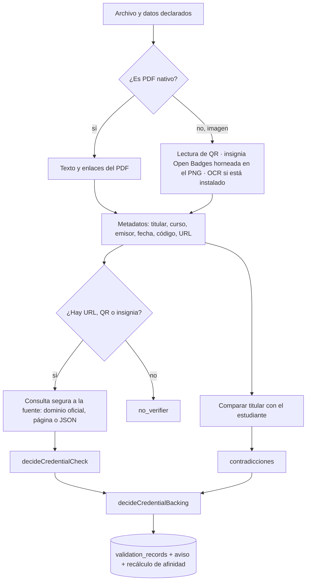

**Estado de la verificación oficial** (`decideCredentialCheck`):

| Resultado | Cuándo |
|---|---|
| `verified_match` | Una insignia Open Badges con destinatario coincidente, alojada o con prueba verificada, en dominio oficial; o una página de **dominio oficial** que **nombra al estudiante** y muestra el **código o el curso** |
| `mismatch` | Insignia revocada o de otra persona; dirección bloqueada; dominio no oficial; página oficial que nombra a otro titular |
| `reachable_no_structured_proof` | Responde, pero no expone una prueba legible (por ejemplo, la página necesita JavaScript) |
| `inconclusive` | Verificador apagado o sin salida a internet |
| `unreachable` | El proveedor no respondió (no es «falso») |
| `no_verifier` | Sin URL, QR ni insignia verificable |

**Dominio oficial**: el del emisor conocido (por palabras del emisor) más las plataformas de insignias, o el que la
oportunidad declaró en su referencia de validación. Se compara por dominio o subdominio, nunca por subcadena
(`evilcredly.com` no es `credly.com`). Credly/IBM, Cisco Networking Academy y Huawei se **reconocen** pero no tienen
verificador integrado: su acceso real no se pudo comprobar con un caso legítimo, y el sistema lo dice.

**Contradicciones** (marcan la credencial como **señalada**): titular distinto, titular oficial distinto, código
distinto, código que no cumple el patrón de la oportunidad, curso distinto, emisor distinto, verificación
contradictoria. Solo se acusa con datos legibles: sin texto, no hay contradicción.

**Respaldo** (`decideCredentialBacking`, en este orden): con contradicciones → **señalado**; `verified_match` →
**corroborado**; metadata coherente, coincidencia con la oportunidad o fuente oficial alcanzable → **con
respaldo**; si no → **declarado**.

**Estado de validación** (eje aparte, el que ve el estudiante): en comprobación, verificada automáticamente,
necesita revisión, verificada manualmente, inconclusa o rechazada, derivado de lo anterior y de la revisión manual.

**Duplicados**: si el mismo dueño ya subió un archivo con la **misma huella SHA-256**, la nueva credencial no
vuelve a respaldar (se marca como contenido repetido).

### 18.3 La revisión manual excepcional

Solo para credenciales **históricas**, ya comprobadas, sin verificador que concluya (`no_verifier`,
`inconclusive`, `unreachable` o `reachable_no_structured_proof`) y **sin contradicciones**. La decide Dirección
(ver 6.4). Una revisión «corroborada» se respeta mientras nada la contradiga; si aparece una contradicción, manda la
contradicción. Una revisión que solo miró el documento no verifica.

## 19. Respaldo de proyectos e inspección de repositorios

### 19.1 Reglas (`project-backing.rules.ts`)

```
si hay problemas graves                          → SEÑALADO (flagged)
si el repositorio no es accesible                → DECLARADO
independiente = demo accesible o ≥1 integrante (sin el responsable) que confirmó su contribución
si corroboración técnica o independiente o evidencia → CON RESPALDO
si corroboración técnica y independiente y atribución no disputada → CORROBORADO
si no es DECLARADO y tiene retroalimentación docente → REVISADO
```

- **Corroboración técnica**: al menos una tecnología declarada que el repositorio respalda por **lenguaje** de
  GitHub o por **manifiesto** (las dos del mismo repositorio cuentan como una sola fuente).
- **Atribución disputada**: el mismo repositorio (normalizado: host + dueño/nombre en minúsculas, sin `.git` ni
  rama) figura en el proyecto de otra persona ajena a este.
- **Problemas graves**: enlace bloqueado, recurso eliminado, duplicación sospechosa, metadatos incompatibles.
- El nivel **nunca se fija a mano**: se deriva de señales observables. `ProjectBackingService.recalculate` lo
  persiste solo si cambia, registra `BACKING_TIER_CHANGED` en la bitácora y recalcula la afinidad de todos los
  integrantes.

### 19.2 La inspección de GitHub (`RepositoryInspectorService`)

- Solo **metadatos públicos**: nunca se descarga ni se analiza el repositorio completo.
- Consulta los **lenguajes** y **un solo listado de la raíz** («tree limitado») para saber qué manifiestos
  controlados hay y si existe README.
- Lee el texto de los manifiestos y extrae dependencias directas (`dependency-map.ts`): `package.json`,
  `package-lock.json` (solo dependencias directas de la raíz), `pnpm-lock.yaml` (bloque del importador raíz),
  `yarn.lock` (solo reconoce el gestor), `requirements.txt`, `pyproject.toml` (PEP 621 y Poetry), `pom.xml` o
  `build.gradle`, `Dockerfile` (imágenes base) y `compose.yml` (imágenes de servicios). Un archivo ilegible no
  aporta nada pero tampoco acusa.
- **Cruza** lo declarado con lo encontrado: cada tecnología queda `declared` (no se encontró rastro: no es falsa),
  `detected` (se encontró y nadie la declaró: es una **sugerencia**) o `both` (declarada y encontrada: corrobora).
- **Caché con ETag** (`github_api_cache`): una respuesta se reutiliza `GITHUB_CACHE_TTL_SECONDS` (600 s); pasado
  el plazo se pregunta con ETag y un 304 no gasta cuota. Respeta la cuota de GitHub (403 con contador en cero o
  429) y reintenta los 5xx. `GITHUB_TOKEN` opcional da más cuota.
- **Sin llamar a GitHub** (`recruzar`): aceptar una sugerencia vuelve a cruzar las señales guardadas con lo que el
  proyecto declara ahora.

## 20. Gamificación: puntos, insignias y propuestas

- **Independiente de la afinidad**: el motor de afinidad no lee los puntos por ningún camino.
- **Solo tres familias generan puntos nuevos** (V5 §10):

| Familia | Disparador | Cómo llega | Puntos por omisión |
|---|---|---|---:|
| Participación confirmada | `participacion_confirmada` | Automático al registrar la asistencia (`sync`) | 10, o lo que fije la regla de la actividad (tope 50) |
| Proyecto reconocido por un docente | `proyecto_corroborado` | Propuesta del docente con sustento, aprobada por Dirección (o directa con autonomía) | 20 |
| Recurso completado atestiguado | `recurso_completado_atestiguado` | Propuesta del docente, aprobada por Dirección | 10 |

- **Extras**: «extras por área» y **extras de temporada** (criterios con vigencia, zona America/La_Paz), uno por hecho.
- **Idempotencia**: cada evento tiene una clave de deduplicación (por ejemplo `participacion:<id>`); `sync` mira el
  estado y reconoce lo que encuentre sin reconocer, así que se puede llamar cuantas veces haga falta.
- **Reversos**: si una corrección quita una asistencia confirmada, se agrega un evento negativo; si vuelve a
  confirmarse, uno nuevo.
- **Total**: `student_points` se recalcula sumando los eventos (`total_points`, `events_count`).
- **Insignias**: se otorgan por umbral de un hecho concreto, nunca por el total de puntos. Desde V6, **asistir no
  otorga insignias** (las ya obtenidas se conservan).
- **Retirado**: retos docentes, recompensas y canjes (V4.1). Sus rutas de creación responden 410; las filas
  históricas se conservan. Los disparadores antiguos (proyecto registrado, evidencia adjunta, certificado externo,
  constancia interna, perfil completo, primer proyecto respaldado, colaboración aceptada, hito de trayectoria) ya no
  generan eventos.

## 21. Trayectoria y currículo

- **Trayectoria** (`/trajectory/me`): el histórico completo, con el nivel de cada cosa en lenguaje natural
  (`cv-eligibility.rules.ts`): proyectos según su respaldo; credenciales según su respaldo y la revisión manual
  («Revisado»); inscripciones según su estado (solo «asistió» es confirmada). Incluye lo que no entra al currículo.
- **Ítems elegibles para el currículo**:
  - proyecto **activo** y **corroborado o revisado**;
  - actividad **interna** con participación **confirmada**;
  - credencial externa **corroborada** (una oportunidad, o una credencial solo «con respaldo», sigue en la
    trayectoria pero no afirma finalización).
- **Armado** (`build`): secciones pedidas, ítems elegidos (sin lista, todos los elegibles; con lista, solo esos y
  en ese orden; un id no elegible no se cuela en silencio), plantilla, presentación propia o asistida aprobada.
- **PDF** (`PdfWriter`): compone el documento por bloques (título, subtítulo, sección, párrafo, viñeta, nota),
  parte el texto en líneas que caben, pagina y serializa objetos, tabla de referencias cruzadas y tráiler, sin
  librerías. Tres temas (clásico, moderno, compacto). Siempre con el descargo y la nota de fuentes. Exportar queda
  en la auditoría (`CURRICULUM_EXPORTED`).

## 22. Colaboración: sugerencia de integrantes y moderación de nombres

### 22.1 Sugerencia de integrantes para una necesidad (`TeamsService.suggestions`)

| Factor | Peso | Qué mide |
|---|---:|---|
| Cobertura de habilidades | 50 | Cuánto de lo que falta tiene esa persona **respaldado** |
| Afinidad contextual | 20 | Afinidad con las áreas de la necesidad |
| Disponibilidad | 15 | Si cumple la disponibilidad pedida |
| Respaldo | 15 | Respaldo de su trayectoria en esas áreas |

Cada candidato viene con sus motivos («Cubre habilidades que faltan», «Tiene afinidad con el área del equipo»,
«Declaró disponibilidad», «Su trayectoria en el área está respaldada», «El equipo ya cubre lo que aporta»).
Solo se sugiere a quien tiene la cuenta activa, aceptó ser descubierto (`peer_discoverable`), no está ya en el
equipo ni invitado y, si la necesidad fija **semestres objetivo**, cursa uno de ellos. **Invitar es siempre un acto
de una persona.**

### 22.2 Elegibilidad por semestre

Una necesidad puede fijar **semestres objetivo** (`team_needs.target_semesters`). Sin ellos, cualquiera puede
verla y postular; con ellos, solo quien cursa uno de esos semestres, y un perfil sin semestre registrado no entra
porque no hay forma de saber si cumple (`semestreElegible`).

### 22.3 Moderación de nombres de equipo (`team-name.rules.ts`)

Primera barrera, por reglas: longitud de 3 a 60, solo caracteres permitidos, sin enlaces, correos ni teléfonos, y
**términos prohibidos por palabra completa** también cuando se escriben con números en lugar de letras («leet»),
con letras repetidas o separadas («p u t a»). La lista base se amplía con `TEAM_NAME_FORBIDDEN_TERMS`. Si las
reglas aprueban y hay IA configurada, la IA puede **marcar** el nombre como ambiguo: queda `name_flag_reason` y no
se comparte hasta corregirlo. Si la IA falla, no bloquea. Corregir el nombre vuelve a pasar por todo.

## 23. El asistente de IA

- **Opcional**: con `AI_PROVIDER=none` el sistema funciona completo y las pantallas no ofrecen el botón.
- **Adaptador** `openai_compatible`: cualquier API con `POST {base}/chat/completions` (OpenAI, Azure con base
  propia, Ollama, LM Studio, vLLM). Configuración: `AI_BASE_URL`, `AI_API_KEY`, `AI_MODEL`, `AI_TIMEOUT_MS`
  (15 s), `AI_MAX_INPUT_CHARS` (4.000), `AI_RATE_LIMIT_PER_MINUTE` (20 por persona).
- **Tareas permitidas** (fuera de esta lista no se usa): sugerencia de etiquetas y área de una tecnología nueva,
  resumen de evidencias de un proyecto, explicación de inconsistencias, ayuda de redacción del CV (mejorar,
  resumir, reorganizar, alternativas), narrativa de tendencias y moderación de nombres de equipo.
- **Garantías**:
  - las **reglas actúan primero** (`resolverPorRegla`): si una regla resuelve, no se llama a la IA;
  - el texto se **sanea** antes de salir (`sanitizeForAi`: sin correos, teléfonos, JWT, `Bearer`, cadenas tipo
    clave ni parámetros de URL) y de la entrada solo se guarda una **huella**;
  - cada respuesta se **valida**: un área que no existe, o **cifras** que la fuente no tenía, invalidan la
    sugerencia (`numbersIn` compara todos los números, incluso «2 años»);
  - **nada cambia hasta que una persona la acepta y la guarda** por el camino normal; aceptar solo deja constancia
    de quién la adoptó (`accepted_at`, `accepted_by`).
- **Nunca** toca afinidad, respaldo, aprobaciones, participación ni constancias.
- Registro: `ai_assistance_runs` (proveedor, modelo, tarea, resultado, estado, latencia, objetivo, aceptación),
  visible para Administración sin el contenido.

## 24. Procesos en segundo plano

No hay Redis ni un servidor de colas: los trabajos pendientes viven en tablas y los atienden temporizadores
dentro del proceso de la API. Por eso un reinicio no pierde trabajo.

| Proceso | Clase | Cada cuánto | Qué hace | Variable |
|---|---|---|---|---|
| Validación de credenciales y evidencias | `ValidationWorker` | 5 s con la cola vacía; 3 trabajos por vuelta | Reclama, procesa, recupera trabajos atascados (> 5 min) | `VALIDATION_WORKER_ENABLED`, `_POLL_MS`, `_BATCH`, `_STALE_MS` |
| Correos de cuenta (activación y recuperación) | `AccountMailService` | Se despierta al encolar y barre cada 30 s | Envía, reintenta a 1, 5, 15 y 60 min (5 intentos), recupera envíos atascados (> 5 min); un destinatario fuera de política no se reintenta | `MAIL_WORKER_ENABLED` |
| Ciclo de vida de actividades | `ActivityLifecycleWorker` | 60 s | Cierra inscripciones de lo que ya empezó (`closed`) y finaliza lo que ya terminó (`finished`); si esperaba una credencial, avisa a los elegibles | `ACTIVITY_LIFECYCLE_INTERVAL_MS` (0 = apagado) |
| Recordatorios de actividades | `ActivityRemindersService` | 30 min | Inscritos o admitidos: un aviso el día antes y otro unas horas antes; interesados: un solo aviso el día antes. Deduplicado | `NOTIFICATION_REMINDERS_ENABLED`, `_INTERVAL_MINUTES` |
| Limpieza de archivos huérfanos | `OrphanFilesService` | 6 h; 200 por tanda; gracia de 24 h | Borra subidas que nunca se adjuntaron a nada (ni credencial, ni evidencia, ni duplicado) | `ORPHAN_CLEANUP_*` |
| Migración de afinidad al motor vigente | `AffinityBackfillService` | Una vez al arrancar | Recalcula perfiles con resultados de una versión anterior del motor | `AFFINITY_BACKFILL_ON_BOOT` |
| Limpieza de previsualizaciones de padrón | `ImportsService.limpiarPrevisualizaciones` | Al previsualizar o aplicar | Borra previsualizaciones no aplicadas tras 24 h | `IMPORT_PREVIEW_TTL_HOURS` |
| Purga de sesiones vencidas | `AuthSessionsService.purgeExpired` | **Nunca se programa** | El método existe pero nada lo llama (ver hallazgo H-01 en el capítulo 34) | — |

Administración puede forzar algunos a mano: `POST /validation/run`, `POST /validation/reprocess-outdated`,
`POST /notifications/admin/run-reminders`, `POST /uploads/cleanup-orphans`, `POST /affinity/recalculate-all`,
`POST /project-backing/recalculate`, `POST /projects/admin/recompute-backing`.

## 25. Archivos, correo, notificaciones y auditoría

### 25.1 Archivos

- **Subida** (`POST /api/uploads`, multipart, campo `file`): un archivo por petición, hasta 10 MB.
  `UploadsService.store` detecta el tipo real por la **firma** de los bytes (PDF, PNG, JPG, WEBP), rechaza si no
  coincide, calcula la huella **SHA-256**, informa si el mismo dueño ya había subido ese contenido (id del
  original), guarda con un nombre generado y un **nombre visible saneado** (sin rutas ni caracteres de control),
  registra `stored_files` con su dueño y devuelve el **identificador**.
- **Drivers** (`STORAGE_DRIVER`): `local` (carpeta `STORAGE_LOCAL_PATH`, por omisión `./uploads`) o `r2`
  (Cloudflare R2 por su API compatible con S3: `R2_ACCOUNT_ID` o `R2_ENDPOINT`, `R2_BUCKET`, claves). Un valor
  desconocido o una configuración incompleta **detiene el arranque**. En producción, `local` solo avisa, porque
  el disco del contenedor no es persistente.
- **Descarga** (`GET /api/files/:key`): ver 14.4. El nombre del archivo en la cabecera se pasa a ASCII seguro.
- **Límites de imagen**: foto de perfil hasta 5 MB; imágenes de proyecto hasta 5 por proyecto.

### 25.2 Correo

- **Transportes** (`MAIL_TRANSPORT`): `auto` (SMTP si hay `SMTP_HOST`; si no, simulado), `smtp` (nodemailer con
  *pool* y ritmo máximo `SMTP_MAX_PER_MINUTE`, autenticación `login`, `oauth2` o `none`), `brevo` (API HTTPS de
  Brevo, para hostings que bloquean SMTP) y `console` (prohibido en producción).
- **Simulado en desarrollo**: sin `SMTP_HOST`, los correos van al registro de la API y a `api/.mail-outbox`
  (`MailCapture`, solo fuera de producción). Mailpit (`npm run mail:preview`, `http://localhost:8025`) permite verlos
  con su diseño real.
- **Plantillas** (`templates.ts`): activación, recuperación y prueba, con botón, caja del código («482 913»), enlace
  de respaldo, fecha de vencimiento en `APP_TIMEZONE` y escape de HTML.
- **Política de destinatarios**: solo dominios institucionales (y los locales de prueba).
- **Errores traducidos** (`explainSmtpError`, `explainBrevoError`): por ejemplo, el aviso de Gmail u Outlook si el
  remitente no coincide con la cuenta, o el error 5.7.139 de Microsoft 365.
- `npm run mail:test -- correo@dominio` prueba la configuración desde la terminal.

### 25.3 Notificaciones

- Se **persisten** en `notifications` con `dedupe_key` único: el mismo hecho no se avisa dos veces aunque el evento
  se emita más de una vez. La operación de negocio **nunca** depende de que el aviso llegue.
- Cada usuario ve solo las suyas; la web consulta el contador y la app lo refresca cada minuto.
- Tipos que emite el código hoy (26), desde 10 servicios: `ACTIVITY_STARTING`, `ACTIVITY_INTEREST_REMINDER`,
  `ACTIVITY_REVIEW_SUBMITTED`, `ACTIVITY_APPROVED`, `ACTIVITY_REVIEW_OBSERVED`, `ACTIVITY_REVIEW_REJECTED`,
  `ACTIVITY_REGISTRATION_ACCEPTED`, `ACTIVITY_REGISTRATION_REJECTED`,
  `PARTICIPATION_CONFIRMED`, `EXTERNAL_EVIDENCE_AVAILABLE`, `EXTERNAL_CREDENTIAL_FLAGGED`,
  `EXTERNAL_CREDENTIAL_MANUAL_REVIEWED`, `CERTIFICATE_DELIVERED`, `PROJECT_INVITATION`,
  `PROJECT_CONTRIBUTION_CHANGED`, `PROJECT_CONTRIBUTION_CORRECTION_REQUESTED`, `PROJECT_CONFIRMATION_REQUIRED`,
  `PROJECT_MEMBER_EXCLUDED`, `TEACHER_FEEDBACK_RECEIVED`, `SKILL_REQUESTED`, `SKILL_REQUEST_DECIDED`,
  `CONTACT_REQUEST`, `TEAM_APPLICATION`, `TEAM_APPLICATION_ACCEPTED`, `TEAM_APPLICATION_REJECTED`,
  `TEAM_INVITATION`. Las decisiones de Dirección sobre **recursos** propuestos y **propuestas de puntos** no
  generan aviso: el docente las ve en su pantalla (ver el hallazgo H-06 del capítulo 34).

### 25.4 Auditoría

- `audit_events`: actor, tipo de evento, entidad afectada, metadatos **saneados** (nunca contraseñas, tokens ni
  códigos; valores largos recortados), IP y fecha.
- 76 tipos de evento, agrupados en 14 módulos legibles: Cuentas y acceso, Importación de padrón, Perfil del
  estudiante, Actividades, Credenciales externas, Proyectos, Recomendaciones, Afinidad, Catálogo, Colaboración y
  equipos, Archivos y evidencias, Asistente de IA, Configuración y Currículo. Resultados: Correcto, Rechazado,
  Cancelado, Moderado.
- Además, cada proyecto tiene su **bitácora** (`project_events`, 17 tipos) y cada actividad su **historia de
  revisión** (`activity_reviews`).

## 26. La aplicación web por dentro

### 26.1 Estructura

| Carpeta / archivo | Qué contiene |
|---|---|
| `main.tsx`, `App.tsx` | Arranque y **router**: rutas públicas, bienvenida a pantalla completa, un solo marco (`Layout`) para todo lo que tiene sesión, guardas por rol, redirecciones de rutas antiguas a pestañas |
| `auth/AuthContext.tsx` | Sesión: al cargar intenta renovar con la cookie; expone usuario, login y logout |
| `api/client.ts` | axios con: token en memoria, cabecera `Authorization`, renovación **única** compartida (y entre pestañas con *Web Locks*), distinción entre sesión inválida (401) y fallo de red (no expulsa por un corte), contador de peticiones para la barra de progreso |
| `services/index.ts` (1.555 líneas), `services/types.ts` (1.294) | Una función por ruta de la API, tipada |
| `navigation.ts` | Menú por rol (agrupado por lo que la persona quiere hacer, con pistas), barra inferior del teléfono, inicio de cada rol, modo técnico |
| `components/` | 31 componentes: `Layout`, `UserMenu`, `NotificationBell`, `ProtectedRoute`, `OnboardingGate`, `ActivityManager` (2.426 líneas: el gestor de actividades del personal), `ActivityCard`, `ActivityTabs`, `AreaSkillPicker`, `PersonPicker`, `ProjectContribution`, `ProjectImages`, `ProjectReadiness`, `ProjectTechnicalCheck`, `RepositoryAnalyzer`, `ParaTi`, `QuestionnaireRunner`, `Declarations`, `affinity`, `charts`, `AiAssist`, `ArchivoProtegido` (abre archivos con sesión), `Avatar`, `CambiosSinGuardar` (aviso al salir con cambios), `Tutorial`, `EstadosDeRespaldo`, `InicioRol`, `feedback` (toasts y confirmaciones), `form`, `ui` (756 líneas de primitivas) |
| `pages/` | 52 pantallas: 11 del estudiante, 7 del docente, 10 de Dirección, 4 de Sociedad, 10 de Administración, 1 compartida de personal (`StudentPoints`), 2 de cuenta (activar o restablecer, y pedir un enlace), 1 de ayuda y 6 generales (portada, login, perfil público, proyecto público, notificaciones, proyectos de la carrera) |
| `hooks/` | `useAsync` (carga con estados) y `viewCache` (memoria de la sesión para pintar al instante al volver) |
| `lib/` | `validators.ts` (las mismas reglas que la API: contraseña, código universitario…), `fechas.ts` (zona `VITE_APP_TIMEZONE`, America/La_Paz), `texto.ts`, `areaIcons.ts` |
| `help/content.ts` | Preguntas frecuentes y tutorial |
| `index.css`, `landing.css`, `login.css`, `welcome.css` | Estilos (variables de color de la carrera, tema bordó) |

### 26.2 Rutas de la web

| Ruta | Pantalla | Rol |
|---|---|---|
| `/` | `LandingPage` | Público |
| `/login` | `LoginPage` | Público |
| `/p/:slug` | `PublicProfile` (perfil compartible) | Público |
| `/proyecto/:token` | `PublicProject` | Público |
| `/activar`, `/activar/solicitar`, `/recuperar`, `/restablecer` | `SetPasswordPage` / `RequestTokenPage` | Público |
| `/student/bienvenida` | `Welcome` (pantalla completa) | Estudiante |
| `/student` | `Dashboard` | Estudiante |
| `/student/profile` | `Profile` (pestañas `?tab=`) | Estudiante |
| `/student/activities` | `Activities` | Estudiante |
| `/student/library` | `Library` | Estudiante |
| `/student/projects` | `Projects` | Estudiante |
| `/student/evidences` | `Evidences` | Estudiante |
| `/student/affinity` | `Affinity` | Estudiante |
| `/student/collaboration` | `Collaboration` (`?tab=contactos` / `equipos`) | Estudiante |
| `/student/progress` | `Progress` (`?tab=resumen`) | Estudiante |
| `/teacher` | `Panel` (pestañas) | Docente |
| `/teacher/my-activities` | `MyActivities` | Docente |
| `/teacher/points` | `StudentPoints` | Docente |
| `/teacher/resources` | `LearningResources` | Docente |
| `/director` | `Dashboard` | Dirección |
| `/director/approvals` | `Approvals` | Dirección |
| `/director/credential-reviews` | `CredentialReviews` | Dirección |
| `/director/autonomy` | `TeacherAutonomy` | Dirección |
| `/director/activities` | `Activities` | Dirección |
| `/director/constancies` | `Constancies` («Participaciones») | Dirección |
| `/director/resources` | `LearningResources` | Dirección |
| `/director/analytics` | `Analytics` (5 pestañas) | Dirección |
| `/director/points` | `StudentPoints` | Dirección |
| `/director/gamification` | `Gamification` (criterios) | Dirección |
| `/society` | `Dashboard` | Sociedad |
| `/society/activities` | `Activities` | Sociedad |
| `/society/participants` | `Participants` | Sociedad |
| `/society/metrics` | `Metrics` | Sociedad |
| `/admin` | `Home` | Administración |
| `/admin/users` | `Users` | Administración |
| `/admin/imports` | `Imports` | Administración |
| `/admin/areas` | `AreasSkills` (`?tab=skills`) | Administración |
| `/admin/skill-requests` | `SkillRequests` | Administración |
| `/admin/activity-categories` | `ActivityCategories` | Administración |
| `/admin/activities` | `Activities` | Administración |
| `/admin/resources` | `LearningResources` | Administración |
| `/admin/gamification` | `Gamification` | Administración |
| `/admin/points` | `StudentPoints` | Administración |
| `/admin/credential-reviews` | `CredentialReviews` | Administración |
| `/admin/audit` | `Audit` | Administración |
| `/admin/mail` | `Mail` (fuera del menú) | Administración |
| `/ayuda` | `Help` | Todos |
| `/proyectos` | `CareerProjects` | Todos con sesión |
| `/notificaciones` | `Notifications` | Todos con sesión |

Las rutas antiguas se conservan como **redirecciones**: por ejemplo `/teacher/students` → `/teacher?tab=estudiantes`,
`/director/affinity` → `/director/analytics?tab=afinidad`, `/student/recommendations` → `/student/activities`,
`/admin/skills` → `/admin/areas?tab=skills`. Cualquier otra ruta lleva al inicio del rol o al login.

### 26.3 Experiencia y accesibilidad

- Un solo marco para todos los roles: pasar a «Ayuda» no desmonta el menú (sin parpadeo).
- `MotionConfig reducedMotion="user"`: con «reducir movimiento» del sistema no hay animaciones.
- En el teléfono, barra inferior de 4 accesos + «Más» para Estudiante, Docente, Dirección y Sociedad;
  Administración no la tiene (su trabajo es de escritorio).
- Formularios con errores por campo (la API devuelve `fields`), confirmaciones antes de acciones irreversibles y
  aviso de cambios sin guardar.

## 27. La aplicación móvil por dentro

| Pieza | Qué hace |
|---|---|
| `App.tsx`, `index.ts` | Arranque, fuentes, proveedor de sesión y navegación |
| `config.ts` | Dirección de la API: `EXPO_PUBLIC_API_URL` → host que sirvió la app en desarrollo (IP de la red, `10.0.2.2` en el emulador) → `extra.apiUrl` de `app.json` → último recurso |
| `api/client.ts` | axios con `X-Afinia-Client: mobile`; tokens en **SecureStore** (cifrado del sistema operativo, no AsyncStorage); una sola renovación compartida |
| `auth/AuthContext.tsx` | Sesión del estudiante |
| `navigation/RootNavigator.tsx` | Sin sesión: Login. Con sesión de Estudiante: bienvenida si falta, si no las 6 pestañas (Inicio, Perfil, Actividades, Proyectos, Afinidad, Avisos) con pilas internas. Con otro rol: pantalla «App para estudiantes» |
| `screens/`, `screens/student/` | `LoginScreen` y 18 archivos del estudiante: 16 pantallas y 2 secciones reutilizables (`ActivityTabs`, `TeamNeedsSection`) (ver 4.12) |
| `services/index.ts` | Funciones por ruta de la API |
| `hooks/useAsync.ts`, `viewCache.ts` | Carga con caché por pantalla. Se corrigió un defecto: la clave de caché usaba `fn.toString()`, y en el motor Hermes todas las funciones dan el mismo texto, así que pantallas distintas compartían datos |
| `components/` | `ui`, `feedback`, `icons`, `PriorityPicker`, `ImagenProtegida` (imágenes con sesión) |
| `theme.ts`, `fechas.ts`, `archivos.ts` | Colores, fechas y selección de archivos (expo-document-picker, expo-file-system, expo-sharing) |

**El APK**: `npm run mobile:apk [url]` (`scripts/movil/construir-apk.mjs`) copia `mobile/` a una ruta corta
(`C:\afinia-apk`), instala con su propio lock, ejecuta `expo prebuild --clean`, ajusta la copia (tráfico http si la
URL es http, tema claro) y compila `gradlew assembleRelease` con firma de depuración para arm64-v8a, armeabi-v7a y
x86_64. La URL de la API queda **fija dentro del APK**: si cambia la red o el servidor, hay que recompilar.
`scripts/movil/instalar-herramientas-android.ps1` instala JDK 17, el SDK, el NDK y el emulador.

**Por qué un APK**: la app está en **Expo SDK 54** y la Expo Go de las tiendas ya es de una versión más nueva;
en Android se puede instalar Expo Go 54 aparte, pero el APK propio no depende de ninguna versión de Expo Go.

## 28. El paquete compartido (`shared/`)

`@perfil/shared` es la fuente única del vocabulario del sistema. Lo importan la API y la web (y el móvil replica
lo que necesita). Contiene 23 archivos de enumeraciones y reglas:

| Archivo | Qué define |
|---|---|
| `role.enum.ts` | Los 5 roles |
| `user.enum.ts` | Estados de cuenta |
| `identity.enum.ts` | Propósito de tokens; estados de fila y de lote de importación |
| `university-code.ts` | Prefijos por rol, patrón, normalización y mensajes del código universitario |
| `profile.enum.ts` | Estado del perfil, disponibilidad, modos y tipos de colaboración, **campos publicables** y visibilidad por omisión (todo oculto) |
| `avatar.ts` | Los 12 avatares |
| `activity.enum.ts` | Origen, política de resultado, tipo, categoría, modalidad, estado, **máquina de estados**, revisión |
| `registration.enum.ts` | Estados de inscripción, modo de inscripción, ventana de asistencia (7 días), tolerancia de inicio (2 min) |
| `project.enum.ts`, `project-backing.enum.ts` | Estado del proyecto, nivel de respaldo, estado de tecnología, eventos de bitácora, **roles de proyecto** y su traducción desde textos antiguos, estado de evidencia de cada tecnología |
| `affinity.enum.ts`, `affinity-engine.ts` | Niveles, familias, códigos de peso, tipos de coincidencia, **versión del motor (5)**, rendimientos decrecientes, topes, puntos de afinidad y de respaldo, umbrales, motivos de exclusión |
| `evidence.enum.ts`, `constancy.enum.ts` | Tipos de evidencia; estados de constancia |
| `validation.enum.ts` | Tipos de recurso, estados del trabajo, respaldo de credenciales, verificación oficial, QR, revisión manual y sus métodos, estado de validación, coincidencia de titular, comprobación de enlaces |
| `recommendation.enum.ts` | Tipos, estados, **motivos** y resultados de las recomendaciones |
| `learning-resource.enum.ts` | Tipos y estados de recurso; tipos prácticos |
| `skill-interest.enum.ts` | «Me interesa» / «Quiero mejorar», procedencia, pasos de la bienvenida |
| `onboarding.enum.ts` | Estados de la orientación, tipos de pregunta, procedencia de un interés |
| `collaboration.enum.ts` | Estados de contactos, necesidades, equipos, postulaciones e invitaciones; motivos de rechazo; **pesos de la sugerencia de integrantes**; alfabeto y largo del identificador público; canales de contacto |
| `gamification.enum.ts` | Disparadores (vigentes y retirados), familias V5, puntos, insignias, **secciones del currículo**, niveles de trayectoria, plantillas, descargo, explicación de los estados de respaldo |
| `portfolio.enum.ts` | Visibilidad de proyectos e invitaciones |
| `ai.enum.ts` | Proveedores, tareas, estados, modos de ayuda del CV, estado de nombre de equipo |

Al estar en `shared`, la pantalla de afinidad muestra **exactamente** las cifras con las que se calculó, sin volver a escribirlas.

## 29. La base de datos: visión general

### 29.1 Cifras (esquema real, 13/11/2026)

| Elemento | Cantidad |
|---|---:|
| Tablas | **90** (86 con entidad TypeORM; 4 sin entidad: `activity_favorites`, `migrations`, `university_code_legacy`, `v32_catalog_seed_log`) |
| Columnas | **799** (549 obligatorias) |
| Claves primarias | 90 (77 simples con UUID, 13 compuestas en tablas de relación) |
| Claves foráneas | **177** (109 `ON DELETE CASCADE`, 54 `SET NULL`, 11 `RESTRICT`, 3 sin acción) |
| Restricciones `UNIQUE` | 31 (más índices únicos) |
| Restricciones `CHECK` | 46 |
| Índices | **293** |
| Tipos enumerados | **57** |
| Migraciones aplicadas | **81** (todas con `up` y `down`) |
| Vistas, funciones propias y disparadores | 0 (solo las funciones de la extensión `uuid-ossp`) |

Tipos de columna: 267 `uuid`, 188 de texto (`varchar` o `text`), 160 `timestamptz`, 69 enumerados, 55 numéricos, 21
booleanos, 20 arreglos (`uuid[]`, `smallint[]`, `text[]`), 16 `jsonb` y 3 `date`. **Ninguna** columna de fecha y
hora es sin zona horaria: una migración de QA las pasó todas a `timestamptz`.

### 29.2 Convenciones y decisiones de diseño

- **Solo migraciones** (`synchronize: false`): el esquema cambia por código revisable y reversible. La tabla
  `migrations` lleva el registro.
- **Claves UUID** generadas por la base (`uuid_generate_v4()`), nunca secuenciales: no revelan cuántos registros hay.
- **Nombres en `snake_case`** en la base y `camelCase` en las entidades (`name: '…'` en cada columna).
- **Enumerados de PostgreSQL** para los estados con valores cerrados (57 tipos), y `CHECK` para los `varchar` con
  valores cerrados más nuevos (por ejemplo `mail_jobs.status`, `approval_policies.module`).
- **Baja lógica**, no borrado: cuentas (`status = inactive`), áreas, habilidades, categorías, recursos, criterios e
  insignias (`is_active`). Lo que tiene historia no se borra.
- **Historia conservada**: instantáneas de afinidad, recomendaciones anteriores (`is_current = false`), revisiones
  de actividades, bitácora de proyectos, eventos de puntos (con reversos), auditoría.
- **Tablas retiradas pero conservadas**, con comentario en la base que lo explica: `conversations`,
  `conversation_members` y `messages` (chat retirado por la V2 §57) y `student_skills` (nivel autodeclarado retirado).
  Otras históricas sin uso funcional: `gamification_challenges`, `gamification_rewards`, `reward_redemptions`
  (retiradas en V4.1), `university_code_legacy` y `v32_catalog_seed_log` (bitácoras de migraciones de datos).
- **Idempotencia en la base**: claves únicas de deduplicación (`notifications.dedupe_key`, eventos de puntos por
  clave, favoritos por pareja, contactos por pareja canónica), así un reintento no duplica.
- **Arreglos** donde el dato es una lista corta sin relaciones propias: semestres destinatarios
  (`activities.semester_scope`), semestres de arrastre, áreas de mejora, etiquetas de área.
- **`jsonb`** para estructuras que se leen enteras: configuración de visibilidad, preferencias de colaboración,
  motivos de una recomendación, datos extraídos de un documento, metadatos de auditoría y de comprobaciones.
- **Copias deliberadas** (desnormalización controlada): `student_profiles.semester`, `university_code` y
  `academic_scope_semesters` copian datos de `users` para que el alcance docente se resuelva sin cruzar tablas;
  `projects.technologies` guarda los nombres como texto; las áreas «principales» se guardan además en una columna
  (`academic_area_id`) para quien lee una sola.

### 29.3 Los grupos de tablas

| Grupo | Tablas |
|---|---|
| Identidad y acceso | `users`, `roles`, `auth_sessions`, `account_tokens`, `mail_jobs`, `teacher_semester_access`, `approval_policies`, `import_batches`, `import_batch_rows`, `university_code_legacy` |
| Perfil del estudiante | `student_profiles`, `student_interests`, `student_free_interests`, `student_skill_interests`, `student_contact_channels`, `student_skills` (histórica), `onboarding_runs`, `onboarding_answers` |
| Catálogos | `academic_areas`, `skills`, `skill_area_relations`, `skill_requests`, `activity_categories`, `learning_resources`, `learning_resource_areas`, `learning_resource_skills`, `learning_resource_favorites`, `gamification_criteria`, `badges`, `affinity_weights`, `v32_catalog_seed_log` |
| Actividades | `activities`, `activity_areas`, `activity_skills`, `activity_reviews`, `activity_registrations`, `activity_responsibles`, `activity_contacts`, `activity_images`, `activity_favorites`, `activity_gamification_rules`, `external_opportunity_validation_references`, `internal_constancies` |
| Proyectos | `projects`, `project_areas`, `project_skills`, `project_members`, `project_member_skills`, `project_invitations`, `project_evidences`, `project_feedback`, `project_events`, `project_images`, `project_repository_checks`, `project_link_checks`, `github_api_cache` |
| Credenciales, archivos y validación | `external_certificates`, `external_certificate_areas`, `external_certificate_skills`, `stored_files`, `validation_records` |
| Afinidad | `affinity_results`, `affinity_contributions`, `affinity_snapshots`, `affinity_snapshot_items` |
| Recomendaciones | `recommendations` |
| Colaboración | `contacts`, `contact_requests`, `contact_notes`, `team_needs`, `team_need_areas`, `team_need_skills`, `teams`, `team_members`, `team_invitations`, `team_applications`, `conversations`, `conversation_members`, `messages` (las tres últimas, históricas) |
| Gamificación | `gamification_events`, `student_points`, `student_badges`, `gamification_proposals`, `gamification_challenges`, `gamification_rewards`, `reward_redemptions` (las tres últimas, históricas) |
| Avisos, IA y auditoría | `notifications`, `ai_assistance_runs`, `audit_events` |
| Infraestructura | `migrations` |

El **diccionario de datos completo** (cada tabla con su propósito, su clase, cada columna con tipo, nulidad,
valor por omisión y descripción, sus claves, restricciones e índices) está en el **Apéndice B**; los valores de
cada tipo enumerado, en el **Apéndice C**; la historia de las 81 migraciones, en el **Apéndice D**.

### 29.4 Diagramas de relaciones por grupo

Cada diagrama muestra las tablas del grupo y sus claves foráneas (la etiqueta es la columna que relaciona).
Las tablas de otros grupos aparecen solo cuando reciben una relación.

#### Identidad y acceso

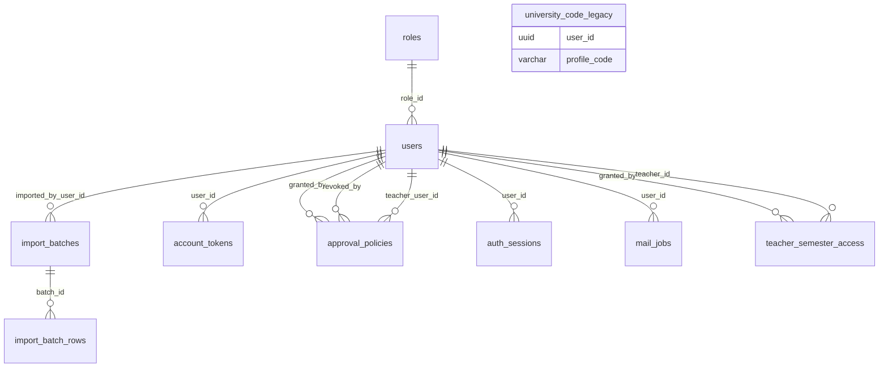

#### Perfil del estudiante

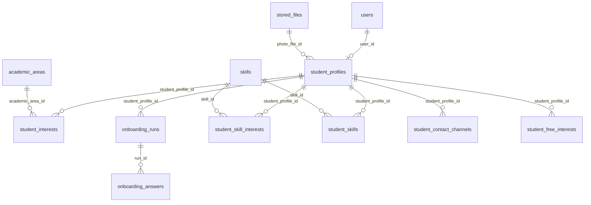

#### Catálogos

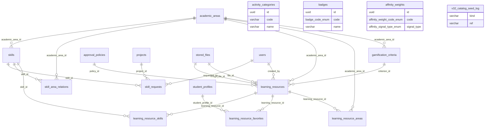

#### Actividades

```mermaid
erDiagram
    academic_areas ||--o{ activities : "academic_area_id"
    academic_areas ||--o{ activity_areas : "academic_area_id"
    academic_areas ||--o{ activity_skills : "academic_area_id"
    activities ||--o{ activity_areas : "activity_id"
    activities ||--o{ activity_contacts : "activity_id"
    activities ||--o{ activity_favorites : "activity_id"
    activities ||--o{ activity_gamification_rules : "activity_id"
    activities ||--o{ activity_images : "activity_id"
    activities ||--o{ activity_registrations : "activity_id"
    activities ||--o{ activity_responsibles : "activity_id"
    activities ||--o{ activity_reviews : "activity_id"
    activities ||--o{ activity_skills : "activity_id"
    activities ||--o{ internal_constancies : "activity_id"
    activities ||--o| external_opportunity_validation_references : "activity_id"
    activity_categories ||--o{ activities : "category_id"
    activity_registrations ||--o{ internal_constancies : "activity_registration_id"
    badges ||--o{ activity_gamification_rules : "badge_id"
    gamification_criteria ||--o{ activity_gamification_rules : "criterion_id"
    skills ||--o{ activity_skills : "skill_id"
    stored_files ||--o{ activities : "image_file_id"
    stored_files ||--o{ activity_images : "stored_file_id"
    stored_files ||--o{ external_opportunity_validation_references : "sample_stored_file_id"
    stored_files ||--o{ internal_constancies : "stored_file_id"
    student_profiles ||--o{ activity_registrations : "student_profile_id"
    student_profiles ||--o{ internal_constancies : "student_profile_id"
    users ||--o{ activities : "creator_id"
    users ||--o{ activities : "responsible_user_id"
    users ||--o{ activities : "reviewed_by"
    users ||--o{ activities : "updated_by"
    users ||--o{ activity_contacts : "user_id"
    users ||--o{ activity_favorites : "user_id"
    users ||--o{ activity_gamification_rules : "created_by"
    users ||--o{ activity_registrations : "confirmed_by"
    users ||--o{ activity_responsibles : "user_id"
    users ||--o{ activity_reviews : "actor_user_id"
    users ||--o{ external_opportunity_validation_references : "updated_by"
    users ||--o{ internal_constancies : "authorized_by"
    users ||--o{ internal_constancies : "issued_by"
```

#### Proyectos

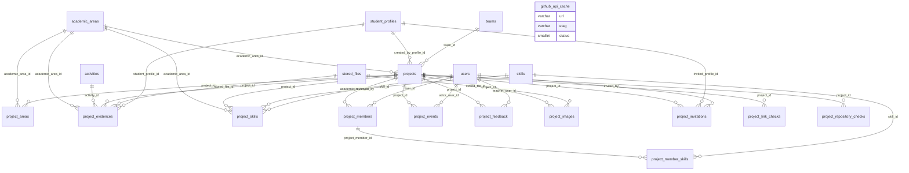

#### Credenciales, archivos y validación

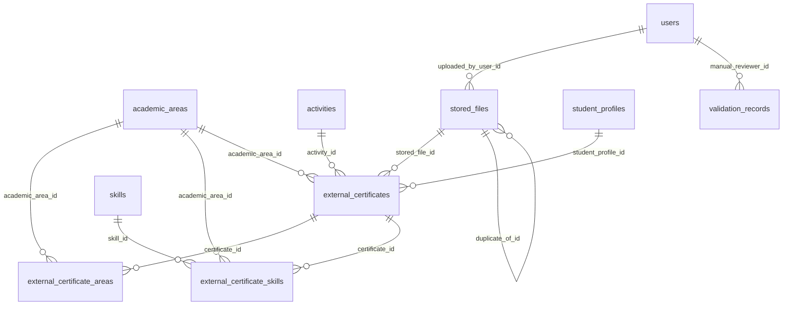

#### Afinidad

```mermaid
erDiagram
    academic_areas ||--o{ affinity_contributions : "academic_area_id"
    academic_areas ||--o{ affinity_results : "academic_area_id"
    academic_areas ||--o{ affinity_snapshot_items : "academic_area_id"
    affinity_snapshots ||--o{ affinity_snapshot_items : "snapshot_id"
    student_profiles ||--o{ affinity_contributions : "student_profile_id"
    student_profiles ||--o{ affinity_results : "student_profile_id"
    student_profiles ||--o{ affinity_snapshots : "student_profile_id"
```

#### Recomendaciones

```mermaid
erDiagram
    academic_areas ||--o{ recommendations : "academic_area_id"
    student_profiles ||--o{ recommendations : "student_profile_id"
```

#### Colaboración

```mermaid
erDiagram
    academic_areas ||--o{ team_need_areas : "academic_area_id"
    activities ||--o{ team_needs : "activity_id"
    contacts ||--o{ contact_notes : "contact_id"
    conversations ||--o{ conversation_members : "conversation_id"
    conversations ||--o{ messages : "conversation_id"
    projects ||--o{ team_needs : "project_id"
    skills ||--o{ team_need_skills : "skill_id"
    student_profiles ||--o{ contact_notes : "owner_profile_id"
    student_profiles ||--o{ contact_requests : "requester_profile_id"
    student_profiles ||--o{ contact_requests : "target_profile_id"
    student_profiles ||--o{ contacts : "profile_a_id"
    student_profiles ||--o{ contacts : "profile_b_id"
    student_profiles ||--o{ conversation_members : "student_profile_id"
    student_profiles ||--o{ messages : "sender_profile_id"
    student_profiles ||--o{ team_applications : "applicant_profile_id"
    student_profiles ||--o{ team_invitations : "invited_by_profile_id"
    student_profiles ||--o{ team_invitations : "invited_profile_id"
    student_profiles ||--o{ team_members : "student_profile_id"
    student_profiles ||--o{ team_needs : "owner_profile_id"
    student_profiles ||--o{ teams : "owner_profile_id"
    team_needs ||--o{ team_applications : "team_need_id"
    team_needs ||--o{ team_need_areas : "team_need_id"
    team_needs ||--o{ team_need_skills : "team_need_id"
    team_needs ||--o{ teams : "team_need_id"
    teams ||--o{ conversations : "team_id"
    teams ||--o{ team_invitations : "team_id"
    teams ||--o{ team_members : "team_id"
```

#### Gamificación

```mermaid
erDiagram
    academic_areas ||--o{ gamification_challenges : "academic_area_id"
    approval_policies ||--o{ gamification_proposals : "policy_id"
    badges ||--o{ student_badges : "badge_id"
    gamification_criteria ||--o{ gamification_events : "criterion_id"
    gamification_criteria ||--o{ gamification_proposals : "criterion_id"
    gamification_rewards ||--o{ reward_redemptions : "reward_id"
    student_profiles ||--o{ gamification_events : "student_profile_id"
    student_profiles ||--o{ gamification_proposals : "student_profile_id"
    student_profiles ||--o{ reward_redemptions : "student_profile_id"
    student_profiles ||--o{ student_badges : "student_profile_id"
    student_profiles ||--o| student_points : "student_profile_id"
    users ||--o{ gamification_challenges : "created_by_user_id"
    users ||--o{ gamification_events : "approved_by"
    users ||--o{ gamification_events : "awarded_by"
    users ||--o{ gamification_proposals : "proposed_by"
    users ||--o{ gamification_rewards : "created_by_user_id"
```

#### Avisos, IA y auditoría

```mermaid
erDiagram
    users ||--o{ ai_assistance_runs : "accepted_by"
    users ||--o{ ai_assistance_runs : "requested_by"
    users ||--o{ audit_events : "actor_user_id"
    users ||--o{ notifications : "recipient_user_id"
```

## 30. Los datos

### 30.1 Qué datos produce cada actor

| Actor | Qué escribe | Tablas principales |
|---|---|---|
| Administración | Cuentas, padrón, semestres docentes, catálogos, criterios | `users`, `import_batches`, `teacher_semester_access`, `academic_areas`, `skills`, `activity_categories`, `gamification_criteria` |
| Estudiante | Perfil, intereses, proyectos, credenciales, inscripciones, colaboración | `student_profiles`, `student_interests`, `student_skill_interests`, `projects`, `project_members`, `external_certificates`, `activity_registrations`, `contacts`, `team_needs` |
| Docente | Actividades propuestas, asistencia, retroalimentación, propuestas | `activities`, `activity_registrations`, `project_feedback`, `gamification_proposals`, `learning_resources` |
| Dirección | Decisiones de revisión, revisiones manuales, autonomía | `activity_reviews`, `validation_records`, `approval_policies` |
| Sociedad científica | Actividades extracurriculares y su asistencia | `activities`, `activity_registrations` |
| El sistema | Afinidad, recomendaciones, validaciones, avisos, auditoría, puntos | `affinity_*`, `recommendations`, `validation_records`, `notifications`, `audit_events`, `gamification_events` |

### 30.2 Datos sembrados

- `npm run seed` (mínimo): **roles**, **áreas académicas**, **habilidades** y el **administrador inicial**
  (`ADMIN_EMAIL`; contraseña de `ADMIN_PASSWORD`, obligatoria en producción).
- `npm run seed:populate` (ejemplo amplio e idempotente, reutiliza el motor de afinidad real): 4 cuentas de
  personal (2 docentes con semestres 1–4 y 5–8, Dirección y Sociedad), **16 estudiantes** con perfil, intereses y
  habilidades, actividades académicas y extracurriculares, cursos y recursos, participaciones mezcladas, proyectos
  con evidencias, integrantes e invitaciones, retroalimentación docente, certificados externos, intereses en texto
  libre, constancias históricas y criterios de puntos. Las cuentas de ejemplo y su contraseña común están en el
  `README.md`.
- Las migraciones también siembran catálogos (categorías, pesos de afinidad, insignias, criterios).

#### Roles

| Código | Descripción |
|---|---|
| `STUDENT` | Construye su perfil estudiantil dinámico. |
| `TEACHER` | Publica actividades y confirma participación. |
| `CAREER_DIRECTOR` | Consulta reportes generales y mapa de afinidad. |
| `SCIENTIFIC_SOCIETY` | Publica actividades extracurriculares. |
| `ADMIN` | Gestiona usuarios, roles y catálogos. |

#### Áreas académicas y sus tecnologías (base de ejemplo)

| Código | Área | Etiquetas | Tecnologías principales |
|---|---|---|---|
| `bases_de_datos` | Bases de Datos | persistencia, modelado de datos, almacenamiento, relacional, no relacional, consultas | MongoDB, PostgreSQL, SQL |
| `ciberseguridad` | Ciberseguridad | seguridad informática, vulnerabilidades, protección de datos, análisis de riesgos, seguridad ofensiva, seguridad defensiva | Análisis de Vulnerabilidades, Criptografía, Pentesting |
| `computacion_en_la_nube` | Computación en la nube | nube, cloud, contenedores, despliegue, escalabilidad, servicios administrados, devops | AWS, Docker, Google Cloud, Kubernetes, Microsoft Azure |
| `desarrollo_movil` | Desarrollo Móvil | aplicaciones móviles, mobile, multiplataforma, android | Flutter, Kotlin, React Native |
| `desarrollo_web` | Desarrollo Web | frontend, backend, aplicaciones web, servicios web, interfaces web | HTML y CSS, JavaScript, Node.js, React, TypeScript |
| `gestion_de_proyectos` | Gestión de Proyectos | planificación, metodologías ágiles, seguimiento, coordinación de equipos, gestión de riesgos | Kanban, Liderazgo, Scrum |
| `ingenieria_de_software` | Ingeniería de Software | arquitectura de software, calidad de software, procesos de desarrollo, requisitos, mantenimiento | Git, Patrones de Diseño, Testing, UML |
| `inteligencia_artificial` | Inteligencia Artificial | aprendizaje automático, modelos predictivos, visión por computadora, procesamiento de lenguaje natural, sistemas inteligentes | Machine Learning, Python, Redes Neuronales |
| `redes` | Redes | networking, conectividad, telecomunicaciones, protocolos, enrutamiento, infraestructura de red | Administración Linux, Routing, TCP/IP |

#### Categorías de actividad

| Código | Nombre | Aplica a | Vigente |
|---|---|---|---|
| `actividad_sociedad_cientifica` | Actividad de sociedad científica | extracurricular | sí |
| `charla` | Charla | academica | sí |
| `clase_espejo` | Clase espejo | academica | sí |
| `club_estudio` | Club de estudio | extracurricular | sí |
| `convocatoria` | Convocatoria | extracurricular | sí |
| `curso_externo_recomendado` | Curso externo recomendado | academica | sí |
| `hackathon` | Hackathon | extracurricular | sí |
| `integracion` | Integración | extracurricular | sí |
| `investigacion` | Investigación | academica | sí |
| `recurso_de_apoyo` | Recurso de apoyo | ambos tipos | sí |
| `responsabilidad_social` | Responsabilidad social | extracurricular | sí |
| `reto` | Reto | extracurricular | sí |
| `seminario` | Seminario | academica | sí |
| `taller_academico` | Taller académico | academica | sí |
| `tutoria` | Tutoría | academica | sí |

#### Pesos de afinidad vigentes (`affinity_weights`)

Solo cuatro valen más que cero: lo demás se registra para explicar por qué no suma.

| Código | Puntos base | Etiqueta |
|---|---:|---|
| `project_reviewed` | 22 | Proyecto revisado por un docente |
| `project_corroborated` | 18 | Proyecto corroborado |
| `certificate_corroborated` | 15 | Certificado externo corroborado |
| `activity_confirmed` | 10 | Participacion confirmada |
| `interest` | 0 | Interes declarado |
| `interest_priority_1` | 0 | Interes declarado con prioridad 1 |
| `interest_priority_2` | 0 | Interes declarado con prioridad 2 |
| `interest_priority_3` | 0 | Interes declarado con prioridad 3 |
| `interest_priority_4` | 0 | Interes declarado con prioridad 4 |
| `interest_priority_5` | 0 | Interes declarado con prioridad 5 |
| `improvement_area` | 0 | Area en la que desea mejorar |
| `skill_basic` | 0 | Habilidad de nivel basico |
| `skill_intermediate` | 0 | Habilidad de nivel intermedio |
| `skill_advanced` | 0 | Habilidad de nivel avanzado |
| `activity_interested` | 0 | Interes en una actividad |
| `activity_registered` | 0 | Inscripcion en una actividad |
| `project_owned` | 0 | Proyecto propio |
| `project_member` | 0 | Proyecto como integrante |
| `project_declared` | 0 | Proyecto declarado |
| `project_supported` | 0 | Proyecto respaldado |
| `project_flagged` | 0 | Proyecto marcado por inconsistencia |
| `evidence` | 0 | Evidencia academica |
| `certificate` | 0 | Certificado externo |
| `certificate_declared` | 0 | Certificado externo declarado |
| `certificate_supported` | 0 | Certificado externo respaldado |
| `constancy` | 0 | Constancia interna |

#### Insignias

| Código | Nombre | Umbral | Disparador | ¿Se otorga hoy? |
|---|---|---:|---|---|
| `primera_participacion` | Primera participación | 1 | `participacion_confirmada` | No: desde V6 asistir no da insignias |
| `cinco_participaciones` | Cinco participaciones | 5 | `participacion_confirmada` | No: desde V6 asistir no da insignias |
| `primer_respaldo` | Primer proyecto respaldado | 1 | `primer_proyecto_respaldado` | No: disparador retirado (hallazgo H-07) |
| `tres_proyectos_corroborados` | Tres proyectos corroborados | 3 | `proyecto_corroborado` | Sí |
| `primera_colaboracion` | Primera colaboración | 1 | `colaboracion_aceptada` | No: disparador retirado (hallazgo H-07) |
| `equipo_formado` | Equipo consolidado | 5 | `colaboracion_aceptada` | No: disparador retirado (hallazgo H-07) |
| `trayectoria_respaldada` | Trayectoria respaldada | 1 | `hito_trayectoria` | No: disparador retirado (hallazgo H-07) |

#### Criterios de puntos (base de ejemplo)

| Código | Nombre | Disparador | Puntos | Activo en la tabla | ¿Genera puntos nuevos? |
|---|---|---|---:|---|---|
| `participacion_confirmada` | Participación confirmada | `participacion_confirmada` | 10 | sí | Sí |
| `proyecto_corroborado` | Proyecto corroborado | `proyecto_corroborado` | 20 | sí | Sí |
| `proyecto_registrado` | Proyecto academico registrado | `proyecto_registrado` | 25 | sí | No (retirado) |
| `evidencia_adjunta` | Evidencia adjunta a un proyecto o actividad | `evidencia_adjunta` | 10 | sí | No (retirado) |
| `certificado_externo` | Certificado externo registrado | `certificado_externo` | 20 | sí | No (retirado) |
| `constancia_interna` | Constancia interna recibida | `constancia_interna` | 15 | sí | No (retirado) |
| `perfil_completo` | Perfil dinamico al 100% | `perfil_completo` | 30 | sí | No (retirado) |
| `recurso_completado_atestiguado` | Recurso completado (atestiguado por un docente) | `recurso_completado_atestiguado` | 10 | sí | Sí |
| `primer_proyecto_respaldado` | Primer proyecto respaldado | `primer_proyecto_respaldado` | 25 | no | No (retirado) |
| `colaboracion_aceptada` | Colaboración aceptada | `colaboracion_aceptada` | 8 | no | No (retirado) |
| `hito_trayectoria` | Hito de trayectoria | `hito_trayectoria` | 15 | no | No (retirado) |

### 30.3 Volumen de datos

La base de **ejemplo** (`afinia_capturas`) se sembró con `seed:populate` para las capturas del documento de
grado. La de **desarrollo** (`perfil_estudiantil`) acumula meses de suites automáticas: sus cifras muestran
cómo crecen las tablas sin purga (hallazgos H-01 y H-02), no un uso real.

| Tabla | Filas (ejemplo) | Filas (desarrollo) |
|---|---:|---:|
| `users` | 21 | 28.394 |
| `roles` | 5 | 5 |
| `auth_sessions` | 10 | 34.222 |
| `account_tokens` | 0 | 28.597 |
| `mail_jobs` | 0 | 26.201 |
| `teacher_semester_access` | 8 | 6.023 |
| `approval_policies` | 0 | 101 |
| `import_batches` | 0 | 857 |
| `import_batch_rows` | 0 | 15.069 |
| `university_code_legacy` | 0 | 2.723 |
| `student_profiles` | 16 | 16.225 |
| `student_interests` | 33 | 3.750 |
| `student_free_interests` | 32 | 485 |
| `student_skill_interests` | 0 | 3.391 |
| `student_contact_channels` | 0 | 142 |
| `student_skills` | 41 | 403 |
| `onboarding_runs` | 0 | 535 |
| `onboarding_answers` | 0 | 5.046 |
| `academic_areas` | 9 | 3.858 |
| `skills` | 32 | 3.619 |
| `skill_area_relations` | 0 | 134 |
| `skill_requests` | 0 | 143 |
| `activity_categories` | 15 | 174 |
| `learning_resources` | 5 | 1.676 |
| `learning_resource_areas` | 5 | 1.727 |
| `learning_resource_skills` | 0 | 227 |
| `learning_resource_favorites` | 0 | 185 |
| `gamification_criteria` | 11 | 343 |
| `badges` | 7 | 7 |
| `affinity_weights` | 26 | 26 |
| `v32_catalog_seed_log` | 6 | 25 |
| `activities` | 19 | 14.964 |
| `activity_areas` | 0 | 13.511 |
| `activity_skills` | 0 | 9.661 |
| `activity_reviews` | 0 | 5.395 |
| `activity_registrations` | 49 | 8.477 |
| `activity_responsibles` | 0 | 15.260 |
| `activity_contacts` | 0 | 61 |
| `activity_images` | 0 | 576 |
| `activity_favorites` | 0 | 10 |
| `activity_gamification_rules` | 0 | 137 |
| `external_opportunity_validation_references` | 0 | 738 |
| `internal_constancies` | 6 | 1.089 |
| `projects` | 8 | 5.911 |
| `project_areas` | 0 | 5.494 |
| `project_skills` | 0 | 4.774 |
| `project_members` | 16 | 6.868 |
| `project_member_skills` | 0 | 1.495 |
| `project_invitations` | 19 | 1.444 |
| `project_evidences` | 16 | 4.640 |
| `project_feedback` | 6 | 807 |
| `project_events` | 1 | 27.312 |
| `project_images` | 0 | 137 |
| `project_repository_checks` | 0 | 4.368 |
| `project_link_checks` | 0 | 560 |
| `github_api_cache` | 0 | 15.106 |
| `external_certificates` | 6 | 4.978 |
| `external_certificate_areas` | 0 | 951 |
| `external_certificate_skills` | 0 | 310 |
| `stored_files` | 0 | 3.232 |
| `validation_records` | 0 | 9.643 |
| `affinity_results` | 21 | 5.327 |
| `affinity_contributions` | 137 | 27.402 |
| `affinity_snapshots` | 22 | 69.524 |
| `affinity_snapshot_items` | 33 | 60.196 |
| `recommendations` | 14 | 10.371 |
| `contacts` | 0 | 348 |
| `contact_requests` | 0 | 488 |
| `contact_notes` | 0 | 0 |
| `team_needs` | 0 | 2.504 |
| `team_need_areas` | 0 | 272 |
| `team_need_skills` | 0 | 375 |
| `teams` | 0 | 1.108 |
| `team_members` | 0 | 2.072 |
| `team_invitations` | 0 | 911 |
| `team_applications` | 0 | 491 |
| `conversations` | 0 | 59 |
| `conversation_members` | 0 | 120 |
| `messages` | 0 | 189 |
| `gamification_events` | 1 | 8.951 |
| `student_points` | 1 | 4.419 |
| `student_badges` | 0 | 5.675 |
| `gamification_proposals` | 0 | 158 |
| `gamification_challenges` | 0 | 74 |
| `gamification_rewards` | 0 | 148 |
| `reward_redemptions` | 0 | 74 |
| `notifications` | 2 | 3.786.701 |
| `ai_assistance_runs` | 0 | 1.429 |
| `audit_events` | 25 | 207.510 |
| `migrations` | 81 | 81 |
| **Total** | **765** | **4.549.199** |

## 31. Configuración: variables de entorno

El `.env.example` documenta las variables de desarrollo y `.env.production.example` las de producción. La API
valida su entorno al arrancar (13.1). Los valores de los secretos **no** se reproducen aquí.

#### Desarrollo (`.env.example`, 85 variables)

| Sección | Variable | Valor de ejemplo | Para qué |
|---|---|---|---|
| Entorno y API | `NODE_ENV` | `development` | Entorno: development o production. En production la API exige secretos, orígenes, dominios y correo reales, y apaga Swagger. |
| Entorno y API | `API_PORT` | `3010` | Puerto local de la API (3010). En producción manda PORT, que asigna el hosting. |
| Entorno y API | `WEB_ORIGINS` | `http://localhost:5173` | Orígenes permitidos por CORS, separados por coma. Obligatorio en producción. |
| Entorno y API | `CORS_ORIGINS` | `http://localhost:5173` | Alias histórico de WEB_ORIGINS. |
| Entorno y API | `SWAGGER_ENABLED` | `(vacío)` | true activa /api/docs también en producción (por omisión, apagado allí). |
| Entorno y API | `ORPHAN_CLEANUP_ENABLED` | `true` | Activa la limpieza periódica de archivos subidos que nunca se adjuntaron. |
| Entorno y API | `ORPHAN_CLEANUP_INTERVAL_MS` | `21600000` | Cada cuánto corre la limpieza de huérfanos (6 h). |
| Entorno y API | `ORPHAN_CLEANUP_GRACE_HOURS` | `24` | Edad mínima de un archivo para considerarlo abandonado (24 h). |
| Entorno y API | `ORPHAN_CLEANUP_BATCH` | `200` | Archivos huérfanos que se borran por vuelta. |
| Base de datos (PostgreSQL) | `POSTGRES_HOST` | `localhost` | Servidor de PostgreSQL (si no hay DATABASE_URL). |
| Base de datos (PostgreSQL) | `POSTGRES_PORT` | `5435` | Puerto del host donde se publica el contenedor de PostgreSQL (5435 sugerido para no chocar con una instalación local). |
| Base de datos (PostgreSQL) | `POSTGRES_USER` | `perfil_user` | Usuario de la base. |
| Base de datos (PostgreSQL) | `POSTGRES_PASSWORD` | `(secreto: no se muestra)` | Contraseña de la base. |
| Base de datos (PostgreSQL) | `POSTGRES_DB` | `perfil_estudiantil` | Nombre de la base. |
| Sesiones (§14) | `JWT_ACCESS_SECRET` | `(secreto: no se muestra)` | Secreto de firma del token de acceso. Obligatorio en producción, ≥ 16 caracteres. |
| Sesiones (§14) | `JWT_REFRESH_SECRET` | `(secreto: no se muestra)` | Secreto propio del refresh, distinto del de acceso. Obligatorio en producción. |
| Sesiones (§14) | `ACCESS_TOKEN_TTL_MINUTES` | `15` | Vida del token de acceso (15 min). |
| Sesiones (§14) | `REFRESH_TOKEN_TTL_DAYS` | `7` | Vida de la sesión renovable (7 días). |
| Sesiones (§14) | `REFRESH_TOKEN_REUSE_GRACE_SECONDS` | `60` | Segundos en que el refresh recién reemplazado sigue sirviendo (60; 0 la desactiva; máximo 300). Cubre un F5 en medio de una renovación. |
| Sesiones (§14) | `REFRESH_COOKIE_SAMESITE` | `lax` | SameSite de la cookie del refresh en la web: lax si web y API comparten sitio; none si no (exige HTTPS). |
| Sesiones (§14) | `REFRESH_COOKIE_SECURE` | `false` | Fuerza Secure en la cookie también en desarrollo (en producción siempre es Secure). |
| Activación y recuperación (V2 §15.3) | `ACTIVATION_TOKEN_TTL_HOURS` | `48` | Vigencia del enlace y el código de activación (48 h). |
| Activación y recuperación (V2 §15.3) | `PASSWORD_RESET_TOKEN_TTL_MINUTES` | `30` | Vigencia del enlace y el código de recuperación (30 min). |
| Activación y recuperación (V2 §15.3) | `ACTIVATION_RESEND_COOLDOWN_SECONDS` | `120` | Espera mínima entre dos correos de cuenta a la misma persona (120 s). |
| Activación y recuperación (V2 §15.3) | `ACTIVATION_RESEND_MAX_PER_DAY` | `5` | Tope de correos de cuenta del mismo tipo por persona y día (5). Alias antiguo: ACCOUNT_EMAILS_MAX_PER_DAY. |
| Activación y recuperación (V2 §15.3) | `ACTIVATION_CODE_MAX_ATTEMPTS` | `10` | Intentos con el código de 6 dígitos antes de anularlo (10). |
| Importación de padrón (V3.2 §7.5) | `IMPORT_PREVIEW_TTL_HOURS` | `24` | Horas que vive una previsualización de padrón sin aplicar (24). |
| Ciclo de vida de las actividades (V3.2 §21.4–§21.5) | `ACTIVITY_LIFECYCLE_INTERVAL_MS` | `60000` | Cada cuánto se cierran inscripciones de lo que empezó y se finaliza lo que terminó (60 s; 0 lo apaga). |
| Identidad institucional (§11) | `INSTITUTIONAL_EMAIL_DOMAINS` | `univalle.edu,est.univalle.edu` | Dominios de correo institucional permitidos. Obligatorio en producción. |
| Correo (§101) — guía completa en docs/CORREO_REAL.md | `MAIL_TRANSPORT` | `auto` | auto (SMTP si hay SMTP_HOST; si no, simulado), smtp, brevo o console (prohibido en producción). |
| Correo (§101) — guía completa en docs/CORREO_REAL.md | `WEB_APP_URL` | `http://localhost:5173` | Dirección pública de la web, la que va en el botón del correo. En producción, https. |
| Correo (§101) — guía completa en docs/CORREO_REAL.md | `APP_TIMEZONE` | `America/La_Paz` | Zona horaria de las fechas en los correos (America/La_Paz). |
| Correo (§101) — guía completa en docs/CORREO_REAL.md | `SMTP_HOST` | `(vacío)` | Servidor SMTP. Vacío = correo simulado (registro y api/.mail-outbox). |
| Correo (§101) — guía completa en docs/CORREO_REAL.md | `SMTP_PORT` | `587` | Puerto SMTP (587 con STARTTLS o 465 seguro). |
| Correo (§101) — guía completa en docs/CORREO_REAL.md | `SMTP_SECURE` | `(vacío)` | Vacío = automático según el puerto. |
| Correo (§101) — guía completa en docs/CORREO_REAL.md | `SMTP_AUTH` | `login` | login (usuario y contraseña de aplicación), oauth2 o none. |
| Correo (§101) — guía completa en docs/CORREO_REAL.md | `SMTP_USER` | `(vacío)` | Usuario SMTP. |
| Correo (§101) — guía completa en docs/CORREO_REAL.md | `SMTP_PASSWORD` | `(vacío)` | Contraseña SMTP (en Gmail, contraseña de aplicación). |
| Correo (§101) — guía completa en docs/CORREO_REAL.md | `SMTP_FROM` | `(vacío)` | Remitente. Con Gmail y Outlook debe ser la misma cuenta de SMTP_USER. |
| Correo (§101) — guía completa en docs/CORREO_REAL.md | `SMTP_FROM_NAME` | `Afinia · Univalle` | Nombre visible del remitente. |
| Correo (§101) — guía completa en docs/CORREO_REAL.md | `SMTP_REPLY_TO` | `(vacío)` | Dirección de respuesta opcional. |
| Correo (§101) — guía completa en docs/CORREO_REAL.md | `SMTP_MAX_PER_MINUTE` | `20` | Ritmo máximo de envío para no disparar filtros del proveedor (20). |
| Correo (§101) — guía completa en docs/CORREO_REAL.md | `SMTP_TLS_REJECT_UNAUTHORIZED` | `true` | false solo para servidores locales de prueba con certificado propio. |
| Correo (§101) — guía completa en docs/CORREO_REAL.md | `SMTP_OAUTH_CLIENT_ID` | `(vacío)` | Solo con SMTP_AUTH=oauth2 (por ejemplo Microsoft 365). |
| Correo (§101) — guía completa en docs/CORREO_REAL.md | `SMTP_OAUTH_CLIENT_SECRET` | `(vacío)` | Solo con SMTP_AUTH=oauth2. |
| Correo (§101) — guía completa en docs/CORREO_REAL.md | `SMTP_OAUTH_REFRESH_TOKEN` | `(vacío)` | Solo con SMTP_AUTH=oauth2. |
| Correo (§101) — guía completa en docs/CORREO_REAL.md | `MAIL_CAPTURE_DIR` | `(vacío)` | Carpeta de la copia local de los correos fuera de producción (vacío = api/.mail-outbox). |
| Correo (§101) — guía completa en docs/CORREO_REAL.md | `MAIL_WORKER_ENABLED` | `true` | Activa la cola de correos de cuenta (solo se apaga para depurar). |
| Protección de abuso (§15) | `RATE_LIMIT_GLOBAL_PER_MINUTE` | `5000` | Peticiones por minuto y por IP en toda la API (300 por omisión del código; el ejemplo de desarrollo lo eleva para las suites). |
| Protección de abuso (§15) | `RATE_LIMIT_AUTH_PER_MINUTE` | `2000` | Límite del login (10 por omisión). |
| Protección de abuso (§15) | `RATE_LIMIT_REFRESH_PER_MINUTE` | `2000` | Límite de la renovación de sesión (60 por omisión). |
| Protección de abuso (§15) | `RATE_LIMIT_ACTIVATION_PER_MINUTE` | `2000` | Límite de activación y recuperación (5 por omisión). |
| Almacenamiento de archivos (§27) | `STORAGE_DRIVER` | `local` | local (disco) o r2 (Cloudflare R2). Otro valor detiene el arranque. |
| Almacenamiento de archivos (§27) | `STORAGE_LOCAL_PATH` | `./uploads` | Carpeta de los archivos con el driver local. |
| Almacenamiento de archivos (§27) | `MAX_UPLOAD_MB` | `10` | Se valida al arrancar (1 a 100) pero ningún código lo usa: el límite real de subida está fijo en 10 MB (hallazgo H-16). |
| Motor de Validación (§26, §29, §31, §76) | `VALIDATION_WORKER_ENABLED` | `true` | Activa el worker de validación dentro de la API. |
| Motor de Validación (§26, §29, §31, §76) | `VALIDATION_WORKER_POLL_MS` | `5000` | Cada cuánto mira la cola cuando está vacía (5 s). |
| Motor de Validación (§26, §29, §31, §76) | `VALIDATION_WORKER_BATCH` | `3` | Trabajos por vuelta (3). |
| Motor de Validación (§26, §29, §31, §76) | `VALIDATION_WORKER_STALE_MS` | `300000` | Tras este tiempo, un trabajo reclamado por un proceso que ya no existe vuelve a la cola (5 min). |
| Motor de Validación (§26, §29, §31, §76) | `LINK_CHECK_ENABLED` | `true` | Activa la comprobación de enlaces externos. Apagado, todo queda «sin verificar». Nunca alcanza direcciones internas. |
| Motor de Validación (§26, §29, §31, §76) | `LINK_CHECK_TIMEOUT_MS` | `8000` | Tiempo máximo de cada consulta externa (8 s). |
| Motor de Validación (§26, §29, §31, §76) | `LINK_CHECK_TEST_ORIGINS` | `(vacío)` | Solo pruebas: orígenes locales que simulan un verificador oficial. Se ignora en producción. |
| Motor de Validación (§26, §29, §31, §76) | `OCR_ENABLED` | `true` | Usa tesseract.js si está instalado (no es dependencia del proyecto). |
| Motor de Validación (§26, §29, §31, §76) | `OCR_LANGUAGES` | `spa+eng` | Idiomas del OCR (spa+eng). |
| Integraciones opcionales | `GITHUB_TOKEN` | `(vacío)` | Token opcional de GitHub: más cuota para comprobar repositorios públicos. |
| Integraciones opcionales | `ANALYTICS_MIN_GROUP_SIZE` | `5` | Tamaño mínimo de un grupo para publicar su desglose en la analítica (5). Aparece dos veces en el archivo, con el mismo valor. |
| Inspección de repositorios (§37, §38) | `REPOSITORY_CHECK_ENABLED` | `true` | Activa la inspección de repositorios (metadatos públicos y manifiestos). |
| Inspección de repositorios (§37, §38) | `GITHUB_API_BASE_URL` | `(vacío)` | Base de la API de GitHub (vacío = la pública). Sirve para GitHub Enterprise y para el GitHub simulado de las pruebas. |
| Inspección de repositorios (§37, §38) | `GITHUB_CACHE_TTL_SECONDS` | `600` | Segundos en que se reutiliza una respuesta de GitHub antes de preguntar con ETag (600). |
| Asistente de IA (V2 §43) — opcional | `AI_PROVIDER` | `none` | none (sin IA) u openai_compatible. |
| Asistente de IA (V2 §43) — opcional | `AI_BASE_URL` | `(vacío)` | Base de la API compatible con /chat/completions. |
| Asistente de IA (V2 §43) — opcional | `AI_API_KEY` | `(vacío)` | Llave del proveedor de IA. |
| Asistente de IA (V2 §43) — opcional | `AI_MODEL` | `(vacío)` | Modelo a usar. |
| Asistente de IA (V2 §43) — opcional | `AI_TIMEOUT_MS` | `15000` | Tiempo máximo por sugerencia (15 s). |
| Asistente de IA (V2 §43) — opcional | `AI_MAX_INPUT_CHARS` | `4000` | Largo máximo del texto enviado (4.000). |
| Asistente de IA (V2 §43) — opcional | `AI_RATE_LIMIT_PER_MINUTE` | `20` | Sugerencias por persona y minuto (20). |
| Moderación de nombres de equipo (V2 §44) | `TEAM_NAME_FORBIDDEN_TERMS` | `(vacío)` | Términos prohibidos adicionales en nombres de equipo, separados por coma. |
| Centro de ayuda (V2 §65) | `HELP_VIDEO_URL` | `(vacío)` | Video opcional del centro de ayuda (https). |
| Administrador inicial (seed) | `ADMIN_EMAIL` | `admin@univalle.edu` | Correo del administrador inicial que crea la semilla. |
| Administrador inicial (seed) | `ADMIN_PASSWORD` | `(secreto: no se muestra)` | Contraseña del administrador inicial (≥ 12 caracteres). Obligatoria en producción. |
| Motor de Afinidad V2 (§48 a §57, §131) | `AFFINITY_BACKFILL_ON_BOOT` | `true` | Al arrancar, recalcula los perfiles calculados con una versión anterior del motor. |
| Analítica (§63, §64, §65) | `ANALYTICS_MIN_GROUP_SIZE` | `5` | Tamaño mínimo de un grupo para publicar su desglose en la analítica (5). Aparece dos veces en el archivo, con el mismo valor. |
| Gamificación por actividad (V2 §31.2) | `GAMIFICATION_ACTIVITY_MAX_POINTS` | `50` | Tope de puntos que una actividad puede dar por participación confirmada (50). |
| Notificaciones (V3 §33) | `NOTIFICATION_REMINDERS_ENABLED` | `true` | Activa los recordatorios de actividades. |
| Notificaciones (V3 §33) | `NOTIFICATION_REMINDERS_INTERVAL_MINUTES` | `30` | Cada cuánto corren los recordatorios (30 min). |

#### Producción (`.env.production.example`, 24 variables, sin valores reales)

| Variable | Valor de referencia | Nota |
|---|---|---|
| `NODE_ENV` | `production` | Entorno: development o production. En production la API exige secretos, orígenes, dominios y correo reales, y apaga Swagger. |
| `SWAGGER_ENABLED` | `false` | true activa /api/docs también en producción (por omisión, apagado allí). |
| `DATABASE_URL` | `${{Postgres.DATABASE_URL}}` | Cadena de conexión única que entrega el hosting; tiene prioridad sobre POSTGRES_*. |
| `DATABASE_SSL` | `false` | true cifra la conexión a la base. |
| `WEB_ORIGINS` | `https://app.TU-DOMINIO.com` | Orígenes permitidos por CORS, separados por coma. Obligatorio en producción. |
| `WEB_APP_URL` | `https://app.TU-DOMINIO.com` | Dirección pública de la web, la que va en el botón del correo. En producción, https. |
| `INSTITUTIONAL_EMAIL_DOMAINS` | `univalle.edu,est.univalle.edu` | Dominios de correo institucional permitidos. Obligatorio en producción. |
| `APP_TIMEZONE` | `America/La_Paz` | Zona horaria de las fechas en los correos (America/La_Paz). |
| `TRUST_PROXY_HOPS` | `1` | Saltos de proxy a confiar para ver la IP real: 1, o 2 detrás del proxy de Cloudflare. |
| `JWT_ACCESS_SECRET` | `(vacío)` | Secreto de firma del token de acceso. Obligatorio en producción, ≥ 16 caracteres. |
| `JWT_REFRESH_SECRET` | `(vacío)` | Secreto propio del refresh, distinto del de acceso. Obligatorio en producción. |
| `REFRESH_COOKIE_SAMESITE` | `lax` | SameSite de la cookie del refresh en la web: lax si web y API comparten sitio; none si no (exige HTTPS). |
| `REFRESH_COOKIE_SECURE` | `true` | Fuerza Secure en la cookie también en desarrollo (en producción siempre es Secure). |
| `ADMIN_EMAIL` | `(vacío)` | Correo del administrador inicial que crea la semilla. |
| `ADMIN_PASSWORD` | `(vacío)` | Contraseña del administrador inicial (≥ 12 caracteres). Obligatoria en producción. |
| `STORAGE_DRIVER` | `r2` | local (disco) o r2 (Cloudflare R2). Otro valor detiene el arranque. |
| `R2_ACCOUNT_ID` | `(vacío)` | Cuenta de Cloudflare R2 (o R2_ENDPOINT). |
| `R2_BUCKET` | `afinia-archivos` | Bucket privado de R2. |
| `R2_ACCESS_KEY_ID` | `(vacío)` | Llave de acceso de R2. |
| `R2_SECRET_ACCESS_KEY` | `(vacío)` | Secreto de acceso de R2. |
| `MAIL_TRANSPORT` | `brevo` | auto (SMTP si hay SMTP_HOST; si no, simulado), smtp, brevo o console (prohibido en producción). |
| `BREVO_API_KEY` | `(vacío)` | Llave de la API de Brevo (correo por HTTPS). |
| `MAIL_FROM` | `no-responder@TU-DOMINIO.com` | Remitente con MAIL_TRANSPORT=brevo. |
| `MAIL_FROM_NAME` | `Afinia` | Nombre visible del remitente con Brevo. |

Valores de seguridad por omisión del código (si la variable no está): access token 15 min, refresh 7 días, gracia de reutilización 60 s, activación 48 h, recuperación 30 min, espera entre correos 120 s, 5 correos por día, 10 intentos del código, 300 peticiones/min global, 10 en login, 60 en renovación, 5 en activación.

Variables de la web: `VITE_API_URL` (base de la API), `VITE_APP_TIMEZONE` (America/La_Paz),
`VITE_TECHNICAL_MODE` (muestra el diagnóstico del correo fuera de desarrollo) y `VITE_ACTIVATION_PASTE_LINK`
(pestaña para pegar el enlace de activación). Variable del móvil: `EXPO_PUBLIC_API_URL`.

## 32. Pruebas y calidad

### 32.1 Resultados vigentes

| Herramienta | Qué prueba | Resultado más reciente |
|---|---|---|
| **node:test** (`npm run test:unit`) | Reglas puras: afinidad, recomendaciones, respaldo, credenciales, currículo, transiciones de estado, contraseña, moderación, canales, IA, PDF, correo, auditoría | **167/167** en 42 suites (13/11/2026, repetido para este documento) |
| **Jest + SuperTest** (`npm run pruebas:jest`) | La aplicación Nest completa en memoria contra `afinia_test`: reglas de negocio, autenticación, autorización y alcance, integridad | **120/120** en 14 suites |
| **Suites propias de regresión** (26 scripts HTTP y de navegador) | Cada batch de cada versión del contrato, con su escenario | **2.606 verificaciones, 0 fallos** (12/11/2026) |
| **Playwright** | E2E web en Chromium, Firefox y WebKit | **54/54** (0 inestables) |
| **Postman + Newman** | Colección de la API | **34 peticiones, 70 aserciones, 0 fallos** |
| **Grafana k6** | Carga y rendimiento | p95 **115 ms** (CRUD), **173 ms** (login), **59 ms** (reportes); 0 % de errores (13/11/2026) |
| **OWASP ZAP** | Seguridad dinámica, pasivo y activo | **814 URL**, 119 reglas PASS, **0 FAIL, 0 WARN** (13/11/2026) |
| **SonarQube** | Análisis estático y cobertura | Quality Gate **aprobado**: cobertura del código nuevo **80,0 %** (mínimo 80), duplicación nueva 0,6 % (máximo 3), 0 incidencias nuevas; global: 0 bugs, 0 vulnerabilidades, 0 *hotspots*, 24 *code smells*, calificaciones A, cobertura 76,0 % |
| **Maestro** | App Android (emulador Pixel 6, Android 15) | **3/3 flujos, 95 pasos, 25 verificaciones** (13/11/2026) |
| **SUS** (usabilidad) | Con participantes reales | **Pendiente**: materiales listos en `pruebas/09-usabilidad-sus/` |
| Teléfono físico | Instalar el APK y repetir los flujos | **Pendiente** |

### 32.2 Cómo se organizan

- **Entorno aislado**: las pruebas nunca tocan la base de desarrollo. `node scripts/pruebas/entorno.mjs
  reconstruir` borra y recrea `afinia_test`, migra, siembra y puebla; la API de pruebas corre en `:3020` y la web en
  `:5180`; el correo va a la consola.
- **Dobles de servicios externos**: un GitHub simulado (`scripts/lib`, `GITHUB_API_BASE_URL=http://127.0.0.1:3996`),
  un verificador oficial simulado (`LINK_CHECK_TEST_ORIGINS`), un proveedor de IA simulado y un R2 simulado
  (`scripts/pruebas/r2-simulado.mjs`).
- **Cobertura combinada** para SonarQube: V8 de la API durante las suites, de las unitarias y del navegador,
  convertida a LCOV (`scripts/pruebas/cobertura.mjs`).
- **Evidencias**: `pruebas/01…10` con reportes HTML, salidas de consola, JSON y capturas; `pruebas/INFORME.md` resume.

### 32.3 Integración continua

`.github/workflows/ci.yml` corre en cada *push* a `main` y `feature/**` y en cada *pull request*: instala, compila
`shared` y la API, corre las **pruebas unitarias**, compila la web (con verificación de tipos) y verifica los tipos
del móvil. Las suites de integración, k6, ZAP, SonarQube y Maestro se corren localmente porque necesitan base,
API levantada o herramientas pesadas.

## 33. Despliegue y operación

### 33.1 Producción prevista

| Pieza | Servicio | Detalle |
|---|---|---|
| API | **Railway** con el `Dockerfile` | Imagen de dos etapas sobre `node:22-bookworm-slim`; en la final solo dependencias de producción; corre como usuario `node` (no root); expone 3010 |
| Migraciones | Railway `preDeployCommand` | `npm run migration:run:prod` **antes** de publicar cada versión |
| Salud | `healthcheckPath: /api/health` | Tiempo de espera 120 s; reinicio ante fallo (hasta 5) |
| Base | PostgreSQL de Railway | `DATABASE_URL`; `DATABASE_SSL` opcional |
| Web | **Cloudflare Pages** | Build de Vite; `VITE_API_URL` apunta a la API |
| Archivos | **Cloudflare R2** | Bucket privado; la descarga siempre pasa por la API |
| Correo | **Brevo** por API HTTPS | Railway bloquea SMTP en sus planes básicos |
| Proxy | Cloudflare | `TRUST_PROXY_HOPS=2` si la API pasa por el proxy (nube naranja) |

La guía paso a paso está en `docs/DESPLIEGUE.md`. En producción la API **no arranca** sin secretos propios,
`WEB_ORIGINS`, `INSTITUTIONAL_EMAIL_DOMAINS`, correo válido y `WEB_APP_URL` con https.

### 33.2 Operación local

```bash
cp .env.example .env
npm install && npm install --prefix web && npm install --prefix mobile
npm run db:up && npm run db:wait            # PostgreSQL 16 en Docker
npm run shared:build && npm run api:migrate && npm run seed:populate
npm run api:dev        # http://localhost:3010/api   (Swagger: /api/docs)
npm run web:dev        # http://localhost:5173
npm run mobile:start   # Expo, o npm run mobile:apk para el APK
```

`npm run db:rebuild` reconstruye la base desde cero (borra el volumen). `npm run mail:preview` levanta Mailpit.

### 33.3 Los scripts del repositorio

| Script | Para qué |
|---|---|
| `scripts/db-wait.mjs` | Espera a que PostgreSQL acepte conexiones |
| `scripts/e2e-*.mjs` (25) | Suites de regresión HTTP y de navegador por versión y batch (`test:40` … `test:v6-web`, `test:web`, `test:web-gestion`, `test:ai`) |
| `scripts/lib/fixtures.mjs`, `cobertura-navegador.mjs` | Utilidades comunes de las suites y cobertura del navegador |
| `scripts/k6/` | Carga con k6 en Docker |
| `scripts/zap/` | OWASP ZAP en Docker (escaneo activo: solo contra una base de desarrollo respaldada) |
| `scripts/pruebas/entorno.mjs` | Entorno de pruebas aislado (reconstruir, API, web) |
| `scripts/pruebas/jest.mjs`, `newman.mjs`, `postman-coleccion.mjs`, `k6.mjs`, `zap.mjs`, `sonar.mjs` | Ejecutan cada herramienta y copian su evidencia a `pruebas/` |
| `scripts/pruebas/cobertura.mjs`, `cobertura-gancho.cjs`, `resumen-regresion.mjs`, `capturar-reportes.mjs`, `r2-simulado.mjs` | Cobertura, resumen de regresión, capturas de reportes y R2 simulado |
| `scripts/movil/construir-apk.mjs`, `instalar-herramientas-android.ps1` | APK de Android y herramientas |
| `scripts/demo-60.ps1`, `scripts/demo-objetivo-6.mjs` | Guiones locales de demostración (no versionados) |

## PARTE III · AUDITORÍA

## 34. Auditoría: hallazgos, riesgos y recomendaciones

### 34.1 Alcance y método

- **Qué se revisó**: el código de la rama `feature/afinia-calidad-sonar` (commit `f98d54e`, 13/11/2026): la API
  (383 archivos), la web (99), el móvil (36) y `shared` (24); el esquema real de PostgreSQL (90 tablas); la
  configuración; las evidencias de pruebas; y el comportamiento de los motores leyendo su código.
- **Cómo**: extracción automática del esquema (`information_schema` y catálogos de PostgreSQL), de las rutas
  (decoradores de los 33 controladores), de las clases y funciones (JSDoc de cada método), de los DTO y de los
  textos de las pantallas; lectura dirigida de los servicios y las reglas; consultas de conteo a las bases
  `afinia_capturas` (ejemplo sembrado) y `perfil_estudiantil` (desarrollo); y ejecución de las pruebas unitarias.
- **Qué no se hizo**: no se modificó el código ni la base; no se ejecutó un pentest manual; no se probó en un
  teléfono físico ni con usuarios reales.
- **Severidad**: **Alta** (riesgo de seguridad o pérdida de datos), **Media** (afecta la operación en producción
  con el tiempo), **Baja** (comportamiento incorrecto acotado o mejora clara), **Informativa** (documentación,
  higiene o decisión pendiente).

### 34.2 Resumen

No se encontraron hallazgos de severidad **Alta**. El sistema tiene un control de acceso en capas coherente, una
sola fuente para el alcance docente, archivos privados con autorización por entidad, protección contra SSRF,
secretos obligatorios en producción, migraciones reversibles y una batería de pruebas amplia (167 unitarias, 120
de API, 2.606 verificaciones de regresión, 54 E2E, Newman, k6, ZAP sin alertas, SonarQube aprobado y Maestro).

| ID | Hallazgo | Severidad | Área |
|---|---|---|---|
| H-01 | Las sesiones vencidas nunca se purgan | Media | Datos / operación |
| H-02 | No hay política de retención para avisos ni auditoría | Media | Datos / operación |
| H-03 | El listado de actividades gestionadas no se pagina (D-12) | Media | Rendimiento |
| H-04 | Las recomendaciones cuentan el cupo solo con asistencias confirmadas | Baja | Lógica |
| H-05 | Los semestres destinatarios no bloquean la inscripción | Baja | Regla de producto |
| H-06 | Las decisiones sobre recursos y puntos no avisan al docente | Baja | Experiencia |
| H-07 | Insignias que ya no se pueden ganar aparecen como pendientes | Baja | Experiencia |
| H-08 | El *healthcheck* responde 200 aunque la base esté caída | Baja | Operación |
| H-09 | La semilla de ejemplo imprime una contraseña fija de administrador | Baja | Higiene de seguridad |
| H-10 | La cobertura del código nuevo está justo en el mínimo (80,0 %) | Baja | Proceso de calidad |
| H-11 | Archivos muy grandes concentran la lógica | Informativa | Mantenibilidad |
| H-12 | Textos de la API y del motor desactualizados, con referencias «§» y sin tildes | Informativa | Documentación |
| H-13 | El reparto de recomendaciones suma 95, no 100 | Informativa | Documentación |
| H-14 | Sin verificadores de proveedor integrados ni OCR instalado | Informativa | Operación |
| H-15 | Pruebas pendientes: usabilidad (SUS), teléfono físico, iOS | Informativa | Validación |
| H-16 | `MAX_UPLOAD_MB` no tiene efecto y una variable está duplicada en `.env.example` | Informativa | Configuración |

### 34.3 Hallazgos en detalle

#### H-01 · Las sesiones vencidas nunca se purgan (Media)

- **Evidencia**: `AuthSessionsService.purgeExpired()` (`api/src/identity/auth-sessions.service.ts:179`) borra las
  sesiones con `expires_at` pasado, pero **ningún proceso lo llama** (no hay temporizador ni ruta). En la base de
  desarrollo hay **31.027 sesiones vencidas de 34.222** (91 %).
- **Impacto**: la tabla `auth_sessions` crece sin límite (una fila por login y por dispositivo). No es un riesgo de
  seguridad (una sesión vencida no sirve), pero degrada índices y respaldos con el tiempo.
- **Recomendación**: programar la purga (por ejemplo, una vez al día, con un temporizador como los demás workers,
  o al iniciar sesión), conservando las sesiones revocadas recientes si se quieren para auditoría.

#### H-02 · No hay política de retención para avisos ni auditoría (Media)

- **Evidencia**: ningún servicio borra ni archiva filas de `notifications` ni de `audit_events`. En la base de
  desarrollo, después de meses de suites automáticas, hay **3.786.701 notificaciones** y **207.510 eventos de
  auditoría**.
- **Impacto**: en producción el volumen será mucho menor, pero crecerá siempre: consultas de la bandeja y de la
  auditoría más lentas y respaldos más pesados.
- **Recomendación**: definir una retención (por ejemplo, borrar avisos leídos con más de 6 meses) y, para la
  auditoría, archivar por año o particionar por fecha. Documentarla en `docs/DESPLIEGUE.md`.

#### H-03 · El listado de actividades gestionadas no se pagina (Media)

- **Evidencia**: `GET /activities/managed` (`ActivitiesService.findManagedBy`) devuelve **todas** las actividades
  del responsable con sus conteos. En la regresión del 12/11/2026, con la cobertura activa, dos verificaciones
  web fallaron por tiempo de espera en la pantalla de gestión de Dirección (defecto **D-12**, documentado en
  `pruebas/10-regresion-suites-propias/corrida-2026-11-12/LEEME.md`); sin instrumentar, 106 de 106 pasaron.
- **Impacto**: con muchos años de actividades, la pantalla de gestión de Dirección y Administración se volverá lenta.
- **Recomendación**: paginar como el listado del estudiante (`{ items, total, limit, offset }`) y filtrar por
  periodo por omisión.

#### H-04 · Las recomendaciones cuentan el cupo solo con asistencias confirmadas (Baja)

- **Evidencia**: `RecommendationsEngine.confirmedCounts` y `hayCupo`
  (`api/src/recommendations/recommendations.engine.ts:197`) cuentan solo inscripciones `confirmed`. Desde V5, los
  admitidos (`accepted`) **también ocupan plaza** (`OCCUPYING_STATUSES`), y la inscripción los cuenta al decidir.
- **Impacto**: una actividad cuyas plazas ya están todas admitidas puede seguir apareciendo en «Para ti»; al
  solicitar, el estudiante recibe «la actividad está llena».
- **Recomendación**: contar `OCCUPYING_STATUSES` (confirmados y admitidos), igual que `ActivitiesService`.

#### H-05 · Los semestres destinatarios no bloquean la inscripción (Baja, decisión de producto)

- **Evidencia**: `activities.semester_scope` se usa como alcance de los docentes y como **filtro duro de las
  recomendaciones** (`esDeSuSemestre`), pero ni el listado del estudiante (`listar`, `findPage`) ni
  `registrationBlockReason` lo consideran. Un estudiante de 2.º semestre puede ver y solicitar una actividad
  dirigida a 7.º y 8.º.
- **Impacto**: depende de la intención. Si «semestres destinatarios» es orientativo, está bien; si es una
  restricción, falta aplicarla. Además, el responsable docente solo opera a los estudiantes de sus semestres, así
  que una solicitud de otro semestre podría quedar sin nadie que la admita.
- **Recomendación**: decidirlo y, si es restricción, agregar el motivo de bloqueo «Esta actividad está dirigida a
  otros semestres» (y mostrarlo en el detalle).

#### H-06 · Las decisiones sobre recursos y puntos no avisan al docente (Baja)

- **Evidencia**: solo 10 servicios emiten notificaciones; `CatalogsService` (revisión de recursos) y
  `GamificationProposalsService` (revisión de propuestas de puntos) no lo hacen. Las decisiones sobre
  **actividades** sí avisan («Actividad aprobada / observada / rechazada»).
- **Impacto**: el docente tiene que entrar a su pantalla para saber si Dirección observó su recurso o rechazó su
  propuesta; un recurso **observado** puede quedar olvidado.
- **Recomendación**: emitir `RESOURCE_REVIEWED` y `GAMIFICATION_PROPOSAL_REVIEWED` con el mismo patrón
  (deduplicación y sin afectar la operación).

#### H-07 · Insignias que ya no se pueden ganar aparecen como pendientes (Baja)

- **Evidencia**: `GamificationService.summary` lista todas las insignias activas, salvo las de asistencia no
  obtenidas. Siguen activas «Primer proyecto respaldado» (disparador `primer_proyecto_respaldado`), «Primera
  colaboración» y «Equipo consolidado» (`colaboracion_aceptada`) y «Trayectoria respaldada» (`hito_trayectoria`),
  cuyos disparadores **ya no generan eventos** desde V4.1/V5 (`ACTIVE_GAMIFICATION_TRIGGERS`). El estudiante las
  ve como «por obtener» en «Puntos e insignias». La pantalla de Administración sí agrupa los **criterios** antiguos
  como «Criterios antiguos que ya no dan puntos».
- **Recomendación**: desactivar esas insignias (`is_active = false`, conservando las ya otorgadas) o filtrarlas
  en `summary` por disparador vigente.

#### H-08 · El *healthcheck* responde 200 aunque la base esté caída (Baja)

- **Evidencia**: `HealthController.check` (`api/src/health/health.controller.ts`) devuelve
  `{ status: 'ok', database: 'down' }` con código **200** si `SELECT 1` falla. Railway usa `/api/health` como
  *healthcheck* y solo mira el código HTTP.
- **Impacto**: si la base se cae, Railway sigue considerando sana la API y no la reinicia ni alerta.
- **Recomendación**: responder **503** cuando `database` sea `down` (manteniendo el cuerpo).

#### H-09 · La semilla de ejemplo imprime una contraseña fija de administrador (Baja)

- **Evidencia**: al terminar, `populate.seed.ts` escribe en la consola una línea con el correo y una contraseña
  **fija** del administrador, aunque el administrador se crea con `ADMIN_PASSWORD` del `.env` (si existe). El
  mensaje puede ser falso y, si es verdadero, deja una credencial en el registro de la terminal o del CI.
- **Recomendación**: imprimir solo «la contraseña del administrador es la de `ADMIN_PASSWORD`». (Este documento no
  reproduce el valor.)

#### H-10 · La cobertura del código nuevo está justo en el mínimo (Baja)

- **Evidencia**: SonarQube 13/11/2026: `new_coverage = 80.0` con umbral 80. Bajó de 80,9 a 80,0 por la corrección
  D-14 del móvil, que no tiene medición de cobertura (Maestro recorre el APK sin instrumentar).
- **Impacto**: cualquier cambio nuevo sin pruebas hará fallar el Quality Gate.
- **Recomendación**: sumar pruebas unitarias a las reglas del móvil o excluir del cálculo el código que solo se
  prueba con Maestro, de forma explícita y documentada.

#### H-11 · Archivos muy grandes concentran la lógica (Informativa)

| Archivo | Líneas |
|---|---:|
| `api/src/activities/activities.service.ts` | 3.259 |
| `web/src/components/ActivityManager.tsx` | 2.426 |
| `api/src/projects/projects.service.ts` | 1.809 |
| `api/src/affinity-recalc/affinity.engine.ts` | 1.711 |
| `web/src/services/index.ts` | 1.555 |
| `web/src/pages/student/Collaboration.tsx` | 1.303 |
| `api/src/recommendations/recommendations.engine.ts` | 1.147 |
| `api/src/validation/validation.service.ts` | 1.101 |
| `api/src/profiles/profiles.service.ts` | 1.063 |

Las reglas puras ya están separadas (`*.rules.ts`) y probadas; lo pendiente es dividir los servicios por
subdominio (por ejemplo, en actividades: revisión, inscripción y asistencia, responsables, ciclo de vida).

#### H-12 · Textos de la API y del motor desactualizados (Informativa)

- `GET /gamification-criteria` dice en Swagger «Ningún módulo los consume todavía», y `CatalogsService.findCriteria`
  «aun sin motor que los consuma»: desde V5 los criterios **sí** fijan los puntos.
- Las descripciones de `affinity_weights` (18 de 26 contienen referencias «§» y varias no llevan tildes, por
  ejemplo la etiqueta «Participacion confirmada») se muestran al estudiante en «Cómo se calcula». Corregirlas exige
  una migración de datos (decisión pendiente desde el 11/11/2026).
- La consola de `populate.seed.ts` dice «Criterios de gamificación definidos … (aun no se aplican)».

#### H-13 · El reparto de recomendaciones suma 95, no 100 (Informativa)

`RULES.ranking` dice «Suma 100», pero desde V6 la retroalimentación vale 0: 40 + 30 + 15 + 10 = **95**. El puntaje
sigue siendo la suma de los motivos visibles, así que no hay error de cálculo; conviene corregir el comentario o
re-escalar a 100. El refuerzo por régimen (`applyRegime`) también quedó desactivado y se conserva el punto de
enganche.

#### H-14 · Sin verificadores de proveedor integrados ni OCR instalado (Informativa)

Credly/IBM, Cisco y Huawei se reconocen pero no tienen verificador integrado (su acceso real no se pudo comprobar);
el verificador genérico solo corrobora si la página oficial nombra al estudiante con el código o el curso. Muchas
páginas exigen JavaScript y quedan «alcanzable sin prueba estructurada». Sin `tesseract.js`, una credencial que es
una imagen escaneada queda «inconclusa». En la práctica, esto trasladará trabajo a la **revisión manual** de
Dirección. Conviene medirlo en la puesta en marcha.

#### H-15 · Pruebas pendientes (Informativa)

La prueba de usabilidad con participantes (SUS) y la prueba en un teléfono Android físico requieren personas y un
dispositivo; los materiales están listos (`pruebas/09-usabilidad-sus/`, `pruebas/08-movil-maestro/COMO_EJECUTAR.md`).
La app no se compiló para iOS.

#### H-16 · `MAX_UPLOAD_MB` no tiene efecto (Informativa)

- **Evidencia**: `MAX_UPLOAD_MB` solo se usa en `assertEnvironment` para validar que esté entre 1 y 100; el límite
  real de subida es la constante `MAX_FILE_BYTES = 10 MB` de `api/src/storage/uploads.service.ts`. Cambiar la
  variable no cambia nada. Además, `ANALYTICS_MIN_GROUP_SIZE` aparece **dos veces** en `.env.example` (con el mismo
  valor, así que hoy no hay efecto).
- **Recomendación**: leer `MAX_UPLOAD_MB` en `UploadsService` (y en el texto de Swagger) o quitarla del ejemplo y del
  chequeo; dejar una sola definición de `ANALYTICS_MIN_GROUP_SIZE`.

### 34.4 Fortalezas verificadas

| Fortaleza | Dónde se ve |
|---|---|
| Control de acceso en capas y alcance docente con una sola fuente de verdad | `TeacherScopeService`, guardas globales, reglas en servicios (14.1–14.2) |
| Rol y estado leídos de la base en cada petición | `JwtStrategy.validate` |
| Sesiones revocables, refresh rotatorio con detección de reutilización, cookie HttpOnly en la web y SecureStore en el móvil | `AuthSessionsService`, `refresh-cookie.ts`, `mobile/src/api/client.ts` |
| Respuestas que no revelan cuentas (login, activación, recuperación) | `AuthService.login`, `respuestaGenerica` |
| Tokens y códigos guardados como hash o HMAC, comparados en tiempo constante | `AccountTokensService` |
| Archivos privados con autorización por entidad y tipo detectado por firma | `FileAccessService`, `file-signature.ts` |
| Protección contra SSRF en los verificadores de enlaces | `LinkCheckerService.assertSafe` |
| Entorno validado al arrancar; producción no arranca mal configurada | `assertEnvironment`, `resolveJwtSecret`, `resolveCorsOptions` |
| Motores deterministas, versionados y explicables línea por línea | `affinity.engine.ts`, `recommendation.rules.ts` |
| Separación estricta entre lo declarado (orienta) y lo respaldado (construye) | Motor V5, `AFFINITY_EXCLUDED_REASON` |
| Idempotencia en puntos, avisos y colas; transacciones y bloqueos donde hay carreras | `gamification.service`, `notifications`, `guardarConCupo`, `claimNext` |
| Privacidad por diseño: perfil compartible apagado, campos cerrados, umbral analítico de 5, IA con texto saneado | `DEFAULT_PUBLIC_VISIBILITY`, `AnalyticsPrivacyService`, `sanitizeForAi` |
| Auditoría legible para personas, con metadatos saneados | `AuditService`, `audit-labels.ts` |
| Migraciones reversibles y esquema 100 % con zona horaria | 81 migraciones, `QaTimestampsWithTimeZone` |
| Pruebas amplias con evidencias reproducibles | `pruebas/` y capítulo 32 |

### 34.5 Recomendaciones priorizadas

1. **Antes de producción**: H-08 (healthcheck 503), H-01 (purga de sesiones), H-09 (mensaje de la semilla).
2. **Primer mes de operación**: H-02 (retención), H-03 (paginar gestión), H-04 (cupo en recomendaciones), H-06
   (avisos al docente), H-07 (insignias), y medir la carga de revisión manual (H-14).
3. **Decisiones de producto**: H-05 (semestres destinatarios) y H-12 (corregir textos del motor con una migración).
4. **Mantenimiento continuo**: H-10 (margen de cobertura), H-11 (dividir los servicios grandes) y H-16 (configuración sin efecto).
5. **Validación con personas**: H-15 (SUS y teléfono físico) antes de dar por cerrada la evaluación.

### 34.6 Conclusión

Afinia es un sistema completo y coherente con su principio central: **solo lo hecho y respaldado construye la
afinidad; lo declarado orienta**. La arquitectura (monolito modular con puertos y adaptadores, colas en la base y
reglas puras probadas) es adecuada para la escala de una carrera universitaria y se puede operar con servicios
administrados (Railway, Cloudflare Pages y R2, Brevo). Los hallazgos son de operación a largo plazo, de
consistencia entre módulos y de documentación; ninguno compromete la seguridad ni la integridad de los datos. Lo
que falta para cerrar la evaluación es la validación con personas reales (SUS) y en un teléfono físico.

## APÉNDICES · INVENTARIOS EXTRAÍDOS DEL CÓDIGO Y DE LA BASE

Todo lo que sigue se generó automáticamente a partir del código y del esquema real (ver Apéndice I).

## Apéndice A · Catálogo completo de rutas de la API

Las 294 rutas, agrupadas por controlador. **Quién**: «Pública» no exige sesión; «Cualquier sesión»
exige iniciar sesión sin restringir el rol; en los demás casos, los roles que la guarda deja pasar (el servicio
aplica además las reglas de alcance). Todas llevan el prefijo `/api`.

### A.1 `ApprovalPoliciesController`

Archivo: `api/src/access/approval-policies.controller.ts` · 6 rutas. V5 §9.2: autonomía docente (excepciones de revisión por módulo).

| Método | Ruta | Quién | Qué hace |
|---|---|---|---|
| GET | `/api/approval-policies` | Dirección, Administración | Excepciones concedidas por Dirección. |
| POST | `/api/approval-policies` | Dirección | Conceder a un docente publicar recursos u otorgar puntos sin revisión. |
| POST | `/api/approval-policies/:id/revoke` | Dirección | Revocar una excepción: afecta lo que venga, no lo ya hecho. *(responde 200)* |
| GET | `/api/approval-policies/direct-actions` | Dirección, Administración | Historial de lo publicado u otorgado con una excepción. |
| GET | `/api/approval-policies/me` | Docente | Qué publico u otorgo sin revisión (REQUIRE_REVIEW por defecto). |
| GET | `/api/approval-policies/teachers` | Dirección, Administración | Docentes activos y sus semestres, para conceder una excepción. |

### A.2 `ActivitiesController`

Archivo: `api/src/activities/activities.controller.ts` · 27 rutas. Actividades academicas y extracurriculares (Objetivo 3) y registro de participacion (Objetivo 4).

| Método | Ruta | Quién | Qué hace |
|---|---|---|---|
| GET | `/api/activities` | Cualquier sesión | Listar actividades. Filtros opcionales por categoría, área, modalidad y fecha (RF8), más tipo y estado. |
| POST | `/api/activities` | Docente, Dirección, Sociedad, Administración | Crear actividad. El director de carrera publica las académicas; la sociedad científica, las extracurriculares. |
| DELETE | `/api/activities/:id` | Docente, Dirección, Sociedad, Administración | Borrar un borrador propio sin historia (V5-06). Lo publicado no se borra: se cancela. *(responde 204)* |
| GET | `/api/activities/:id` | Cualquier sesión | Detalle de una actividad; el estudiante recibe además su propio estado. |
| PATCH | `/api/activities/:id` | Docente, Dirección, Sociedad, Administración | Editar la actividad o cambiar su estado (publicar, abrir, cerrar…). |
| POST | `/api/activities/:id/attendance/close` | Docente, Dirección, Sociedad, Administración | Cerrar el acta de asistencia de una actividad terminada (V4.1 §5). *(responde 200)* |
| POST | `/api/activities/:id/cancel-registration` | Estudiante | Darse de baja de una actividad (§23). Solo antes de que se confirme la participación. |
| POST | `/api/activities/:id/cancel-submission` | Docente, Sociedad, Administración | Retirar el envío a revisión antes de la decisión de Dirección (V3.2 §23.1). *(responde 200)* |
| PATCH | `/api/activities/:id/confirm-participation` | Docente, Dirección, Sociedad, Administración | Admitir o rechazar una solicitud, o registrar la asistencia. Solo el responsable de la actividad (RF10, V5 §6). *(responde 200)* |
| POST | `/api/activities/:id/duplicate` | Docente, Dirección, Sociedad, Administración | Duplicar una actividad como borrador nuevo, sin fechas ni participantes (V4.1 §4.6). |
| DELETE | `/api/activities/:id/favorite` | Cualquier sesión | Quitar una actividad de favoritas (V5-01). |
| PUT | `/api/activities/:id/favorite` | Cualquier sesión | Marcar una actividad como favorita (V5-01). No recomienda ni reserva lugar. |
| GET | `/api/activities/:id/participants` | Docente, Dirección, Sociedad, Administración | Participantes de la actividad, para el responsable. |
| POST | `/api/activities/:id/participation-correction` | Dirección, Administración | Corrección excepcional de una participación, con motivo y reconciliación (V4.1 §5). *(responde 200)* |
| POST | `/api/activities/:id/register` | Estudiante | El estudiante se inscribe (crea una solicitud pendiente de aprobación). |
| POST | `/api/activities/:id/register-interest` | Estudiante | El estudiante manifiesta interés en la actividad. |
| POST | `/api/activities/:id/review` | Dirección | Aprobar, observar o rechazar una actividad enviada (V2 §27.3). *(responde 200)* |
| GET | `/api/activities/:id/reviews` | Docente, Dirección, Sociedad, Administración | Historia de la revisión de una actividad. |
| POST | `/api/activities/:id/submit` | Docente, Sociedad, Administración | Enviar a revisión de Dirección (V2 §27.3). *(responde 200)* |
| GET | `/api/activities/:id/validation-reference` | Docente, Dirección, Sociedad, Administración | Referencia de validación de una oportunidad externa (V3 §17). |
| PUT | `/api/activities/:id/validation-reference` | Docente, Dirección, Sociedad, Administración | Registra la referencia de validación (V3 §17): curso esperado, patrón del código, ejemplo. Ayuda a leer y comparar la credencial que adjunte el estudiante. |
| GET | `/api/activities/managed` | Docente, Dirección, Sociedad, Administración | Actividades que el usuario gestiona, incluidos sus borradores. |
| GET | `/api/activities/my-registrations` | Estudiante | Actividades del estudiante con su estado de participación. |
| GET | `/api/activities/my-scope` | Docente | Semestres a los que el docente puede dirigir actividades (V2 §28). |
| GET | `/api/activities/people` | Docente, Dirección, Sociedad, Administración | Candidatos para responsables o contactos (V3.2 §16–§17). Búsqueda acotada a 20 resultados; solo lo que quien pregunta podría asignar. |
| GET | `/api/activities/responsibles` | Cualquier sesión | Responsables de actividades publicadas, para filtrar (V5-02). Solo nombre y rol, hasta 20; ningún dato de contacto. |
| GET | `/api/activities/reviews/pending` | Dirección | Actividades de Docentes y Sociedad que esperan la decisión de Dirección (V2 §27). |

### A.3 `AffinityController`

Archivo: `api/src/affinity-recalc/affinity.controller.ts` · 11 rutas. Consulta de afinidades academicas (RF17).

| Método | Ruta | Quién | Qué hace |
|---|---|---|---|
| GET | `/api/affinity/me` | Estudiante | Areas de afinidad del estudiante autenticado. |
| GET | `/api/affinity/me/areas/:areaId/breakdown` | Estudiante | Por que el estudiante tiene esa afinidad con un area. La suma de las contribuciones es exactamente el puntaje del area. |
| GET | `/api/affinity/me/history` | Estudiante | Evolucion de las afinidades del estudiante (RF17). Historial de calculos anteriores. |
| GET | `/api/affinity/me/summary` | Estudiante | Afinidades con estado, ranking y nivel relativo (RF17). Distingue de forma explicita el caso en que todavia no hay informacion suficiente para orientar, que es la salida de fallo que define RF17. |
| POST | `/api/affinity/recalculate-all` | Administración | Recalcula la afinidad de todos los perfiles. *(responde 200)* |
| POST | `/api/affinity/recalculate/:studentId` | Docente, Dirección, Administración | Recalcula la afinidad de un estudiante de su alcance. *(responde 200)* |
| POST | `/api/affinity/recalculate/me` | Estudiante | Recalcula la afinidad del estudiante autenticado. *(responde 200)* |
| GET | `/api/affinity/student/:studentId` | Docente, Dirección, Administración | Areas de afinidad de un estudiante de su alcance. |
| GET | `/api/affinity/student/:studentId/areas/:areaId/breakdown` | Docente, Dirección, Administración | Desglose de un area de un estudiante de su alcance. |
| GET | `/api/affinity/student/:studentId/summary` | Docente, Dirección, Administración | Afinidades con estado y ranking de un estudiante de su alcance. |
| GET | `/api/affinity/weights` | Cualquier sesión | Ponderaciones vigentes del motor (RN-14). Solo lectura. |

### A.4 `AiController`

Archivo: `api/src/ai/ai.controller.ts` · 4 rutas. Una llamada al modelo cuesta: tope por persona y minuto.

| Método | Ruta | Quién | Qué hace |
|---|---|---|---|
| GET | `/api/ai/runs` | Administración | Últimas ejecuciones, sin su contenido (soporte) |
| POST | `/api/ai/runs/:id/accept` | Cualquier sesión | Registra que la persona adoptó la sugerencia (§43.3) |
| GET | `/api/ai/status` | Cualquier sesión | Si hay asistente de IA y qué tareas puede pedir el usuario (V2 §43) |
| POST | `/api/ai/suggestions` | Cualquier sesión | Pide una sugerencia. No cambia nada hasta que la persona la guarde. *(límite propio de peticiones)* |

### A.5 `AuditController`

Archivo: `api/src/audit/audit.controller.ts` · 3 rutas. Consulta de la bitacora.

| Método | Ruta | Quién | Qué hace |
|---|---|---|---|
| GET | `/api/audit/events` | Administración | Eventos de auditoría, filtrables por entidad, actor o tipo. |
| GET | `/api/audit/log` | Administración | Auditoría legible: actor, módulo, acción, fecha y resultado, con filtros y páginas (V3.2 §59). |
| GET | `/api/audit/log/catalog` | Administración | Módulos, acciones y resultados para filtrar la auditoría. |

### A.6 `AuthController`

Archivo: `api/src/auth/auth.controller.ts` · 6 rutas. V2 §67: la app móvil se identifica; cualquier otro cliente es la web.

| Método | Ruta | Quién | Qué hace |
|---|---|---|---|
| POST | `/api/auth/login` | Pública | Iniciar sesión. Devuelve access token y refresh token. *(límite propio de peticiones, responde 200)* |
| POST | `/api/auth/logout` | Pública | Cerrar la sesión actual revocando su refresh token. *(responde 200)* |
| GET | `/api/auth/me` | Cualquier sesión | Usuario de la sesión actual. |
| POST | `/api/auth/refresh` | Pública | Canjear el refresh token por un par nuevo. Rotatorio: el token presentado deja de servir en cuanto se canjea (salvo una gracia corta, REFRESH_TOKEN_REUSE_GRACE_SECONDS, para recargas en medio de la renovación). *(límite propio de peticiones, responde 200)* |
| DELETE | `/api/auth/sessions` | Cualquier sesión | Cerrar todas las sesiones del usuario. |
| GET | `/api/auth/sessions` | Cualquier sesión | Sesiones abiertas del usuario. |

### A.7 `CatalogsController`

Archivo: `api/src/catalogs/catalogs.controller.ts` · 21 rutas

| Método | Ruta | Quién | Qué hace |
|---|---|---|---|
| GET | `/api/academic-areas` | Cualquier sesión | Áreas académicas vigentes. El administrador ve también las inactivas. |
| POST | `/api/academic-areas` | Administración | Crea un área académica (nombre único normalizado). |
| PATCH | `/api/academic-areas/:id` | Administración | Editar un área académica o cambiar su estado. |
| POST | `/api/academic-areas/tag-analysis` | Administración | Riesgos de unas etiquetas antes de guardar un área (V3 §9.4). Devuelve las etiquetas normalizadas, las genéricas y las que ya usan otras áreas. *(responde 200)* |
| GET | `/api/activity-categories` | Cualquier sesión | Categorías de actividad vigentes. El administrador ve también las dadas de baja. |
| POST | `/api/activity-categories` | Administración | Registrar una categoría de actividad. |
| PATCH | `/api/activity-categories/:id` | Administración | Editar una categoría de actividad o cambiar su estado. |
| GET | `/api/activity-categories/:id/usage` | Administración | Cuántas actividades usan la categoría. |
| GET | `/api/gamification-criteria` | Administración, Dirección | Criterios de gamificación administrados. Ningún módulo los consume todavía: el motor pertenece a una fase posterior. |
| POST | `/api/gamification-criteria` | Administración, Dirección | Crea un criterio global de puntos. |
| PATCH | `/api/gamification-criteria/:id` | Administración, Dirección | Actualiza un criterio global de puntos. |
| GET | `/api/gamification-criteria/available` | Administración, Dirección, Docente, Sociedad | Criterios vigentes de participación que una actividad puede elegir (V4.1 §9.2: sin puntos libres). |
| GET | `/api/learning-resources` | Cualquier sesión | Recursos y cursos externos del catálogo controlado (§61). El estudiante ve los vigentes. |
| POST | `/api/learning-resources` | Dirección, Administración, Docente | Incorporar un recurso al catálogo (§61). Un docente lo propone para sus semestres y lo revisa Dirección (V4.1 §7). |
| PATCH | `/api/learning-resources/:id` | Dirección, Administración, Docente | Editar un recurso o retirarlo del catálogo. No hay borrado: retirar es pasar el estado a «inactive». |
| POST | `/api/learning-resources/:id/review` | Dirección, Administración | Aprobar, observar o rechazar un recurso propuesto (V4.1 §7). *(responde 200)* |
| GET | `/api/learning-resources/reviews/pending` | Dirección, Administración | Recursos propuestos por docentes que esperan la revisión de Dirección (V4.1 §7, §9.4). |
| GET | `/api/skills` | Cualquier sesión | Habilidades vigentes. El administrador ve también las inactivas. |
| POST | `/api/skills` | Administración | Crea una habilidad con alias y áreas secundarias; valida el área con el sugeridor (V3.2 §10.5). |
| PATCH | `/api/skills/:id` | Administración | Editar una habilidad o cambiar su estado. |
| GET | `/api/skills/classify` | Administración | Área sugerida para una tecnología (V3.2 §10.5). Prioridad: habilidad o alias exacto → etiqueta de área → habilidades relacionadas → coincidencia débil → ninguna. |

### A.8 `CertificatesController`

Archivo: `api/src/certificates/certificates.controller.ts` · 6 rutas

| Método | Ruta | Quién | Qué hace |
|---|---|---|---|
| POST | `/api/certificates/external` | Estudiante | Registra un certificado externo con sus tecnologías (V2 §41). |
| DELETE | `/api/certificates/external/:id` | Estudiante | Elimina un certificado propio y su archivo. *(responde 204)* |
| PATCH | `/api/certificates/external/:id` | Estudiante | Actualiza un certificado propio; se vuelve a validar. |
| POST | `/api/certificates/external/:id/manual-review` | Estudiante | Pide a Dirección la revisión excepcional de una credencial histórica sin verificador (V3 §16). *(responde 200)* |
| GET | `/api/certificates/external/eligible-opportunities` | Estudiante | Oportunidades terminadas en las que ya puede adjuntar su credencial (V3 §15). Externas en las que fue aceptado e internas con credencial de un tercero en las que fue confirmado, ya finalizadas y sin credencial adjunta. |
| GET | `/api/certificates/external/my` | Estudiante | Certificados externos propios, con sus tecnologías. |

### A.9 `CollaborationController`

Archivo: `api/src/collaboration/collaboration.controller.ts` · 35 rutas. V6 §8.3: la foto es un archivo que el estudiante ya subió (POST /uploads).

| Método | Ruta | Quién | Qué hace |
|---|---|---|---|
| GET | `/api/contacts` | Estudiante | Contactos establecidos. |
| DELETE | `/api/contacts/:profileId` | Estudiante | Deshace un contacto. Cualquiera de los dos puede. |
| PATCH | `/api/contacts/:profileId/note` | Estudiante | Alias, contexto y canal preferido de un contacto (V2 §56). Solo los ve quien los escribe. |
| POST | `/api/contacts/requests` | Estudiante | Solicita contacto a quien publicó su perfil (§45). Escanear un QR no establece contacto: lo establece esta solicitud, si la aceptan. |
| DELETE | `/api/contacts/requests/:id` | Estudiante | Retira una solicitud propia que nadie respondió. |
| PATCH | `/api/contacts/requests/:id` | Estudiante | Acepta o rechaza una solicitud (§45). |
| GET | `/api/contacts/requests/received` | Estudiante | Solicitudes de contacto pendientes de responder. |
| GET | `/api/contacts/requests/sent` | Estudiante | Solicitudes enviadas que siguen sin respuesta. |
| GET | `/api/contacts/search` | Estudiante | V6 §8.4: buscar por nombre o identificador entre quienes aceptaron ser encontrados. Mínimo 3 caracteres, hasta 10 resultados, sin correos. |
| GET | `/api/profiles/me/contact-channels` | Estudiante | Canales de contacto que comparto (V2 §59). |
| PUT | `/api/profiles/me/contact-channels` | Estudiante | Reemplaza mis canales de contacto; cada uno se valida por formato. |
| DELETE | `/api/profiles/me/photo` | Estudiante | Quitar mi foto: vuelve el avatar. |
| GET | `/api/profiles/me/photo` | Estudiante | Mi foto (solo para mí). |
| PUT | `/api/profiles/me/photo` | Estudiante | Poner o cambiar mi foto (un archivo que subí: PNG, JPG o WEBP, hasta 5 MB). |
| GET | `/api/profiles/me/public-link` | Estudiante | Enlace y código QR del perfil compartible propio (§43). El QR contiene únicamente la URL del perfil, nada más. |
| POST | `/api/profiles/me/public-link/rotate` | Estudiante | Cambia el identificador público (§43). Los códigos QR impresos con el identificador anterior dejan de funcionar. *(responde 200)* |
| GET | `/api/public/profiles/:slug` | Pública | Perfil compartible por su identificador público (§43). |
| GET | `/api/public/profiles/:slug/photo` | Pública | Foto del perfil compartido, si su dueño la publicó (V6 §8.3). |
| DELETE | `/api/team-applications/:id` | Estudiante | Retira una postulación propia pendiente. |
| PATCH | `/api/team-applications/:id` | Estudiante | El responsable acepta o rechaza una postulación (V3 §55). Rechazar exige un motivo predefinido; «other» exige además un comentario breve. |
| GET | `/api/team-applications/mine` | Estudiante | Mis postulaciones y su respuesta. |
| GET | `/api/team-needs` | Estudiante | Necesidades abiertas de la carrera. |
| POST | `/api/team-needs` | Estudiante | Declara qué le falta a un equipo (§46). |
| PATCH | `/api/team-needs/:id` | Estudiante | Edita o cierra una necesidad propia. |
| GET | `/api/team-needs/:id/applications` | Estudiante | Postulaciones a una necesidad propia, con lo que cada una cubre. |
| POST | `/api/team-needs/:id/applications` | Estudiante | Postula a una necesidad abierta para tu semestre (V3 §55). |
| GET | `/api/team-needs/:id/suggestions` | Estudiante | Candidatos para cubrir la necesidad, con su motivo (§47). Solo sugiere. |
| POST | `/api/team-needs/:id/team` | Estudiante | Crea el equipo de una necesidad propia (§46). |
| GET | `/api/team-needs/for-me` | Estudiante | V6 §8.5: «Equipos → Para ti», necesidades que encajan con lo que declaraste, con el porqué. |
| GET | `/api/team-needs/mine` | Estudiante | Necesidades propias. |
| PATCH | `/api/teams/:id` | Estudiante | Corrige el nombre del equipo; vuelve a moderarse (V2 §44). |
| POST | `/api/teams/:id/invitations` | Estudiante | Invita a alguien al equipo (§47). |
| PATCH | `/api/teams/invitations/:id` | Estudiante | Acepta o declina una invitación a un equipo. |
| GET | `/api/teams/invitations/mine` | Estudiante | Invitaciones a equipos pendientes de responder. |
| GET | `/api/teams/mine` | Estudiante | Equipos del estudiante, con lo cubierto y lo que falta (§93). |

### A.10 `ConstanciesController`

Archivo: `api/src/constancies/constancies.controller.ts` · 6 rutas. Constancias internas (RF12).

| Método | Ruta | Quién | Qué hace |
|---|---|---|---|
| POST | `/api/constancies/internal` | Dirección, Docente, Sociedad | Constancia interna: devuelve la ya emitida. V5 §1.2: Afinia no emite constancias nuevas (403 CONSTANCY_ISSUANCE_DISABLED). |
| GET | `/api/constancies/internal/activity/:activityId` | Dirección, Administración | Constancias emitidas para una actividad. |
| GET | `/api/constancies/internal/eligible/:activityId` | Dirección, Docente, Sociedad, Administración | Participantes confirmados de una actividad, indicando si ya tienen constancia emitida. |
| POST | `/api/constancies/internal/institution-certificates/:activityId` | Dirección, Docente, Sociedad | Entregar el certificado emitido por la institución a participantes confirmados (V3.2 §28.3). Afinia lo registra con su emisor real; no se atribuye la autoría. |
| GET | `/api/constancies/internal/my` | Estudiante | Constancias internas del estudiante. |
| GET | `/api/constancies/internal/student/:studentId` | Docente, Dirección, Administración | Constancias de un estudiante, dentro del alcance del consultante. |

### A.11 `EvidencesController`

Archivo: `api/src/evidences/evidences.controller.ts` · 3 rutas

| Método | Ruta | Quién | Qué hace |
|---|---|---|---|
| POST | `/api/evidences` | Estudiante, Administración | Registrar una evidencia (enlace o archivo) asociada a un proyecto, una actividad o un área. |
| DELETE | `/api/evidences/:id` | Estudiante, Administración | Eliminar una evidencia propia; también borra el archivo asociado. *(responde 204)* |
| GET | `/api/evidences/my` | Estudiante, Administración | Evidencias registradas por el estudiante. |

### A.12 `GamificationExtrasController`

Archivo: `api/src/gamification/gamification-extras.controller.ts` · 16 rutas. Retos docentes, recompensas y puntos por periodo (correcciones de QA, §66).

| Método | Ruta | Quién | Qué hace |
|---|---|---|---|
| GET | `/api/gamification/challenges` | Docente, Dirección, Administración | Mis retos (todos, si soy administrador). |
| POST | `/api/gamification/challenges` | Docente, Dirección, Administración | Crear un reto para mis estudiantes. |
| PATCH | `/api/gamification/challenges/:id` | Docente, Dirección, Administración | Actualiza un reto. |
| POST | `/api/gamification/challenges/:id/award` | Docente, Dirección, Administración | Reconocer un reto a estudiantes de mi alcance. Cada estudiante se comprueba contra el alcance docente (§68). *(responde 200)* |
| GET | `/api/gamification/me/wallet` | Estudiante | Mi saldo, mis puntos por periodo y mis canjes. |
| GET | `/api/gamification/proposals` | Docente, Dirección, Administración | Propuestas de puntos: las mías (docente) o todas (Dirección y Administración). |
| POST | `/api/gamification/proposals` | Docente | Proponer puntos por un proyecto de un estudiante de mi alcance; lo decide Dirección (V4.1 §9.3). |
| POST | `/api/gamification/proposals/:id/review` | Dirección, Administración | Aprobar o rechazar una propuesta de puntos (V4.1 §9.4). *(responde 200)* |
| GET | `/api/gamification/redemptions` | Docente, Dirección, Administración | Canjes de las recompensas que ofrezco. |
| PATCH | `/api/gamification/redemptions/:id` | Docente, Dirección, Administración | Marcar un canje como entregado o rechazarlo (los puntos vuelven). |
| GET | `/api/gamification/rewards` | Estudiante, Docente, Dirección, Administración | Recompensas: las vigentes (estudiante) o las que ofrezco (personal). |
| POST | `/api/gamification/rewards` | Docente, Dirección, Administración | Crea una recompensa canjeable. |
| PATCH | `/api/gamification/rewards/:id` | Docente, Dirección, Administración | Actualiza una recompensa canjeable. |
| POST | `/api/gamification/rewards/:id/redeem` | Estudiante | Canjear puntos por una recompensa. |
| GET | `/api/gamification/scope-points` | Docente, Dirección, Administración | Puntos del periodo de los estudiantes que acompaño. No es público. |
| GET | `/api/gamification/students/:profileId/history` | Docente, Dirección, Administración | V5 §10.3: historial de puntos de un estudiante (criterio, origen, quién otorgó y aprobó, estado). Docente: solo su alcance. |

### A.13 `GamificationController`

Archivo: `api/src/gamification/gamification.controller.ts` · 7 rutas. Progreso y resumen de trayectoria (§66, §67).

| Método | Ruta | Quién | Qué hace |
|---|---|---|---|
| GET | `/api/gamification/me` | Estudiante | Puntos, insignias y progreso del estudiante (§66). Los puntos son independientes de la afinidad: nunca la alimentan. |
| GET | `/api/trajectory-summary/items` | Estudiante | Ítems elegibles por sección para el currículo (V3 §43.2, §43.3). Proyectos activos y corroborados o revisados, participaciones confirmadas, credenciales corroboradas. |
| GET | `/api/trajectory-summary/pdf` | Estudiante | Resumen de Trayectoria Académica Complementaria en PDF (§67). |
| POST | `/api/trajectory-summary/pdf` | Estudiante | CV en PDF con plantilla y presentación aprobada (V2 §61). |
| POST | `/api/trajectory-summary/preview` | Estudiante | Arma el resumen con las secciones elegidas, para revisarlo antes de exportar. |
| GET | `/api/trajectory-summary/sections` | Estudiante | Secciones que se pueden incluir en el resumen (§67). |
| GET | `/api/trajectory/me` | Estudiante | Mi trayectoria: histórico completo con el nivel de cada cosa (V3 §42). Declarado, con respaldo, corroborado, revisado o inconcluso, en lenguaje natural. |

### A.14 `HealthController`

Archivo: `api/src/health/health.controller.ts` · 1 rutas

| Método | Ruta | Quién | Qué hace |
|---|---|---|---|
| GET | `/api/health` | Pública | Estado de la API y de la base de datos. |

### A.15 `HelpController`

Archivo: `api/src/help/help.controller.ts` · 1 rutas. Centro de ayuda (V2 §65).

| Método | Ruta | Quién | Qué hace |
|---|---|---|---|
| GET | `/api/help` | Pública | Configuración pública del centro de ayuda (video explicativo). |

### A.16 `ActivationController`

Archivo: `api/src/identity/activation.controller.ts` · 5 rutas. Activación de cuenta y recuperación de contraseña (especificación §12).

| Método | Ruta | Quién | Qué hace |
|---|---|---|---|
| POST | `/api/activation/activate` | Pública | Activar la cuenta y fijar la contraseña. Con el token del enlace, o con el correo institucional y el código de 6 dígitos. *(límite propio de peticiones, responde 200)* |
| POST | `/api/activation/check` | Pública | Comprobar un enlace antes de pedir la contraseña. Dice si sirve y, si no, por qué: usado, vencido o reemplazado por uno más reciente. *(límite propio de peticiones, responde 200)* |
| POST | `/api/activation/forgot-password` | Pública | Solicitar el restablecimiento de la contraseña. Respuesta genérica. *(límite propio de peticiones, responde 200)* |
| POST | `/api/activation/request` | Pública | Solicitar o reenviar el correo de activación. Solo a correos institucionales. *(límite propio de peticiones, responde 200)* |
| POST | `/api/activation/reset-password` | Pública | Fijar una contraseña nueva. Con el token del enlace, o con el correo y el código de 6 dígitos. *(límite propio de peticiones, responde 200)* |

### A.17 `ImportsController`

Archivo: `api/src/imports/imports.controller.ts` · 10 rutas. Importacion de padron institucional (especificacion §10).

| Método | Ruta | Quién | Qué hace |
|---|---|---|---|
| GET | `/api/imports/students` | Administración | Historial de importaciones. |
| GET | `/api/imports/students/:batchId` | Administración | Detalle de un lote, fila por fila. |
| POST | `/api/imports/students/:batchId/apply` | Administración | Aplicar una previsualización. Solo crea las filas NEW y actualiza las UPDATE. |
| POST | `/api/imports/students/:batchId/discard` | Administración | Descartar una previsualización sin aplicarla. |
| POST | `/api/imports/students/preview` | Administración | Analizar un CSV de padrón sin aplicar nada. Devuelve el veredicto por fila: NEW, UPDATE, UNCHANGED, CONFLICT o INVALID, con los conteos y el motivo de cada rechazo. *(subida de archivo)* |
| GET | `/api/imports/teachers` | Administración | Historial de importaciones de docentes. |
| GET | `/api/imports/teachers/:batchId` | Administración | Detalle de un lote de docentes, fila por fila. |
| POST | `/api/imports/teachers/:batchId/apply` | Administración | Aplicar una previsualización de docentes (crea cuentas y fija sus semestres habilitados). |
| POST | `/api/imports/teachers/:batchId/discard` | Administración | Descartar una previsualización de docentes. |
| POST | `/api/imports/teachers/preview` | Administración | Analizar un CSV de padrón de docentes sin aplicar nada. Columnas: university_code (DOC-…), first_name, first_surname, second_surname (opcional), institutional_email, (o la plantilla anterior con last_name), authorized_semesters (por ejemplo «1;5»). *(subida de archivo)* |

### A.18 `LibraryController`

Archivo: `api/src/library/library.controller.ts` · 3 rutas. Biblioteca de recursos (V3.2 §35).

| Método | Ruta | Quién | Qué hace |
|---|---|---|---|
| GET | `/api/library` | Cualquier sesión | Recursos vigentes con búsqueda, filtros por área, habilidad y tipo, y favoritos (V3.2 §35.1). |
| DELETE | `/api/library/:id/favorite` | Estudiante | Quitar un recurso de favoritos. |
| PUT | `/api/library/:id/favorite` | Estudiante | Guardar un recurso como favorito (no aporta afinidad, §35.3). *(responde 200)* |

### A.19 `MailController`

Archivo: `api/src/mail/mail.controller.ts` · 3 rutas. Diagnóstico del correo, solo para administración.

| Método | Ruta | Quién | Qué hace |
|---|---|---|---|
| GET | `/api/mail/status` | Administración | Estado del envío de correo. Transporte, servidor, remitente y si la conexión funciona. |
| POST | `/api/mail/test` | Administración | Envía un correo de prueba. Al correo indicado o, si se omite, al del administrador. *(límite propio de peticiones, responde 200)* |
| POST | `/api/mail/verify` | Administración | Vuelve a comprobar la conexión con el servidor de correo. *(límite propio de peticiones, responde 200)* |

### A.20 `NotificationsController`

Archivo: `api/src/notifications/notifications.controller.ts` · 5 rutas

| Método | Ruta | Quién | Qué hace |
|---|---|---|---|
| PATCH | `/api/notifications/:id/read` | Estudiante, Docente, Dirección, Sociedad, Administración | Marca una notificación propia como leída. |
| POST | `/api/notifications/admin/run-reminders` | Administración | Fuerza una vuelta de recordatorios de actividades (V3 §33.1). Corre sola cada media hora; esto existe para diagnóstico y pruebas. *(responde 200)* |
| GET | `/api/notifications/me` | Estudiante, Docente, Dirección, Sociedad, Administración | Mis notificaciones, de la más reciente a la más antigua (V3 §33). |
| POST | `/api/notifications/me/read-all` | Estudiante, Docente, Dirección, Sociedad, Administración | Marca todas como leídas. *(responde 200)* |
| GET | `/api/notifications/me/unread-count` | Estudiante, Docente, Dirección, Sociedad, Administración | Cuántas me faltan por leer. |

### A.21 `OnboardingController`

Archivo: `api/src/onboarding/onboarding.controller.ts` · 5 rutas. Cuestionario Inicial de Orientación Académica (especificacion §16).

| Método | Ruta | Quién | Qué hace |
|---|---|---|---|
| GET | `/api/onboarding/me` | Estudiante | Mi cuestionario vigente. Incluye si queda pendiente de confirmar qué áreas incorporar como intereses. |
| GET | `/api/onboarding/me/history` | Estudiante | Todas mis pasadas del cuestionario. Puede repetirse. |
| GET | `/api/onboarding/questionnaire` | Estudiante | Obtener el cuestionario vigente. Devuelve las preguntas y sus opciones, con la versión del banco. |
| POST | `/api/onboarding/runs` | Estudiante | Responder el cuestionario. Calcula las áreas sugeridas y las guarda, pero **no crea ningún interés**: solo la confirmación posterior los crea (§16). |
| POST | `/api/onboarding/runs/:runId/confirm` | Estudiante | Incorporar como intereses las áreas elegidas. Solo admite áreas que el propio cuestionario haya sugerido. |

### A.22 `ProfilesController`

Archivo: `api/src/profiles/profiles.controller.ts` · 27 rutas

| Método | Ruta | Quién | Qué hace |
|---|---|---|---|
| GET | `/api/profiles/:studentId/allowed` | Docente, Dirección, Administración | Perfil permitido de un estudiante del alcance del docente. |
| PATCH | `/api/profiles/:studentId/institutional-data` | Administración | Fijar el semestre y el código universitario de un estudiante. Reservado al administrador. |
| GET | `/api/profiles/me` | Estudiante | Perfil del estudiante autenticado. |
| PATCH | `/api/profiles/me` | Estudiante | Editar mi perfil. Solo campos propios (§17.2). |
| POST | `/api/profiles/me` | Estudiante | Crea el perfil del estudiante autenticado. |
| GET | `/api/profiles/me/free-interests` | Estudiante | Intereses declarados en texto libre. Distintos de las áreas de preferencia, que salen del catálogo. |
| POST | `/api/profiles/me/free-interests` | Estudiante | Agregar un interés en texto libre. |
| DELETE | `/api/profiles/me/free-interests/:id` | Estudiante | Eliminar un interés propio. *(responde 204)* |
| PATCH | `/api/profiles/me/free-interests/:id` | Estudiante | Editar un interés propio. |
| POST | `/api/profiles/me/interests` | Estudiante | Alias histórico de POST /profiles/me/preferred-areas. |
| PUT | `/api/profiles/me/interests` | Estudiante | Alias histórico de PUT /profiles/me/preferred-areas. |
| GET | `/api/profiles/me/onboarding` | Estudiante | Estado de mi bienvenida. Si la terminé, por qué paso voy y qué tengo declarado. |
| PATCH | `/api/profiles/me/onboarding` | Estudiante | Guardar por qué paso de la bienvenida voy. |
| POST | `/api/profiles/me/onboarding/complete` | Estudiante | Terminar la bienvenida. Exige lo obligatorio de V2 §20.2: datos confirmados, un interés o área de mejora, disponibilidad y privacidad. *(responde 200)* |
| POST | `/api/profiles/me/onboarding/institutional-confirmation` | Estudiante | Paso 1: confirmo mis datos institucionales. Semestre y código universitario se ven, no se editan (V2 §6.1, §20.2). *(responde 200)* |
| POST | `/api/profiles/me/onboarding/privacy` | Estudiante | Paso 4: mi privacidad básica (V2 §20.2). *(responde 200)* |
| POST | `/api/profiles/me/preferred-areas` | Estudiante | Agregar o actualizar áreas de preferencia con su prioridad. |
| PUT | `/api/profiles/me/preferred-areas` | Estudiante | Reemplazar el conjunto completo de áreas de preferencia. |
| GET | `/api/profiles/me/skill-interests` | Estudiante | Tecnologías que me interesan o quiero mejorar. |
| PUT | `/api/profiles/me/skill-interests` | Estudiante | Reemplazar mis tecnologías de interés. Declarativo: alimenta recomendaciones y colaboración, nunca la afinidad (V2 §21). |
| POST | `/api/profiles/me/skills` | Estudiante | Retirado: nivel autodeclarado (V2 §22). Responde 410. |
| PUT | `/api/profiles/me/skills` | Estudiante | Retirado: nivel autodeclarado (V2 §22). Responde 410. |
| GET | `/api/profiles/me/summary` | Estudiante | Perfil dinámico: tecnologías respaldadas, intereses y trayectoria. |
| GET | `/api/profiles/me/visibility` | Estudiante | Qué comparto hoy en mi perfil compartible. |
| PUT | `/api/profiles/me/visibility` | Estudiante | Cambiar qué comparto. La lista de campos es cerrada: el correo institucional, los archivos privados y los identificadores internos no tienen forma de activarse. |
| GET | `/api/profiles/peers` | Estudiante | Buscar compañeros por nombre para invitarlos a un proyecto (RF14). Tarjeta mínima: nombre y semestre, sin correo. |
| GET | `/api/profiles/students` | Docente, Dirección, Administración | Estudiantes que el usuario puede consultar (alcance docente). |

### A.23 `ProjectFeedbackController`

Archivo: `api/src/project-feedback/project-feedback.controller.ts` · 4 rutas. Retroalimentacion academica sobre proyectos (RF16).

| Método | Ruta | Quién | Qué hace |
|---|---|---|---|
| GET | `/api/projects/:projectId/feedback` | Estudiante, Docente, Administración | Retroalimentación del proyecto. La ven el docente autorizado y los estudiantes vinculados. |
| POST | `/api/projects/:projectId/feedback` | Docente | Registrar retroalimentación. Solo el docente, sobre un proyecto visible dentro de su alcance. |
| PATCH | `/api/projects/:projectId/feedback/:feedbackId` | Docente | Editar la retroalimentación propia. |
| POST | `/api/projects/:projectId/feedback/skills/:skillId` | Docente | El docente confirma una tecnología declarada con retroalimentación específica (V3 §29). |

### A.24 `ProjectGalleryController`

Archivo: `api/src/projects/project-gallery.controller.ts` · 5 rutas. V5 BATCH 13 (§13.4): imágenes de muestra y «Proyectos de la carrera».

| Método | Ruta | Quién | Qué hace |
|---|---|---|---|
| GET | `/api/projects/:id/images` | Estudiante, Docente, Dirección, Sociedad, Administración | Imágenes de muestra del proyecto (0 a 5), para quien puede verlo. |
| POST | `/api/projects/:id/images` | Estudiante | Agregar una imagen de muestra (PNG, JPG o WEBP; hasta 5). La primera es la portada. |
| DELETE | `/api/projects/:id/images/:imageId` | Estudiante | Quitar una imagen de muestra. Si era la portada, pasa a serlo la primera. |
| PATCH | `/api/projects/:id/images/:imageId` | Estudiante | Elegir portada o cambiar el orden. |
| GET | `/api/projects/community` | Estudiante, Docente, Dirección, Sociedad, Administración | «Proyectos de la carrera»: solo ACTIVE y visibles para quien consulta; 6 por página. |

### A.25 `ProjectsAdminController`

Archivo: `api/src/projects/projects-admin.controller.ts` · 3 rutas. V4.1 A41-020 / A41-021: lo que decide Administración sobre el catálogo (pedidos de tecnologías no catalogadas) y el recálculo auditado del respaldo de proyectos, con informe antes / después.

| Método | Ruta | Quién | Qué hace |
|---|---|---|---|
| POST | `/api/project-backing/recalculate` | Administración | Recalcula el respaldo de todos los proyectos. Sin `apply`, solo informa antes / después. *(responde 200)* |
| GET | `/api/skill-requests` | Administración | Pedidos de tecnologías no catalogadas (V4.1 §11.4). |
| POST | `/api/skill-requests/:id/decision` | Administración | Resolver un pedido: alias de una tecnología existente, tecnología nueva con su área, o rechazo con motivo (V5-25). *(responde 200)* |

### A.26 `ProjectsController`

Archivo: `api/src/projects/projects.controller.ts` · 32 rutas. Portafolio de proyectos estudiantiles (Objetivo 5, RF13 a RF15).

| Método | Ruta | Quién | Qué hace |
|---|---|---|---|
| POST | `/api/projects` | Estudiante | Registrar un proyecto en el portafolio. |
| GET | `/api/projects/:id` | Estudiante, Docente, Administración | Detalle de un proyecto, según visibilidad y alcance. |
| PATCH | `/api/projects/:id` | Estudiante, Administración | Editar un proyecto propio, incluida su visibilidad. |
| GET | `/api/projects/:id/checks` | Estudiante, Docente, Dirección, Administración | Nivel de respaldo y estado de repositorio y demo (§36, §37, §39). Las tecnologías detectadas indican indicios compatibles en fuentes públicas. |
| POST | `/api/projects/:id/checks/recheck` | Estudiante, Administración | Volver a comprobar repositorio y demo. Solo el responsable. |
| POST | `/api/projects/:id/evidences` | Estudiante, Administración | Adjuntar evidencia al proyecto (archivo o enlace). |
| DELETE | `/api/projects/:id/evidences/:evidenceId` | Estudiante, Administración | Quita una evidencia del proyecto. *(responde 204)* |
| GET | `/api/projects/:id/invitations` | Estudiante, Administración | Invitaciones del proyecto. Solo el estudiante responsable. |
| POST | `/api/projects/:id/invitations` | Estudiante, Administración | Invitar a un estudiante con un rol propuesto. Solo pasa a integrante cuando acepta. |
| PATCH | `/api/projects/:id/invitations/:invitationId/cancel` | Estudiante, Administración | Cancelar una invitación pendiente. |
| POST | `/api/projects/:id/invite-team` | Estudiante | Invita a los integrantes del equipo vinculado (V3 §31). |
| GET | `/api/projects/:id/members` | Estudiante, Docente, Administración | Integrantes aceptados del proyecto, con su rol. |
| DELETE | `/api/projects/:id/members/:memberId` | Estudiante, Administración | Retirar a un integrante del proyecto. *(responde 204)* |
| PATCH | `/api/projects/:id/members/:memberId/contribution` | Estudiante, Administración | Proponer la contribución de un integrante (§33). El responsable propone; no atribuye. |
| GET | `/api/projects/:id/members/detailed` | Estudiante, Docente, Dirección, Administración | Integrantes con su contribución y sus tecnologías (§33, §34). Indica si cada contribución fue confirmada por su propio autor. |
| PUT | `/api/projects/:id/my-contribution` | Estudiante | Confirmar mi contribución y las tecnologías que usé (§33). Solo el propio integrante. |
| POST | `/api/projects/:id/my-contribution/correction` | Estudiante | El integrante pide corregir lo que le propusieron (V3 §30). |
| PUT | `/api/projects/:id/my-gallery-consent` | Estudiante | V6 §7.5: mostrar o no mi nombre y mis roles en «Proyectos de la carrera». Solo el propio integrante, por su sesión. |
| GET | `/api/projects/:id/points` | Estudiante, Docente, Administración | V5: puntos que dio el proyecto (criterio, quién otorgó y aprobó). No cambian el respaldo ni la afinidad. |
| GET | `/api/projects/:id/readiness` | Estudiante, Administración | Qué le falta para pasar a ACTIVE (V3 §22). |
| GET | `/api/projects/:id/suggestions` | Estudiante | Señales detectadas en el repositorio, cotejadas con el catálogo (sin añadirlas solas). |
| POST | `/api/projects/:id/suggestions/accept` | Estudiante | Aceptar una sugerencia eligiendo el área en la que se usó. Queda con su procedencia. *(responde 200)* |
| POST | `/api/projects/:id/suggestions/dismiss` | Estudiante | Descartar una sugerencia: no se vuelve a proponer. *(responde 200)* |
| POST | `/api/projects/:id/suggestions/request-skill` | Estudiante | «Tecnología no catalogada»: pedir a Administración que la evalúe. |
| GET | `/api/projects/:id/timeline` | Estudiante, Docente, Dirección, Administración | Bitácora del proyecto (§41). Eventos estructurados: quién hizo qué y cuándo. |
| POST | `/api/projects/admin/recompute-backing` | Administración | Recalcula el respaldo de los proyectos con las reglas vigentes (V3 §28), en tandas. No consulta GitHub: usa la última comprobación guardada. |
| GET | `/api/projects/institutional` | Docente, Administración | Proyectos habilitados para consulta docente, de estudiantes dentro del alcance del docente. |
| PATCH | `/api/projects/invitations/:invitationId` | Estudiante | Aceptar o rechazar una invitación recibida. |
| GET | `/api/projects/invitations/mine` | Estudiante | Invitaciones que ha recibido el estudiante. |
| GET | `/api/projects/my` | Estudiante | Portafolio del estudiante: proyectos propios y aquellos donde es integrante aceptado. |
| GET | `/api/projects/public/:token` | Pública | Resumen público de un proyecto con visibilidad PUBLIC_LINK. |
| POST | `/api/projects/repository/analyze` | Estudiante | V5 §11.1: analizar un repositorio antes de guardar (opcional). No guarda nada; si GitHub no responde, INCONCLUSIVE. *(responde 200)* |

### A.27 `RecommendationsController`

Archivo: `api/src/recommendations/recommendations.controller.ts` · 5 rutas. Recomendaciones academicas ligeras (RF18).

| Método | Ruta | Quién | Qué hace |
|---|---|---|---|
| GET | `/api/recommendations/me` | Estudiante | Recomendaciones del estudiante, agrupadas por tipo (RF18). Genera las recomendaciones al consultar, como describe la Tabla 2.27. |
| GET | `/api/recommendations/me/:id` | Estudiante | Detalle de una recomendación propia (Tabla 2.27, paso 7). Abrir el detalle la marca como vista: es la operación markAsViewed() del diagrama de clases. |
| PATCH | `/api/recommendations/me/:id` | Estudiante | Guardar, descartar o restaurar una recomendación (RN-16). La decisión del estudiante se conserva aunque las recomendaciones se vuelvan a generar. |
| GET | `/api/recommendations/me/history` | Estudiante | Recomendaciones guardadas o descartadas por el estudiante (RN-16). |
| GET | `/api/recommendations/rules` | Cualquier sesión | Reglas con que se generan las recomendaciones, de solo lectura. El puntaje de una recomendación es exactamente la suma de sus motivos. |

### A.28 `ReportsController`

Archivo: `api/src/reports/reports.controller.ts` · 15 rutas

| Método | Ruta | Quién | Qué hace |
|---|---|---|---|
| GET | `/api/reports/admin/overview` | Administración | Inicio de Administración: usuarios por rol y lo que requiere atención (V3 §54). |
| GET | `/api/reports/director/affinity-map` | Dirección, Administración | Mapa de áreas con afinidad y respaldo, con umbral de privacidad (§65, §69). |
| GET | `/api/reports/director/overview` | Dirección, Administración | Panel general de Dirección. |
| GET | `/api/reports/director/participation-by-semester` | Dirección, Administración | Participación por semestre (agregada). |
| GET | `/api/reports/director/pending` | Dirección, Administración | Inicio de Dirección: aprobaciones, revisiones y constancias pendientes (V3 §52). |
| GET | `/api/reports/director/projects-summary` | Dirección, Administración | Proyectos de la carrera, agregados. |
| GET | `/api/reports/director/trends` | Dirección, Administración | Tendencias descriptivas de la carrera (§64). Describen lo que ocurrió. |
| GET | `/api/reports/me/evolution` | Estudiante | Evolución descriptiva del propio estudiante (§63). |
| GET | `/api/reports/society/activities` | Sociedad, Administración | Métricas de las actividades que organiza la sociedad científica (§65). Solo sus actividades. |
| GET | `/api/reports/student/:studentId/evolution` | Docente, Dirección, Administración | Evolución de un estudiante del alcance autorizado (§63, §68). |
| GET | `/api/reports/teacher/affinity-summary` | Docente, Administración | Afinidad agregada de los semestres del docente. |
| GET | `/api/reports/teacher/overview` | Docente, Administración | Panel académico del docente, con resumen por semestre (V2 §62). |
| GET | `/api/reports/teacher/projects-summary` | Docente, Administración | Proyectos de los semestres del docente, agregados. |
| GET | `/api/reports/teacher/support-summary` | Docente, Administración | Respaldo del grupo del docente, limitado a sus semestres (§68). |
| GET | `/api/reports/teacher/team-needs` | Docente | Necesidades de equipo abiertas en los semestres del docente (solo lectura). |

### A.29 `RolesController`

Archivo: `api/src/roles/roles.controller.ts` · 1 rutas

| Método | Ruta | Quién | Qué hace |
|---|---|---|---|
| GET | `/api/roles` | Administración | Roles fijos del sistema. |

### A.30 `FilesController`

Archivo: `api/src/storage/files.controller.ts` · 1 rutas. Descarga autorizada de archivos (especificación §27.1 y §83).

| Método | Ruta | Quién | Qué hace |
|---|---|---|---|
| GET | `/api/files/:key` | Cualquier sesión | Descargar un archivo de evidencia o certificado. Requiere sesión. |

### A.31 `UploadsController`

Archivo: `api/src/storage/uploads.controller.ts` · 2 rutas. Subida de archivos (especificacion §27).

| Método | Ruta | Quién | Qué hace |
|---|---|---|---|
| POST | `/api/uploads` | Estudiante, Docente, Dirección, Sociedad, Administración | Subir un archivo. Máximo 10 MB. Formatos: PDF, PNG, JPG o WEBP. Devuelve el identificador del archivo, su huella SHA-256 y, si ya había subido ese mismo contenido, el identificador del original. *(subida de archivo)* |
| POST | `/api/uploads/cleanup-orphans` | Administración | Elimina los archivos subidos que nunca llegaron a adjuntarse (§136). Solo alcanza a los que superan el periodo de gracia y a los que no menciona ningún certificado, ninguna evidencia ni ningún duplicado. |

### A.32 `UsersController`

Archivo: `api/src/users/users.controller.ts` · 9 rutas

| Método | Ruta | Quién | Qué hace |
|---|---|---|---|
| GET | `/api/users` | Administración | Listar usuarios, con búsqueda opcional por nombre o correo. |
| POST | `/api/users` | Administración | Crear usuario institucional (docente, director o sociedad). |
| DELETE | `/api/users/:id` | Administración | Da de baja a un usuario (§85). Cambia su estado a inactivo y revoca sus sesiones. |
| GET | `/api/users/:id` | Administración | Detalle de una cuenta. |
| PATCH | `/api/users/:id` | Administración | Actualiza datos de una cuenta (el código universitario no se borra). |
| POST | `/api/users/:id/resend-activation` | Administración | Reenviar el enlace de activación de una cuenta provisionada. *(responde 200)* |
| GET | `/api/users/:id/semesters` | Administración | Semestres habilitados de un docente. |
| PUT | `/api/users/:id/semesters` | Administración | Reemplazar los semestres habilitados de un docente. |
| PATCH | `/api/users/:id/status` | Administración | Cambiar el estado de una cuenta. Retirar el acceso revoca las sesiones abiertas y los enlaces de activación pendientes. |

### A.33 `ValidationController`

Archivo: `api/src/validation/validation.controller.ts` · 6 rutas. Consulta del Motor de Validación (§26, §76).

| Método | Ruta | Quién | Qué hace |
|---|---|---|---|
| GET | `/api/validation/:resourceType/:resourceId` | Estudiante, Administración | Veredicto de validación de un recurso propio. Incluye el nivel de respaldo (§30), la metadata extraída (§29) y el resultado de comprobar el enlace (§31). |
| GET | `/api/validation/manual-reviews` | Dirección, Administración | Credenciales históricas esperando revisión manual excepcional (V3 §16). |
| POST | `/api/validation/manual-reviews/:certificateId` | Dirección, Administración | Dirección decide la revisión excepcional: es la única vía para corroborar una histórica sin verificador. *(responde 200)* |
| GET | `/api/validation/queue` | Administración | Estado de la cola de validación. Diagnóstico: cuántos trabajos hay en cada estado y cuántos están listos. |
| POST | `/api/validation/reprocess-outdated` | Administración | Vuelve a encolar lo validado con una versión anterior del validador. Tras subir VALIDATOR_VERSION (V3 §18–§20). *(responde 200)* |
| POST | `/api/validation/run` | Administración | Procesar la cola ahora. Fuerza una vuelta del worker sin esperar a su temporizador. |

## Apéndice B · Diccionario de datos completo

Cada tabla con su propósito, la clase TypeORM que la representa, sus filas en la base de ejemplo y en la de
desarrollo, cada columna (tipo, si es obligatoria, valor por omisión y descripción) y sus claves, restricciones e
índices. Las descripciones salen de los comentarios del código; donde el código no las tenía, se redactaron a
partir de su uso. Los tipos `…_enum` muestran sus valores (lista completa en el Apéndice C).

### B.1 Identidad y acceso

#### B.1.1 `users`

Clase `User` en `api/src/entities/user.entity.ts` · filas: 21 (ejemplo) · 28.394 (desarrollo)

| Columna | Tipo | Obligatoria | Por omisión | Descripción |
|---|---|---|---|---|
| `id` | `uuid` | sí | `uuid_generate_v4()` | Identificador UUID generado por la base. |
| `email` | `varchar(160)` | sí |  | Correo institucional (único). Es el usuario para entrar. |
| `password_hash` | `varchar(255)` | sí |  | Hash bcrypt de la contraseña. Nunca sale de la API. |
| `first_name` | `varchar(100)` | sí |  | Nombres. |
| `last_name` | `varchar(100)` | sí |  | Apellido completo, tal como se muestra. |
| `status` | `users_status_enum` (pending_activation, active, suspended, inactive) | sí | `'pending_activation'` | pending_activation, active, suspended o inactive. Solo active puede entrar. |
| `role_id` | `uuid` | sí |  | Referencia a `roles` (impide borrar). |
| `created_at` | `timestamptz` | sí | `now()` | Fecha y hora de creación. |
| `updated_at` | `timestamptz` | sí | `now()` | Fecha y hora de la última modificación. |
| `university_code` | `varchar(11)` | sí |  | Código universitario, en toda cuenta: `PREFIJO-XXXXXXX` según el rol (ver `UNIVERSITY_CODE_PREFIX`). |
| `semester` | `smallint` | no |  | Semestre que cursa, en los roles que lo indican (`SEMESTER_ROLES`). |
| `academic_scope_semesters` | `smallint[]` | sí | `'{}'` | Semestres adicionales que cursa un estudiante por arrastre o repetición (V3 §8.1). |
| `first_surname` | `varchar(50)` | no |  | V5-04: primer apellido. |
| `second_surname` | `varchar(50)` | no |  | V5-04: segundo apellido (opcional). |

<details><summary>Claves, restricciones e índices (8)</summary>

- Comprobación: `CHECK ((academic_scope_semesters <@ ARRAY[(1)::smallint, (2)::smallint, (3)::smallint, (4)::smallint, (5)::smallint, (6)::smallint, (7)::smallint, (8)::smallint, (9)::smallint, (10)::smallint, (11)::smallint, (12)::smallint]))`
- Comprobación: `CHECK (((semester IS NULL) OR ((semester >= 1) AND (semester <= 12))))`
- Comprobación: `CHECK (((university_code)::text ~ '^(EST|DOC|DIR|ADM)-[A-Z0-9]{7}$'::text))`
- Clave foránea: `FOREIGN KEY (role_id) REFERENCES roles(id)`
- Clave primaria: `PRIMARY KEY (id)`
- Índice único `IDX_97672ac88f789774dd47f7c8be`: `btree (email)`
- Índice `IDX_a2cecd1a3531c0b041e29ba46e`: `btree (role_id)`
- Índice único `uq_users_university_code`: `btree (university_code)`

</details>

#### B.1.2 `roles`

Clase `Role` en `api/src/entities/role.entity.ts` · filas: 5 (ejemplo) · 5 (desarrollo)

| Columna | Tipo | Obligatoria | Por omisión | Descripción |
|---|---|---|---|---|
| `id` | `uuid` | sí | `uuid_generate_v4()` | Identificador UUID generado por la base. |
| `name` | `roles_name_enum` (STUDENT, TEACHER, CAREER_DIRECTOR, SCIENTIFIC_SOCIETY, ADMIN) | sí |  | Nombre del rol: STUDENT, TEACHER, CAREER_DIRECTOR, SCIENTIFIC_SOCIETY o ADMIN. |
| `description` | `varchar(200)` | no |  | Qué hace el rol. |
| `created_at` | `timestamptz` | sí | `now()` | Fecha y hora de creación. |
| `updated_at` | `timestamptz` | sí | `now()` | Fecha y hora de la última modificación. |

<details><summary>Claves, restricciones e índices (2)</summary>

- Clave primaria: `PRIMARY KEY (id)`
- Índice único `IDX_648e3f5447f725579d7d4ffdfb`: `btree (name)`

</details>

#### B.1.3 `auth_sessions`

Sesion abierta de un usuario (especificacion §14). Existe para poder **revocar**. Un JWT por si solo no se puede retirar antes de que expire; con una fila por sesion, cerrar sesion, cambiar la contraseña o suspender una cuenta cortan el acceso de inmediato.

Clase `AuthSession` en `api/src/entities/auth-session.entity.ts` · filas: 10 (ejemplo) · 34.222 (desarrollo)

| Columna | Tipo | Obligatoria | Por omisión | Descripción |
|---|---|---|---|---|
| `id` | `uuid` | sí | `uuid_generate_v4()` | Identificador UUID generado por la base. |
| `user_id` | `uuid` | sí |  | Referencia a `users` (se borra en cascada). |
| `refresh_token_hash` | `varchar(64)` | sí |  | SHA-256 del refresh token vigente de esta sesion. |
| `expires_at` | `timestamptz` | sí |  | Vencimiento de la sesión (refresh token): 7 días por omisión. |
| `revoked_at` | `timestamptz` | no |  | Cuándo se cerró la sesión (logout, cierre de todas, cambio de contraseña). |
| `last_used_at` | `timestamptz` | no |  | Ultima vez que esta sesion rotó su refresh token. |
| `user_agent` | `varchar(200)` | no |  | Contexto minimo para que el usuario reconozca sus sesiones. |
| `ip_address` | `varchar(64)` | no |  | IP desde la que se abrió (para que el titular reconozca sus sesiones). |
| `created_at` | `timestamptz` | sí | `now()` | Fecha y hora de creación. |
| `previous_refresh_token_hash` | `varchar(64)` | no |  | SHA-256 del refresh token que este reemplazó en la última rotación. |
| `rotated_at` | `timestamptz` | no |  | Última rotación del refresh token; habilita la gracia de reutilización de 60 s. |

<details><summary>Claves, restricciones e índices (5)</summary>

- Clave foránea: `FOREIGN KEY (user_id) REFERENCES users(id) ON DELETE CASCADE`
- Clave primaria: `PRIMARY KEY (id)`
- Índice `IDX_auth_sessions_user_active`: `btree (user_id, revoked_at)`
- Índice único `UQ_auth_sessions_refresh_hash`: `btree (refresh_token_hash)`
- Índice `idx_auth_sessions_previous_hash`: `btree (previous_refresh_token_hash)`

</details>

#### B.1.4 `account_tokens`

Token de un solo uso para activar una cuenta o restablecer la contraseña (especificacion §12). Se guarda **solo el hash**: si alguien lee esta tabla no obtiene enlaces utilizables. El token en claro existe unicamente el tiempo que tarda en llegar al correo de su destinatario.

Clase `AccountToken` en `api/src/entities/account-token.entity.ts` · filas: 0 (ejemplo) · 28.597 (desarrollo)

| Columna | Tipo | Obligatoria | Por omisión | Descripción |
|---|---|---|---|---|
| `id` | `uuid` | sí | `uuid_generate_v4()` | Identificador UUID generado por la base. |
| `user_id` | `uuid` | sí |  | Referencia a `users` (se borra en cascada). |
| `purpose` | `account_token_purpose_enum` (account_activation, password_reset) | sí |  | Para qué sirve el token: activar la cuenta o restablecer la contraseña. |
| `token_hash` | `varchar(64)` | sí |  | SHA-256 del token entregado. |
| `expires_at` | `timestamptz` | sí |  | Momento en que el enlace y el código dejan de servir (48 h para activar y 30 min para recuperar, por omisión). |
| `used_at` | `timestamptz` | no |  | Sellado al consumirlo. |
| `revoked_at` | `timestamptz` | no |  | Sellado cuando se emite otro token del mismo proposito: pedir un enlace nuevo invalida el anterior (§12). |
| `created_at` | `timestamptz` | sí | `now()` | Fecha y hora de creación. |
| `code_hash` | `varchar(64)` | no |  | HMAC del código de seis dígitos que acompaña al enlace. |
| `failed_attempts` | `integer` | sí | `0` | Intentos fallidos con el código. |
| `revoked_reason` | `varchar(30)` | no |  | Por qué se revocó: se pidió otro, se agotaron los intentos o se suspendió la cuenta. |

<details><summary>Claves, restricciones e índices (5)</summary>

- Clave foránea: `FOREIGN KEY (user_id) REFERENCES users(id) ON DELETE CASCADE`
- Clave primaria: `PRIMARY KEY (id)`
- Índice `IDX_account_tokens_user_purpose`: `btree (user_id, purpose)`
- Índice único `UQ_account_tokens_hash`: `btree (token_hash)`
- Índice `idx_account_tokens_user_purpose_created`: `btree (user_id, purpose, created_at DESC)`

</details>

#### B.1.5 `mail_jobs`

Un correo de cuenta pendiente de enviar. Guarda la **intención** —«mandarle la activación a esta persona»—, no el mensaje. El token se emite justo antes de enviar, de modo que en esta tabla nunca hay un enlace ni un código utilizables: si alguien la lee, no obtiene nada con lo que activar una cuenta ajena.

Clase `MailJob` en `api/src/entities/mail-job.entity.ts` · filas: 0 (ejemplo) · 26.201 (desarrollo)

| Columna | Tipo | Obligatoria | Por omisión | Descripción |
|---|---|---|---|---|
| `id` | `uuid` | sí | `uuid_generate_v4()` | Identificador UUID generado por la base. |
| `user_id` | `uuid` | sí |  | Referencia a `users` (se borra en cascada). |
| `kind` | `varchar(30)` | sí |  | account_activation o password_reset. |
| `status` | `varchar(20)` | sí | `'pending'` | pending, sending, sent, failed o skipped. |
| `attempts` | `integer` | sí | `0` | Intentos de envío realizados. |
| `last_error` | `varchar(300)` | no |  | Motivo del último fallo, legible para el administrador. |
| `next_attempt_at` | `timestamptz` | sí | `now()` | Cuándo se reintentará (espera creciente). |
| `requested_by` | `uuid` | no |  | Quién lo pidió: el administrador, la importación o el propio titular. |
| `sent_at` | `timestamptz` | no |  | Cuándo el proveedor aceptó el correo. |
| `created_at` | `timestamptz` | sí | `now()` | Fecha y hora de creación. |
| `updated_at` | `timestamptz` | sí | `now()` | Fecha y hora de la última modificación. |

<details><summary>Claves, restricciones e índices (7)</summary>

- Comprobación: `CHECK (((kind)::text = ANY (ARRAY[('account_activation'::character varying)::text, ('password_reset'::character varying)::text])))`
- Comprobación: `CHECK (((status)::text = ANY (ARRAY[('pending'::character varying)::text, ('sending'::character varying)::text, ('sent'::character varying)::text, ('failed'::character varying)::text, ('skipped'::character varying)::text])))`
- Clave foránea: `FOREIGN KEY (user_id) REFERENCES users(id) ON DELETE CASCADE`
- Clave primaria: `PRIMARY KEY (id)`
- Índice `idx_mail_jobs_status_next`: `btree (status, next_attempt_at)`
- Índice `idx_mail_jobs_user_kind_created`: `btree (user_id, kind, created_at)`
- Índice único `pk_mail_jobs`: `btree (id)`

</details>

#### B.1.6 `teacher_semester_access`

Semestres habilitados para que un docente consulte perfiles de estudiantes. Relacion N:M normalizada entre usuario (docente) y semestre, administrada unicamente por el administrador (RF3).

Clase `TeacherSemesterAccess` en `api/src/entities/teacher-semester-access.entity.ts` · filas: 8 (ejemplo) · 6.023 (desarrollo)

| Columna | Tipo | Obligatoria | Por omisión | Descripción |
|---|---|---|---|---|
| `id` | `uuid` | sí | `uuid_generate_v4()` | Identificador UUID generado por la base. |
| `teacher_id` | `uuid` | sí |  | Referencia a `users` (se borra en cascada). |
| `semester` | `smallint` | sí |  | Semestre que el docente tiene habilitado (1 a 8, por restricción de la base). |
| `granted_by` | `uuid` | no |  | Referencia a `users` (queda nula al borrar). |
| `created_at` | `timestamptz` | sí | `now()` | Fecha y hora de creación. |

<details><summary>Claves, restricciones e índices (7)</summary>

- Comprobación: `CHECK (((semester >= 1) AND (semester <= 8)))`
- Clave foránea: `FOREIGN KEY (granted_by) REFERENCES users(id) ON DELETE SET NULL`
- Clave foránea: `FOREIGN KEY (teacher_id) REFERENCES users(id) ON DELETE CASCADE`
- Clave primaria: `PRIMARY KEY (id)`
- Única: `UNIQUE (teacher_id, semester)`
- Índice `IDX_teacher_semester_teacher`: `btree (teacher_id)`
- Índice único `uq_teacher_semester`: `btree (teacher_id, semester)`

</details>

#### B.1.7 `approval_policies`

Excepción de revisión concedida por Dirección a un docente (V5 §9.2). Sin fila vigente, el docente está en REQUIRE_REVIEW. La fila no se borra al revocar: `revokedAt` cierra la excepción para lo que venga, y lo que ya se publicó u otorgó con ella sigue apuntando aquí.

Clase `ApprovalPolicy` en `api/src/entities/approval-policy.entity.ts` · filas: 0 (ejemplo) · 101 (desarrollo)

| Columna | Tipo | Obligatoria | Por omisión | Descripción |
|---|---|---|---|---|
| `id` | `uuid` | sí | `gen_random_uuid()` | Identificador UUID generado por la base. |
| `module` | `varchar(20)` | sí |  | Módulo de la excepción: RESOURCE, GAMIFICATION o ACTIVITY. |
| `teacher_user_id` | `uuid` | sí |  | Referencia a `users` (impide borrar). |
| `decision` | `varchar(20)` | sí | `'DIRECT_ALLOWED'` | Siempre DIRECT_ALLOWED: el docente puede actuar sin revisión previa en ese módulo. |
| `justification` | `varchar(500)` | sí |  | Por qué Dirección concedió la autonomía. |
| `granted_by` | `uuid` | sí |  | Referencia a `users` (impide borrar). |
| `granted_at` | `timestamptz` | sí | `now()` | Cuándo se concedió. |
| `revoked_at` | `timestamptz` | no |  | Cuándo se revocó; nulo si sigue vigente. |
| `revoked_by` | `uuid` | no |  | Referencia a `users` (impide borrar). |
| `revoke_reason` | `varchar(500)` | no |  | Motivo de la revocación. |

<details><summary>Claves, restricciones e índices (8)</summary>

- Comprobación: `CHECK (((decision)::text = 'DIRECT_ALLOWED'::text))`
- Comprobación: `CHECK (((module)::text = ANY ((ARRAY['RESOURCE'::character varying, 'GAMIFICATION'::character varying, 'ACTIVITY'::character varying])::text[])))`
- Comprobación: `CHECK (((revoked_at IS NULL) = (revoked_by IS NULL)))`
- Clave foránea: `FOREIGN KEY (granted_by) REFERENCES users(id) ON DELETE RESTRICT`
- Clave foránea: `FOREIGN KEY (revoked_by) REFERENCES users(id) ON DELETE RESTRICT`
- Clave foránea: `FOREIGN KEY (teacher_user_id) REFERENCES users(id) ON DELETE RESTRICT`
- Clave primaria: `PRIMARY KEY (id)`
- Índice único `UQ_approval_policies_vigente`: `btree (teacher_user_id, module) WHERE (revoked_at IS NULL)`

</details>

#### B.1.8 `import_batches`

Clase `ImportBatch` en `api/src/entities/import-batch.entity.ts` · filas: 0 (ejemplo) · 857 (desarrollo)

| Columna | Tipo | Obligatoria | Por omisión | Descripción |
|---|---|---|---|---|
| `id` | `uuid` | sí | `uuid_generate_v4()` | Identificador UUID generado por la base. |
| `original_filename` | `varchar(255)` | sí |  | Nombre del archivo CSV subido. |
| `file_sha256` | `varchar(64)` | sí |  | SHA-256 del archivo tal como se recibio. |
| `status` | `import_batch_status_enum` (previewed, applied, discarded, failed) | sí | `'previewed'` | previsualizado, aplicado, descartado o fallido. |
| `imported_by_user_id` | `uuid` | sí |  | Referencia a `users` (impide borrar). |
| `counts` | `jsonb` | sí | `'{}'` | Conteo por estado de fila. |
| `total_rows` | `integer` | sí | `0` | Filas leídas del archivo. |
| `applied_at` | `timestamptz` | no |  | Cuándo se aplicó. |
| `created_at` | `timestamptz` | sí | `now()` | Fecha y hora de creación. |
| `kind` | `varchar(20)` | sí | `'students'` | Padrón de estudiantes o de docentes (V3 §7.1). |
| `failure_reason` | `varchar(300)` | no |  | V3.2 §7.5: por qué no se pudo aplicar (sin datos personales). |

<details><summary>Claves, restricciones e índices (4)</summary>

- Comprobación: `CHECK (((kind)::text = ANY ((ARRAY['students'::character varying, 'teachers'::character varying])::text[])))`
- Clave foránea: `FOREIGN KEY (imported_by_user_id) REFERENCES users(id)`
- Clave primaria: `PRIMARY KEY (id)`
- Índice `IDX_import_batches_sha`: `btree (file_sha256)`

</details>

#### B.1.9 `import_batch_rows`

Una fila del archivo, con el veredicto que produjo. Se guarda el dato normalizado y el motivo del rechazo para que el administrador pueda corregir el archivo sin adivinar.

Clase `ImportBatchRow` en `api/src/entities/import-batch.entity.ts` · filas: 0 (ejemplo) · 15.069 (desarrollo)

| Columna | Tipo | Obligatoria | Por omisión | Descripción |
|---|---|---|---|---|
| `id` | `uuid` | sí | `uuid_generate_v4()` | Identificador UUID generado por la base. |
| `batch_id` | `uuid` | sí |  | Referencia a `import_batches` (se borra en cascada). |
| `row_number` | `integer` | sí |  | Numero de linea en el archivo original, para senalar el error. |
| `university_code` | `varchar(40)` | no |  | Código universitario leído de la fila. |
| `institutional_email` | `varchar(160)` | no |  | Correo institucional leído de la fila. |
| `first_name` | `varchar(100)` | no |  | Nombres leídos de la fila. |
| `last_name` | `varchar(100)` | no |  | Apellido completo leído (o compuesto con los dos apellidos). |
| `semester` | `integer` | no |  | Semestre leído de la fila. |
| `status` | `import_row_status_enum` (new, update, unchanged, conflict, invalid) | sí |  | Veredicto de la fila: nueva, actualiza, sin cambios, conflicto o inválida. |
| `message` | `varchar(300)` | no |  | Por que la fila es INVALID o CONFLICT. |
| `user_id` | `uuid` | no |  | Usuario creado o actualizado al aplicar. |
| `created_at` | `timestamptz` | sí | `now()` | Fecha y hora de creación. |
| `semesters` | `smallint[]` | no |  | Semestres autorizados de una fila de docente (V3 §7.1). |
| `first_surname` | `varchar(50)` | no |  | V5-05: primer y segundo apellido de la plantilla nueva (null en la anterior). |
| `second_surname` | `varchar(50)` | no |  | Segundo apellido (plantilla V5). |

<details><summary>Claves, restricciones e índices (3)</summary>

- Clave foránea: `FOREIGN KEY (batch_id) REFERENCES import_batches(id) ON DELETE CASCADE`
- Clave primaria: `PRIMARY KEY (id)`
- Índice `IDX_import_batch_rows_batch_status`: `btree (batch_id, status)`

</details>

#### B.1.10 `university_code_legacy`

Histórico de la migración que dio código universitario a todas las cuentas: conserva el código anterior de cada perfil.

Sin entidad TypeORM · filas: 0 (ejemplo) · 2.723 (desarrollo)

| Columna | Tipo | Obligatoria | Por omisión | Descripción |
|---|---|---|---|---|
| `user_id` | `uuid` | sí |  | Histórico de la migración de códigos: cuenta afectada. |
| `profile_code` | `varchar(30)` | no |  | Histórico: código anterior que tenía el perfil. |

<details><summary>Claves, restricciones e índices (2)</summary>

- Clave primaria: `PRIMARY KEY (user_id)`
- Índice único `university_code_legacy_pkey`: `btree (user_id)`

</details>

### B.2 Perfil del estudiante

#### B.2.1 `student_profiles`

Clase `StudentProfile` en `api/src/entities/student-profile.entity.ts` · filas: 16 (ejemplo) · 16.225 (desarrollo)

| Columna | Tipo | Obligatoria | Por omisión | Descripción |
|---|---|---|---|---|
| `id` | `uuid` | sí | `uuid_generate_v4()` | Identificador UUID generado por la base. |
| `user_id` | `uuid` | sí |  | Referencia a `users` (impide borrar). |
| `university_code` | `varchar(30)` | no |  | Copia del código universitario de la cuenta. |
| `semester` | `smallint` | no |  | Semestre actual (copia del de la cuenta; lo fija Administración). |
| `bio` | `text` | no |  | Presentación escrita por el estudiante. |
| `status` | `student_profiles_status_enum` (incomplete, active, updated) | sí | `'incomplete'` | incomplete, active o updated. |
| `completion_percentage` | `smallint` | sí | `'0'` | Porcentaje de completitud del perfil. |
| `created_at` | `timestamptz` | sí | `now()` | Fecha y hora de creación. |
| `updated_at` | `timestamptz` | sí | `now()` | Fecha y hora de la última modificación. |
| `improvement_area_ids` | `uuid[]` | no |  | Áreas en las que quiere mejorar (orientan recomendaciones; no suman afinidad). |
| `peer_discoverable` | `boolean` | sí | `true` | Si el estudiante acepta aparecer como posible companero de equipo en las recomendaciones de otros estudiantes (RF18, RN-16). |
| `availability` | `student_profiles_availability_enum` (looking, open, busy, unspecified) | sí | `'unspecified'` | Disponibilidad declarada para colaborar (§17.2). |
| `collaboration_preferences` | `jsonb` | no |  | Como y en que le interesa colaborar (§17.2). |
| `public_profile_enabled` | `boolean` | sí | `false` | Si el perfil compartible está activo (por omisión, no). |
| `public_visibility_config` | `jsonb` | sí | `'{"bio": false, "areas": false, "skills"` | Que campos acepta mostrar, dentro de los limites del sistema (§44). |
| `public_profile_slug` | `varchar(24)` | sí |  | Perfil compartible activo (§44). |
| `claimed_at` | `timestamptz` | no |  | Cuándo empezó el estudiante su perfil. |
| `onboarding_step` | `varchar(30)` | no |  | Último paso alcanzado del asistente de bienvenida. |
| `onboarding_completed_at` | `timestamptz` | no |  | Cuándo terminó la bienvenida. |
| `institutional_confirmed_at` | `timestamptz` | no |  | Paso 1 de la bienvenida V2 (§20.2): vio y confirmó sus datos institucionales. |
| `privacy_reviewed_at` | `timestamptz` | no |  | Revisó su configuración básica de privacidad (§20.2). |
| `availability_decided_at` | `timestamptz` | no |  | Decidió su disponibilidad (§20.2), aunque sea «prefiero no decirlo». |
| `academic_scope_semesters` | `smallint[]` | sí | `'{}'` | Copia de `users.academic_scope_semesters` (V3 §8.1), para el alcance docente. |
| `avatar_key` | `varchar(40)` | no |  | Avatar de catálogo elegido (V3 §11.2), una de `AVATAR_KEYS`. |
| `photo_file_id` | `uuid` | no |  | V6 §8.3: foto propia opcional (un archivo que subió el estudiante). → `stored_files` (queda nula al borrar). |

<details><summary>Claves, restricciones e índices (11)</summary>

- Clave foránea: `FOREIGN KEY (user_id) REFERENCES users(id)`
- Clave foránea: `FOREIGN KEY (photo_file_id) REFERENCES stored_files(id) ON DELETE SET NULL`
- Clave primaria: `PRIMARY KEY (id)`
- Única: `UNIQUE (user_id)`
- Única: `UNIQUE (public_profile_slug)`
- Índice único `IDX_7a66baf31b37f3b9301a0e621d`: `btree (university_code)`
- Índice único `IDX_cef016a0d95e26ae7c0f167ec2`: `btree (user_id)`
- Índice único `REL_cef016a0d95e26ae7c0f167ec2`: `btree (user_id)`
- Índice único `UQ_student_profiles_university_code`: `btree (university_code) WHERE (university_code IS NOT NULL)`
- Índice `idx_student_profiles_academic_scope`: `gin (academic_scope_semesters)`
- Índice único `uq_student_profile_slug`: `btree (public_profile_slug)`

</details>

#### B.2.2 `student_interests`

Clase `StudentInterest` en `api/src/entities/student-interest.entity.ts` · filas: 33 (ejemplo) · 3.750 (desarrollo)

| Columna | Tipo | Obligatoria | Por omisión | Descripción |
|---|---|---|---|---|
| `id` | `uuid` | sí | `uuid_generate_v4()` | Identificador UUID generado por la base. |
| `student_profile_id` | `uuid` | sí |  | Referencia a `student_profiles` (se borra en cascada). |
| `academic_area_id` | `uuid` | sí |  | Referencia a `academic_areas` (se borra en cascada). |
| `priority` | `smallint` | sí | `'1'` | Orden del área entre los intereses (1 = la más importante, hasta 5). |
| `created_at` | `timestamptz` | sí | `now()` | Fecha y hora de creación. |
| `updated_at` | `timestamptz` | sí | `now()` | Fecha y hora de la última modificación. |
| `source` | `student_interests_source_enum` (onboarding, manual) | sí | `'manual'` | De donde salio este interes (§18). |

<details><summary>Claves, restricciones e índices (8)</summary>

- Comprobación: `CHECK (((priority >= 1) AND (priority <= 5)))`
- Clave foránea: `FOREIGN KEY (academic_area_id) REFERENCES academic_areas(id) ON DELETE CASCADE`
- Clave foránea: `FOREIGN KEY (student_profile_id) REFERENCES student_profiles(id) ON DELETE CASCADE`
- Clave primaria: `PRIMARY KEY (id)`
- Única: `UNIQUE (student_profile_id, academic_area_id)`
- Índice `IDX_386ae46353ccef9141daac674d`: `btree (academic_area_id)`
- Índice `IDX_4101a088bf42022b4c68f5f920`: `btree (student_profile_id)`
- Índice único `uq_student_interest`: `btree (student_profile_id, academic_area_id)`

</details>

#### B.2.3 `student_free_interests`

Clase `StudentFreeInterest` en `api/src/entities/student-free-interest.entity.ts` · filas: 32 (ejemplo) · 485 (desarrollo)

| Columna | Tipo | Obligatoria | Por omisión | Descripción |
|---|---|---|---|---|
| `id` | `uuid` | sí | `uuid_generate_v4()` | Identificador UUID generado por la base. |
| `student_profile_id` | `uuid` | sí |  | Referencia a `student_profiles` (se borra en cascada). |
| `name` | `varchar(120)` | sí |  | Interés escrito con palabras propias. |
| `description` | `varchar(300)` | no |  | Detalle opcional del interés. |
| `created_at` | `timestamptz` | sí | `now()` | Fecha y hora de creación. |
| `updated_at` | `timestamptz` | sí | `now()` | Fecha y hora de la última modificación. |

<details><summary>Claves, restricciones e índices (4)</summary>

- Clave foránea: `FOREIGN KEY (student_profile_id) REFERENCES student_profiles(id) ON DELETE CASCADE`
- Clave primaria: `PRIMARY KEY (id)`
- Índice `IDX_free_interest_profile`: `btree (student_profile_id)`
- Índice único `uq_student_free_interest`: `btree (student_profile_id, lower((name)::text))`

</details>

#### B.2.4 `student_skill_interests`

Interés del estudiante por una tecnología del catálogo (V2 §21, §22). Declarativo: sirve para recomendaciones, personalización y colaboración. El motor de afinidad no lo lee (§45.1). Sustituye a `student_skills`, que se conserva como histórico y ya no se escribe.

Clase `StudentSkillInterest` en `api/src/entities/student-skill-interest.entity.ts` · filas: 0 (ejemplo) · 3.391 (desarrollo)

| Columna | Tipo | Obligatoria | Por omisión | Descripción |
|---|---|---|---|---|
| `id` | `uuid` | sí | `uuid_generate_v4()` | Identificador UUID generado por la base. |
| `student_profile_id` | `uuid` | sí |  | Referencia a `student_profiles` (se borra en cascada). |
| `skill_id` | `uuid` | sí |  | Referencia a `skills` (se borra en cascada). |
| `kind` | `skill_interest_kind_enum` (interest, improve) | sí | `'interest'` | interest («Me interesa») o improve («Quiero mejorar»). |
| `source` | `skill_interest_source_enum` (declared, orientation, historical_self_assessment) | sí | `'declared'` | Procedencia: declarado, de la orientación o migrado del nivel autodeclarado retirado. |
| `created_at` | `timestamptz` | sí | `now()` | Fecha y hora de creación. |
| `updated_at` | `timestamptz` | sí | `now()` | Fecha y hora de la última modificación. |

<details><summary>Claves, restricciones e índices (8)</summary>

- Clave foránea: `FOREIGN KEY (student_profile_id) REFERENCES student_profiles(id) ON DELETE CASCADE`
- Clave foránea: `FOREIGN KEY (skill_id) REFERENCES skills(id) ON DELETE CASCADE`
- Clave primaria: `PRIMARY KEY (id)`
- Única: `UNIQUE (student_profile_id, skill_id)`
- Índice `idx_ssi_profile`: `btree (student_profile_id)`
- Índice `idx_ssi_skill`: `btree (skill_id)`
- Índice único `pk_student_skill_interests`: `btree (id)`
- Índice único `uq_student_skill_interest`: `btree (student_profile_id, skill_id)`

</details>

#### B.2.5 `student_contact_channels`

Un canal de contacto que el estudiante decidió compartir (V2 §59). Lo ven sus contactos aceptados. En el perfil público aparece solo si marcó `isPublic`: el correo institucional nunca se expone por omisión.

Clase `StudentContactChannel` en `api/src/entities/contact-channel.entity.ts` · filas: 0 (ejemplo) · 142 (desarrollo)

| Columna | Tipo | Obligatoria | Por omisión | Descripción |
|---|---|---|---|---|
| `id` | `uuid` | sí | `uuid_generate_v4()` | Identificador UUID generado por la base. |
| `student_profile_id` | `uuid` | sí |  | Referencia a `student_profiles` (se borra en cascada). |
| `channel` | `varchar(20)` | sí |  | teams, whatsapp, linkedin, email o link. |
| `value` | `varchar(300)` | sí |  | Valor del canal, validado y normalizado según su tipo. |
| `is_public` | `boolean` | sí | `false` | Si se muestra en el perfil compartible. |
| `created_at` | `timestamptz` | sí | `now()` | Fecha y hora de creación. |
| `updated_at` | `timestamptz` | sí | `now()` | Fecha y hora de la última modificación. |

<details><summary>Claves, restricciones e índices (7)</summary>

- Comprobación: `CHECK (((channel)::text = ANY (ARRAY[('teams'::character varying)::text, ('whatsapp'::character varying)::text, ('linkedin'::character varying)::text, ('email'::character varying)::text, ('link'::character varying)::text])))`
- Clave foránea: `FOREIGN KEY (student_profile_id) REFERENCES student_profiles(id) ON DELETE CASCADE`
- Clave primaria: `PRIMARY KEY (id)`
- Única: `UNIQUE (student_profile_id, channel)`
- Índice `idx_contact_channels_profile`: `btree (student_profile_id)`
- Índice único `pk_student_contact_channels`: `btree (id)`
- Índice único `uq_contact_channel`: `btree (student_profile_id, channel)`

</details>

#### B.2.6 `student_skills`

Comentario en la base: «Histórico: nivel autodeclarado retirado por la especificación V2 §22. No se escribe ni alimenta afinidad; ver student_skill_interests.»

Clase `StudentSkill` en `api/src/entities/student-skill.entity.ts` · filas: 41 (ejemplo) · 403 (desarrollo)

| Columna | Tipo | Obligatoria | Por omisión | Descripción |
|---|---|---|---|---|
| `id` | `uuid` | sí | `uuid_generate_v4()` | Identificador UUID generado por la base. |
| `student_profile_id` | `uuid` | sí |  | Referencia a `student_profiles` (se borra en cascada). |
| `skill_id` | `uuid` | sí |  | Referencia a `skills` (se borra en cascada). |
| `level` | `student_skills_level_enum` (basic, intermediate, advanced) | sí | `'basic'` | Autoevaluacion en tres niveles (§21.1). |
| `created_at` | `timestamptz` | sí | `now()` | Fecha y hora de creación. |
| `updated_at` | `timestamptz` | sí | `now()` | Fecha y hora de la última modificación. |

<details><summary>Claves, restricciones e índices (7)</summary>

- Clave foránea: `FOREIGN KEY (student_profile_id) REFERENCES student_profiles(id) ON DELETE CASCADE`
- Clave foránea: `FOREIGN KEY (skill_id) REFERENCES skills(id) ON DELETE CASCADE`
- Clave primaria: `PRIMARY KEY (id)`
- Única: `UNIQUE (student_profile_id, skill_id)`
- Índice `IDX_22df62931512c384a1ea7c3bad`: `btree (student_profile_id)`
- Índice `IDX_379f5842981fcdc1dc3c886b86`: `btree (skill_id)`
- Índice único `uq_student_skill`: `btree (student_profile_id, skill_id)`

</details>

#### B.2.7 `onboarding_runs`

Una pasada completa del Cuestionario Inicial de Orientación Académica (§16). El cuestionario puede repetirse, asi que puede haber varias ejecuciones por estudiante; solo una esta vigente y las anteriores quedan como `superseded`. Se conserva version, fecha, respuestas y resultado, que es exactamente lo que §16 exige guardar.

Clase `OnboardingRun` en `api/src/entities/onboarding-run.entity.ts` · filas: 0 (ejemplo) · 535 (desarrollo)

| Columna | Tipo | Obligatoria | Por omisión | Descripción |
|---|---|---|---|---|
| `id` | `uuid` | sí | `uuid_generate_v4()` | Identificador UUID generado por la base. |
| `student_profile_id` | `uuid` | sí |  | Referencia a `student_profiles` (se borra en cascada). |
| `questionnaire_version` | `smallint` | sí |  | Version del banco de preguntas con la que se respondio. |
| `status` | `onboarding_runs_status_enum` (completed, confirmed, superseded) | sí | `'completed'` | completed, confirmed o superseded. |
| `suggested_areas` | `jsonb` | sí | `'[]'` | Areas sugeridas y su puntaje, en orden descendente. |
| `confirmed_area_ids` | `uuid[]` | no |  | Areas que el estudiante decidio incorporar al confirmar. |
| `confirmed_at` | `timestamptz` | no |  | Cuándo el estudiante eligió qué áreas sugeridas incorporar. |
| `created_at` | `timestamptz` | sí | `now()` | Fecha y hora de creación. |
| `updated_at` | `timestamptz` | sí | `now()` | Fecha y hora de la última modificación. |

<details><summary>Claves, restricciones e índices (4)</summary>

- Clave foránea: `FOREIGN KEY (student_profile_id) REFERENCES student_profiles(id) ON DELETE CASCADE`
- Clave primaria: `PRIMARY KEY (id)`
- Índice `IDX_onboarding_runs_profile`: `btree (student_profile_id)`
- Índice único `UQ_onboarding_runs_vigente`: `btree (student_profile_id) WHERE (status <> 'superseded'::onboarding_runs_status_enum)`

</details>

#### B.2.8 `onboarding_answers`

Una respuesta concreta dentro de una ejecucion. Se guardan los codigos de opcion tal cual se eligieron, no las areas que salieron de ellos: si el cuestionario cambia de version, la respuesta original sigue siendo legible con el banco de preguntas de su version.

Clase `OnboardingAnswer` en `api/src/entities/onboarding-run.entity.ts` · filas: 0 (ejemplo) · 5.046 (desarrollo)

| Columna | Tipo | Obligatoria | Por omisión | Descripción |
|---|---|---|---|---|
| `id` | `uuid` | sí | `uuid_generate_v4()` | Identificador UUID generado por la base. |
| `run_id` | `uuid` | sí |  | Referencia a `onboarding_runs` (se borra en cascada). |
| `question_code` | `varchar(60)` | sí |  | Código de la pregunta del cuestionario respondida. |
| `option_codes` | `varchar(60)[]` | sí |  | Codigos de opcion elegidos. |
| `created_at` | `timestamptz` | sí | `now()` | Fecha y hora de creación. |

<details><summary>Claves, restricciones e índices (5)</summary>

- Clave foránea: `FOREIGN KEY (run_id) REFERENCES onboarding_runs(id) ON DELETE CASCADE`
- Clave primaria: `PRIMARY KEY (id)`
- Única: `UNIQUE (run_id, question_code)`
- Índice `IDX_onboarding_answers_run`: `btree (run_id)`
- Índice único `UQ_onboarding_answers_pregunta`: `btree (run_id, question_code)`

</details>

### B.3 Catálogos

#### B.3.1 `academic_areas`

Clase `AcademicArea` en `api/src/entities/academic-area.entity.ts` · filas: 9 (ejemplo) · 3.858 (desarrollo)

| Columna | Tipo | Obligatoria | Por omisión | Descripción |
|---|---|---|---|---|
| `id` | `uuid` | sí | `uuid_generate_v4()` | Identificador UUID generado por la base. |
| `name` | `varchar(120)` | sí |  | Nombre visible del área (por ejemplo «Desarrollo Web»). Único entre las áreas. |
| `description` | `varchar(255)` | no |  | Explicación breve del área que se muestra al elegirla. |
| `tags` | `text[]` | no |  | Etiquetas semánticas del área (palabras clave). Desde V3.2 sirven para buscar y para el cuestionario; nunca para asignar afinidad por texto. |
| `created_at` | `timestamptz` | sí | `now()` | Fecha y hora de creación. |
| `updated_at` | `timestamptz` | sí | `now()` | Fecha y hora de la última modificación. |
| `is_active` | `boolean` | sí | `true` | Si el área está vigente. Un área dada de baja no se ofrece, pero se conserva para no romper el historial. |
| `code` | `varchar(60)` | sí |  | Identificador estable, único y legible (p. |

<details><summary>Claves, restricciones e índices (4)</summary>

- Clave primaria: `PRIMARY KEY (id)`
- Índice único `IDX_c168bdb675b12baab72abe2c1e`: `btree (name)`
- Índice único `uq_academic_areas_code`: `btree (code)`
- Índice único `uq_academic_areas_name_norm`: `btree (lower(btrim((name)::text)))`

</details>

#### B.3.2 `skills`

Clase `Skill` en `api/src/entities/skill.entity.ts` · filas: 32 (ejemplo) · 3.619 (desarrollo)

| Columna | Tipo | Obligatoria | Por omisión | Descripción |
|---|---|---|---|---|
| `id` | `uuid` | sí | `uuid_generate_v4()` | Identificador UUID generado por la base. |
| `name` | `varchar(120)` | sí |  | Nombre de la tecnología o habilidad (único; un alias de otra no puede ser nombre). |
| `academic_area_id` | `uuid` | no |  | Referencia a `academic_areas` (queda nula al borrar). |
| `created_at` | `timestamptz` | sí | `now()` | Fecha y hora de creación. |
| `updated_at` | `timestamptz` | sí | `now()` | Fecha y hora de la última modificación. |
| `is_active` | `boolean` | sí | `true` | Si se ofrece al declarar tecnologías. |
| `code` | `varchar(60)` | sí |  | Identificador estable, único y legible (p. |
| `aliases` | `text[]` | sí | `'{}'` | Otros nombres de la misma tecnología (V2 §23.2): «ReactJS» para React. |

<details><summary>Claves, restricciones e índices (6)</summary>

- Clave foránea: `FOREIGN KEY (academic_area_id) REFERENCES academic_areas(id) ON DELETE SET NULL`
- Clave primaria: `PRIMARY KEY (id)`
- Índice `IDX_60e5eab8ffc315375bc48a973c`: `btree (academic_area_id)`
- Índice único `IDX_81f05095507fd84aa2769b4a52`: `btree (name)`
- Índice único `uq_skills_code`: `btree (code)`
- Índice único `uq_skills_name_norm`: `btree (lower(btrim((name)::text)))`

</details>

#### B.3.3 `skill_area_relations`

V3.2 §11: área secundaria de una habilidad. La principal sigue en `skills.academic_area_id`. Una secundaria permite ofrecer la habilidad en los formularios de otra área («Relacionadas con esta área»), pero no reparte puntaje: la afinidad usa el área explícita de cada experiencia (§11.5).

Clase `SkillAreaRelation` en `api/src/entities/skill-area-relation.entity.ts` · filas: 0 (ejemplo) · 134 (desarrollo)

| Columna | Tipo | Obligatoria | Por omisión | Descripción |
|---|---|---|---|---|
| `skill_id` | `uuid` | sí |  | Referencia a `skills` (se borra en cascada). |
| `academic_area_id` | `uuid` | sí |  | Referencia a `academic_areas` (se borra en cascada). |
| `relation_type` | `varchar(20)` | sí | `'SECONDARY'` | Tipo de relación; hoy siempre SECONDARY (área secundaria de la habilidad). |
| `created_at` | `timestamptz` | sí | `now()` | Fecha y hora de creación. |

<details><summary>Claves, restricciones e índices (5)</summary>

- Comprobación: `CHECK (((relation_type)::text = 'SECONDARY'::text))`
- Clave foránea: `FOREIGN KEY (academic_area_id) REFERENCES academic_areas(id) ON DELETE CASCADE`
- Clave foránea: `FOREIGN KEY (skill_id) REFERENCES skills(id) ON DELETE CASCADE`
- Clave primaria: `PRIMARY KEY (skill_id, academic_area_id)`
- Índice `IDX_skill_area_relations_area`: `btree (academic_area_id)`

</details>

#### B.3.4 `skill_requests`

«Tecnología no catalogada» que un estudiante pide evaluar (V4.1 A41-020, §11.2, §11.4). Nada se agrega al catálogo por una dependencia detectada: Administración decide si la tecnología existe (con su área y alias) o la rechaza. Mientras tanto no puntúa ni bloquea un borrador.

Clase `SkillRequest` en `api/src/entities/skill-request.entity.ts` · filas: 0 (ejemplo) · 143 (desarrollo)

| Columna | Tipo | Obligatoria | Por omisión | Descripción |
|---|---|---|---|---|
| `id` | `uuid` | sí | `gen_random_uuid()` | Identificador UUID generado por la base. |
| `name` | `varchar(80)` | sí |  | Nombre de la tecnología no catalogada que se pidió. |
| `source` | `varchar(160)` | no |  | Dónde se detectó («requirements.txt (fastapi)»), si vino de una sugerencia. |
| `project_id` | `uuid` | no |  | Referencia a `projects` (queda nula al borrar). |
| `requested_by` | `uuid` | sí |  | Referencia a `users` (se borra en cascada). |
| `status` | `varchar(12)` | sí | `'pending'` | pending, added (se resolvió como alias o como tecnología nueva, ver resolution) o rejected. |
| `skill_id` | `uuid` | no |  | Referencia a `skills` (queda nula al borrar). |
| `decision_note` | `varchar(300)` | no |  | Explicación de la decisión de Administración. |
| `decided_by` | `uuid` | no |  | Quién decidió el pedido. |
| `decided_at` | `timestamptz` | no |  | Cuándo se decidió. |
| `created_at` | `timestamptz` | sí | `now()` | Fecha y hora de creación. |
| `resolution` | `varchar(12)` | no |  | V5-25: cómo se agregó. |

<details><summary>Claves, restricciones e índices (8)</summary>

- Comprobación: `CHECK (((resolution IS NULL) OR ((resolution)::text = ANY ((ARRAY['alias'::character varying, 'new_skill'::character varying])::text[]))))`
- Comprobación: `CHECK (((status)::text = ANY ((ARRAY['pending'::character varying, 'added'::character varying, 'rejected'::character varying])::text[])))`
- Clave foránea: `FOREIGN KEY (project_id) REFERENCES projects(id) ON DELETE SET NULL`
- Clave foránea: `FOREIGN KEY (skill_id) REFERENCES skills(id) ON DELETE SET NULL`
- Clave foránea: `FOREIGN KEY (requested_by) REFERENCES users(id) ON DELETE CASCADE`
- Clave primaria: `PRIMARY KEY (id)`
- Índice `IDX_skill_requests_status`: `btree (status)`
- Índice único `UQ_skill_requests_pendiente`: `btree (lower((name)::text), requested_by) WHERE ((status)::text = 'pending'::text)`

</details>

#### B.3.5 `activity_categories`

Catalogo administrable de categorias de actividad (RF4). Antes las categorias eran un enum fijo en el codigo; el documento exige que el administrador pueda registrarlas y actualizarlas como el resto de catalogos.

Clase `ActivityCategory` en `api/src/entities/activity-category.entity.ts` · filas: 15 (ejemplo) · 174 (desarrollo)

| Columna | Tipo | Obligatoria | Por omisión | Descripción |
|---|---|---|---|---|
| `id` | `uuid` | sí | `uuid_generate_v4()` | Identificador UUID generado por la base. |
| `code` | `varchar(60)` | sí |  | Código estable de la categoría (por ejemplo «taller_academico»). |
| `name` | `varchar(120)` | sí |  | Nombre visible de la categoría. |
| `description` | `varchar(255)` | no |  | Explicación de la categoría. |
| `applies_to` | `activity_categories_applies_to_enum` (academica, extracurricular) | no |  | A qué tipo de actividad aplica: académica, extracurricular o ambas (nulo). |
| `is_active` | `boolean` | sí | `true` | Si la categoría se ofrece al crear actividades. |
| `created_at` | `timestamptz` | sí | `now()` | Fecha y hora de creación. |
| `updated_at` | `timestamptz` | sí | `now()` | Fecha y hora de la última modificación. |

<details><summary>Claves, restricciones e índices (4)</summary>

- Clave primaria: `PRIMARY KEY (id)`
- Índice único `IDX_activity_categories_code`: `btree (code)`
- Índice único `IDX_activity_categories_name`: `btree (name)`
- Índice único `uq_activity_categories_name_norm`: `btree (lower(btrim((name)::text)))`

</details>

#### B.3.6 `learning_resources`

Entrada del catalogo controlado de recursos y cursos externos (§61). El campo que da sentido a todo lo demas es `createdBy`: un recurso esta aqui porque una persona concreta de la carrera decidio incluirlo, y queda registrado quien fue. Eso es lo que separa un catalogo controlado de una lista de enlaces recogidos automaticamente, que es lo que §61 prohibe.

Clase `LearningResource` en `api/src/entities/learning-resource.entity.ts` · filas: 5 (ejemplo) · 1.676 (desarrollo)

| Columna | Tipo | Obligatoria | Por omisión | Descripción |
|---|---|---|---|---|
| `id` | `uuid` | sí | `uuid_generate_v4()` | Identificador UUID generado por la base. |
| `title` | `varchar(200)` | sí |  | Título del recurso de la Biblioteca. |
| `provider` | `varchar(160)` | sí |  | Quien publica el material: la plataforma, la editorial o la institucion. |
| `url` | `varchar(500)` | no |  | V5-13: enlace del material; puede faltar si el recurso es un archivo. |
| `description` | `varchar(500)` | no |  | Descripción del recurso. |
| `academic_area_id` | `uuid` | sí |  | Referencia a `academic_areas` (se borra en cascada). |
| `resource_type` | `learning_resource_type_enum` (external_course, documentation, guide, video, book, tool, practice) | sí |  | Clase de material: curso de autoaprendizaje, documentación, guía, video, libro, herramienta o práctica. |
| `status` | `learning_resource_status_enum` (active, inactive) | sí | `'active'` | active o inactive (un inactivo no se recomienda pero se conserva). |
| `created_by` | `uuid` | no |  | Quien lo incorporo al catalogo (§61). → `users` (queda nula al borrar). |
| `created_at` | `timestamptz` | sí | `now()` | Fecha y hora de creación. |
| `updated_at` | `timestamptz` | sí | `now()` | Fecha y hora de la última modificación. |
| `image_file_id` | `uuid` | no |  | V3.2 §35: imagen opcional del recurso. → `stored_files` (queda nula al borrar). |
| `review_status` | `varchar(16)` | sí | `'not_required'` | V4.1 A41-014 (§7): lo que crean Dirección o Administración no necesita revisión; lo que propone un docente pasa por Dirección. |
| `semester_scope` | `smallint[]` | sí | `'{}'` | Semestres a los que va dirigido; vacío = toda la carrera. |
| `review_comment` | `varchar(500)` | no |  | Comentario de Dirección al revisar una propuesta docente. |
| `reviewed_by` | `uuid` | no |  | Quién revisó la propuesta. |
| `reviewed_at` | `timestamptz` | no |  | Cuándo se revisó. |
| `file_id` | `uuid` | no |  | V5-13: archivo del almacenamiento (PDF o imagen); los bytes no van a la base. → `stored_files` (queda nula al borrar). |
| `policy_id` | `uuid` | no |  | V5 §9.2: la excepción de Dirección con la que un docente lo publicó sin revisión. → `approval_policies` (impide borrar). |
| `criterion_id` | `uuid` | no |  | V5 §8.3: criterio opcional de «recurso completado». → `gamification_criteria` (queda nula al borrar). |

<details><summary>Claves, restricciones e índices (12)</summary>

- Comprobación: `CHECK (((review_status)::text = ANY ((ARRAY['not_required'::character varying, 'pending'::character varying, 'observed'::character varying, 'approved'::character varying, 'rejected'::character varying])::text[])))`
- Comprobación: `CHECK (((url IS NOT NULL) OR (file_id IS NOT NULL)))`
- Clave foránea: `FOREIGN KEY (academic_area_id) REFERENCES academic_areas(id) ON DELETE CASCADE`
- Clave foránea: `FOREIGN KEY (created_by) REFERENCES users(id) ON DELETE SET NULL`
- Clave foránea: `FOREIGN KEY (criterion_id) REFERENCES gamification_criteria(id) ON DELETE SET NULL`
- Clave foránea: `FOREIGN KEY (file_id) REFERENCES stored_files(id) ON DELETE SET NULL`
- Clave foránea: `FOREIGN KEY (image_file_id) REFERENCES stored_files(id) ON DELETE SET NULL`
- Clave foránea: `FOREIGN KEY (policy_id) REFERENCES approval_policies(id) ON DELETE RESTRICT`
- Clave primaria: `PRIMARY KEY (id)`
- Índice `IDX_learning_resources_area`: `btree (academic_area_id)`
- Índice `IDX_learning_resources_review`: `btree (review_status)`
- Índice `idx_learning_resources_area_estado`: `btree (academic_area_id, status)`

</details>

#### B.3.7 `learning_resource_areas`

V3.2 §35: un recurso puede tocar varias áreas; `academic_area_id` es la principal.

Clase `LearningResourceArea` en `api/src/entities/learning-resource-library.entity.ts` · filas: 5 (ejemplo) · 1.727 (desarrollo)

| Columna | Tipo | Obligatoria | Por omisión | Descripción |
|---|---|---|---|---|
| `learning_resource_id` | `uuid` | sí |  | Referencia a `learning_resources` (se borra en cascada). |
| `academic_area_id` | `uuid` | sí |  | Referencia a `academic_areas` (se borra en cascada). |

<details><summary>Claves, restricciones e índices (4)</summary>

- Clave foránea: `FOREIGN KEY (academic_area_id) REFERENCES academic_areas(id) ON DELETE CASCADE`
- Clave foránea: `FOREIGN KEY (learning_resource_id) REFERENCES learning_resources(id) ON DELETE CASCADE`
- Clave primaria: `PRIMARY KEY (learning_resource_id, academic_area_id)`
- Índice `IDX_lra_area`: `btree (academic_area_id)`

</details>

#### B.3.8 `learning_resource_skills`

Habilidad que trabaja un recurso del catalogo (§61, `skills[]`). Va despues de `LearningResource` a proposito: con `emitDecoratorMetadata`, el tipo de una relacion se evalua al decorar, y una clase citada antes de existir rompe el arranque.

Clase `LearningResourceSkill` en `api/src/entities/learning-resource.entity.ts` · filas: 0 (ejemplo) · 227 (desarrollo)

| Columna | Tipo | Obligatoria | Por omisión | Descripción |
|---|---|---|---|---|
| `id` | `uuid` | sí | `uuid_generate_v4()` | Identificador UUID generado por la base. |
| `learning_resource_id` | `uuid` | sí |  | Referencia a `learning_resources` (se borra en cascada). |
| `skill_id` | `uuid` | sí |  | Referencia a `skills` (se borra en cascada). |
| `created_at` | `timestamptz` | sí | `now()` | Fecha y hora de creación. |

<details><summary>Claves, restricciones e índices (7)</summary>

- Clave foránea: `FOREIGN KEY (learning_resource_id) REFERENCES learning_resources(id) ON DELETE CASCADE`
- Clave foránea: `FOREIGN KEY (skill_id) REFERENCES skills(id) ON DELETE CASCADE`
- Clave primaria: `PRIMARY KEY (id)`
- Única: `UNIQUE (learning_resource_id, skill_id)`
- Índice `IDX_learning_resource_skills_recurso`: `btree (learning_resource_id)`
- Índice `IDX_learning_resource_skills_skill`: `btree (skill_id)`
- Índice único `uq_learning_resource_skill`: `btree (learning_resource_id, skill_id)`

</details>

#### B.3.9 `learning_resource_favorites`

V3.2 §35.1–§35.3: un recurso guardado como favorito. Organización personal; a lo sumo, señal secundaria y explícita para recomendar. Nunca afinidad.

Clase `LearningResourceFavorite` en `api/src/entities/learning-resource-library.entity.ts` · filas: 0 (ejemplo) · 185 (desarrollo)

| Columna | Tipo | Obligatoria | Por omisión | Descripción |
|---|---|---|---|---|
| `student_profile_id` | `uuid` | sí |  | Referencia a `student_profiles` (se borra en cascada). |
| `learning_resource_id` | `uuid` | sí |  | Referencia a `learning_resources` (se borra en cascada). |
| `created_at` | `timestamptz` | sí | `now()` | Fecha y hora de creación. |

<details><summary>Claves, restricciones e índices (4)</summary>

- Clave foránea: `FOREIGN KEY (student_profile_id) REFERENCES student_profiles(id) ON DELETE CASCADE`
- Clave foránea: `FOREIGN KEY (learning_resource_id) REFERENCES learning_resources(id) ON DELETE CASCADE`
- Clave primaria: `PRIMARY KEY (student_profile_id, learning_resource_id)`
- Índice `IDX_lrf_resource`: `btree (learning_resource_id)`

</details>

#### B.3.10 `gamification_criteria`

Criterio de gamificacion administrable (RF4). ALCANCE: en el 40% esta entidad se administra de forma real y persistente, pero NINGUN modulo la consume todavia: el motor de gamificacion pertenece a una fase posterior. Se deja definida para que ese modulo la lea sin cambiar el esquema. No se generan puntos ni insignias en esta iteracion.

Clase `GamificationCriterion` en `api/src/entities/gamification-criterion.entity.ts` · filas: 11 (ejemplo) · 343 (desarrollo)

| Columna | Tipo | Obligatoria | Por omisión | Descripción |
|---|---|---|---|---|
| `id` | `uuid` | sí | `uuid_generate_v4()` | Identificador UUID generado por la base. |
| `code` | `varchar(60)` | sí |  | Código estable del criterio de puntos. |
| `name` | `varchar(120)` | sí |  | Nombre visible del criterio. |
| `description` | `varchar(300)` | no |  | Explicación del criterio. |
| `trigger` | `gamification_criteria_trigger_enum` (participacion_confirmada, primer_proyecto_respaldado, proyecto_corroborado, colaboracion_aceptada, hito_trayectoria, proyecto_registrado, evidencia_adjunta, certificado_externo, … (12 valores)) | sí |  | Hecho que premia. Solo tres generan puntos nuevos: participación confirmada, proyecto reconocido por un docente y recurso completado atestiguado. |
| `points` | `integer` | sí | `0` | Puntos que otorga el hecho. |
| `academic_area_id` | `uuid` | no |  | Referencia a `academic_areas` (queda nula al borrar). |
| `is_active` | `boolean` | sí | `true` | Si el criterio está vigente. |
| `created_at` | `timestamptz` | sí | `now()` | Fecha y hora de creación. |
| `updated_at` | `timestamptz` | sí | `now()` | Fecha y hora de la última modificación. |
| `valid_from` | `date` | no |  | Inicio de vigencia (para extras de temporada). |
| `valid_until` | `date` | no |  | Fin de vigencia. |
| `is_bonus` | `boolean` | sí | `false` | V4.1 A41-016 (§9.3, A.10): extra de temporada. |

<details><summary>Claves, restricciones e índices (6)</summary>

- Comprobación: `CHECK (((valid_from IS NULL) OR (valid_until IS NULL) OR (valid_until >= valid_from)))`
- Comprobación: `CHECK (((points >= 0) AND (points <= 1000)))`
- Clave foránea: `FOREIGN KEY (academic_area_id) REFERENCES academic_areas(id) ON DELETE SET NULL`
- Clave primaria: `PRIMARY KEY (id)`
- Índice `IDX_gamification_criteria_area`: `btree (academic_area_id)`
- Índice único `IDX_gamification_criteria_code`: `btree (code)`

</details>

#### B.3.11 `badges`

Insignia del catálogo (§73.8). Cada una reconoce una cantidad de un hecho concreto —`trigger` más `threshold`— y no el puntaje total. Una insignia por acumular puntos premiaría acumular; §66 quiere reconocer cosas hechas.

Clase `Badge` en `api/src/entities/gamification.entity.ts` · filas: 7 (ejemplo) · 7 (desarrollo)

| Columna | Tipo | Obligatoria | Por omisión | Descripción |
|---|---|---|---|---|
| `id` | `uuid` | sí | `uuid_generate_v4()` | Identificador UUID generado por la base. |
| `code` | `badge_code_enum` (primera_participacion, cinco_participaciones, primer_respaldo, tres_proyectos_corroborados, primera_colaboracion, equipo_formado, trayectoria_respaldada, … (7 valores)) | sí |  | Código estable de la insignia. |
| `name` | `varchar(120)` | sí |  | Nombre visible de la insignia. |
| `description` | `varchar(300)` | sí |  | Qué reconoce la insignia. |
| `trigger` | `gamification_criteria_trigger_enum` (participacion_confirmada, primer_proyecto_respaldado, proyecto_corroborado, colaboracion_aceptada, hito_trayectoria, proyecto_registrado, evidencia_adjunta, certificado_externo, … (12 valores)) | sí |  | Qué hecho cuenta para esta insignia. |
| `threshold` | `smallint` | sí | `1` | Cuántas veces hace falta. |
| `is_active` | `boolean` | sí | `true` | Si la insignia se sigue otorgando. |
| `created_at` | `timestamptz` | sí | `now()` | Fecha y hora de creación. |

<details><summary>Claves, restricciones e índices (3)</summary>

- Comprobación: `CHECK ((threshold > 0))`
- Clave primaria: `PRIMARY KEY (id)`
- Índice único `IDX_badges_code`: `btree (code)`

</details>

#### B.3.12 `affinity_weights`

Ponderacion configurable del motor de afinidad (RN-14). RN-14 exige que el calculo se realice "mediante reglas, etiquetas, puntuaciones, coincidencias y mecanismos de ponderacion definidos para el sistema". Antes esos pesos vivian como una constante dentro del codigo fuente: el resultado no era auditable y nadie fuera del repositorio podia saber que regla se habia aplicado.

Clase `AffinityWeight` en `api/src/entities/affinity-weight.entity.ts` · filas: 26 (ejemplo) · 26 (desarrollo)

| Columna | Tipo | Obligatoria | Por omisión | Descripción |
|---|---|---|---|---|
| `id` | `uuid` | sí | `uuid_generate_v4()` | Identificador UUID generado por la base. |
| `code` | `affinity_weight_code_enum` (interest, interest_priority_1, interest_priority_2, interest_priority_3, interest_priority_4, interest_priority_5, improvement_area, skill_basic, … (26 valores)) | sí |  | Identificador estable de la regla. |
| `signal_type` | `affinity_signal_type_enum` (interest, skill, improvement_area, activity, project, evidence, certificate, constancy) | sí |  | Familia de senal a la que pertenece, para agrupar la explicacion. |
| `points` | `numeric(5,2)` | sí |  | Puntos que aporta la senal cada vez que se cumple. |
| `label` | `varchar(120)` | sí |  | Texto corto que se muestra al estudiante en el desglose. |
| `description` | `varchar(400)` | sí |  | Justificacion de la ponderacion, para la defensa y la auditoria. |
| `is_active` | `boolean` | sí | `true` | Una regla desactivada deja de sumar, pero no se borra: los calculos anteriores que la usaron siguen siendo explicables. |
| `created_at` | `timestamptz` | sí | `now()` | Fecha y hora de creación. |
| `updated_at` | `timestamptz` | sí | `now()` | Fecha y hora de la última modificación. |

<details><summary>Claves, restricciones e índices (4)</summary>

- Comprobación: `CHECK (((points >= (0)::numeric) AND (points <= (100)::numeric)))`
- Clave primaria: `PRIMARY KEY (id)`
- Única: `UNIQUE (code)`
- Índice único `uq_affinity_weight_code`: `btree (code)`

</details>

#### B.3.13 `v32_catalog_seed_log`

Bitácora de la siembra de catálogo de la V3.2: qué elementos creó la migración, para poder revertirla.

Sin entidad TypeORM · filas: 6 (ejemplo) · 25 (desarrollo)

| Columna | Tipo | Obligatoria | Por omisión | Descripción |
|---|---|---|---|---|
| `kind` | `varchar(20)` | sí |  | Bitácora de la siembra de catálogo V3.2: tipo de elemento creado. |
| `ref` | `varchar(120)` | sí |  | Bitácora de la siembra: referencia del elemento creado. |

<details><summary>Claves, restricciones e índices (2)</summary>

- Clave primaria: `PRIMARY KEY (kind, ref)`
- Índice único `v32_catalog_seed_log_pkey`: `btree (kind, ref)`

</details>

### B.4 Actividades

#### B.4.1 `activities`

Clase `Activity` en `api/src/entities/activity.entity.ts` · filas: 19 (ejemplo) · 14.964 (desarrollo)

| Columna | Tipo | Obligatoria | Por omisión | Descripción |
|---|---|---|---|---|
| `id` | `uuid` | sí | `uuid_generate_v4()` | Identificador UUID generado por la base. |
| `title` | `varchar(160)` | sí |  | Título de la actividad u oportunidad. |
| `description` | `text` | no |  | Descripción larga que ve el estudiante en el detalle. |
| `type` | `activities_type_enum` (academica, extracurricular) | sí |  | Tipo: académica (la gestionan Dirección y docentes) o extracurricular (la gestiona la sociedad científica). |
| `modality` | `activities_modality_enum` (presencial, virtual, hibrida) | sí | `'presencial'` | Modalidad: presencial, virtual o híbrida. Determina si se pide aula o enlace de reunión. |
| `academic_area_id` | `uuid` | no |  | Referencia a `academic_areas` (queda nula al borrar). |
| `creator_id` | `uuid` | sí |  | Referencia a `users` (impide borrar). |
| `event_date` | `timestamptz` | no |  | Inicio de la actividad. |
| `capacity` | `integer` | no |  | Cupo máximo. Nulo = sin cupo. Con cupo, las plazas se asignan por orden de solicitud o las decide el responsable. |
| `status` | `activities_status_enum` (draft, published, open, closed, finished, cancelled) | sí | `'draft'` | Estado del ciclo de vida: borrador, publicada, inscripciones abiertas, cerradas, finalizada o cancelada. |
| `tags` | `text[]` | no |  | Etiquetas escritas a mano (histórico). |
| `created_at` | `timestamptz` | sí | `now()` | Fecha y hora de creación. |
| `updated_at` | `timestamptz` | sí | `now()` | Fecha y hora de la última modificación. |
| `location` | `varchar(200)` | no |  | Lugar físico (aula, auditorio). Se vacía si la modalidad es virtual. |
| `external_url` | `varchar(500)` | no |  | Enlace oficial (página del proveedor en una oportunidad externa, o material de apoyo). |
| `evidence_required` | `boolean` | sí | `false` | Indicador heredado: si la actividad pedía evidencia de participación. |
| `category_id` | `uuid` | sí |  | Categoria del catalogo administrable (RF4). → `activity_categories` (impide borrar). |
| `end_at` | `timestamptz` | no |  | Fin de la actividad (§22, `end_at`). |
| `semester_scope` | `smallint[]` | no |  | Semestres a los que va dirigida (§22, `semester_scope`). |
| `registration_mode` | `activities_registration_mode_enum` (open, approval) | sí | `'open'` | Como se entra (§22, `registration_mode`). |
| `requirements` | `varchar(500)` | no |  | Requisitos previos, en texto libre (§22, `requirements`). |
| `responsible_user_id` | `uuid` | no |  | Quien responde por la actividad (§22, `responsible_user_id`). → `users` (queda nula al borrar). |
| `review_status` | `activity_review_status_enum` (not_required, pending, observed, approved, rejected) | no |  | Revisión de Dirección (V2 §27.2). |
| `requires_review` | `boolean` | sí | `false` | La creó Docente o Sociedad: necesita aprobación de Dirección (§27.3, §27.4). |
| `submitted_at` | `timestamptz` | no |  | Cuándo se envió a revisión de Dirección. |
| `reviewed_at` | `timestamptz` | no |  | Cuándo Dirección tomó su última decisión (aprobar, observar o rechazar). |
| `reviewed_by` | `uuid` | no |  | Referencia a `users` (queda nula al borrar). |
| `review_comment` | `varchar(1000)` | no |  | Última observación o motivo de rechazo de Dirección. |
| `internal_constancy_enabled` | `boolean` | sí | `false` | La actividad emite constancias internas (§30); parte de lo que se aprueba. |
| `origin_type` | `activity_origin_enum` (internal, external) | sí | `'internal'` | V3 §12: interna (la organiza la carrera) o externa (un proveedor). |
| `provider` | `varchar(160)` | no |  | V3 §12.1 · Externa: quién la ofrece (Cisco, IBM, Coursera…). |
| `credential_expected` | `boolean` | sí | `false` | V3 §12.1 · Externa: si al terminarla se espera una credencial del proveedor. |
| `expected_issuer_domains` | `text[]` | sí | `'{}'` | V3 §12.1 · Dominios oficiales del emisor, para validar credenciales (B9). |
| `expected_keywords` | `text[]` | sí | `'{}'` | V3 §12.1 · Palabras que se esperan en la credencial (nombre del curso…). |
| `outcome_policy` | `activity_outcome_policy_enum` (none, internal_constancy, external_credential_expected, other_authorized_resource, participation_only, institution_issued_certificate) | sí | `'none'` | V3 §14: qué puede generarse al terminar (constancia, credencial externa…). |
| `meeting_url` | `varchar(500)` | no |  | V3.2 §18.2: enlace de la reunión (virtual o híbrida). |
| `resource_links` | `jsonb` | sí | `'[]'` | V3.2 §18.2: 0..N enlaces de apoyo (guía, material, sitio, patrocinador). |
| `image_file_id` | `uuid` | no |  | V3.2 §18.3: imagen ilustrativa opcional (archivo subido por quien la gestiona). → `stored_files` (queda nula al borrar). |
| `cancellation_reason` | `varchar(500)` | no |  | V3.2 §21.6: cancelar exige motivo; el estudiante lo ve. |
| `cancelled_at` | `timestamptz` | no |  | Cuándo se canceló, si se canceló. |
| `updated_by` | `uuid` | no |  | V3.2 §9: quién hizo el último cambio. → `users` (queda nula al borrar). |
| `search_keywords` | `text[]` | sí | `'{}'` | V3.2 §20: términos de búsqueda derivados de las áreas (nombre y etiquetas) y de las habilidades (nombre y alias). |
| `certificate_issuer` | `varchar(200)` | no |  | V3.2 §28.3: quién emite el certificado cuando el resultado es INSTITUTION_ISSUED_CERTIFICATE (Univalle, una facultad…). |
| `attendance_status` | `varchar(16)` | sí | `'open'` | V4.1 A41-011 (§5): acta de asistencia. |
| `attendance_closed_at` | `timestamptz` | no |  | Cuándo el responsable cerró el acta de asistencia; después solo Dirección o Administración corrigen, con motivo. |
| `attendance_closed_by` | `uuid` | no |  | Usuario que cerró el acta de asistencia. |

<details><summary>Claves, restricciones e índices (18)</summary>

- Comprobación: `CHECK (((attendance_status)::text = ANY ((ARRAY['open'::character varying, 'locked'::character varying])::text[])))`
- Clave foránea: `FOREIGN KEY (category_id) REFERENCES activity_categories(id) ON DELETE RESTRICT`
- Clave foránea: `FOREIGN KEY (image_file_id) REFERENCES stored_files(id) ON DELETE SET NULL`
- Clave foránea: `FOREIGN KEY (responsible_user_id) REFERENCES users(id) ON DELETE SET NULL`
- Clave foránea: `FOREIGN KEY (updated_by) REFERENCES users(id) ON DELETE SET NULL`
- Clave foránea: `FOREIGN KEY (academic_area_id) REFERENCES academic_areas(id) ON DELETE SET NULL`
- Clave foránea: `FOREIGN KEY (creator_id) REFERENCES users(id) ON DELETE RESTRICT`
- Clave foránea: `FOREIGN KEY (reviewed_by) REFERENCES users(id) ON DELETE SET NULL`
- Clave primaria: `PRIMARY KEY (id)`
- Índice `IDX_146a66975e0a017af25c63c665`: `btree (status)`
- Índice `IDX_704a5fe2080d400189b76938cd`: `btree (type)`
- Índice `IDX_activities_category`: `btree (category_id)`
- Índice `IDX_activities_responsible`: `btree (responsible_user_id)`
- Índice `IDX_activities_semester_scope`: `gin (semester_scope)`
- Índice `IDX_b4a09769351466c6567161cf1e`: `btree (academic_area_id)`
- Índice `IDX_f62723d88ccd72e9192bca6292`: `btree (creator_id)`
- Índice `idx_activities_origin`: `btree (origin_type)`
- Índice `idx_activities_review`: `btree (review_status)`

</details>

#### B.4.2 `activity_areas`

Áreas de una oportunidad (V3 §12.1, `areas[]`). Una oportunidad puede tocar varias áreas; `activities.academic_area_id` conserva la principal.

Clase `ActivityArea` en `api/src/entities/activity-area.entity.ts` · filas: 0 (ejemplo) · 13.511 (desarrollo)

| Columna | Tipo | Obligatoria | Por omisión | Descripción |
|---|---|---|---|---|
| `activity_id` | `uuid` | sí |  | Referencia a `activities` (se borra en cascada). |
| `academic_area_id` | `uuid` | sí |  | Referencia a `academic_areas` (se borra en cascada). |

<details><summary>Claves, restricciones e índices (5)</summary>

- Clave foránea: `FOREIGN KEY (activity_id) REFERENCES activities(id) ON DELETE CASCADE`
- Clave foránea: `FOREIGN KEY (academic_area_id) REFERENCES academic_areas(id) ON DELETE CASCADE`
- Clave primaria: `PRIMARY KEY (activity_id, academic_area_id)`
- Índice `idx_activity_areas_area`: `btree (academic_area_id)`
- Índice único `pk_activity_areas`: `btree (activity_id, academic_area_id)`

</details>

#### B.4.3 `activity_skills`

Habilidad que una actividad trabaja (especificacion §22, §73.3). Hasta ahora una actividad solo declaraba su area academica, de modo que participar en un taller de React y en uno de bases de datos aportaba lo mismo si ambos estaban en la misma area. Declarar las habilidades permite que la participacion confirmada diga *que* se trabajo, no solo donde.

Clase `ActivitySkill` en `api/src/entities/activity-skill.entity.ts` · filas: 0 (ejemplo) · 9.661 (desarrollo)

| Columna | Tipo | Obligatoria | Por omisión | Descripción |
|---|---|---|---|---|
| `id` | `uuid` | sí | `uuid_generate_v4()` | Identificador UUID generado por la base. |
| `activity_id` | `uuid` | sí |  | Referencia a `activities` (se borra en cascada). |
| `skill_id` | `uuid` | sí |  | Referencia a `skills` (se borra en cascada). |
| `created_at` | `timestamptz` | sí | `now()` | Fecha y hora de creación. |
| `academic_area_id` | `uuid` | no |  | V3.2 §11.4: en cuál de las áreas de la actividad se trabajó esta habilidad. → `academic_areas` (queda nula al borrar). |

<details><summary>Claves, restricciones e índices (9)</summary>

- Clave foránea: `FOREIGN KEY (activity_id) REFERENCES activities(id) ON DELETE CASCADE`
- Clave foránea: `FOREIGN KEY (academic_area_id) REFERENCES academic_areas(id) ON DELETE SET NULL`
- Clave foránea: `FOREIGN KEY (skill_id) REFERENCES skills(id) ON DELETE CASCADE`
- Clave primaria: `PRIMARY KEY (id)`
- Única: `UNIQUE (activity_id, skill_id)`
- Índice `IDX_activity_skills_activity`: `btree (activity_id)`
- Índice `IDX_activity_skills_area`: `btree (academic_area_id)`
- Índice `IDX_activity_skills_skill`: `btree (skill_id)`
- Índice único `uq_activity_skill`: `btree (activity_id, skill_id)`

</details>

#### B.4.4 `activity_reviews`

Una decisión en la revisión de una actividad (V2 §27): envío, aprobación, observación o rechazo. Es la auditoría de la aprobación (§88, punto 12).

Clase `ActivityReview` en `api/src/entities/activity-review.entity.ts` · filas: 0 (ejemplo) · 5.395 (desarrollo)

| Columna | Tipo | Obligatoria | Por omisión | Descripción |
|---|---|---|---|---|
| `id` | `uuid` | sí | `uuid_generate_v4()` | Identificador UUID generado por la base. |
| `activity_id` | `uuid` | sí |  | Referencia a `activities` (se borra en cascada). |
| `actor_user_id` | `uuid` | no |  | Referencia a `users` (queda nula al borrar). |
| `action` | `varchar(20)` | sí |  | Acción de la revisión: submitted, approved, observed, rejected o cancelled. |
| `comment` | `varchar(1000)` | no |  | Comentario de Dirección o de quien envió (obligatorio al observar o rechazar). |
| `created_at` | `timestamptz` | sí | `now()` | Fecha y hora de creación. |

<details><summary>Claves, restricciones e índices (6)</summary>

- Comprobación: `CHECK (((action)::text = ANY ((ARRAY['submitted'::character varying, 'approved'::character varying, 'observed'::character varying, 'rejected'::character varying, 'cancelled'::character varying])::text[])))`
- Clave foránea: `FOREIGN KEY (activity_id) REFERENCES activities(id) ON DELETE CASCADE`
- Clave foránea: `FOREIGN KEY (actor_user_id) REFERENCES users(id) ON DELETE SET NULL`
- Clave primaria: `PRIMARY KEY (id)`
- Índice `idx_activity_reviews_activity`: `btree (activity_id, created_at)`
- Índice único `pk_activity_reviews`: `btree (id)`

</details>

#### B.4.5 `activity_registrations`

Clase `ActivityRegistration` en `api/src/entities/activity-registration.entity.ts` · filas: 49 (ejemplo) · 8.477 (desarrollo)

| Columna | Tipo | Obligatoria | Por omisión | Descripción |
|---|---|---|---|---|
| `id` | `uuid` | sí | `uuid_generate_v4()` | Identificador UUID generado por la base. |
| `activity_id` | `uuid` | sí |  | Referencia a `activities` (se borra en cascada). |
| `student_profile_id` | `uuid` | sí |  | Referencia a `student_profiles` (se borra en cascada). |
| `status` | `activity_registrations_status_enum` (interested, registered, accepted, rejected, confirmed, absent, cancelled) | sí | `'interested'` | Estado de la inscripción: interesado, solicitó, admitido, no admitido, asistió (confirmado), ausente o dado de baja. |
| `confirmed_by` | `uuid` | no |  | Referencia a `users` (queda nula al borrar). |
| `created_at` | `timestamptz` | sí | `now()` | Fecha y hora de creación. |
| `updated_at` | `timestamptz` | sí | `now()` | Fecha y hora de la última modificación. |
| `accepted_at` | `timestamptz` | no |  | Cuándo se admitió la inscripción: el responsable de una interna (o la admisión automática, V5 §6.1) o el proveedor de una externa (V3 §15). |
| `decision_reason` | `varchar(300)` | no |  | V5 §6: motivo de una solicitud no admitida. |

<details><summary>Claves, restricciones e índices (8)</summary>

- Clave foránea: `FOREIGN KEY (confirmed_by) REFERENCES users(id) ON DELETE SET NULL`
- Clave foránea: `FOREIGN KEY (student_profile_id) REFERENCES student_profiles(id) ON DELETE CASCADE`
- Clave foránea: `FOREIGN KEY (activity_id) REFERENCES activities(id) ON DELETE CASCADE`
- Clave primaria: `PRIMARY KEY (id)`
- Única: `UNIQUE (activity_id, student_profile_id)`
- Índice `IDX_b21638a8c330ae083afbfb4a40`: `btree (student_profile_id)`
- Índice `IDX_bcc386851d4476e5fab2a683c3`: `btree (activity_id)`
- Índice único `uq_activity_registration`: `btree (activity_id, student_profile_id)`

</details>

#### B.4.6 `activity_responsibles`

Responsable académico u operativo de una actividad (V3.2 §16). Una actividad tiene uno o varios. Gestionan la actividad y confirman la participación. No es lo mismo que su creador (`creator_id`) ni que un contacto visible para el estudiante.

Clase `ActivityResponsible` en `api/src/entities/activity-responsible.entity.ts` · filas: 0 (ejemplo) · 15.260 (desarrollo)

| Columna | Tipo | Obligatoria | Por omisión | Descripción |
|---|---|---|---|---|
| `activity_id` | `uuid` | sí |  | Referencia a `activities` (se borra en cascada). |
| `user_id` | `uuid` | sí |  | Referencia a `users` (se borra en cascada). |
| `created_at` | `timestamptz` | sí | `now()` | Fecha y hora de creación. |
| `semesters` | `smallint[]` | sí | `'{}'` | V6 §3.2: semestres de la audiencia que cubre este responsable. |

<details><summary>Claves, restricciones e índices (4)</summary>

- Clave foránea: `FOREIGN KEY (activity_id) REFERENCES activities(id) ON DELETE CASCADE`
- Clave foránea: `FOREIGN KEY (user_id) REFERENCES users(id) ON DELETE CASCADE`
- Clave primaria: `PRIMARY KEY (activity_id, user_id)`
- Índice `IDX_activity_responsibles_user`: `btree (user_id)`

</details>

#### B.4.7 `activity_contacts`

Persona de contacto de una actividad (V3.2 §16). A quien el estudiante puede escribir. Puede ser un estudiante de contexto si un docente lo asigna: ese estudiante no publica, no aprueba, no confirma asistencia y no adquiere ningún rol nuevo.

Clase `ActivityContact` en `api/src/entities/activity-contact.entity.ts` · filas: 0 (ejemplo) · 61 (desarrollo)

| Columna | Tipo | Obligatoria | Por omisión | Descripción |
|---|---|---|---|---|
| `activity_id` | `uuid` | sí |  | Referencia a `activities` (se borra en cascada). |
| `user_id` | `uuid` | sí |  | Referencia a `users` (se borra en cascada). |
| `created_at` | `timestamptz` | sí | `now()` | Fecha y hora de creación. |

<details><summary>Claves, restricciones e índices (4)</summary>

- Clave foránea: `FOREIGN KEY (activity_id) REFERENCES activities(id) ON DELETE CASCADE`
- Clave foránea: `FOREIGN KEY (user_id) REFERENCES users(id) ON DELETE CASCADE`
- Clave primaria: `PRIMARY KEY (activity_id, user_id)`
- Índice `IDX_activity_contacts_user`: `btree (user_id)`

</details>

#### B.4.8 `activity_images`

Imágenes de una actividad (V4.1 A41-006, A.5). Hasta cinco, en orden: la de `position` 0 es la portada y se copia también en `activities.image_file_id`, para que los clientes que solo conocen una imagen (la app móvil, versiones anteriores de la web) sigan viendo la misma.

Clase `ActivityImage` en `api/src/entities/activity-image.entity.ts` · filas: 0 (ejemplo) · 576 (desarrollo)

| Columna | Tipo | Obligatoria | Por omisión | Descripción |
|---|---|---|---|---|
| `activity_id` | `uuid` | sí |  | Referencia a `activities` (se borra en cascada). |
| `stored_file_id` | `uuid` | sí |  | Referencia a `stored_files` (se borra en cascada). |
| `position` | `smallint` | sí | `0` | Orden de la imagen; la primera es la portada. |
| `created_at` | `timestamptz` | sí | `now()` | Fecha y hora de creación. |

<details><summary>Claves, restricciones e índices (4)</summary>

- Clave foránea: `FOREIGN KEY (activity_id) REFERENCES activities(id) ON DELETE CASCADE`
- Clave foránea: `FOREIGN KEY (stored_file_id) REFERENCES stored_files(id) ON DELETE CASCADE`
- Clave primaria: `PRIMARY KEY (activity_id, stored_file_id)`
- Índice `IDX_activity_images_file`: `btree (stored_file_id)`

</details>

#### B.4.9 `activity_favorites`

Actividades que cada usuario marcó como favoritas (V5-01). Se maneja con SQL directo desde ActivitiesService: es un marcador personal que no reserva lugar ni cambia recomendaciones.

Sin entidad TypeORM · filas: 0 (ejemplo) · 10 (desarrollo)

| Columna | Tipo | Obligatoria | Por omisión | Descripción |
|---|---|---|---|---|
| `user_id` | `uuid` | sí |  | Referencia a `users` (se borra en cascada). |
| `activity_id` | `uuid` | sí |  | Referencia a `activities` (se borra en cascada). |
| `created_at` | `timestamptz` | sí | `now()` | Fecha y hora de creación. |

<details><summary>Claves, restricciones e índices (4)</summary>

- Clave foránea: `FOREIGN KEY (activity_id) REFERENCES activities(id) ON DELETE CASCADE`
- Clave foránea: `FOREIGN KEY (user_id) REFERENCES users(id) ON DELETE CASCADE`
- Clave primaria: `PRIMARY KEY (user_id, activity_id)`
- Índice `IDX_activity_favorites_activity`: `btree (activity_id)`

</details>

#### B.4.10 `activity_gamification_rules`

Regla de gamificación propia de una actividad (V2 §31.2): cuántos puntos da un hecho permitido en ESTA actividad. Sin expresiones ni scripts: un hecho de la lista controlada, unos puntos en rango y, opcionalmente, una insignia.

Clase `ActivityGamificationRule` en `api/src/entities/activity-review.entity.ts` · filas: 0 (ejemplo) · 137 (desarrollo)

| Columna | Tipo | Obligatoria | Por omisión | Descripción |
|---|---|---|---|---|
| `id` | `uuid` | sí | `uuid_generate_v4()` | Identificador UUID generado por la base. |
| `activity_id` | `uuid` | sí |  | Referencia a `activities` (se borra en cascada). |
| `criterion_id` | `uuid` | no |  | Criterio del catálogo global del que parte la regla. → `gamification_criteria` (queda nula al borrar). |
| `trigger` | `gamification_criteria_trigger_enum` (participacion_confirmada, primer_proyecto_respaldado, proyecto_corroborado, colaboracion_aceptada, hito_trayectoria, proyecto_registrado, evidencia_adjunta, certificado_externo, … (12 valores)) | sí |  | Hecho que la actividad premia (por ejemplo participación confirmada). |
| `points` | `integer` | sí |  | Puntos que otorga ese hecho en esta actividad (dentro del tope GAMIFICATION_ACTIVITY_MAX_POINTS). |
| `badge_id` | `uuid` | no |  | Referencia a `badges` (queda nula al borrar). |
| `description` | `varchar(300)` | no |  | Explicación de la regla que se muestra al estudiante. |
| `created_by` | `uuid` | no |  | Referencia a `users` (queda nula al borrar). |
| `created_at` | `timestamptz` | sí | `now()` | Fecha y hora de creación. |

<details><summary>Claves, restricciones e índices (9)</summary>

- Comprobación: `CHECK (((points >= 1) AND (points <= 1000)))`
- Clave foránea: `FOREIGN KEY (activity_id) REFERENCES activities(id) ON DELETE CASCADE`
- Clave foránea: `FOREIGN KEY (badge_id) REFERENCES badges(id) ON DELETE SET NULL`
- Clave foránea: `FOREIGN KEY (created_by) REFERENCES users(id) ON DELETE SET NULL`
- Clave foránea: `FOREIGN KEY (criterion_id) REFERENCES gamification_criteria(id) ON DELETE SET NULL`
- Clave primaria: `PRIMARY KEY (id)`
- Única: `UNIQUE (activity_id, trigger)`
- Índice único `pk_activity_gamification_rules`: `btree (id)`
- Índice único `uq_activity_rule_trigger`: `btree (activity_id, trigger)`

</details>

#### B.4.11 `external_opportunity_validation_references`

Referencia de validación de una oportunidad externa (V3 §17). La registra el responsable para que la credencial que adjunte después el estudiante pueda leerse y compararse: nombre esperado del curso, patrón del código y un certificado de ejemplo. El proveedor, los dominios oficiales y las palabras clave ya viven en la oportunidad (§12) y no se duplican aquí.

Clase `ExternalOpportunityValidationReference` en `api/src/entities/external-opportunity-validation-reference.entity.ts` · filas: 0 (ejemplo) · 738 (desarrollo)

| Columna | Tipo | Obligatoria | Por omisión | Descripción |
|---|---|---|---|---|
| `id` | `uuid` | sí | `uuid_generate_v4()` | Identificador UUID generado por la base. |
| `activity_id` | `uuid` | sí |  | Referencia a `activities` (se borra en cascada). |
| `expected_course_name` | `varchar(200)` | no |  | Nombre del curso que se espera ver en la credencial de esa oportunidad. |
| `credential_id_pattern` | `varchar(80)` | no |  | Patrón del código de credencial: `#` dígito, `@` letra, `*` varios caracteres alfanuméricos; el resto, literal. |
| `sample_stored_file_id` | `uuid` | no |  | Referencia a `stored_files` (queda nula al borrar). |
| `notes` | `varchar(300)` | no |  | Notas del responsable para validar las credenciales de la oportunidad. |
| `updated_by` | `uuid` | no |  | Referencia a `users` (queda nula al borrar). |
| `created_at` | `timestamptz` | sí | `now()` | Fecha y hora de creación. |
| `updated_at` | `timestamptz` | sí | `now()` | Fecha y hora de la última modificación. |

<details><summary>Claves, restricciones e índices (7)</summary>

- Clave foránea: `FOREIGN KEY (sample_stored_file_id) REFERENCES stored_files(id) ON DELETE SET NULL`
- Clave foránea: `FOREIGN KEY (activity_id) REFERENCES activities(id) ON DELETE CASCADE`
- Clave foránea: `FOREIGN KEY (updated_by) REFERENCES users(id) ON DELETE SET NULL`
- Clave primaria: `PRIMARY KEY (id)`
- Única: `UNIQUE (activity_id)`
- Índice único `external_opportunity_validation_references_activity_id_key`: `btree (activity_id)`
- Índice único `external_opportunity_validation_references_pkey`: `btree (id)`

</details>

#### B.4.12 `internal_constancies`

Clase `InternalConstancy` en `api/src/entities/internal-constancy.entity.ts` · filas: 6 (ejemplo) · 1.089 (desarrollo)

| Columna | Tipo | Obligatoria | Por omisión | Descripción |
|---|---|---|---|---|
| `id` | `uuid` | sí | `uuid_generate_v4()` | Identificador UUID generado por la base. |
| `student_profile_id` | `uuid` | sí |  | Referencia a `student_profiles` (se borra en cascada). |
| `created_at` | `timestamptz` | sí | `now()` | Fecha y hora de creación. |
| `activity_id` | `uuid` | no |  | Referencia a `activities` (queda nula al borrar). |
| `activity_registration_id` | `uuid` | no |  | Referencia a `activity_registrations` (queda nula al borrar). |
| `description` | `varchar(300)` | sí |  | Texto de la constancia o del certificado institucional. |
| `status` | `internal_constancies_status_enum` (pending, authorized, rejected) | sí | `'authorized'` | pending, authorized o rejected. |
| `authorized_by` | `uuid` | no |  | Referencia a `users` (queda nula al borrar). |
| `issued_by` | `uuid` | no |  | Quien la emitió (V2 §30): Dirección o el responsable autorizado. → `users` (queda nula al borrar). |
| `kind` | `varchar(30)` | sí | `'internal_constancy'` | V3.2 §28.2–§28.3: `internal_constancy` la emite Afinia al confirmar; `institution_certificate` lo emite la institución y lo entrega el responsable. |
| `issuer_name` | `varchar(200)` | no |  | Emisor real del certificado institucional. |
| `stored_file_id` | `uuid` | no |  | El certificado entregado (archivo subido por quien lo entrega). → `stored_files` (queda nula al borrar). |
| `certificate_code` | `varchar(80)` | no |  | Código de verificación del emisor, si lo tiene. |

<details><summary>Claves, restricciones e índices (10)</summary>

- Comprobación: `CHECK (((kind)::text = ANY ((ARRAY['internal_constancy'::character varying, 'institution_certificate'::character varying])::text[])))`
- Clave foránea: `FOREIGN KEY (student_profile_id) REFERENCES student_profiles(id) ON DELETE CASCADE`
- Clave foránea: `FOREIGN KEY (authorized_by) REFERENCES users(id) ON DELETE SET NULL`
- Clave foránea: `FOREIGN KEY (activity_registration_id) REFERENCES activity_registrations(id) ON DELETE SET NULL`
- Clave foránea: `FOREIGN KEY (activity_id) REFERENCES activities(id) ON DELETE SET NULL`
- Clave foránea: `FOREIGN KEY (stored_file_id) REFERENCES stored_files(id) ON DELETE SET NULL`
- Clave foránea: `FOREIGN KEY (issued_by) REFERENCES users(id) ON DELETE SET NULL`
- Clave primaria: `PRIMARY KEY (id)`
- Índice `IDX_14cec42ca75fec1519492a4929`: `btree (student_profile_id)`
- Índice único `uq_constancy_student_activity`: `btree (student_profile_id, activity_id) WHERE (activity_id IS NOT NULL)`

</details>

### B.5 Proyectos

#### B.5.1 `projects`

Clase `Project` en `api/src/entities/project.entity.ts` · filas: 8 (ejemplo) · 5.911 (desarrollo)

| Columna | Tipo | Obligatoria | Por omisión | Descripción |
|---|---|---|---|---|
| `id` | `uuid` | sí | `uuid_generate_v4()` | Identificador UUID generado por la base. |
| `title` | `varchar(160)` | sí |  | Título del proyecto. |
| `description` | `text` | no |  | Descripción del proyecto. |
| `status` | `projects_status_enum` (draft, active, archived) | sí | `'draft'` | draft, active o archived. |
| `technologies` | `text[]` | no |  | Nombres de tecnologías como texto (copia legible de project_skills y datos anteriores al catálogo). |
| `academic_area_id` | `uuid` | no |  | Referencia a `academic_areas` (queda nula al borrar). |
| `created_at` | `timestamptz` | sí | `now()` | Fecha y hora de creación. |
| `updated_at` | `timestamptz` | sí | `now()` | Fecha y hora de la última modificación. |
| `created_by_profile_id` | `uuid` | sí |  | Referencia a `student_profiles` (se borra en cascada). |
| `repository_url` | `varchar(500)` | no |  | Repositorio público (GitHub, GitLab o Bitbucket), normalizado a su raíz. |
| `demo_url` | `varchar(500)` | no |  | Demo pública (solo https y sin credenciales en la URL). |
| `visibility` | `projects_visibility_enum` (private, team, profile, teachers, public_link) | sí | `'profile'` | Nivel de visibilidad del proyecto (RF13). |
| `backing_tier` | `projects_backing_tier_enum` (declared, supported, corroborated, reviewed, flagged) | sí | `'declared'` | Nivel de respaldo derivado (§36). |
| `backing_reasons` | `text[]` | no |  | Por que esta en ese nivel, en lenguaje legible. |
| `public_link_token` | `varchar(64)` | no |  | V3 §40: secreto del enlace público. |
| `team_id` | `uuid` | no |  | V3 §21.1: equipo de colaboración con el que se trabaja el proyecto. → `teams` (queda nula al borrar). |
| `dismissed_suggestions` | `jsonb` | sí | `'[]'` | V4.1 §11.2: señales detectadas que el estudiante descartó como sugerencia. |

<details><summary>Claves, restricciones e índices (10)</summary>

- Clave foránea: `FOREIGN KEY (created_by_profile_id) REFERENCES student_profiles(id) ON DELETE CASCADE`
- Clave foránea: `FOREIGN KEY (academic_area_id) REFERENCES academic_areas(id) ON DELETE SET NULL`
- Clave foránea: `FOREIGN KEY (team_id) REFERENCES teams(id) ON DELETE SET NULL`
- Clave primaria: `PRIMARY KEY (id)`
- Índice `IDX_094f87ce814bd60bae98a47345`: `btree (created_by_profile_id)`
- Índice `IDX_ec6de185916136cb2fbddd32ff`: `btree (academic_area_id)`
- Índice `IDX_projects_backing_tier`: `btree (backing_tier)`
- Índice `IDX_projects_visibility`: `btree (visibility)`
- Índice `idx_project_team`: `btree (team_id)`
- Índice único `uq_project_public_link`: `btree (public_link_token) WHERE (public_link_token IS NOT NULL)`

</details>

#### B.5.2 `project_areas`

Áreas de un proyecto (V3 §21.2). Un proyecto puede tocar varias áreas; `projects.academic_area_id` conserva la principal por compatibilidad.

Clase `ProjectArea` en `api/src/entities/project-area.entity.ts` · filas: 0 (ejemplo) · 5.494 (desarrollo)

| Columna | Tipo | Obligatoria | Por omisión | Descripción |
|---|---|---|---|---|
| `project_id` | `uuid` | sí |  | Referencia a `projects` (se borra en cascada). |
| `academic_area_id` | `uuid` | sí |  | Referencia a `academic_areas` (se borra en cascada). |

<details><summary>Claves, restricciones e índices (5)</summary>

- Clave foránea: `FOREIGN KEY (academic_area_id) REFERENCES academic_areas(id) ON DELETE CASCADE`
- Clave foránea: `FOREIGN KEY (project_id) REFERENCES projects(id) ON DELETE CASCADE`
- Clave primaria: `PRIMARY KEY (project_id, academic_area_id)`
- Índice `idx_project_areas_area`: `btree (academic_area_id)`
- Índice único `project_areas_pkey`: `btree (project_id, academic_area_id)`

</details>

#### B.5.3 `project_skills`

Tecnologías del catálogo que declara el proyecto (V3 §21.1, `skills[]`). Declarar no es respaldar: lo que cada integrante usó lo confirma él (`project_member_skills`), y el respaldo técnico lo da el repositorio.

Clase `ProjectSkill` en `api/src/entities/project-area.entity.ts` · filas: 0 (ejemplo) · 4.774 (desarrollo)

| Columna | Tipo | Obligatoria | Por omisión | Descripción |
|---|---|---|---|---|
| `project_id` | `uuid` | sí |  | Referencia a `projects` (se borra en cascada). |
| `skill_id` | `uuid` | sí |  | Referencia a `skills` (se borra en cascada). |
| `evidence_status` | `project_skill_evidence_enum` (declared, corroborated_by_github_language, corroborated_by_manifest, corroborated_by_academic_review) | sí | `'declared'` | V3 §24.4: cómo se corroboró. |
| `evidence_source` | `varchar(200)` | no |  | De dónde: `languages`, `package.json (react)`… |
| `academic_reviewed_by` | `uuid` | no |  | V3 §29: confirmación de un docente autorizado. → `users` (queda nula al borrar). |
| `academic_reviewed_at` | `timestamptz` | no |  | Cuándo un docente confirmó la tecnología con retroalimentación. |
| `academic_review_comment` | `varchar(500)` | no |  | Comentario del docente que la confirmó. |
| `academic_area_id` | `uuid` | no |  | V3.2 §11.4: área del proyecto en la que se usó esta tecnología. → `academic_areas` (queda nula al borrar). |
| `provenance` | `varchar(160)` | no |  | V4.1 §11.3: de dónde salió la afirmación del estudiante: `declarada` o `sugerida: requirements.txt (fastapi)`. |

<details><summary>Claves, restricciones e índices (8)</summary>

- Clave foránea: `FOREIGN KEY (academic_area_id) REFERENCES academic_areas(id) ON DELETE SET NULL`
- Clave foránea: `FOREIGN KEY (academic_reviewed_by) REFERENCES users(id) ON DELETE SET NULL`
- Clave foránea: `FOREIGN KEY (project_id) REFERENCES projects(id) ON DELETE CASCADE`
- Clave foránea: `FOREIGN KEY (skill_id) REFERENCES skills(id) ON DELETE CASCADE`
- Clave primaria: `PRIMARY KEY (project_id, skill_id)`
- Índice `IDX_project_skills_area`: `btree (academic_area_id)`
- Índice `idx_project_skills_skill`: `btree (skill_id)`
- Índice único `project_skills_pkey`: `btree (project_id, skill_id)`

</details>

#### B.5.4 `project_members`

Clase `ProjectMember` en `api/src/entities/project-member.entity.ts` · filas: 16 (ejemplo) · 6.868 (desarrollo)

| Columna | Tipo | Obligatoria | Por omisión | Descripción |
|---|---|---|---|---|
| `id` | `uuid` | sí | `uuid_generate_v4()` | Identificador UUID generado por la base. |
| `project_id` | `uuid` | sí |  | Referencia a `projects` (se borra en cascada). |
| `user_id` | `uuid` | sí |  | Referencia a `users` (se borra en cascada). |
| `created_at` | `timestamptz` | sí | `now()` | Fecha y hora de creación. |
| `role` | `varchar(80)` | no |  | Rol principal (el primero de `roles`); se conserva para clientes anteriores. |
| `contribution` | `text` | no |  | Lo que el integrante dice que hizo (lo confirma él mismo). |
| `contribution_confirmed_at` | `timestamptz` | no |  | Cuando el propio integrante confirmo su contribucion (§33). |
| `is_owner` | `boolean` | sí | `false` | Fila del responsable del proyecto (V2 §34, §48): existe para que también él confirme las tecnologías que usó. |
| `roles` | `varchar(40)[]` | sí | `'{}'` | V5-29: 0..N roles del catálogo. |
| `show_in_gallery` | `boolean` | sí | `false` | V6 §7.5: el integrante acepta que su nombre y sus roles se vean en «Proyectos de la carrera». |

<details><summary>Claves, restricciones e índices (8)</summary>

- Clave foránea: `FOREIGN KEY (project_id) REFERENCES projects(id) ON DELETE CASCADE`
- Clave foránea: `FOREIGN KEY (user_id) REFERENCES users(id) ON DELETE CASCADE`
- Clave primaria: `PRIMARY KEY (id)`
- Única: `UNIQUE (project_id, user_id)`
- Índice `IDX_b5729113570c20c7e214cf3f58`: `btree (project_id)`
- Índice `IDX_e89aae80e010c2faa72e6a49ce`: `btree (user_id)`
- Índice `idx_project_members_owner`: `btree (project_id) WHERE is_owner`
- Índice único `uq_project_member`: `btree (project_id, user_id)`

</details>

#### B.5.5 `project_member_skills`

Tecnologia que un integrante concreto uso en el proyecto (especificacion §34, §73.4). Es distinta de `project.technologies`, que describe el proyecto entero. El ejemplo de §34 lo dice todo:

Clase `ProjectMemberSkill` en `api/src/entities/project-member-skill.entity.ts` · filas: 0 (ejemplo) · 1.495 (desarrollo)

| Columna | Tipo | Obligatoria | Por omisión | Descripción |
|---|---|---|---|---|
| `id` | `uuid` | sí | `uuid_generate_v4()` | Identificador UUID generado por la base. |
| `project_member_id` | `uuid` | sí |  | Referencia a `project_members` (se borra en cascada). |
| `skill_id` | `uuid` | sí |  | Referencia a `skills` (se borra en cascada). |
| `created_at` | `timestamptz` | sí | `now()` | Fecha y hora de creación. |

<details><summary>Claves, restricciones e índices (7)</summary>

- Clave foránea: `FOREIGN KEY (project_member_id) REFERENCES project_members(id) ON DELETE CASCADE`
- Clave foránea: `FOREIGN KEY (skill_id) REFERENCES skills(id) ON DELETE CASCADE`
- Clave primaria: `PRIMARY KEY (id)`
- Única: `UNIQUE (project_member_id, skill_id)`
- Índice `IDX_project_member_skills_member`: `btree (project_member_id)`
- Índice `IDX_project_member_skills_skill`: `btree (skill_id)`
- Índice único `uq_project_member_skill`: `btree (project_member_id, skill_id)`

</details>

#### B.5.6 `project_invitations`

Invitacion a integrar un proyecto del portafolio (RF14). El documento es explicito: el estudiante responsable invita, y el invitado "puede aceptar o rechazar la invitacion ANTES de quedar asociado al proyecto" (Tabla 2.23). Por eso la pertenencia no se inserta directamente: se crea esta invitacion en estado PENDING y solo al aceptarla nace el ProjectMember.

Clase `ProjectInvitation` en `api/src/entities/project-invitation.entity.ts` · filas: 19 (ejemplo) · 1.444 (desarrollo)

| Columna | Tipo | Obligatoria | Por omisión | Descripción |
|---|---|---|---|---|
| `id` | `uuid` | sí | `uuid_generate_v4()` | Identificador UUID generado por la base. |
| `project_id` | `uuid` | sí |  | Referencia a `projects` (se borra en cascada). |
| `invited_profile_id` | `uuid` | sí |  | Perfil del estudiante invitado. → `student_profiles` (se borra en cascada). |
| `proposed_role` | `varchar(80)` | sí |  | Rol propuesto dentro del proyecto: texto acotado, no un enum cerrado. |
| `status` | `project_invitations_status_enum` (pending, accepted, rejected, cancelled) | sí | `'pending'` | pending, accepted, rejected o cancelled. |
| `invited_by` | `uuid` | no |  | Quien envio la invitacion; siempre el estudiante responsable del proyecto. → `users` (queda nula al borrar). |
| `responded_at` | `timestamptz` | no |  | Cuándo respondió el invitado. |
| `created_at` | `timestamptz` | sí | `now()` | Fecha y hora de creación. |
| `updated_at` | `timestamptz` | sí | `now()` | Fecha y hora de la última modificación. |

<details><summary>Claves, restricciones e índices (8)</summary>

- Clave foránea: `FOREIGN KEY (invited_by) REFERENCES users(id) ON DELETE SET NULL`
- Clave foránea: `FOREIGN KEY (invited_profile_id) REFERENCES student_profiles(id) ON DELETE CASCADE`
- Clave foránea: `FOREIGN KEY (project_id) REFERENCES projects(id) ON DELETE CASCADE`
- Clave primaria: `PRIMARY KEY (id)`
- Índice `IDX_invitation_invited`: `btree (invited_profile_id)`
- Índice `IDX_invitation_project`: `btree (project_id)`
- Índice `IDX_invitation_status`: `btree (status)`
- Índice único `uq_pending_invitation`: `btree (project_id, invited_profile_id) WHERE (status = 'pending'::project_invitations_status_enum)`

</details>

#### B.5.7 `project_evidences`

Evidencia academica del estudiante (RF11). Siempre pertenece a un perfil, y opcionalmente se asocia a un proyecto, a una actividad o a un area academica, segun lo que la evidencia respalde. Conserva el nombre de tabla project_evidences para no romper el historial existente.

Clase `ProjectEvidence` en `api/src/entities/project-evidence.entity.ts` · filas: 16 (ejemplo) · 4.640 (desarrollo)

| Columna | Tipo | Obligatoria | Por omisión | Descripción |
|---|---|---|---|---|
| `id` | `uuid` | sí | `uuid_generate_v4()` | Identificador UUID generado por la base. |
| `project_id` | `uuid` | no |  | Referencia a `projects` (se borra en cascada). |
| `created_at` | `timestamptz` | sí | `now()` | Fecha y hora de creación. |
| `evidence_type` | `project_evidences_evidence_type_enum` (link, file) | sí |  | link (enlace) o file (archivo). |
| `description` | `varchar(300)` | no |  | Qué muestra la evidencia. |
| `file_url` | `varchar(500)` | no |  | Clave interna del archivo (no es una URL pública). |
| `external_url` | `varchar(500)` | no |  | Enlace externo de la evidencia. |
| `student_profile_id` | `uuid` | sí |  | Referencia a `student_profiles` (se borra en cascada). |
| `activity_id` | `uuid` | no |  | Referencia a `activities` (queda nula al borrar). |
| `academic_area_id` | `uuid` | no |  | Referencia a `academic_areas` (queda nula al borrar). |
| `file_name` | `varchar(160)` | no |  | Metadatos del archivo subido; nulos cuando la evidencia es un enlace. |
| `mime_type` | `varchar(120)` | no |  | Tipo real del archivo. |
| `file_size` | `integer` | no |  | Tamaño del archivo en bytes. |
| `stored_file_id` | `uuid` | no |  | Archivo adjunto como entidad con dueno (§27.2). → `stored_files` (queda nula al borrar). |

<details><summary>Claves, restricciones e índices (11)</summary>

- Clave foránea: `FOREIGN KEY (project_id) REFERENCES projects(id) ON DELETE CASCADE`
- Clave foránea: `FOREIGN KEY (activity_id) REFERENCES activities(id) ON DELETE SET NULL`
- Clave foránea: `FOREIGN KEY (academic_area_id) REFERENCES academic_areas(id) ON DELETE SET NULL`
- Clave foránea: `FOREIGN KEY (student_profile_id) REFERENCES student_profiles(id) ON DELETE CASCADE`
- Clave foránea: `FOREIGN KEY (stored_file_id) REFERENCES stored_files(id) ON DELETE SET NULL`
- Clave primaria: `PRIMARY KEY (id)`
- Índice `IDX_343302c16aba87992e012f6944`: `btree (project_id)`
- Índice `IDX_evidence_activity`: `btree (activity_id)`
- Índice `IDX_evidence_area`: `btree (academic_area_id)`
- Índice `IDX_evidence_student_profile`: `btree (student_profile_id)`
- Índice `IDX_project_evidences_stored_file`: `btree (stored_file_id)`

</details>

#### B.5.8 `project_feedback`

Retroalimentacion academica basica de un docente sobre un proyecto (RF16). ALCANCE (RN-13): es orientacion academica complementaria. NO es una nota, ni una evaluacion oficial, ni un juicio de aprobacion. Por eso la entidad no tiene puntaje, rubrica ni estado de aprobacion: solo un comentario.

Clase `ProjectFeedback` en `api/src/entities/project-feedback.entity.ts` · filas: 6 (ejemplo) · 807 (desarrollo)

| Columna | Tipo | Obligatoria | Por omisión | Descripción |
|---|---|---|---|---|
| `id` | `uuid` | sí | `uuid_generate_v4()` | Identificador UUID generado por la base. |
| `project_id` | `uuid` | sí |  | Referencia a `projects` (se borra en cascada). |
| `teacher_user_id` | `uuid` | sí |  | Referencia a `users` (impide borrar). |
| `comment` | `varchar(1000)` | sí |  | Retroalimentación del docente (hasta 1000 caracteres). |
| `edited_at` | `timestamptz` | no |  | Se completa solo si el docente edita su propio comentario. |
| `created_at` | `timestamptz` | sí | `now()` | Fecha y hora de creación. |
| `updated_at` | `timestamptz` | sí | `now()` | Fecha y hora de la última modificación. |

<details><summary>Claves, restricciones e índices (6)</summary>

- Comprobación: `CHECK ((length(btrim((comment)::text)) >= 10))`
- Clave foránea: `FOREIGN KEY (project_id) REFERENCES projects(id) ON DELETE CASCADE`
- Clave foránea: `FOREIGN KEY (teacher_user_id) REFERENCES users(id) ON DELETE RESTRICT`
- Clave primaria: `PRIMARY KEY (id)`
- Índice `IDX_feedback_project`: `btree (project_id)`
- Índice `IDX_feedback_teacher`: `btree (teacher_user_id)`

</details>

#### B.5.9 `project_events`

Bitacora del proyecto (§41). La auditoria funcional se hace con eventos estructurados, no analizando conversaciones. Es distinta de `audit_events`, que registra decisiones administrativas sobre personas: esta cuenta la vida de un proyecto y la ven sus integrantes.

Clase `ProjectEvent` en `api/src/entities/project-check.entity.ts` · filas: 1 (ejemplo) · 27.312 (desarrollo)

| Columna | Tipo | Obligatoria | Por omisión | Descripción |
|---|---|---|---|---|
| `id` | `uuid` | sí | `uuid_generate_v4()` | Identificador UUID generado por la base. |
| `project_id` | `uuid` | sí |  | Referencia a `projects` (se borra en cascada). |
| `actor_user_id` | `uuid` | no |  | Nulo cuando lo produjo el sistema, no una persona. → `users` (queda nula al borrar). |
| `event_type` | `project_events_type_enum` (project_created, member_invited, member_accepted, member_declined, member_removed, contribution_updated, contribution_confirmed, evidence_added, … (17 valores)) | sí |  | Tipo de evento de la bitácora del proyecto. |
| `metadata` | `jsonb` | sí | `'{}'` | Detalle mínimo del evento, saneado. |
| `created_at` | `timestamptz` | sí | `now()` | Fecha y hora de creación. |

<details><summary>Claves, restricciones e índices (4)</summary>

- Clave foránea: `FOREIGN KEY (actor_user_id) REFERENCES users(id) ON DELETE SET NULL`
- Clave foránea: `FOREIGN KEY (project_id) REFERENCES projects(id) ON DELETE CASCADE`
- Clave primaria: `PRIMARY KEY (id)`
- Índice `IDX_project_events_proyecto`: `btree (project_id, created_at DESC)`

</details>

#### B.5.10 `project_images`

Imagen de muestra de un proyecto (V5 §13.4): de 0 a 5, una de portada. No es una evidencia. La evidencia respalda y es privada por defecto; la imagen de muestra la elige el estudiante para enseñar el proyecto y solo se ve donde el proyecto ya se ve.

Clase `ProjectImage` en `api/src/entities/project-image.entity.ts` · filas: 0 (ejemplo) · 137 (desarrollo)

| Columna | Tipo | Obligatoria | Por omisión | Descripción |
|---|---|---|---|---|
| `id` | `uuid` | sí | `gen_random_uuid()` | Identificador UUID generado por la base. |
| `project_id` | `uuid` | sí |  | Referencia a `projects` (se borra en cascada). |
| `stored_file_id` | `uuid` | sí |  | Referencia a `stored_files` (impide borrar). |
| `position` | `smallint` | sí |  | Orden de la imagen en la galería del proyecto. |
| `is_cover` | `boolean` | sí | `false` | Si es la portada del proyecto. |
| `created_at` | `timestamptz` | sí | `now()` | Fecha y hora de creación. |

<details><summary>Claves, restricciones e índices (8)</summary>

- Comprobación: `CHECK ((("position" >= 0) AND ("position" <= 4)))`
- Clave foránea: `FOREIGN KEY (stored_file_id) REFERENCES stored_files(id) ON DELETE RESTRICT`
- Clave foránea: `FOREIGN KEY (project_id) REFERENCES projects(id) ON DELETE CASCADE`
- Clave primaria: `PRIMARY KEY (id)`
- Única: `UNIQUE (project_id, stored_file_id)`
- Índice `IDX_project_images_project`: `btree (project_id, "position")`
- Índice único `UQ_project_images_cover`: `btree (project_id) WHERE is_cover`
- Índice único `UQ_project_images_file`: `btree (project_id, stored_file_id)`

</details>

#### B.5.11 `project_repository_checks`

Comprobacion de un repositorio publico (§37, §73.4). GitHub es opcional: un proyecto no necesita repositorio para existir. Cuando lo hay, se consulta solo metadata publica y manifiestos, nunca el contenido completo — §37 lo prohibe explicitamente.

Clase `ProjectRepositoryCheck` en `api/src/entities/project-check.entity.ts` · filas: 0 (ejemplo) · 4.368 (desarrollo)

| Columna | Tipo | Obligatoria | Por omisión | Descripción |
|---|---|---|---|---|
| `id` | `uuid` | sí | `uuid_generate_v4()` | Identificador UUID generado por la base. |
| `project_id` | `uuid` | sí |  | Referencia a `projects` (se borra en cascada). |
| `repository_url` | `varchar(500)` | sí |  | Repositorio comprobado. |
| `status` | `link_check_status_enum` (unverified, available, unavailable, blocked) | sí | `'unverified'` | Resultado de la comprobación del repositorio. |
| `metadata` | `jsonb` | no |  | Metadatos públicos: lenguajes, manifiestos, señales de tecnologías. |
| `technology_signals` | `jsonb` | sí | `'[]'` | Cruce entre lo declarado y lo encontrado (§38). |
| `checked_at` | `timestamptz` | sí | `now()` | Cuándo se comprobó. |
| `created_at` | `timestamptz` | sí | `now()` | Fecha y hora de creación. |

<details><summary>Claves, restricciones e índices (3)</summary>

- Clave foránea: `FOREIGN KEY (project_id) REFERENCES projects(id) ON DELETE CASCADE`
- Clave primaria: `PRIMARY KEY (id)`
- Índice `IDX_project_repository_checks_project`: `btree (project_id)`

</details>

#### B.5.12 `project_link_checks`

Comprobacion de una demo desplegada (§39, §73.4). Solo se comprueba lo observable: que responda, si usa HTTPS, su titulo y su metadata publica. §39 es explicito en que no se infiere backend ni base de datos: React declarado puede dejar rastro publico; PostgreSQL declarado normalmente no, y se queda como declarado.

Clase `ProjectLinkCheck` en `api/src/entities/project-check.entity.ts` · filas: 0 (ejemplo) · 560 (desarrollo)

| Columna | Tipo | Obligatoria | Por omisión | Descripción |
|---|---|---|---|---|
| `id` | `uuid` | sí | `uuid_generate_v4()` | Identificador UUID generado por la base. |
| `project_id` | `uuid` | sí |  | Referencia a `projects` (se borra en cascada). |
| `url` | `varchar(500)` | sí |  | Enlace comprobado (demo o evidencia). |
| `status` | `link_check_status_enum` (unverified, available, unavailable, blocked) | sí | `'unverified'` | unverified, available, unavailable o blocked. |
| `is_https` | `boolean` | sí | `false` | Si el enlace usa https. |
| `title` | `varchar(200)` | no |  | Título de la página, si es HTML. |
| `http_status` | `smallint` | no |  | Código HTTP recibido. |
| `blocked_reason` | `varchar(200)` | no |  | Por qué no se consultó (dirección interna, rango privado, metadata de nube). |
| `checked_at` | `timestamptz` | sí | `now()` | Cuándo se comprobó. |
| `created_at` | `timestamptz` | sí | `now()` | Fecha y hora de creación. |
| `metadata` | `jsonb` | no |  | V3 §26: metadata pública mínima de la página (descripción, nombre del sitio, adónde llevó). |

<details><summary>Claves, restricciones e índices (3)</summary>

- Clave foránea: `FOREIGN KEY (project_id) REFERENCES projects(id) ON DELETE CASCADE`
- Clave primaria: `PRIMARY KEY (id)`
- Índice `IDX_project_link_checks_project`: `btree (project_id)`

</details>

#### B.5.13 `github_api_cache`

Caché de respuestas de la API de GitHub (V3 §24.6). Una fila por URL consultada, con su ETag: volver a preguntar con `If-None-Match` devuelve 304 si nada cambió, y GitHub no lo descuenta de la cuota. Así un recálculo o una edición del título no gastan cuota.

Clase `GithubApiCache` en `api/src/entities/github-api-cache.entity.ts` · filas: 0 (ejemplo) · 15.106 (desarrollo)

| Columna | Tipo | Obligatoria | Por omisión | Descripción |
|---|---|---|---|---|
| `url` | `varchar(600)` | sí |  | URL de la API de GitHub consultada. |
| `etag` | `varchar(200)` | no |  | ETag de la respuesta: permite preguntar de nuevo sin gastar cuota (304). |
| `status` | `smallint` | sí |  | Estado HTTP de la última respuesta útil (200 o 404). |
| `body` | `text` | no |  | Cuerpo JSON tal cual, o null en un 404. |
| `fetched_at` | `timestamptz` | sí |  | Cuándo se obtuvo la respuesta (vale GITHUB_CACHE_TTL_SECONDS, 600 s por omisión). |

<details><summary>Claves, restricciones e índices (2)</summary>

- Clave primaria: `PRIMARY KEY (url)`
- Índice único `github_api_cache_pkey`: `btree (url)`

</details>

### B.6 Credenciales, archivos y validación

#### B.6.1 `external_certificates`

Certificado emitido por una entidad externa y adjuntado por el estudiante. El sistema NO certifica ni valida legalmente el documento: lo registra como evidencia externa dentro del perfil.

Clase `ExternalCertificate` en `api/src/entities/external-certificate.entity.ts` · filas: 6 (ejemplo) · 4.978 (desarrollo)

| Columna | Tipo | Obligatoria | Por omisión | Descripción |
|---|---|---|---|---|
| `id` | `uuid` | sí | `uuid_generate_v4()` | Identificador UUID generado por la base. |
| `student_profile_id` | `uuid` | sí |  | Referencia a `student_profiles` (se borra en cascada). |
| `issuer` | `varchar(160)` | sí |  | Emisor de la credencial (Cisco, IBM, Coursera…). |
| `created_at` | `timestamptz` | sí | `now()` | Fecha y hora de creación. |
| `certificate_name` | `varchar(200)` | sí |  | Nombre del curso o credencial. |
| `certificate_url` | `varchar(500)` | no |  | URL de verificación oficial declarada por el estudiante. |
| `issue_date` | `date` | no |  | Fecha de emisión (no puede ser futura). |
| `description` | `varchar(300)` | no |  | Descripción libre del estudiante. |
| `academic_area_id` | `uuid` | no |  | Referencia a `academic_areas` (queda nula al borrar). |
| `file_url` | `varchar(500)` | no |  | Archivo adjunto del certificado; alternativo al enlace externo. |
| `file_name` | `varchar(160)` | no |  | Nombre original del archivo adjunto (si se subió). |
| `mime_type` | `varchar(120)` | no |  | Tipo real del archivo, detectado por su firma. |
| `file_size` | `integer` | no |  | Tamaño del archivo en bytes. |
| `credential_id` | `varchar(80)` | no |  | Identificador que imprime el emisor (§30). |
| `stored_file_id` | `uuid` | no |  | Archivo adjunto como entidad con dueno (§27.2). → `stored_files` (queda nula al borrar). |
| `source` | `external_credential_source_enum` (opportunity, historical_external) | sí | `'historical_external'` | V3 §15/§16: de una oportunidad en la que participó o histórica. |
| `activity_id` | `uuid` | no |  | Oportunidad de la que viene, si viene de una (§15). → `activities` (queda nula al borrar). |

<details><summary>Claves, restricciones e índices (10)</summary>

- Clave foránea: `FOREIGN KEY (student_profile_id) REFERENCES student_profiles(id) ON DELETE CASCADE`
- Clave foránea: `FOREIGN KEY (academic_area_id) REFERENCES academic_areas(id) ON DELETE SET NULL`
- Clave foránea: `FOREIGN KEY (stored_file_id) REFERENCES stored_files(id) ON DELETE SET NULL`
- Clave foránea: `FOREIGN KEY (activity_id) REFERENCES activities(id) ON DELETE SET NULL`
- Clave primaria: `PRIMARY KEY (id)`
- Índice `IDX_5fe0af9cc3f00241eb7d01d1a6`: `btree (student_profile_id)`
- Índice `IDX_certificate_area`: `btree (academic_area_id)`
- Índice `IDX_external_certificates_stored_file`: `btree (stored_file_id)`
- Índice `idx_external_certificate_activity`: `btree (activity_id)`
- Índice único `uq_external_certificate_activity`: `btree (student_profile_id, activity_id) WHERE (activity_id IS NOT NULL)`

</details>

#### B.6.2 `external_certificate_areas`

V3.2 §33: áreas de una credencial externa; `academic_area_id` es la principal.

Clase `ExternalCertificateArea` en `api/src/entities/external-certificate.entity.ts` · filas: 0 (ejemplo) · 951 (desarrollo)

| Columna | Tipo | Obligatoria | Por omisión | Descripción |
|---|---|---|---|---|
| `certificate_id` | `uuid` | sí |  | Referencia a `external_certificates` (se borra en cascada). |
| `academic_area_id` | `uuid` | sí |  | Referencia a `academic_areas` (se borra en cascada). |

<details><summary>Claves, restricciones e índices (3)</summary>

- Clave foránea: `FOREIGN KEY (academic_area_id) REFERENCES academic_areas(id) ON DELETE CASCADE`
- Clave foránea: `FOREIGN KEY (certificate_id) REFERENCES external_certificates(id) ON DELETE CASCADE`
- Clave primaria: `PRIMARY KEY (certificate_id, academic_area_id)`

</details>

#### B.6.3 `external_certificate_skills`

Tecnología de un certificado externo (V2 §41, `skills[]`).

Clase `ExternalCertificateSkill` en `api/src/entities/external-certificate.entity.ts` · filas: 0 (ejemplo) · 310 (desarrollo)

| Columna | Tipo | Obligatoria | Por omisión | Descripción |
|---|---|---|---|---|
| `certificate_id` | `uuid` | sí |  | Referencia a `external_certificates` (se borra en cascada). |
| `skill_id` | `uuid` | sí |  | Referencia a `skills` (se borra en cascada). |
| `academic_area_id` | `uuid` | no |  | V3.2 §50.1: área de la credencial en la que se acredita esta tecnología. → `academic_areas` (queda nula al borrar). |

<details><summary>Claves, restricciones e índices (6)</summary>

- Clave foránea: `FOREIGN KEY (academic_area_id) REFERENCES academic_areas(id) ON DELETE SET NULL`
- Clave foránea: `FOREIGN KEY (certificate_id) REFERENCES external_certificates(id) ON DELETE CASCADE`
- Clave foránea: `FOREIGN KEY (skill_id) REFERENCES skills(id) ON DELETE CASCADE`
- Clave primaria: `PRIMARY KEY (certificate_id, skill_id)`
- Índice `idx_cert_skills_skill`: `btree (skill_id)`
- Índice único `pk_external_certificate_skills`: `btree (certificate_id, skill_id)`

</details>

#### B.6.4 `stored_files`

Metadatos de un archivo subido (especificacion §27.2). Antes estos datos vivian dispersos en cada evidencia y cada certificado como columnas sueltas —`file_url`, `file_name`, `mime_type`, `file_size`— y el cliente enviaba la URL al adjuntar. Eso permitia adjuntar la URL de otra persona y, como la autorizacion de descarga se resuelve mirando a quien pertenece la evidencia, ganar acceso a un archivo ajeno.

Clase `StoredFileRecord` en `api/src/entities/stored-file.entity.ts` · filas: 0 (ejemplo) · 3.232 (desarrollo)

| Columna | Tipo | Obligatoria | Por omisión | Descripción |
|---|---|---|---|---|
| `id` | `uuid` | sí | `uuid_generate_v4()` | Identificador UUID generado por la base. |
| `storage_key` | `varchar(200)` | sí |  | Nombre del archivo dentro del almacenamiento. |
| `original_filename` | `varchar(160)` | sí |  | Nombre con el que lo subio la persona, ya saneado, solo para mostrarlo. |
| `mime_type_declared` | `varchar(120)` | sí |  | Lo que el cliente dijo que era. |
| `mime_type_detected` | `varchar(120)` | sí |  | Lo que el archivo es en realidad, leido de su firma. |
| `size_bytes` | `integer` | sí |  | Tamaño del archivo en bytes (máximo 10 MB). |
| `sha256` | `character(64)` | sí |  | Huella del contenido (§28). |
| `uploaded_by_user_id` | `uuid` | sí |  | Referencia a `users` (se borra en cascada). |
| `duplicate_of_id` | `uuid` | no |  | Archivo anterior con el mismo contenido del mismo dueno, si lo hay (§28). → `stored_files` (queda nula al borrar). |
| `created_at` | `timestamptz` | sí | `now()` | Fecha y hora de creación. |

<details><summary>Claves, restricciones e índices (6)</summary>

- Clave foránea: `FOREIGN KEY (duplicate_of_id) REFERENCES stored_files(id) ON DELETE SET NULL`
- Clave foránea: `FOREIGN KEY (uploaded_by_user_id) REFERENCES users(id) ON DELETE CASCADE`
- Clave primaria: `PRIMARY KEY (id)`
- Índice `IDX_stored_files_owner`: `btree (uploaded_by_user_id)`
- Índice `IDX_stored_files_sha_owner`: `btree (sha256, uploaded_by_user_id)`
- Índice único `UQ_stored_files_storage_key`: `btree (storage_key)`

</details>

#### B.6.5 `validation_records`

Trabajo y veredicto del Motor de Validación (§73.5, §76). Una fila por recurso validable. Es a la vez la cola de trabajo y el resultado: persistir el trabajo es lo que permite que un reinicio de la API no pierda nada (§76).

Clase `ValidationRecord` en `api/src/entities/validation-record.entity.ts` · filas: 0 (ejemplo) · 9.643 (desarrollo)

| Columna | Tipo | Obligatoria | Por omisión | Descripción |
|---|---|---|---|---|
| `id` | `uuid` | sí | `uuid_generate_v4()` | Identificador UUID generado por la base. |
| `resource_type` | `validation_resource_type_enum` (project_evidence, external_certificate, activity_evidence) | sí |  | Qué se valida: evidencia de proyecto, credencial externa o evidencia de actividad. |
| `resource_id` | `uuid` | sí |  | Registro validado. |
| `status` | `validation_status_enum` (pending, processing, completed, inconclusive, failed) | sí | `'pending'` | Estado del trabajo: pending, processing, completed, inconclusive o failed. |
| `backing_tier` | `validation_backing_tier_enum` (declared, supported, corroborated, flagged) | sí | `'declared'` | Respaldo resultante: declared, supported, corroborated o flagged. |
| `extracted_data` | `jsonb` | no |  | Lo leído del documento: texto, titular, curso, emisor, fecha, código, URL, QR, insignia. |
| `identity_match_status` | `validation_identity_match_enum` (match, partial_match, mismatch, unknown) | sí | `'unknown'` | Coincidencia del titular: match, partial_match, mismatch o unknown. |
| `link_check` | `jsonb` | no |  | Resultado de la consulta a la fuente oficial. |
| `duplicate_of_id` | `uuid` | no |  | Archivo del que este veredicto ya existe, si el contenido esta repetido (§28). |
| `validator_version` | `smallint` | sí | `1` | Version del validador que produjo el veredicto, para poder reprocesar. |
| `attempts` | `smallint` | sí | `0` | cola |
| `next_attempt_at` | `timestamptz` | sí | `now()` | Cuando puede volver a intentarse. |
| `claimed_by` | `varchar(80)` | no |  | Quien tiene el trabajo reclamado. |
| `started_at` | `timestamptz` | no |  | Cuándo el worker empezó a procesar. |
| `finished_at` | `timestamptz` | no |  | Cuándo terminó. |
| `error_code` | `varchar(80)` | no |  | Código del error técnico, si falló. |
| `error_detail` | `varchar(400)` | no |  | Detalle del error, sin datos sensibles. |
| `created_at` | `timestamptz` | sí | `now()` | Fecha y hora de creación. |
| `updated_at` | `timestamptz` | sí | `now()` | Fecha y hora de la última modificación. |
| `credential_check` | `jsonb` | no |  | V3 §18: verificación oficial de una credencial externa. |
| `manual_review_status` | `validation_manual_review_enum` (requested, corroborated, not_corroborated, inconclusive, rejected) | no |  | revisión manual excepcional V3 §16/§19: solo históricas sin verificador; la decide Dirección. |
| `manual_review_note` | `varchar(300)` | no |  | Lo que el estudiante cuenta a Dirección al pedirla. |
| `manual_review_requested_at` | `timestamptz` | no |  | Cuándo el estudiante pidió la revisión manual excepcional. |
| `manual_reviewer_id` | `uuid` | no |  | Referencia a `users` (queda nula al borrar). |
| `manual_reviewed_at` | `timestamptz` | no |  | Cuándo Dirección la resolvió. |
| `manual_review_reason` | `varchar(500)` | no |  | Cómo lo comprobó quien revisó. |
| `manual_review_method` | `varchar(40)` | no |  | V4.1 A41-018: método de la revisión (`ManualReviewMethod`). |
| `manual_review_proof` | `varchar(500)` | no |  | V4.1 A41-018: prueba externa independiente (URL o referencia), si la hubo. |

<details><summary>Claves, restricciones e índices (5)</summary>

- Clave foránea: `FOREIGN KEY (manual_reviewer_id) REFERENCES users(id) ON DELETE SET NULL`
- Clave primaria: `PRIMARY KEY (id)`
- Índice `IDX_validation_records_cola`: `btree (status, next_attempt_at)`
- Índice único `IDX_validation_records_recurso`: `btree (resource_type, resource_id)`
- Índice `idx_validation_manual_review`: `btree (manual_review_status) WHERE (manual_review_status IS NOT NULL)`

</details>

### B.7 Afinidad

#### B.7.1 `affinity_results`

Clase `AffinityResult` en `api/src/entities/affinity-result.entity.ts` · filas: 21 (ejemplo) · 5.327 (desarrollo)

| Columna | Tipo | Obligatoria | Por omisión | Descripción |
|---|---|---|---|---|
| `id` | `uuid` | sí | `uuid_generate_v4()` | Identificador UUID generado por la base. |
| `student_profile_id` | `uuid` | sí |  | Referencia a `student_profiles` (se borra en cascada). |
| `academic_area_id` | `uuid` | sí |  | Referencia a `academic_areas` (se borra en cascada). |
| `score` | `numeric(6,2)` | sí | `'0'` | AFFINITY_SCORE de §49: de 0 a 100, normalizado contra el maximo teorico. |
| `level` | `affinity_results_level_enum` (low, medium, high) | sí | `'low'` | Nivel de afinidad del área: bajo (0–24), medio (25–59) o alto (60–100). |
| `calculated_at` | `timestamptz` | sí | `now()` | Momento del cálculo que produjo este resultado. |
| `updated_at` | `timestamptz` | sí | `now()` | Fecha y hora de la última modificación. |
| `raw_points` | `numeric(6,2)` | sí | `0` | Puntos crudos antes de normalizar, sobre 60 (§52). |
| `support_score` | `smallint` | sí | `0` | SUPPORT_SCORE de §49: cuanta informacion trazable sostiene la afinidad. |
| `support_level` | `affinity_results_level_enum` (low, medium, high) | sí | `'low'` | Nivel de respaldo del área, con la regla de diversidad: un respaldo alto exige al menos dos familias de prueba independientes. |
| `support_families` | `text[]` | sí | `'{}'` | Familias independientes que aportaron respaldo (§54). |
| `engine_version` | `smallint` | sí | `1` | Version del motor que produjo esta fila (§56). |

<details><summary>Claves, restricciones e índices (8)</summary>

- Clave foránea: `FOREIGN KEY (academic_area_id) REFERENCES academic_areas(id) ON DELETE CASCADE`
- Clave foránea: `FOREIGN KEY (student_profile_id) REFERENCES student_profiles(id) ON DELETE CASCADE`
- Clave primaria: `PRIMARY KEY (id)`
- Única: `UNIQUE (student_profile_id, academic_area_id)`
- Índice `IDX_9d0079daebb6fa81c5d40faa84`: `btree (academic_area_id)`
- Índice `IDX_affinity_results_engine`: `btree (engine_version)`
- Índice `IDX_ee5099d75a475f8543d635f7df`: `btree (student_profile_id)`
- Índice único `uq_affinity_result`: `btree (student_profile_id, academic_area_id)`

</details>

#### B.7.2 `affinity_contributions`

Una linea del desglose que explica un puntaje de afinidad (RF17, RN-14). El motor ya calculaba un numero, pero el estudiante no tenia forma de saber de donde salia. RN-15 dice que la afinidad es orientacion: una orientacion que no se puede explicar es una caja negra, y un tribunal la cuestiona con razon.

Clase `AffinityContribution` en `api/src/entities/affinity-contribution.entity.ts` · filas: 137 (ejemplo) · 27.402 (desarrollo)

| Columna | Tipo | Obligatoria | Por omisión | Descripción |
|---|---|---|---|---|
| `id` | `uuid` | sí | `uuid_generate_v4()` | Identificador UUID generado por la base. |
| `student_profile_id` | `uuid` | sí |  | Referencia a `student_profiles` (se borra en cascada). |
| `academic_area_id` | `uuid` | sí |  | Referencia a `academic_areas` (se borra en cascada). |
| `signal_type` | `affinity_signal_type_enum` (interest, skill, improvement_area, activity, project, evidence, certificate, constancy) | sí |  | Familia de senal, para agrupar el desglose por origen. |
| `weight_code` | `affinity_weight_code_enum` (interest, interest_priority_1, interest_priority_2, interest_priority_3, interest_priority_4, interest_priority_5, improvement_area, skill_basic, … (26 valores)) | sí |  | Regla concreta que se aplico. |
| `match_type` | `affinity_match_type_enum` (declared, tag, text, inherited) | sí |  | Si el area venia declarada o el sistema la dedujo, y como. |
| `points` | `numeric(5,2)` | sí |  | Puntos finales de afinidad. |
| `source_label` | `varchar(300)` | sí |  | Explicacion legible, tal como se le muestra al estudiante. |
| `source_id` | `uuid` | no |  | Identificador del registro de origen (proyecto, actividad, certificado). |
| `created_at` | `timestamptz` | sí | `now()` | Fecha y hora de creación. |
| `signal_family` | `affinity_signal_family_enum` (preference, activity, project, external_certificate, academic_review, other) | sí | `'other'` | Familia de prueba a la que pertenece (§53, §54). |
| `source_entity_type` | `affinity_source_entity_type_enum` (student_interest, student_skill, improvement_area, activity_registration, project, external_certificate, project_evidence, activity_evidence, … (10 valores)) | no |  | Tipo de registro del que salio, para poder volver a el (§56). |
| `raw_points` | `numeric(5,2)` | sí | `0` | Puntos que dictaba la regla antes de aplicar rendimientos (§56). |
| `multiplier` | `numeric(4,2)` | sí | `1` | Multiplicador aplicado por rendimientos decrecientes (§51). |
| `support_points` | `numeric(5,2)` | sí | `0` | Puntos de respaldo que aporto esta misma senal (§53). |
| `engine_version` | `smallint` | sí | `1` | Version del motor que produjo la linea (§56). |

<details><summary>Claves, restricciones e índices (6)</summary>

- Clave foránea: `FOREIGN KEY (academic_area_id) REFERENCES academic_areas(id) ON DELETE CASCADE`
- Clave foránea: `FOREIGN KEY (student_profile_id) REFERENCES student_profiles(id) ON DELETE CASCADE`
- Clave primaria: `PRIMARY KEY (id)`
- Índice `IDX_affinity_contribution_area`: `btree (academic_area_id)`
- Índice `IDX_affinity_contribution_profile`: `btree (student_profile_id)`
- Índice `idx_affinity_contribution_profile_area`: `btree (student_profile_id, academic_area_id)`

</details>

#### B.7.3 `affinity_snapshots`

Instantanea de una ejecucion del motor de afinidad (RF17). RF17 pide "calcular, ACTUALIZAR y permitir consultar" las afinidades. Sin historial, "actualizar" es indistinguible de "sobrescribir": no hay forma de ver como evoluciono la orientacion del estudiante ni de auditar un calculo anterior.

Clase `AffinitySnapshot` en `api/src/entities/affinity-snapshot.entity.ts` · filas: 22 (ejemplo) · 69.524 (desarrollo)

| Columna | Tipo | Obligatoria | Por omisión | Descripción |
|---|---|---|---|---|
| `id` | `uuid` | sí | `uuid_generate_v4()` | Identificador UUID generado por la base. |
| `student_profile_id` | `uuid` | sí |  | Referencia a `student_profiles` (se borra en cascada). |
| `status` | `affinity_calculation_status_enum` (calculated, insufficient_data) | sí |  | Distingue un calculo con resultado de uno sin datos suficientes. |
| `total_score` | `numeric(8,2)` | sí | `0` | Suma de los puntajes de todas las areas en este calculo. |
| `areas_count` | `smallint` | sí | `0` | Cuantas areas obtuvieron puntaje. |
| `signals_count` | `smallint` | sí | `0` | Cuantas senales individuales alimentaron el calculo. |
| `rules_version` | `varchar(64)` | sí |  | Huella de las ponderaciones vigentes al calcular. |
| `calculated_at` | `timestamptz` | sí | `now()` | Momento en que se tomó la instantánea (se conservan las 30 últimas por estudiante). |
| `engine_version` | `smallint` | sí | `1` | Version del motor que produjo la instantanea (§56). |
| `average_support` | `smallint` | sí | `0` | Respaldo promedio de las areas con puntaje, para leer la evolucion. |

<details><summary>Claves, restricciones e índices (4)</summary>

- Clave foránea: `FOREIGN KEY (student_profile_id) REFERENCES student_profiles(id) ON DELETE CASCADE`
- Clave primaria: `PRIMARY KEY (id)`
- Índice `IDX_affinity_snapshot_profile`: `btree (student_profile_id)`
- Índice `idx_affinity_snapshot_profile_date`: `btree (student_profile_id, calculated_at)`

</details>

#### B.7.4 `affinity_snapshot_items`

Puntaje de un area academica dentro de una instantanea de afinidad (RF17). Es la linea de detalle de `affinity_snapshots`: una fila por area con puntaje. Comparando la misma area entre dos instantaneas se obtiene su evolucion, que es lo que RF17 llama "actualizar".

Clase `AffinitySnapshotItem` en `api/src/entities/affinity-snapshot-item.entity.ts` · filas: 33 (ejemplo) · 60.196 (desarrollo)

| Columna | Tipo | Obligatoria | Por omisión | Descripción |
|---|---|---|---|---|
| `id` | `uuid` | sí | `uuid_generate_v4()` | Identificador UUID generado por la base. |
| `snapshot_id` | `uuid` | sí |  | Referencia a `affinity_snapshots` (se borra en cascada). |
| `academic_area_id` | `uuid` | sí |  | Referencia a `academic_areas` (se borra en cascada). |
| `score` | `numeric(6,2)` | sí |  | Afinidad del área en esa instantánea (0–100). |
| `level` | `affinity_results_level_enum` (low, medium, high) | sí |  | Nivel de afinidad en esa instantánea. |
| `rank` | `smallint` | sí |  | Posicion del area en el ranking de este calculo. |
| `raw_points` | `numeric(6,2)` | sí | `0` | Puntos crudos sobre 60 en ese momento (§52). |
| `support_score` | `smallint` | sí | `0` | SUPPORT_SCORE del area en ese momento (§49). |
| `support_level` | `affinity_results_level_enum` (low, medium, high) | sí | `'low'` | Nivel de respaldo en esa instantánea. |

<details><summary>Claves, restricciones e índices (7)</summary>

- Clave foránea: `FOREIGN KEY (academic_area_id) REFERENCES academic_areas(id) ON DELETE CASCADE`
- Clave foránea: `FOREIGN KEY (snapshot_id) REFERENCES affinity_snapshots(id) ON DELETE CASCADE`
- Clave primaria: `PRIMARY KEY (id)`
- Única: `UNIQUE (snapshot_id, academic_area_id)`
- Índice `IDX_affinity_snapshot_item_area`: `btree (academic_area_id)`
- Índice `IDX_affinity_snapshot_item_snapshot`: `btree (snapshot_id)`
- Índice único `uq_affinity_snapshot_item`: `btree (snapshot_id, academic_area_id)`

</details>

### B.8 Recomendaciones

#### B.8.1 `recommendations`

Recomendacion academica dirigida a un estudiante (RF18, RN-16). El diagrama de clases del documento modela Recommendation con tipo, titulo, descripcion, enlace y fecha, y con las operaciones generate() y markAsViewed(). Esta entidad es esa clase, con tres agregados que la hacen defendible:

Clase `Recommendation` en `api/src/entities/recommendation.entity.ts` · filas: 14 (ejemplo) · 10.371 (desarrollo)

| Columna | Tipo | Obligatoria | Por omisión | Descripción |
|---|---|---|---|---|
| `id` | `uuid` | sí | `uuid_generate_v4()` | Identificador UUID generado por la base. |
| `student_profile_id` | `uuid` | sí |  | Referencia a `student_profiles` (se borra en cascada). |
| `type` | `recommendation_type_enum` (activity, opportunity, external_course, resource, strengthening_area, teammate) | sí |  | activity, opportunity, external_course, resource, strengthening_area o teammate. |
| `status` | `recommendation_status_enum` (new, viewed, saved, dismissed) | sí | `'new'` | new, viewed, saved o dismissed. |
| `target_id` | `uuid` | sí |  | Actividad, area academica o perfil de estudiante, segun el tipo. |
| `academic_area_id` | `uuid` | no |  | Referencia a `academic_areas` (queda nula al borrar). |
| `title` | `varchar(200)` | sí |  | Título mostrado. |
| `description` | `varchar(500)` | no |  | Descripción mostrada. |
| `target_link` | `varchar(500)` | no |  | Enlace externo del elemento recomendado, si lo tiene (targetLink). |
| `score` | `numeric(6,2)` | sí | `0` | Relevancia para el estudiante. |
| `reasons` | `jsonb` | sí | `'[]'` | Motivos con sus puntos: la suma de los motivos es el puntaje. |
| `is_current` | `boolean` | sí | `true` | Si pertenece al último cálculo (las anteriores se conservan como historia). |
| `rules_version` | `varchar(64)` | sí |  | Huella de las reglas con que se genero, como en el motor de afinidad. |
| `generated_at` | `timestamptz` | sí | `now()` | Cuándo se generó. |
| `viewed_at` | `timestamptz` | no |  | Cuándo el estudiante abrió su detalle. |
| `decided_at` | `timestamptz` | no |  | Momento en que el estudiante la guardo o la descarto. |
| `created_at` | `timestamptz` | sí | `now()` | Fecha y hora de creación. |
| `updated_at` | `timestamptz` | sí | `now()` | Fecha y hora de la última modificación. |

<details><summary>Claves, restricciones e índices (10)</summary>

- Comprobación: `CHECK ((jsonb_typeof(reasons) = 'array'::text))`
- Comprobación: `CHECK ((score >= (0)::numeric))`
- Clave foránea: `FOREIGN KEY (academic_area_id) REFERENCES academic_areas(id) ON DELETE SET NULL`
- Clave foránea: `FOREIGN KEY (student_profile_id) REFERENCES student_profiles(id) ON DELETE CASCADE`
- Clave primaria: `PRIMARY KEY (id)`
- Única: `UNIQUE (student_profile_id, type, target_id)`
- Índice `IDX_recommendation_area`: `btree (academic_area_id)`
- Índice `IDX_recommendation_profile`: `btree (student_profile_id)`
- Índice `idx_recommendation_profile_status`: `btree (student_profile_id, status)`
- Índice único `uq_recommendation_target`: `btree (student_profile_id, type, target_id)`

</details>

### B.9 Colaboración

#### B.9.1 `contacts`

Contacto establecido (§45). Una sola fila por pareja, con los dos identificadores ordenados. Guardar dos filas simetricas obligaria a mantenerlas de acuerdo, y basta con que una se borre a medias para que A vea a B entre sus contactos y B no vea a A.

Clase `Contact` en `api/src/entities/collaboration.entity.ts` · filas: 0 (ejemplo) · 348 (desarrollo)

| Columna | Tipo | Obligatoria | Por omisión | Descripción |
|---|---|---|---|---|
| `id` | `uuid` | sí | `uuid_generate_v4()` | Identificador UUID generado por la base. |
| `profile_a_id` | `uuid` | sí |  | Referencia a `student_profiles` (se borra en cascada). |
| `profile_b_id` | `uuid` | sí |  | Referencia a `student_profiles` (se borra en cascada). |
| `source` | `contact_source_enum` (qr, suggestion, directory) | sí | `'directory'` | De dónde salió el contacto (QR, sugerencia o búsqueda). |
| `created_at` | `timestamptz` | sí | `now()` | Fecha y hora de creación. |

<details><summary>Claves, restricciones e índices (8)</summary>

- Comprobación: `CHECK ((profile_a_id < profile_b_id))`
- Clave foránea: `FOREIGN KEY (profile_a_id) REFERENCES student_profiles(id) ON DELETE CASCADE`
- Clave foránea: `FOREIGN KEY (profile_b_id) REFERENCES student_profiles(id) ON DELETE CASCADE`
- Clave primaria: `PRIMARY KEY (id)`
- Única: `UNIQUE (profile_a_id, profile_b_id)`
- Índice `IDX_contacts_a`: `btree (profile_a_id)`
- Índice `IDX_contacts_b`: `btree (profile_b_id)`
- Índice único `uq_contact_pareja`: `btree (profile_a_id, profile_b_id)`

</details>

#### B.9.2 `contact_requests`

Solicitud de contacto entre dos estudiantes (§45). §45 describe el flujo entero y lo cierra con una frase que manda sobre todo lo demas: *«El QR no establece contacto automaticamente»*. Escanear lleva al perfil publico; el contacto nace de una solicitud que la otra persona responde.

Clase `ContactRequest` en `api/src/entities/collaboration.entity.ts` · filas: 0 (ejemplo) · 488 (desarrollo)

| Columna | Tipo | Obligatoria | Por omisión | Descripción |
|---|---|---|---|---|
| `id` | `uuid` | sí | `uuid_generate_v4()` | Identificador UUID generado por la base. |
| `requester_profile_id` | `uuid` | sí |  | Referencia a `student_profiles` (se borra en cascada). |
| `target_profile_id` | `uuid` | sí |  | Referencia a `student_profiles` (se borra en cascada). |
| `status` | `contact_request_status_enum` (pending, accepted, rejected, cancelled) | sí | `'pending'` | pendiente, aceptada, rechazada o cancelada. |
| `source` | `contact_source_enum` (qr, suggestion, directory) | sí | `'directory'` | Cómo se encontraron: QR, sugerencia o búsqueda. |
| `message` | `varchar(300)` | no |  | Presentacion breve. |
| `decided_at` | `timestamptz` | no |  | Cuándo el destinatario respondió. |
| `created_at` | `timestamptz` | sí | `now()` | Fecha y hora de creación. |
| `updated_at` | `timestamptz` | sí | `now()` | Fecha y hora de la última modificación. |

<details><summary>Claves, restricciones e índices (7)</summary>

- Comprobación: `CHECK ((requester_profile_id <> target_profile_id))`
- Clave foránea: `FOREIGN KEY (target_profile_id) REFERENCES student_profiles(id) ON DELETE CASCADE`
- Clave foránea: `FOREIGN KEY (requester_profile_id) REFERENCES student_profiles(id) ON DELETE CASCADE`
- Clave primaria: `PRIMARY KEY (id)`
- Índice `IDX_contact_requests_solicitante`: `btree (requester_profile_id)`
- Índice `idx_contact_requests_destino`: `btree (target_profile_id, status)`
- Índice único `uq_contact_request_pendiente`: `btree (requester_profile_id, target_profile_id) WHERE (status = 'pending'::contact_request_status_enum)`

</details>

#### B.9.3 `contact_notes`

Lo que cada uno anota de un contacto (V2 §56): alias, contexto y canal preferido. Es personal: A y B tienen cada uno su nota sobre el otro.

Clase `ContactNote` en `api/src/entities/contact-channel.entity.ts` · filas: 0 (ejemplo) · 0 (desarrollo)

| Columna | Tipo | Obligatoria | Por omisión | Descripción |
|---|---|---|---|---|
| `id` | `uuid` | sí | `uuid_generate_v4()` | Identificador UUID generado por la base. |
| `contact_id` | `uuid` | sí |  | Referencia a `contacts` (se borra en cascada). |
| `owner_profile_id` | `uuid` | sí |  | Referencia a `student_profiles` (se borra en cascada). |
| `alias` | `varchar(60)` | no |  | Cómo llama el estudiante a ese contacto (hasta 60 caracteres). Privado. |
| `context` | `varchar(300)` | no |  | Dónde se conocieron o de qué trata el vínculo (hasta 300 caracteres). Privado. |
| `preferred_channel` | `varchar(20)` | no |  | Canal preferido para escribirle (teams, whatsapp, linkedin, email o link). |
| `created_at` | `timestamptz` | sí | `now()` | Fecha y hora de creación. |
| `updated_at` | `timestamptz` | sí | `now()` | Fecha y hora de la última modificación. |

<details><summary>Claves, restricciones e índices (7)</summary>

- Comprobación: `CHECK (((preferred_channel IS NULL) OR ((preferred_channel)::text = ANY (ARRAY[('teams'::character varying)::text, ('whatsapp'::character varying)::text, ('linkedin'::character varying)::text, ('email'::character varying)::text, ('link'::character varying)::text]))))`
- Clave foránea: `FOREIGN KEY (contact_id) REFERENCES contacts(id) ON DELETE CASCADE`
- Clave foránea: `FOREIGN KEY (owner_profile_id) REFERENCES student_profiles(id) ON DELETE CASCADE`
- Clave primaria: `PRIMARY KEY (id)`
- Única: `UNIQUE (contact_id, owner_profile_id)`
- Índice único `pk_contact_notes`: `btree (id)`
- Índice único `uq_contact_note_owner`: `btree (contact_id, owner_profile_id)`

</details>

#### B.9.4 `team_needs`

Necesidad de equipo (§46). §46 abre con el objetivo: *«priorizar complementariedad»*. Por eso lo que se declara son las habilidades que **faltan**, no las que el grupo ya tiene.

Clase `TeamNeed` en `api/src/entities/collaboration.entity.ts` · filas: 0 (ejemplo) · 2.504 (desarrollo)

| Columna | Tipo | Obligatoria | Por omisión | Descripción |
|---|---|---|---|---|
| `id` | `uuid` | sí | `uuid_generate_v4()` | Identificador UUID generado por la base. |
| `owner_profile_id` | `uuid` | sí |  | Referencia a `student_profiles` (se borra en cascada). |
| `purpose` | `varchar(300)` | sí |  | Para que se busca gente. |
| `description` | `varchar(1000)` | no |  | Qué se necesita y para qué. |
| `project_id` | `uuid` | no |  | Referencia a `projects` (queda nula al borrar). |
| `activity_id` | `uuid` | no |  | Referencia a `activities` (queda nula al borrar). |
| `max_members` | `smallint` | sí | `5` | Tamaño máximo del equipo: entre 2 y 20, 5 por omisión. |
| `availability_requirement` | `availability_requirement_enum` (any, open_or_looking, looking) | sí | `'any'` | Disponibilidad pedida: cualquiera, abierto o buscando, o solo buscando. |
| `status` | `team_need_status_enum` (open, closed) | sí | `'open'` | open o closed. |
| `created_at` | `timestamptz` | sí | `now()` | Fecha y hora de creación. |
| `updated_at` | `timestamptz` | sí | `now()` | Fecha y hora de la última modificación. |
| `target_semesters` | `smallint[]` | sí | `'{}'` | V3 §55: semestres que pueden verla y postular. |

<details><summary>Claves, restricciones e índices (7)</summary>

- Comprobación: `CHECK (((max_members >= 2) AND (max_members <= 20)))`
- Clave foránea: `FOREIGN KEY (activity_id) REFERENCES activities(id) ON DELETE SET NULL`
- Clave foránea: `FOREIGN KEY (owner_profile_id) REFERENCES student_profiles(id) ON DELETE CASCADE`
- Clave foránea: `FOREIGN KEY (project_id) REFERENCES projects(id) ON DELETE SET NULL`
- Clave primaria: `PRIMARY KEY (id)`
- Índice `IDX_team_needs_owner`: `btree (owner_profile_id)`
- Índice `idx_team_needs_estado`: `btree (status)`

</details>

#### B.9.5 `team_need_areas`

Area preferida de una necesidad (§46, `preferred_areas[]`).

Clase `TeamNeedArea` en `api/src/entities/collaboration.entity.ts` · filas: 0 (ejemplo) · 272 (desarrollo)

| Columna | Tipo | Obligatoria | Por omisión | Descripción |
|---|---|---|---|---|
| `id` | `uuid` | sí | `uuid_generate_v4()` | Identificador UUID generado por la base. |
| `team_need_id` | `uuid` | sí |  | Referencia a `team_needs` (se borra en cascada). |
| `academic_area_id` | `uuid` | sí |  | Referencia a `academic_areas` (se borra en cascada). |

<details><summary>Claves, restricciones e índices (7)</summary>

- Clave foránea: `FOREIGN KEY (academic_area_id) REFERENCES academic_areas(id) ON DELETE CASCADE`
- Clave foránea: `FOREIGN KEY (team_need_id) REFERENCES team_needs(id) ON DELETE CASCADE`
- Clave primaria: `PRIMARY KEY (id)`
- Única: `UNIQUE (team_need_id, academic_area_id)`
- Índice `IDX_team_need_areas_area`: `btree (academic_area_id)`
- Índice `IDX_team_need_areas_need`: `btree (team_need_id)`
- Índice único `uq_team_need_area`: `btree (team_need_id, academic_area_id)`

</details>

#### B.9.6 `team_need_skills`

Habilidad que una necesidad pide (§46, `required_skills[]`).

Clase `TeamNeedSkill` en `api/src/entities/collaboration.entity.ts` · filas: 0 (ejemplo) · 375 (desarrollo)

| Columna | Tipo | Obligatoria | Por omisión | Descripción |
|---|---|---|---|---|
| `id` | `uuid` | sí | `uuid_generate_v4()` | Identificador UUID generado por la base. |
| `team_need_id` | `uuid` | sí |  | Referencia a `team_needs` (se borra en cascada). |
| `skill_id` | `uuid` | sí |  | Referencia a `skills` (se borra en cascada). |

<details><summary>Claves, restricciones e índices (7)</summary>

- Clave foránea: `FOREIGN KEY (team_need_id) REFERENCES team_needs(id) ON DELETE CASCADE`
- Clave foránea: `FOREIGN KEY (skill_id) REFERENCES skills(id) ON DELETE CASCADE`
- Clave primaria: `PRIMARY KEY (id)`
- Única: `UNIQUE (team_need_id, skill_id)`
- Índice `IDX_team_need_skills_need`: `btree (team_need_id)`
- Índice `IDX_team_need_skills_skill`: `btree (skill_id)`
- Índice único `uq_team_need_skill`: `btree (team_need_id, skill_id)`

</details>

#### B.9.7 `teams`

Equipo formado a partir de una necesidad (§46).

Clase `Team` en `api/src/entities/collaboration.entity.ts` · filas: 0 (ejemplo) · 1.108 (desarrollo)

| Columna | Tipo | Obligatoria | Por omisión | Descripción |
|---|---|---|---|---|
| `id` | `uuid` | sí | `uuid_generate_v4()` | Identificador UUID generado por la base. |
| `name` | `varchar(160)` | sí |  | Nombre del equipo, moderado por reglas (y por IA si está configurada). |
| `owner_profile_id` | `uuid` | sí |  | Referencia a `student_profiles` (se borra en cascada). |
| `team_need_id` | `uuid` | no |  | Referencia a `team_needs` (queda nula al borrar). |
| `status` | `team_status_enum` (forming, active, closed) | sí | `'forming'` | forming, active o closed. |
| `created_at` | `timestamptz` | sí | `now()` | Fecha y hora de creación. |
| `updated_at` | `timestamptz` | sí | `now()` | Fecha y hora de la última modificación. |
| `name_status` | `varchar(20)` | sí | `'ok'` | V2 §44: un nombre marcado no se comparte hasta corregirlo. |
| `name_flag_reason` | `varchar(300)` | no |  | Por qué el nombre quedó marcado; mientras lo esté, no se comparte. |

<details><summary>Claves, restricciones e índices (6)</summary>

- Comprobación: `CHECK (((name_status)::text = ANY (ARRAY[('ok'::character varying)::text, ('flagged'::character varying)::text])))`
- Clave foránea: `FOREIGN KEY (team_need_id) REFERENCES team_needs(id) ON DELETE SET NULL`
- Clave foránea: `FOREIGN KEY (owner_profile_id) REFERENCES student_profiles(id) ON DELETE CASCADE`
- Clave primaria: `PRIMARY KEY (id)`
- Índice `IDX_teams_need`: `btree (team_need_id)`
- Índice `IDX_teams_owner`: `btree (owner_profile_id)`

</details>

#### B.9.8 `team_members`

Integrante aceptado de un equipo (§46).

Clase `TeamMember` en `api/src/entities/collaboration.entity.ts` · filas: 0 (ejemplo) · 2.072 (desarrollo)

| Columna | Tipo | Obligatoria | Por omisión | Descripción |
|---|---|---|---|---|
| `id` | `uuid` | sí | `uuid_generate_v4()` | Identificador UUID generado por la base. |
| `team_id` | `uuid` | sí |  | Referencia a `teams` (se borra en cascada). |
| `student_profile_id` | `uuid` | sí |  | Referencia a `student_profiles` (se borra en cascada). |
| `role` | `varchar(80)` | no |  | Rol dentro del equipo (texto libre corto). |
| `joined_at` | `timestamptz` | sí | `now()` | Cuándo se sumó. |

<details><summary>Claves, restricciones e índices (7)</summary>

- Clave foránea: `FOREIGN KEY (student_profile_id) REFERENCES student_profiles(id) ON DELETE CASCADE`
- Clave foránea: `FOREIGN KEY (team_id) REFERENCES teams(id) ON DELETE CASCADE`
- Clave primaria: `PRIMARY KEY (id)`
- Única: `UNIQUE (team_id, student_profile_id)`
- Índice `IDX_team_members_profile`: `btree (student_profile_id)`
- Índice `IDX_team_members_team`: `btree (team_id)`
- Índice único `uq_team_member`: `btree (team_id, student_profile_id)`

</details>

#### B.9.9 `team_invitations`

Invitacion a un equipo (§47). §47 termina con *«No enviar invitaciones automaticamente»*: el motor sugiere, una persona decide. `reason` guarda por que se sugirio, para que quien recibe sepa de donde sale y no le llegue como spam.

Clase `TeamInvitation` en `api/src/entities/collaboration.entity.ts` · filas: 0 (ejemplo) · 911 (desarrollo)

| Columna | Tipo | Obligatoria | Por omisión | Descripción |
|---|---|---|---|---|
| `id` | `uuid` | sí | `uuid_generate_v4()` | Identificador UUID generado por la base. |
| `team_id` | `uuid` | sí |  | Referencia a `teams` (se borra en cascada). |
| `invited_profile_id` | `uuid` | sí |  | Referencia a `student_profiles` (se borra en cascada). |
| `invited_by_profile_id` | `uuid` | sí |  | Referencia a `student_profiles` (se borra en cascada). |
| `status` | `team_invitation_status_enum` (pending, accepted, declined, cancelled) | sí | `'pending'` | pending, accepted, declined o cancelled. |
| `message` | `varchar(300)` | no |  | Mensaje de la invitación. |
| `decided_at` | `timestamptz` | no |  | Cuándo respondió el invitado. |
| `created_at` | `timestamptz` | sí | `now()` | Fecha y hora de creación. |

<details><summary>Claves, restricciones e índices (8)</summary>

- Clave foránea: `FOREIGN KEY (invited_by_profile_id) REFERENCES student_profiles(id) ON DELETE CASCADE`
- Clave foránea: `FOREIGN KEY (invited_profile_id) REFERENCES student_profiles(id) ON DELETE CASCADE`
- Clave foránea: `FOREIGN KEY (team_id) REFERENCES teams(id) ON DELETE CASCADE`
- Clave primaria: `PRIMARY KEY (id)`
- Única: `UNIQUE (team_id, invited_profile_id)`
- Índice `IDX_team_invitations_team`: `btree (team_id)`
- Índice `idx_team_invitations_invitado`: `btree (invited_profile_id, status)`
- Índice único `uq_team_invitation`: `btree (team_id, invited_profile_id)`

</details>

#### B.9.10 `team_applications`

Postulación a una necesidad de equipo (V3 §31, §55). Una fila por (necesidad, estudiante). El rechazo lleva un motivo predefinido y, si ayuda, un comentario breve: nada de texto libre largo.

Clase `TeamApplication` en `api/src/entities/collaboration.entity.ts` · filas: 0 (ejemplo) · 491 (desarrollo)

| Columna | Tipo | Obligatoria | Por omisión | Descripción |
|---|---|---|---|---|
| `id` | `uuid` | sí | `uuid_generate_v4()` | Identificador UUID generado por la base. |
| `team_need_id` | `uuid` | sí |  | Referencia a `team_needs` (se borra en cascada). |
| `applicant_profile_id` | `uuid` | sí |  | Referencia a `student_profiles` (se borra en cascada). |
| `message` | `varchar(300)` | no |  | Mensaje del estudiante al postular. |
| `status` | `team_application_status_enum` (pending, accepted, rejected, withdrawn) | sí | `'pending'` | pending, accepted, rejected o withdrawn. |
| `rejection_reason` | `varchar(40)` | no |  | Motivo predefinido del rechazo. |
| `rejection_comment` | `varchar(200)` | no |  | Comentario del rechazo (obligatorio con «Otro motivo»). |
| `decided_at` | `timestamptz` | no |  | Cuándo decidió el responsable. |
| `created_at` | `timestamptz` | sí | `now()` | Fecha y hora de creación. |
| `updated_at` | `timestamptz` | sí | `now()` | Fecha y hora de la última modificación. |

<details><summary>Claves, restricciones e índices (9)</summary>

- Comprobación: `CHECK (((status <> 'rejected'::team_application_status_enum) OR (rejection_reason IS NOT NULL)))`
- Clave foránea: `FOREIGN KEY (applicant_profile_id) REFERENCES student_profiles(id) ON DELETE CASCADE`
- Clave foránea: `FOREIGN KEY (team_need_id) REFERENCES team_needs(id) ON DELETE CASCADE`
- Clave primaria: `PRIMARY KEY (id)`
- Única: `UNIQUE (team_need_id, applicant_profile_id)`
- Índice `idx_team_applications_necesidad`: `btree (team_need_id, status)`
- Índice `idx_team_applications_postulante`: `btree (applicant_profile_id)`
- Índice único `team_applications_pkey`: `btree (id)`
- Índice único `uq_team_application`: `btree (team_need_id, applicant_profile_id)`

</details>

#### B.9.11 `conversations`

Conversacion (§42). §42 la llama «apoyo contextual» y es exactamente eso: existe porque hay una relacion detras -un contacto aceptado o un equipo-, no al reves. Sus reglas son igual de explicitas: no alimenta afinidad, no puntua por cantidad, no se analiza el contenido y no sirve como prueba de contribucion. La bitacora del proyecto (§41) es la fuente de auditoria. Comentario en la base: «Retirado por la especificación V2 §57 (chat fuera del alcance). Se conserva como historia sin acceso funcional; no borrar sin auditoría.»

Clase `Conversation` en `api/src/entities/collaboration.entity.ts` · filas: 0 (ejemplo) · 59 (desarrollo)

| Columna | Tipo | Obligatoria | Por omisión | Descripción |
|---|---|---|---|---|
| `id` | `uuid` | sí | `uuid_generate_v4()` | Identificador UUID generado por la base. |
| `kind` | `conversation_kind_enum` (direct, team) | sí |  | Histórico del chat retirado: directa o de equipo. |
| `team_id` | `uuid` | no |  | Solo en las de equipo. → `teams` (se borra en cascada). |
| `last_message_at` | `timestamptz` | no |  | Histórico del chat retirado: fecha del último mensaje. |
| `created_at` | `timestamptz` | sí | `now()` | Fecha y hora de creación. |

<details><summary>Claves, restricciones e índices (5)</summary>

- Comprobación: `CHECK ((((kind = 'team'::conversation_kind_enum) AND (team_id IS NOT NULL)) OR ((kind = 'direct'::conversation_kind_enum) AND (team_id IS NULL))))`
- Clave foránea: `FOREIGN KEY (team_id) REFERENCES teams(id) ON DELETE CASCADE`
- Clave primaria: `PRIMARY KEY (id)`
- Índice `IDX_conversations_team`: `btree (team_id)`
- Índice único `uq_conversation_equipo`: `btree (team_id) WHERE (team_id IS NOT NULL)`

</details>

#### B.9.12 `conversation_members`

Quien participa de una conversacion (§42, §107 `canAccessConversation`). Comentario en la base: «Retirado por la especificación V2 §57 (chat fuera del alcance). Se conserva como historia sin acceso funcional; no borrar sin auditoría.»

Clase `ConversationMember` en `api/src/entities/collaboration.entity.ts` · filas: 0 (ejemplo) · 120 (desarrollo)

| Columna | Tipo | Obligatoria | Por omisión | Descripción |
|---|---|---|---|---|
| `id` | `uuid` | sí | `uuid_generate_v4()` | Identificador UUID generado por la base. |
| `conversation_id` | `uuid` | sí |  | Referencia a `conversations` (se borra en cascada). |
| `student_profile_id` | `uuid` | sí |  | Referencia a `student_profiles` (se borra en cascada). |
| `last_read_at` | `timestamptz` | no |  | Hasta donde leyo. |
| `joined_at` | `timestamptz` | sí | `now()` | Histórico del chat retirado: cuándo entró a la conversación. |

<details><summary>Claves, restricciones e índices (7)</summary>

- Clave foránea: `FOREIGN KEY (conversation_id) REFERENCES conversations(id) ON DELETE CASCADE`
- Clave foránea: `FOREIGN KEY (student_profile_id) REFERENCES student_profiles(id) ON DELETE CASCADE`
- Clave primaria: `PRIMARY KEY (id)`
- Única: `UNIQUE (conversation_id, student_profile_id)`
- Índice `IDX_conversation_members_conv`: `btree (conversation_id)`
- Índice `IDX_conversation_members_profile`: `btree (student_profile_id)`
- Índice único `uq_conversation_member`: `btree (conversation_id, student_profile_id)`

</details>

#### B.9.13 `messages`

Mensaje (§42). Se guarda el texto y quien lo escribio. Nada mas: §42 prohibe analizar el contenido para inferir competencia, asi que no hay etiquetas, ni conteos por persona, ni ningun campo derivado que invite a hacerlo mas adelante. Comentario en la base: «Retirado por la especificación V2 §57 (chat fuera del alcance). Se conserva como historia sin acceso funcional; no borrar sin auditoría.»

Clase `Message` en `api/src/entities/collaboration.entity.ts` · filas: 0 (ejemplo) · 189 (desarrollo)

| Columna | Tipo | Obligatoria | Por omisión | Descripción |
|---|---|---|---|---|
| `id` | `uuid` | sí | `uuid_generate_v4()` | Identificador UUID generado por la base. |
| `conversation_id` | `uuid` | sí |  | Referencia a `conversations` (se borra en cascada). |
| `sender_profile_id` | `uuid` | sí |  | Referencia a `student_profiles` (se borra en cascada). |
| `body` | `varchar(2000)` | sí |  | Histórico del chat retirado: texto del mensaje. |
| `created_at` | `timestamptz` | sí | `now()` | Fecha y hora de creación. |

<details><summary>Claves, restricciones e índices (5)</summary>

- Clave foránea: `FOREIGN KEY (conversation_id) REFERENCES conversations(id) ON DELETE CASCADE`
- Clave foránea: `FOREIGN KEY (sender_profile_id) REFERENCES student_profiles(id) ON DELETE CASCADE`
- Clave primaria: `PRIMARY KEY (id)`
- Índice `IDX_messages_sender`: `btree (sender_profile_id)`
- Índice `idx_messages_conversacion`: `btree (conversation_id, created_at)`

</details>

### B.10 Gamificación

#### B.10.1 `gamification_events`

Un hecho reconocido con puntos (§66, §73.8). `dedupe_key` es lo que hace el sistema idempotente, que §66 exige expresamente. Sin ella, confirmar dos veces una participación —o un recálculo que vuelve a pasar por el mismo proyecto— daría puntos otra vez, y los puntos dejarían de significar «hiciste esto» para significar «esto se procesó varias veces».

Clase `GamificationEvent` en `api/src/entities/gamification.entity.ts` · filas: 1 (ejemplo) · 8.951 (desarrollo)

| Columna | Tipo | Obligatoria | Por omisión | Descripción |
|---|---|---|---|---|
| `id` | `uuid` | sí | `uuid_generate_v4()` | Identificador UUID generado por la base. |
| `student_profile_id` | `uuid` | sí |  | Referencia a `student_profiles` (se borra en cascada). |
| `trigger` | `gamification_criteria_trigger_enum` (participacion_confirmada, primer_proyecto_respaldado, proyecto_corroborado, colaboracion_aceptada, hito_trayectoria, proyecto_registrado, evidencia_adjunta, certificado_externo, … (12 valores)) | sí |  | Hecho que dio los puntos. |
| `dedupe_key` | `varchar(120)` | sí |  | Identidad del hecho. |
| `points` | `integer` | sí |  | Puntos del evento; negativo si es un reverso por corrección. |
| `reason` | `varchar(300)` | sí |  | Texto legible: el estudiante ve por qué obtuvo cada punto. |
| `source_entity_type` | `varchar(40)` | no |  | Registro que originó el hecho. |
| `source_entity_id` | `uuid` | no |  | Registro que originó el hecho (inscripción, proyecto, recurso). |
| `occurred_at` | `timestamptz` | sí | `now()` | Cuándo ocurrió el hecho. |
| `criterion_id` | `uuid` | no |  | V5 §10.3: el criterio que fijó los puntos, quién los otorgó (el responsable que confirmó la asistencia, o el docente que reconoció) y quién los aprobó si hubo revisión. → `gamification_criteria` (queda nula al borrar). |
| `awarded_by` | `uuid` | no |  | Referencia a `users` (queda nula al borrar). |
| `approved_by` | `uuid` | no |  | Referencia a `users` (queda nula al borrar). |

<details><summary>Claves, restricciones e índices (10)</summary>

- Comprobación: `CHECK ((((points >= 0) AND (points <= 1000)) OR ((points < 0) AND (points >= '-1000'::integer) AND ((dedupe_key)::text ~~ 'reverso:%'::text))))`
- Clave foránea: `FOREIGN KEY (approved_by) REFERENCES users(id) ON DELETE SET NULL`
- Clave foránea: `FOREIGN KEY (awarded_by) REFERENCES users(id) ON DELETE SET NULL`
- Clave foránea: `FOREIGN KEY (criterion_id) REFERENCES gamification_criteria(id) ON DELETE SET NULL`
- Clave foránea: `FOREIGN KEY (student_profile_id) REFERENCES student_profiles(id) ON DELETE CASCADE`
- Clave primaria: `PRIMARY KEY (id)`
- Única: `UNIQUE (student_profile_id, dedupe_key)`
- Índice `IDX_gamification_events_perfil`: `btree (student_profile_id)`
- Índice `idx_gamification_events_perfil`: `btree (student_profile_id, occurred_at)`
- Índice único `uq_gamification_event`: `btree (student_profile_id, dedupe_key)`

</details>

#### B.10.2 `student_points`

Total acumulado de un estudiante (§73.8, `student_points`). Es una caché: se recalcula sumando los eventos, nunca incrementando. Un contador que se incrementa acaba desviándose de lo que explica —basta un evento borrado o una transacción a medias— y entonces el número que ve el estudiante deja de corresponder a su propia lista.

Clase `StudentPoints` en `api/src/entities/gamification.entity.ts` · filas: 1 (ejemplo) · 4.419 (desarrollo)

| Columna | Tipo | Obligatoria | Por omisión | Descripción |
|---|---|---|---|---|
| `id` | `uuid` | sí | `uuid_generate_v4()` | Identificador UUID generado por la base. |
| `student_profile_id` | `uuid` | sí |  | Referencia a `student_profiles` (se borra en cascada). |
| `total_points` | `integer` | sí | `0` | Total de puntos (suma de los eventos, reversos incluidos). |
| `events_count` | `integer` | sí | `0` | Cantidad de eventos sumados. |
| `updated_at` | `timestamptz` | sí | `now()` | Fecha y hora de la última modificación. |

<details><summary>Claves, restricciones e índices (3)</summary>

- Clave foránea: `FOREIGN KEY (student_profile_id) REFERENCES student_profiles(id) ON DELETE CASCADE`
- Clave primaria: `PRIMARY KEY (id)`
- Índice único `IDX_student_points_perfil`: `btree (student_profile_id)`

</details>

#### B.10.3 `student_badges`

Insignia obtenida por un estudiante (§73.8).

Clase `StudentBadge` en `api/src/entities/gamification.entity.ts` · filas: 0 (ejemplo) · 5.675 (desarrollo)

| Columna | Tipo | Obligatoria | Por omisión | Descripción |
|---|---|---|---|---|
| `id` | `uuid` | sí | `uuid_generate_v4()` | Identificador UUID generado por la base. |
| `student_profile_id` | `uuid` | sí |  | Referencia a `student_profiles` (se borra en cascada). |
| `badge_id` | `uuid` | sí |  | Referencia a `badges` (se borra en cascada). |
| `awarded_at` | `timestamptz` | sí | `now()` | Cuándo se otorgó la insignia. |

<details><summary>Claves, restricciones e índices (7)</summary>

- Clave foránea: `FOREIGN KEY (badge_id) REFERENCES badges(id) ON DELETE CASCADE`
- Clave foránea: `FOREIGN KEY (student_profile_id) REFERENCES student_profiles(id) ON DELETE CASCADE`
- Clave primaria: `PRIMARY KEY (id)`
- Única: `UNIQUE (student_profile_id, badge_id)`
- Índice `IDX_student_badges_badge`: `btree (badge_id)`
- Índice `IDX_student_badges_perfil`: `btree (student_profile_id)`
- Índice único `uq_student_badge`: `btree (student_profile_id, badge_id)`

</details>

#### B.10.4 `gamification_proposals`

Propuesta de puntos de un docente (V4.1 A41-016, §9.3, A.10). El docente no otorga puntos: propone un criterio configurado sobre un hecho concreto (hoy, un proyecto de un estudiante de su alcance) y Dirección aprueba o rechaza. Al aprobarse, los puntos entran una sola vez al historial, con la clave (estudiante, criterio, origen).

Clase `GamificationProposal` en `api/src/entities/gamification-proposal.entity.ts` · filas: 0 (ejemplo) · 158 (desarrollo)

| Columna | Tipo | Obligatoria | Por omisión | Descripción |
|---|---|---|---|---|
| `id` | `uuid` | sí | `gen_random_uuid()` | Identificador UUID generado por la base. |
| `criterion_id` | `uuid` | sí |  | Referencia a `gamification_criteria` (impide borrar). |
| `source_type` | `varchar(20)` | sí |  | V5 §10: un proyecto (reconocimiento) o un recurso (completado atestiguado). |
| `source_id` | `uuid` | sí |  | Proyecto o recurso sobre el que el docente propone puntos. |
| `student_profile_id` | `uuid` | sí |  | Referencia a `student_profiles` (se borra en cascada). |
| `proposed_by` | `uuid` | sí |  | Referencia a `users` (impide borrar). |
| `reason` | `varchar(500)` | sí |  | Sustento del docente (obligatorio). |
| `status` | `varchar(12)` | sí | `'pending'` | pending, approved o rejected. |
| `review_comment` | `varchar(500)` | no |  | Comentario de Dirección al decidir. |
| `reviewed_by` | `uuid` | no |  | Quién decidió la propuesta. |
| `reviewed_at` | `timestamptz` | no |  | Cuándo se decidió. |
| `created_at` | `timestamptz` | sí | `now()` | Fecha y hora de creación. |
| `policy_id` | `uuid` | no |  | V5 §9.2: la excepción con la que el docente otorgó los puntos sin revisión. → `approval_policies` (impide borrar). |

<details><summary>Claves, restricciones e índices (9)</summary>

- Comprobación: `CHECK (((source_type)::text = ANY ((ARRAY['project'::character varying, 'resource'::character varying])::text[])))`
- Comprobación: `CHECK (((status)::text = ANY ((ARRAY['pending'::character varying, 'approved'::character varying, 'rejected'::character varying])::text[])))`
- Clave foránea: `FOREIGN KEY (policy_id) REFERENCES approval_policies(id) ON DELETE RESTRICT`
- Clave foránea: `FOREIGN KEY (criterion_id) REFERENCES gamification_criteria(id) ON DELETE RESTRICT`
- Clave foránea: `FOREIGN KEY (student_profile_id) REFERENCES student_profiles(id) ON DELETE CASCADE`
- Clave foránea: `FOREIGN KEY (proposed_by) REFERENCES users(id) ON DELETE RESTRICT`
- Clave primaria: `PRIMARY KEY (id)`
- Índice `IDX_gamification_proposals_status`: `btree (status)`
- Índice único `UQ_gamification_proposals_vigente`: `btree (criterion_id, source_type, source_id, student_profile_id) WHERE ((status)::text <> 'rejected'::text)`

</details>

#### B.10.5 `gamification_challenges`

Un reto que define un docente para sus estudiantes. «Completa el laboratorio de SQL», «mejor exposición del taller»: el docente lo crea con sus puntos y lo reconoce a quien lo cumple. Cada estudiante lo recibe una sola vez por reto.

Clase `GamificationChallenge` en `api/src/entities/gamification-extra.entity.ts` · filas: 0 (ejemplo) · 74 (desarrollo)

| Columna | Tipo | Obligatoria | Por omisión | Descripción |
|---|---|---|---|---|
| `id` | `uuid` | sí | `uuid_generate_v4()` | Identificador UUID generado por la base. |
| `title` | `varchar(120)` | sí |  | Histórico (retos docentes retirados en V4.1): título del reto. |
| `description` | `varchar(400)` | no |  | Histórico: descripción del reto. |
| `points` | `integer` | sí |  | Histórico: puntos que daba el reto. |
| `academic_area_id` | `uuid` | no |  | Referencia a `academic_areas` (queda nula al borrar). |
| `created_by_user_id` | `uuid` | sí |  | Referencia a `users` (se borra en cascada). |
| `is_active` | `boolean` | sí | `true` | Histórico: si el reto estaba vigente. |
| `created_at` | `timestamptz` | sí | `now()` | Fecha y hora de creación. |
| `updated_at` | `timestamptz` | sí | `now()` | Fecha y hora de la última modificación. |

<details><summary>Claves, restricciones e índices (6)</summary>

- Comprobación: `CHECK (((points >= 1) AND (points <= 100)))`
- Clave foránea: `FOREIGN KEY (academic_area_id) REFERENCES academic_areas(id) ON DELETE SET NULL`
- Clave foránea: `FOREIGN KEY (created_by_user_id) REFERENCES users(id) ON DELETE CASCADE`
- Clave primaria: `PRIMARY KEY (id)`
- Índice `idx_challenges_creator`: `btree (created_by_user_id)`
- Índice único `pk_gamification_challenges`: `btree (id)`

</details>

#### B.10.6 `gamification_rewards`

Una recompensa que se obtiene canjeando puntos.

Clase `GamificationReward` en `api/src/entities/gamification-extra.entity.ts` · filas: 0 (ejemplo) · 148 (desarrollo)

| Columna | Tipo | Obligatoria | Por omisión | Descripción |
|---|---|---|---|---|
| `id` | `uuid` | sí | `uuid_generate_v4()` | Identificador UUID generado por la base. |
| `name` | `varchar(120)` | sí |  | Histórico (recompensas retiradas en V4.1): nombre. |
| `description` | `varchar(400)` | no |  | Histórico: descripción de la recompensa. |
| `cost` | `integer` | sí |  | Histórico: puntos que costaba. |
| `stock` | `integer` | no |  | Unidades disponibles. |
| `created_by_user_id` | `uuid` | sí |  | Referencia a `users` (se borra en cascada). |
| `is_active` | `boolean` | sí | `true` | Histórico: si se podía canjear. |
| `created_at` | `timestamptz` | sí | `now()` | Fecha y hora de creación. |
| `updated_at` | `timestamptz` | sí | `now()` | Fecha y hora de la última modificación. |

<details><summary>Claves, restricciones e índices (5)</summary>

- Comprobación: `CHECK (((cost >= 1) AND (cost <= 10000)))`
- Comprobación: `CHECK (((stock IS NULL) OR (stock >= 0)))`
- Clave foránea: `FOREIGN KEY (created_by_user_id) REFERENCES users(id) ON DELETE CASCADE`
- Clave primaria: `PRIMARY KEY (id)`
- Índice único `pk_gamification_rewards`: `btree (id)`

</details>

#### B.10.7 `reward_redemptions`

Un canje. Los puntos quedan reservados desde que se pide; si se rechaza, vuelven. El costo se copia: si la recompensa cambia de precio, el canje ya pedido conserva el suyo.

Clase `RewardRedemption` en `api/src/entities/gamification-extra.entity.ts` · filas: 0 (ejemplo) · 74 (desarrollo)

| Columna | Tipo | Obligatoria | Por omisión | Descripción |
|---|---|---|---|---|
| `id` | `uuid` | sí | `uuid_generate_v4()` | Identificador UUID generado por la base. |
| `reward_id` | `uuid` | sí |  | Referencia a `gamification_rewards` (se borra en cascada). |
| `student_profile_id` | `uuid` | sí |  | Referencia a `student_profiles` (se borra en cascada). |
| `cost` | `integer` | sí |  | Histórico: puntos reservados por el canje. |
| `status` | `varchar(20)` | sí | `'pending'` | Histórico: pending, delivered o rejected. |
| `note` | `varchar(300)` | no |  | Histórico: nota de quien resolvió. |
| `resolved_by_user_id` | `uuid` | no |  | Histórico: quién resolvió el canje. |
| `resolved_at` | `timestamptz` | no |  | Histórico: cuándo se resolvió. |
| `created_at` | `timestamptz` | sí | `now()` | Fecha y hora de creación. |

<details><summary>Claves, restricciones e índices (7)</summary>

- Comprobación: `CHECK (((status)::text = ANY (ARRAY[('pending'::character varying)::text, ('delivered'::character varying)::text, ('rejected'::character varying)::text])))`
- Clave foránea: `FOREIGN KEY (student_profile_id) REFERENCES student_profiles(id) ON DELETE CASCADE`
- Clave foránea: `FOREIGN KEY (reward_id) REFERENCES gamification_rewards(id) ON DELETE CASCADE`
- Clave primaria: `PRIMARY KEY (id)`
- Índice `idx_redemptions_profile`: `btree (student_profile_id, status)`
- Índice `idx_redemptions_reward`: `btree (reward_id, status)`
- Índice único `pk_reward_redemptions`: `btree (id)`

</details>

### B.11 Avisos, IA y auditoría

#### B.11.1 `notifications`

Notificación dentro de Afinia (V3 §33). No es un chat: avisa de un hecho y lleva a donde se resuelve.

Clase `Notification` en `api/src/entities/notification.entity.ts` · filas: 2 (ejemplo) · 3.786.701 (desarrollo)

| Columna | Tipo | Obligatoria | Por omisión | Descripción |
|---|---|---|---|---|
| `id` | `uuid` | sí | `uuid_generate_v4()` | Identificador UUID generado por la base. |
| `recipient_user_id` | `uuid` | sí |  | Referencia a `users` (se borra en cascada). |
| `type` | `varchar(60)` | sí |  | Tipo estable (§33): PARTICIPATION_CONFIRMED, TEAM_INVITATION… |
| `entity_type` | `varchar(60)` | no |  | Tipo de registro del que trata el aviso. |
| `entity_id` | `uuid` | no |  | Registro del que trata el aviso. |
| `title` | `varchar(160)` | sí |  | Título del aviso. |
| `body` | `varchar(500)` | sí |  | Texto del aviso. |
| `link` | `varchar(300)` | no |  | Ruta de la interfaz a la que lleva. |
| `dedupe_key` | `varchar(200)` | sí |  | Clave de deduplicación: el mismo hecho no se avisa dos veces. |
| `created_at` | `timestamptz` | sí | `now()` | Fecha y hora de creación. |
| `read_at` | `timestamptz` | no |  | Cuándo el destinatario lo marcó como leído. |
| `delivered_at` | `timestamptz` | no |  | Cuándo se registró la entrega. |

<details><summary>Claves, restricciones e índices (6)</summary>

- Clave foránea: `FOREIGN KEY (recipient_user_id) REFERENCES users(id) ON DELETE CASCADE`
- Clave primaria: `PRIMARY KEY (id)`
- Única: `UNIQUE (recipient_user_id, dedupe_key)`
- Índice `idx_notifications_inbox`: `btree (recipient_user_id, read_at, created_at DESC)`
- Índice único `notifications_pkey`: `btree (id)`
- Índice único `uq_notification_dedupe`: `btree (recipient_user_id, dedupe_key)`

</details>

#### B.11.2 `ai_assistance_runs`

Una ejecución del asistente de IA (V2 §43.3). Guarda lo que §43.3 exige —proveedor, modelo, tarea, huella de la entrada, resultado, fecha y quién lo aceptó— y **no** guarda la entrada: la huella permite reconocer que dos pedidos fueron iguales sin conservar el texto, que puede incluir redacción personal del estudiante (§43.4).

Clase `AiAssistanceRun` en `api/src/entities/ai-assistance-run.entity.ts` · filas: 0 (ejemplo) · 1.429 (desarrollo)

| Columna | Tipo | Obligatoria | Por omisión | Descripción |
|---|---|---|---|---|
| `id` | `uuid` | sí | `uuid_generate_v4()` | Identificador UUID generado por la base. |
| `provider` | `varchar(40)` | sí |  | Proveedor usado (none u openai_compatible). |
| `model` | `varchar(120)` | no |  | Modelo del proveedor que respondió. |
| `task_type` | `varchar(40)` | sí |  | Tarea pedida: etiquetas, resumen de evidencias, inconsistencias, redacción del CV, narrativa o moderación. |
| `input_fingerprint` | `character(64)` | sí |  | SHA-256 de la entrada ya saneada. |
| `result` | `jsonb` | no |  | Sugerencia devuelta (ya validada). No se aplica sola: una persona la acepta. |
| `status` | `varchar(20)` | sí |  | completed o failed. |
| `error_message` | `varchar(300)` | no |  | Motivo del fallo, sin datos sensibles. |
| `latency_ms` | `integer` | no |  | Tiempo que tardó el proveedor. |
| `target_type` | `varchar(40)` | no |  | Sobre qué se pidió: `project`, `skill`, `cv`, `team`... |
| `target_id` | `uuid` | no |  | Registro sobre el que se pidió la ayuda (proyecto, área, etc.). |
| `requested_by` | `uuid` | no |  | Referencia a `users` (queda nula al borrar). |
| `accepted_by` | `uuid` | no |  | Referencia a `users` (queda nula al borrar). |
| `accepted_at` | `timestamptz` | no |  | Cuándo una persona aceptó la sugerencia (queda constancia de quién la adoptó). |
| `created_at` | `timestamptz` | sí | `now()` | Fecha y hora de creación. |

<details><summary>Claves, restricciones e índices (8)</summary>

- Comprobación: `CHECK (((accepted_by IS NULL) = (accepted_at IS NULL)))`
- Comprobación: `CHECK (((status)::text = ANY (ARRAY[('completed'::character varying)::text, ('failed'::character varying)::text])))`
- Comprobación: `CHECK (((task_type)::text = ANY (ARRAY[('TAG_SUGGESTION'::character varying)::text, ('EVIDENCE_SUMMARY'::character varying)::text, ('INCONSISTENCY_EXPLANATION'::character varying)::text, ('CV_TEXT_ASSIST'::character varying)::text, ('ANALYTICS_NARRATIVE'::character varying)::text, ('CONTENT_MODERATION_FLAG'::character varying)::text])))`
- Clave foránea: `FOREIGN KEY (accepted_by) REFERENCES users(id) ON DELETE SET NULL`
- Clave foránea: `FOREIGN KEY (requested_by) REFERENCES users(id) ON DELETE SET NULL`
- Clave primaria: `PRIMARY KEY (id)`
- Índice `idx_ai_runs_requested`: `btree (requested_by, created_at)`
- Índice único `pk_ai_assistance_runs`: `btree (id)`

</details>

#### B.11.3 `audit_events`

Evento de auditoria (especificacion §70). Responde "quien hizo que, sobre que y cuando" para las acciones que cambian acceso, identidad o trayectoria. No sustituye al log de aplicacion: aqui solo entra lo que alguien podria tener que justificar despues.

Clase `AuditEvent` en `api/src/entities/audit-event.entity.ts` · filas: 25 (ejemplo) · 207.510 (desarrollo)

| Columna | Tipo | Obligatoria | Por omisión | Descripción |
|---|---|---|---|---|
| `id` | `uuid` | sí | `uuid_generate_v4()` | Identificador UUID generado por la base. |
| `actor_user_id` | `uuid` | no |  | Nulo solo si lo origina el propio sistema (por ejemplo, un worker). → `users` (queda nula al borrar). |
| `event_type` | `varchar(60)` | sí |  | Verbo en mayusculas: USER_PROVISIONED, PARTICIPATION_CONFIRMED, etc. |
| `entity_type` | `varchar(60)` | sí |  | Tipo de registro afectado (user, activity, project…). |
| `entity_id` | `varchar(64)` | no |  | Identificador del registro afectado. |
| `metadata` | `jsonb` | sí | `'{}'` | Detalle mínimo del evento, saneado: nunca contraseñas, tokens ni códigos. |
| `created_at` | `timestamptz` | sí | `now()` | Fecha y hora de creación. |

<details><summary>Claves, restricciones e índices (5)</summary>

- Clave foránea: `FOREIGN KEY (actor_user_id) REFERENCES users(id) ON DELETE SET NULL`
- Clave primaria: `PRIMARY KEY (id)`
- Índice `IDX_audit_events_actor`: `btree (actor_user_id, created_at)`
- Índice `IDX_audit_events_entity`: `btree (entity_type, entity_id)`
- Índice `IDX_audit_events_type`: `btree (event_type)`

</details>

### B.12 Infraestructura

#### B.12.1 `migrations`

Registro de TypeORM de las migraciones aplicadas, en orden.

Sin entidad TypeORM · filas: 81 (ejemplo) · 81 (desarrollo)

| Columna | Tipo | Obligatoria | Por omisión | Descripción |
|---|---|---|---|---|
| `id` | `integer` | sí | `nextval('migrations_id_seq')` | Identificador UUID generado por la base. |
| `timestamp` | `bigint` | sí |  | Marca de orden de la migración (no es la fecha real de creación). |
| `name` | `varchar` | sí |  | Nombre de la clase de migración aplicada. |

<details><summary>Claves, restricciones e índices (1)</summary>

- Clave primaria: `PRIMARY KEY (id)`

</details>

## Apéndice C · Tipos enumerados de la base

Los 57 tipos `ENUM` de PostgreSQL, con todos sus valores y dónde se usan.

| Tipo | Valores | Columnas que lo usan |
|---|---|---|
| `account_token_purpose_enum` | account_activation, password_reset | account_tokens.purpose |
| `activities_modality_enum` | presencial, virtual, hibrida | activities.modality |
| `activities_registration_mode_enum` | open, approval | activities.registration_mode |
| `activities_status_enum` | draft, published, open, closed, finished, cancelled | activities.status |
| `activities_type_enum` | academica, extracurricular | activities.type |
| `activity_categories_applies_to_enum` | academica, extracurricular | activity_categories.applies_to |
| `activity_origin_enum` | internal, external | activities.origin_type |
| `activity_outcome_policy_enum` | none, internal_constancy, external_credential_expected, other_authorized_resource, participation_only, institution_issued_certificate | activities.outcome_policy |
| `activity_registrations_status_enum` | interested, registered, accepted, rejected, confirmed, absent, cancelled | activity_registrations.status |
| `activity_review_status_enum` | not_required, pending, observed, approved, rejected | activities.review_status |
| `affinity_calculation_status_enum` | calculated, insufficient_data | affinity_snapshots.status |
| `affinity_match_type_enum` | declared, tag, text, inherited | affinity_contributions.match_type |
| `affinity_results_level_enum` | low, medium, high | affinity_results.level, affinity_results.support_level, affinity_snapshot_items.level, affinity_snapshot_items.support_level |
| `affinity_signal_family_enum` | preference, activity, project, external_certificate, academic_review, other | affinity_contributions.signal_family |
| `affinity_signal_type_enum` | interest, skill, improvement_area, activity, project, evidence, certificate, constancy | affinity_contributions.signal_type, affinity_weights.signal_type |
| `affinity_source_entity_type_enum` | student_interest, student_skill, improvement_area, activity_registration, project, external_certificate, project_evidence, activity_evidence, internal_constancy, project_feedback | affinity_contributions.source_entity_type |
| `affinity_weight_code_enum` | interest, interest_priority_1, interest_priority_2, interest_priority_3, interest_priority_4, interest_priority_5, improvement_area, skill_basic, skill_intermediate, skill_advanced, activity_interested, activity_registered, activity_confirmed, project_owned, project_member, project_declared, project_supported, project_corroborated, project_reviewed, project_flagged, evidence, certificate, certificate_declared, certificate_supported, certificate_corroborated, constancy | affinity_contributions.weight_code, affinity_weights.code |
| `availability_requirement_enum` | any, open_or_looking, looking | team_needs.availability_requirement |
| `badge_code_enum` | primera_participacion, cinco_participaciones, primer_respaldo, tres_proyectos_corroborados, primera_colaboracion, equipo_formado, trayectoria_respaldada | badges.code |
| `contact_request_status_enum` | pending, accepted, rejected, cancelled | contact_requests.status |
| `contact_source_enum` | qr, suggestion, directory | contact_requests.source, contacts.source |
| `conversation_kind_enum` | direct, team | conversations.kind |
| `external_credential_source_enum` | opportunity, historical_external | external_certificates.source |
| `gamification_criteria_trigger_enum` | participacion_confirmada, primer_proyecto_respaldado, proyecto_corroborado, colaboracion_aceptada, hito_trayectoria, proyecto_registrado, evidencia_adjunta, certificado_externo, constancia_interna, perfil_completo, reconocimiento_docente, recurso_completado_atestiguado | activity_gamification_rules.trigger, badges.trigger, gamification_criteria.trigger, gamification_events.trigger |
| `import_batch_status_enum` | previewed, applied, discarded, failed | import_batches.status |
| `import_row_status_enum` | new, update, unchanged, conflict, invalid | import_batch_rows.status |
| `internal_constancies_status_enum` | pending, authorized, rejected | internal_constancies.status |
| `learning_resource_status_enum` | active, inactive | learning_resources.status |
| `learning_resource_type_enum` | external_course, documentation, guide, video, book, tool, practice | learning_resources.resource_type |
| `link_check_status_enum` | unverified, available, unavailable, blocked | project_link_checks.status, project_repository_checks.status |
| `onboarding_runs_status_enum` | completed, confirmed, superseded | onboarding_runs.status |
| `project_events_type_enum` | project_created, member_invited, member_accepted, member_declined, member_removed, contribution_updated, contribution_confirmed, evidence_added, evidence_removed, repository_checked, demo_checked, feedback_added, project_visibility_changed, project_archived, backing_tier_changed, project_activated, contribution_correction_requested | project_events.event_type |
| `project_evidences_evidence_type_enum` | link, file | project_evidences.evidence_type |
| `project_invitations_status_enum` | pending, accepted, rejected, cancelled | project_invitations.status |
| `project_skill_evidence_enum` | declared, corroborated_by_github_language, corroborated_by_manifest, corroborated_by_academic_review | project_skills.evidence_status |
| `projects_backing_tier_enum` | declared, supported, corroborated, reviewed, flagged | projects.backing_tier |
| `projects_status_enum` | draft, active, archived | projects.status |
| `projects_visibility_enum` | private, team, profile, teachers, public_link | projects.visibility |
| `recommendation_status_enum` | new, viewed, saved, dismissed | recommendations.status |
| `recommendation_type_enum` | activity, opportunity, external_course, resource, strengthening_area, teammate | recommendations.type |
| `roles_name_enum` | STUDENT, TEACHER, CAREER_DIRECTOR, SCIENTIFIC_SOCIETY, ADMIN | roles.name |
| `skill_interest_kind_enum` | interest, improve | student_skill_interests.kind |
| `skill_interest_source_enum` | declared, orientation, historical_self_assessment | student_skill_interests.source |
| `student_interests_source_enum` | onboarding, manual | student_interests.source |
| `student_profiles_availability_enum` | looking, open, busy, unspecified | student_profiles.availability |
| `student_profiles_status_enum` | incomplete, active, updated | student_profiles.status |
| `student_skills_level_enum` | basic, intermediate, advanced | student_skills.level |
| `team_application_status_enum` | pending, accepted, rejected, withdrawn | team_applications.status |
| `team_invitation_status_enum` | pending, accepted, declined, cancelled | team_invitations.status |
| `team_need_status_enum` | open, closed | team_needs.status |
| `team_status_enum` | forming, active, closed | teams.status |
| `users_status_enum` | pending_activation, active, suspended, inactive | users.status |
| `validation_backing_tier_enum` | declared, supported, corroborated, flagged | validation_records.backing_tier |
| `validation_identity_match_enum` | match, partial_match, mismatch, unknown | validation_records.identity_match_status |
| `validation_manual_review_enum` | requested, corroborated, not_corroborated, inconclusive, rejected | validation_records.manual_review_status |
| `validation_resource_type_enum` | project_evidence, external_certificate, activity_evidence | validation_records.resource_type |
| `validation_status_enum` | pending, processing, completed, inconclusive, failed | validation_records.status |

## Apéndice D · Historia de las migraciones

Las 81 migraciones aplicadas, en orden. La marca numérica del nombre ordena las migraciones; la fecha es la del
commit que agregó el archivo. Los nombres dicen la versión del contrato (Objective, Batch, Qa, V2, V3, V32, V41, V5, V6).

| # | Fecha (git) | Migración | En palabras |
|---:|---|---|---|
| 1 | 2026-05-30 | `InitialSchema1780171623169` | Initial Schema |
| 2 | 2026-05-30 | `RenameRoleValues1780172000000` | Rename Role Values |
| 3 | 2026-05-30 | `AddImprovementAreas1780175301816` | Add Improvement Areas |
| 4 | 2026-05-30 | `AddActivityFields1780175882779` | Add Activity Fields |
| 5 | 2026-05-30 | `RefactorProjects1780176772925` | Refactor Projects |
| 6 | 2026-05-30 | `RefactorEvidenceTables1780177516870` | Refactor Evidence Tables |
| 7 | 2026-08-31 | `Objective1AccessAndCatalogs1780200000000` | Objective1 Access And Catalogs |
| 8 | 2026-08-31 | `Objective4EvidenceAndConstancies1780210000000` | Objective4 Evidence And Constancies |
| 9 | 2026-08-31 | `Rf4CategoriesAndRf5FreeInterests1780220000000` | Rf4 Categories And Rf5 Free Interests |
| 10 | 2026-09-02 | `Objective5Portfolio1780230000000` | Objective5 Portfolio |
| 11 | 2026-09-07 | `Objective6AffinityEngine1780260000000` | Objective6 Affinity Engine |
| 12 | 2026-09-13 | `Objective7Recommendations1780270000000` | Objective7 Recommendations |
| 13 | 2026-09-21 | `Batch1IdentityAndSecurity1780280000000` | Batch1 Identity And Security |
| 14 | 2026-09-21 | `Batch2ProfileAndOnboarding1780290000000` | Batch2 Profile And Onboarding |
| 15 | 2026-09-21 | `Batch3StorageAndValidation1780300000000` | Batch3 Storage And Validation |
| 16 | 2026-09-21 | `Batch4Activities1780310000000` | Batch4 Activities |
| 17 | 2026-09-21 | `Batch5Projects1780320000000` | Batch5 Projects |
| 18 | 2026-09-22 | `Batch6AffinityV21780330000000` | Batch6 Affinity V2 |
| 19 | 2026-09-22 | `Batch7Recommendations1780340000000` | Batch7 Recommendations |
| 20 | 2026-09-22 | `Batch8Collaboration1780350000000` | Batch8 Collaboration |
| 21 | 2026-09-22 | `Batch9Gamification1780360000000` | Batch9 Gamification |
| 22 | 2026-10-03 | `QaAccountCodes1780370000000` | Qa Account Codes |
| 23 | 2026-10-03 | `QaMailJobs1780370100000` | Qa Mail Jobs |
| 24 | 2026-10-03 | `QaProfileOnboarding1780370200000` | Qa Profile Onboarding |
| 25 | 2026-10-03 | `QaCatalogCodes1780370300000` | Qa Catalog Codes |
| 26 | 2026-10-03 | `QaGamification1780370400000` | Qa Gamification |
| 27 | 2026-10-03 | `QaTimestampsWithTimeZone1780370500000` | Qa Timestamps With Time Zone |
| 28 | 2026-10-03 | `V2OnboardingAndSkillInterests1780380000000` | V2 Onboarding And Skill Interests |
| 29 | 2026-10-03 | `V2ProjectOwnerMembership1780390000000` | V2 Project Owner Membership |
| 30 | 2026-10-03 | `V3AffinityWeights1780390100000` | V3 Affinity Weights |
| 31 | 2026-10-03 | `V2CatalogSemantics1780400000000` | V2 Catalog Semantics |
| 32 | 2026-10-04 | `V2ActivityReview1780410000000` | V2 Activity Review |
| 33 | 2026-10-04 | `V2ConstancyIssuer1780410100000` | V2 Constancy Issuer |
| 34 | 2026-10-04 | `V2AiAssistant1780420000000` | V2 Ai Assistant |
| 35 | 2026-10-04 | `V2ContactChannelsAndChatRetirement1780430000000` | V2 Contact Channels And Chat Retirement |
| 36 | 2026-10-04 | `V2CertificateSkills1780440000000` | V2 Certificate Skills |
| 37 | 2026-10-05 | `V2RefreshTokenGrace1780450000000` | V2 Refresh Token Grace |
| 38 | 2026-10-05 | `UniversityCodeAllAccounts1780460000000` | University Code All Accounts |
| 39 | 2026-10-06 | `V3AcademicScopeAndTeacherImport1780470000000` | V3 Academic Scope And Teacher Import |
| 40 | 2026-10-06 | `V3ProfileAvatar1780480000000` | V3 Profile Avatar |
| 41 | 2026-10-06 | `V3OpportunityModel1780490000000` | V3 Opportunity Model |
| 42 | 2026-10-07 | `V3OutcomePolicy1780500000000` | V3 Outcome Policy |
| 43 | 2026-10-07 | `V3ExternalCredentials1780510000000` | V3 External Credentials |
| 44 | 2026-10-07 | `V3CredentialValidation1780520000000` | V3 Credential Validation |
| 45 | 2026-10-07 | `V3ProjectModel1780530000000` | V3 Project Model |
| 46 | 2026-10-07 | `V3GithubCache1780540000000` | V3 Github Cache |
| 47 | 2026-10-07 | `V3ProjectTeams1780550000000` | V3 Project Teams |
| 48 | 2026-10-07 | `V3ProjectSkillEvidence1780560000000` | V3 Project Skill Evidence |
| 49 | 2026-10-07 | `V3AffinityV4Weights1780570000000` | V3 Affinity V4 Weights |
| 50 | 2026-10-07 | `V3Notifications1780580000000` | V3 Notifications |
| 51 | 2026-10-07 | `V3TeamApplications1780590000000` | V3 Team Applications |
| 52 | 2026-10-12 | `V32ImportHistory1780600000000` | V32 Import History |
| 53 | 2026-10-12 | `V32SkillSecondaryAreas1780610000000` | V32 Skill Secondary Areas |
| 54 | 2026-10-12 | `V32SemanticAreaTags1780610000001` | V32 Semantic Area Tags |
| 55 | 2026-10-12 | `V32ActivitySkillContext1780620000000` | V32 Activity Skill Context |
| 56 | 2026-10-12 | `V32ActivityFields1780630000000` | V32 Activity Fields |
| 57 | 2026-10-12 | `V32ReviewCancelSubmission1780640000000` | V32 Review Cancel Submission |
| 58 | 2026-10-13 | `V32InstitutionCertificate1780650000000` | V32 Institution Certificate |
| 59 | 2026-10-13 | `V32ResourceLibrary1780660000000` | V32 Resource Library |
| 60 | 2026-10-13 | `V32ProjectSkillContext1780670000000` | V32 Project Skill Context |
| 61 | 2026-10-13 | `V32NotificationNames1780680000000` | V32 Notification Names |
| 62 | 2026-10-13 | `V32CertificateContext1780690000000` | V32 Certificate Context |
| 63 | 2026-10-17 | `V41ActivityImages1780700000000` | V41 Activity Images |
| 64 | 2026-10-17 | `V41AttendanceSettlement1780710000000` | V41 Attendance Settlement |
| 65 | 2026-10-17 | `V41PointsReversal1780710000001` | V41 Points Reversal |
| 66 | 2026-10-17 | `V41ResourceReview1780720000000` | V41 Resource Review |
| 67 | 2026-10-17 | `V41GamificationCriteria1780730000000` | V41 Gamification Criteria |
| 68 | 2026-10-17 | `V41CredentialValidation1780740000000` | V41 Credential Validation |
| 69 | 2026-10-17 | `V41GithubProvenance1780750000000` | V41 Github Provenance |
| 70 | 2026-10-27 | `V5AdmissionAttendance1780760000000` | V5 Admission Attendance |
| 71 | 2026-10-27 | `V5ActivityFavorites1780770000000` | V5 Activity Favorites |
| 72 | 2026-10-27 | `V5Surnames1780780000000` | V5 Surnames |
| 73 | 2026-10-27 | `V5SkillRequestResolution1780790000000` | V5 Skill Request Resolution |
| 74 | 2026-10-27 | `V5MemberRoles1780800000000` | V5 Member Roles |
| 75 | 2026-10-27 | `V5ResourceFile1780810000000` | V5 Resource File |
| 76 | 2026-10-27 | `V5ApprovalPolicies1780820000000` | V5 Approval Policies |
| 77 | 2026-10-27 | `V5GamificationFamilies1780830000000` | V5 Gamification Families |
| 78 | 2026-10-27 | `V5ProjectImages1780840000000` | V5 Project Images |
| 79 | 2026-10-31 | `V6ResponsibleSemesters1780850000000` | V6 Responsible Semesters |
| 80 | 2026-10-31 | `V6GalleryConsent1780860000000` | V6 Gallery Consent |
| 81 | 2026-10-31 | `V6ProfilePhoto1780870000000` | V6 Profile Photo |

## Apéndice E · Lo que acepta cada petición (DTO)

Cada DTO es la forma exacta del cuerpo o de la consulta que acepta una ruta. Con la validación global, una
propiedad que no esté aquí hace que la petición se rechace (`forbidNonWhitelisted`).

### Módulo `activities`

**`ConfirmParticipationDto`** · `api/src/activities/dto/confirm-participation.dto.ts`

| Campo | Obligatorio | Tipo | Validaciones | Nota |
|---|---|---|---|---|
| `studentProfileId` | sí | `string` | IsUUID |  |
| `status` | sí | `RegistrationStatus` | IsEnum(RegistrationStatus), IsIn([RegistrationStatus.ACCEPTED, RegistrationStatus.REJECTED, RegistrationStatus.CONFIRMED, RegistrationStatus.ABSENT]) | V5 §6: `accepted` admite la solicitud (en una externa: el proveedor lo aceptó); `rejected` no la admite, con motivo; `confirmed` / `absent` registran la asistencia de una interna… |
| `reason` | no | `string` | ValidateIf, IsString, MinLength(5), MaxLength(300) | Obligatorio al rechazar: lo ve el estudiante. |

**`CorrectParticipationDto`** · `api/src/activities/dto/confirm-participation.dto.ts`

| Campo | Obligatorio | Tipo | Validaciones | Nota |
|---|---|---|---|---|
| `studentProfileId` | sí | `string` | IsUUID |  |
| `status` | sí | `RegistrationStatus` | IsEnum(RegistrationStatus), IsIn([RegistrationStatus.CONFIRMED, RegistrationStatus.ABSENT, RegistrationStatus.REGISTERED]) |  |
| `reason` | sí | `string` | IsString, MinLength(10), MaxLength(400) | Obligatorio: queda en la auditoría y lo ve el estudiante. |

**`ActivityGamificationRuleDto`** · `api/src/activities/dto/create-activity.dto.ts`

| Campo | Obligatorio | Tipo | Validaciones | Nota |
|---|---|---|---|---|
| `trigger` | sí | `GamificationTrigger` | IsEnum(GamificationTrigger) |  |
| `criterionId` | no | `string` | IsUUID | V4.1 A41-016 (§9.2, A.10): la actividad elige un criterio configurado por Dirección o Administración; los puntos salen del criterio. |
| `points` | no | `number` | IsInt, Min(1) | Compatibilidad: si se envía, tiene que coincidir con los puntos del criterio. |
| `badgeId` | no | `string` | IsUUID |  |
| `description` | no | `string` | Transform, IsString, MaxLength(300) |  |

**`CreateActivityDto`** · `api/src/activities/dto/create-activity.dto.ts`

| Campo | Obligatorio | Tipo | Validaciones | Nota |
|---|---|---|---|---|
| `title` | sí | `string` | Transform, IsString, IsNotEmpty, MinLength(3), MaxLength(160), Matches |  |
| `description` | no | `string` | Transform, IsString, MaxLength(2000) |  |
| `type` | sí | `ActivityType` | IsEnum(ActivityType) |  |
| `categoryId` | sí | `string` | IsUUID |  |
| `modality` | no | `ActivityModality` | IsEnum(ActivityModality) |  |
| `activityDate` | no | `string` | IsISO8601 |  |
| `location` | no | `string` | Transform, IsString, MaxLength(200), IsPlaceName |  |
| `capacity` | no | `number` | IsInt, Min(1), Max(1000) |  |
| `areaId` | no | `string` | IsUUID |  |
| `areaIds` | no | `string[]` | IsArray, ArrayMaxSize(6), ArrayUnique, IsUUID | V3 §12.1 `areas[]`: una oportunidad puede tocar varias áreas. |
| `originType` | no | `ActivityOrigin` | IsEnum(ActivityOrigin) | V3 §12: interna (la organiza la carrera) o externa (un proveedor). |
| `outcomePolicy` | no | `ActivityOutcomePolicy` | IsEnum(ActivityOutcomePolicy) | V3 §14: qué genera al terminar. |
| `provider` | no | `string` | Transform, IsString, MaxLength(160) | V3 §12.1 · Externa: proveedor (obligatorio si es externa). |
| `credentialExpected` | no | `boolean` | IsBoolean | V3 §12.1 · Externa: si al terminar se espera una credencial del proveedor. |
| `expectedIssuerDomains` | no | `string[]` | Transform, IsArray, ArrayMaxSize(10), Matches | V3 §12.1 · Dominios oficiales del emisor (para validar la credencial). |
| `expectedKeywords` | no | `string[]` | Transform, IsArray, ArrayMaxSize(15), IsString, MaxLength(60) | V3 §12.1 · Palabras que se esperan en la credencial (nombre del curso…). |
| `responsibleUserId` | no | `string` | IsUUID | V3 §6.5, §12.2: responsable de la oportunidad. |
| `responsibleUserIds` | no | `string[]` | IsArray, ArrayMaxSize(5), ArrayUnique, IsUUID | V3.2 §16–§17: responsables académicos u operativos (1..N). |
| `responsibleAssignments` | no | `ResponsibleAssignmentDto[]` | IsArray, ArrayMaxSize(5) | V6 §3.2: qué semestres cubre cada responsable. |
| `contactUserIds` | no | `string[]` | IsArray, ArrayMaxSize(5), ArrayUnique, IsUUID | V3.2 §16: personas de contacto visibles para el estudiante (0..N). |
| `meetingUrl` | no | `string \| null` | Transform, ValidateIf, IsUrl, MaxLength(500) | V3.2 §18.1–§18.2: enlace de la reunión (virtual o híbrida). |
| `resourceLinks` | no | `ResourceLinkDto[]` | IsArray, ArrayMaxSize(10) | V3.2 §18.2: enlaces de apoyo (0..N). |
| `imageFileId` | no | `string \| null` | ValidateIf, IsUUID | V3.2 §18.3: imagen ilustrativa (id de un archivo subido). |
| `imageFileIds` | no | `string[]` | IsArray, ArrayMaxSize(5), ArrayUnique, IsUUID | V4.1 A41-006: hasta cinco imágenes, en orden; la primera es la portada (también queda en `imageFileId`). |
| `certificateIssuer` | no | `string` | Transform, IsString, MaxLength(200) | V3.2 §28.3: emisor real del certificado institucional. |
| `cancellationReason` | no | `string` | Transform, IsString, MinLength(10), MaxLength(500) | V3.2 §21.6: motivo de la cancelación (obligatorio al cancelar). |
| `tags` | no | `string[]` | Transform, IsArray, ArrayMaxSize(15), ArrayUnique, IsString, MaxLength(40) |  |
| `externalUrl` | no | `string` | Transform, IsUrl, MaxLength(500) |  |
| `evidenceRequired` | no | `boolean` | IsBoolean |  |
| `status` | no | `ActivityStatus` | IsEnum(ActivityStatus) |  |
| `endAt` | no | `string` | IsISO8601 | Fin de la actividad (§22, `end_at`). |
| `semesterScope` | no | `number[]` | IsArray, ArrayMaxSize(8), ArrayUnique, IsInt, Min(1), Max(8) | Semestres a los que va dirigida (§22, `semester_scope`). |
| `skillIds` | no | `string[]` | IsArray, ArrayMaxSize(20), ArrayUnique, IsUUID | Habilidades que la actividad trabaja (§22, §73.3). |
| `skillContexts` | no | `SkillContextDto[]` | IsArray, ArrayMaxSize(20) |  |
| `registrationMode` | no | `RegistrationMode` | IsEnum(RegistrationMode) |  |
| `requirements` | no | `string` | Transform, IsString, MaxLength(500) | Requisitos previos (§22, `requirements`). |
| `internalConstancyEnabled` | no | `boolean` | IsBoolean | La actividad emite constancias internas (V2 §30). |
| `gamificationRules` | no | `ActivityGamificationRuleDto[]` | IsArray, ArrayMaxSize(3) | Puntos propios de la actividad (V2 §31.2); para Docente/Sociedad los revisa Dirección. |

**`ResourceLinkDto`** · `api/src/activities/dto/create-activity.dto.ts`

| Campo | Obligatorio | Tipo | Validaciones | Nota |
|---|---|---|---|---|
| `label` | sí | `string` | Transform, IsString, IsNotEmpty, MaxLength(80) |  |
| `url` | sí | `string` | Transform, IsUrl, MaxLength(500) |  |

**`ResponsibleAssignmentDto`** · `api/src/activities/dto/create-activity.dto.ts`

| Campo | Obligatorio | Tipo | Validaciones | Nota |
|---|---|---|---|---|
| `userId` | sí | `string` | IsUUID |  |
| `semesters` | sí | `number[]` | IsArray, ArrayMaxSize(12), ArrayUnique, IsInt, Min(1, cada uno), Max(12, cada uno) |  |

**`SkillContextDto`** · `api/src/activities/dto/create-activity.dto.ts`

| Campo | Obligatorio | Tipo | Validaciones | Nota |
|---|---|---|---|---|
| `skillId` | sí | `string` | IsUUID |  |
| `areaId` | sí | `string` | IsUUID |  |

**`QueryActivitiesDto`** · `api/src/activities/dto/query-activities.dto.ts`

| Campo | Obligatorio | Tipo | Validaciones | Nota |
|---|---|---|---|---|
| `type` | no | `ActivityType` | IsEnum(ActivityType) |  |
| `categoryId` | no | `string` | IsUUID |  |
| `status` | no | `ActivityStatus` | IsEnum(ActivityStatus) |  |
| `modality` | no | `ActivityModality` | IsEnum(ActivityModality) |  |
| `areaId` | no | `string` | IsUUID |  |
| `originType` | no | `ActivityOrigin` | IsEnum(ActivityOrigin) |  |
| `fromDate` | no | `string` | Transform, IsISO8601 |  |
| `toDate` | no | `string` | Transform, IsISO8601, ValidateIf, IsNotBeforeField |  |
| `limit` | no | `number` | IsInt, Min(1), Max(100) |  |
| `offset` | no | `number` | IsInt, Min(0) |  |
| `q` | no | `string` | Transform, IsString, MaxLength(100) |  |
| `mine` | no | `'interested' \| 'enrolled'` | IsIn(['interested', 'enrolled']) |  |
| `responsibleId` | no | `string` | IsUUID | V5-02: solo las actividades de las que responde esta persona (con limit). |
| `favorites` | no | `'true'` | IsIn(['true']) | V5-01: solo mis favoritas (con limit). |

**`ReviewActivityDto`** · `api/src/activities/dto/review-activity.dto.ts`

| Campo | Obligatorio | Tipo | Validaciones | Nota |
|---|---|---|---|---|
| `decision` | sí | `'approve' \| 'observe' \| 'reject'` | IsIn(['approve', 'observe', 'reject']) |  |
| `comment` | no | `string` | ValidateIf, Transform, IsString, MinLength(5), MaxLength(1000) |  |

**`SubmitActivityDto`** · `api/src/activities/dto/review-activity.dto.ts`

| Campo | Obligatorio | Tipo | Validaciones | Nota |
|---|---|---|---|---|
| `comment` | no | `string` | Transform, IsString, MaxLength(1000) |  |

**`UpdateActivityDto`** · `api/src/activities/dto/update-activity.dto.ts` · `extends PartialType(CreateActivityDto)`

**`SaveValidationReferenceDto`** · `api/src/activities/dto/validation-reference.dto.ts`

| Campo | Obligatorio | Tipo | Validaciones | Nota |
|---|---|---|---|---|
| `expectedCourseName` | no | `string \| null` | Transform, IsString, MaxLength(200) |  |
| `credentialIdPattern` | no | `string \| null` | Transform, IsString, MaxLength(80) | `#` dígito · `@` letra · `*` varios caracteres; el resto, literal. |
| `sampleStoredFileId` | no | `string \| null` | IsUUID |  |
| `notes` | no | `string \| null` | Transform, IsString, MaxLength(300) |  |

### Módulo `ai`

**`AiSuggestionDto`** · `api/src/ai/dto/ai-suggestion.dto.ts`

| Campo | Obligatorio | Tipo | Validaciones | Nota |
|---|---|---|---|---|
| `task` | sí | `AiTaskType` | IsEnum(AiTaskType) |  |
| `text` | no | `string` | IsString, MaxLength(20000) | TAG_SUGGESTION: título y descripción de la actividad o nombre de la habilidad. |
| `target` | no | `'activity' \| 'skill'` | IsIn(['activity', 'skill']) | TAG_SUGGESTION: sobre qué se sugiere. |
| `projectId` | no | `string` | IsUUID | EVIDENCE_SUMMARY e INCONSISTENCY_EXPLANATION. |
| `mode` | no | `CvAssistMode` | IsEnum(CvAssistMode) |  |

### Módulo `auth`

**`LoginDto`** · `api/src/auth/dto/login.dto.ts`

| Campo | Obligatorio | Tipo | Validaciones | Nota |
|---|---|---|---|---|
| `email` | sí | `string` | Transform, IsEmail |  |
| `password` | sí | `string` | IsString, MinLength(6) |  |

**`RefreshDto`** · `api/src/auth/dto/refresh.dto.ts`

| Campo | Obligatorio | Tipo | Validaciones | Nota |
|---|---|---|---|---|
| `refreshToken` | no | `string` | IsString, MinLength(16), MaxLength(200) |  |

### Módulo `catalogs`

**`CreateActivityCategoryDto`** · `api/src/catalogs/dto/activity-category.dto.ts`

| Campo | Obligatorio | Tipo | Validaciones | Nota |
|---|---|---|---|---|
| `code` | sí | `string` | Transform, IsString, IsNotEmpty, MinLength(3), MaxLength(60), Matches |  |
| `name` | sí | `string` | Transform, IsString, IsNotEmpty, MinLength(3), MaxLength(120), IsCatalogName |  |
| `description` | no | `string` | Transform, IsString, MaxLength(255) |  |
| `appliesTo` | no | `ActivityType` | IsEnum(ActivityType) |  |
| `isActive` | no | `boolean` | IsBoolean |  |

**`UpdateActivityCategoryDto`** · `api/src/catalogs/dto/activity-category.dto.ts` · `extends PartialType(CreateActivityCategoryDto)`

**`CreateAcademicAreaDto`** · `api/src/catalogs/dto/create-academic-area.dto.ts`

| Campo | Obligatorio | Tipo | Validaciones | Nota |
|---|---|---|---|---|
| `name` | sí | `string` | Transform, IsString, IsNotEmpty, MinLength(3), MaxLength(120), IsCatalogName |  |
| `code` | no | `string` | Transform, IsString, Matches |  |
| `description` | no | `string` | Transform, IsString, MaxLength(255) |  |
| `tags` | sí | `string[]` | Transform, IsArray, ArrayMinSize(1), ArrayMaxSize(20), ArrayUnique, IsTagList |  |

**`CreateSkillDto`** · `api/src/catalogs/dto/create-skill.dto.ts`

| Campo | Obligatorio | Tipo | Validaciones | Nota |
|---|---|---|---|---|
| `name` | sí | `string` | Transform, IsString, IsNotEmpty, MaxLength(120), IsSkillName |  |
| `code` | no | `string` | Transform, IsString, Matches |  |
| `academicAreaId` | sí | `string` | IsUUID |  |
| `aliases` | no | `string[]` | IsArray, ArrayMaxSize(10), Transform, Matches, MaxLength(120) |  |
| `secondaryAreaIds` | no | `string[]` | IsArray, ArrayMaxSize(5), IsUUID |  |
| `overrideReason` | no | `string` | Transform, IsString, MinLength(10), MaxLength(300) |  |

**`CreateGamificationCriterionDto`** · `api/src/catalogs/dto/gamification-criterion.dto.ts`

| Campo | Obligatorio | Tipo | Validaciones | Nota |
|---|---|---|---|---|
| `code` | sí | `string` | Transform, IsString, IsNotEmpty, MinLength(3), MaxLength(60), Matches |  |
| `name` | sí | `string` | Transform, IsString, IsNotEmpty, MinLength(3), MaxLength(120), IsCatalogName |  |
| `description` | no | `string` | Transform, IsString, MaxLength(300) |  |
| `trigger` | sí | `GamificationTrigger` | IsEnum(GamificationTrigger) |  |
| `points` | sí | `number` | IsInt, Min(1), Max(1000) |  |
| `academicAreaId` | no | `string` | IsUUID |  |
| `isActive` | no | `boolean` | IsBoolean |  |
| `isBonus` | no | `boolean` | IsBoolean | V4.1 A41-016: extra de temporada (suma además de los puntos del hecho). |
| `validFrom` | no | `string` | Matches |  |
| `validUntil` | no | `string` | Matches |  |

**`UpdateGamificationCriterionDto`** · `api/src/catalogs/dto/gamification-criterion.dto.ts` · `extends PartialType( CreateGamificationCriterionDto, )`

**`CreateLearningResourceDto`** · `api/src/catalogs/dto/learning-resource.dto.ts`

| Campo | Obligatorio | Tipo | Validaciones | Nota |
|---|---|---|---|---|
| `title` | sí | `string` | Transform, IsString, IsNotEmpty, MaxLength(200), IsMeaningfulText |  |
| `provider` | sí | `string` | Transform, IsString, IsNotEmpty, MaxLength(160), IsMeaningfulText |  |
| `url` | no | `string` | IsUrl, MaxLength(500) | V5-13: enlace o archivo; al menos uno de los dos (lo exige el servicio). |
| `fileId` | no | `string \| null` | ValidateIf, IsUUID | V5-13: archivo subido (PDF o imagen, hasta 10 MB). |
| `description` | no | `string` | Transform, IsString, MaxLength(500) |  |
| `academicAreaId` | sí | `string` | IsUUID |  |
| `resourceType` | sí | `LearningResourceType` | IsEnum(LearningResourceType) |  |
| `skillIds` | no | `string[]` | IsArray, ArrayMaxSize(20), ArrayUnique, IsUUID | §61: `skills[]`. |
| `areaIds` | no | `string[]` | IsArray, ArrayMaxSize(6), IsUUID | V3.2 §35: áreas del recurso (la primera es la principal). |
| `imageFileId` | no | `string \| null` | ValidateIf, IsUUID | V3.2 §35: imagen opcional (id de un archivo subido). |
| `criterionId` | no | `string \| null` | ValidateIf, IsUUID | V5 §8.3: criterio opcional de «recurso completado». |
| `semesterScope` | no | `number[]` | IsArray, ArrayMaxSize(10), IsInt, Min(1, cada uno), Max(10, cada uno) | V4.1 A41-014: semestres a los que va dirigido (vacío = toda la carrera; un docente, los suyos). |

**`ReviewLearningResourceDto`** · `api/src/catalogs/dto/learning-resource.dto.ts`

| Campo | Obligatorio | Tipo | Validaciones | Nota |
|---|---|---|---|---|
| `decision` | sí | `'approve' \| 'observe' \| 'reject'` | IsIn(['approve', 'observe', 'reject']) |  |
| `comment` | no | `string` | Transform, IsString, MaxLength(500) |  |

**`UpdateLearningResourceDto`** · `api/src/catalogs/dto/learning-resource.dto.ts`

| Campo | Obligatorio | Tipo | Validaciones | Nota |
|---|---|---|---|---|
| `title` | no | `string` | Transform, IsString, IsNotEmpty, MaxLength(200), IsMeaningfulText |  |
| `provider` | no | `string` | Transform, IsString, IsNotEmpty, MaxLength(160), IsMeaningfulText |  |
| `url` | no | `string \| null` | ValidateIf, IsUrl, MaxLength(500) | V5-13: null quita el enlace (si queda un archivo). |
| `fileId` | no | `string \| null` | ValidateIf, IsUUID | V5-13: null quita el archivo (si queda un enlace). |
| `description` | no | `string` | Transform, IsString, MaxLength(500) |  |
| `academicAreaId` | no | `string` | IsUUID |  |
| `resourceType` | no | `LearningResourceType` | IsEnum(LearningResourceType) |  |
| `status` | no | `LearningResourceStatus` | IsEnum(LearningResourceStatus) |  |
| `skillIds` | no | `string[]` | IsArray, ArrayMaxSize(20), ArrayUnique, IsUUID |  |
| `areaIds` | no | `string[]` | IsArray, ArrayMaxSize(6), IsUUID | V3.2 §35: áreas del recurso (la primera es la principal). |
| `imageFileId` | no | `string \| null` | ValidateIf, IsUUID | V3.2 §35: imagen opcional (id de un archivo subido). |
| `criterionId` | no | `string \| null` | ValidateIf, IsUUID | V5 §8.3: criterio opcional de «recurso completado». |
| `semesterScope` | no | `number[]` | IsArray, ArrayMaxSize(10), IsInt, Min(1, cada uno), Max(10, cada uno) | V5-6 (§8.2): semestres a los que va dirigido; vacío = toda la carrera. |

**`UpdateAcademicAreaDto`** · `api/src/catalogs/dto/update-academic-area.dto.ts` · `extends PartialType(CreateAcademicAreaDto)`

| Campo | Obligatorio | Tipo | Validaciones | Nota |
|---|---|---|---|---|
| `isActive` | no | `boolean` | IsBoolean |  |

**`UpdateSkillDto`** · `api/src/catalogs/dto/update-skill.dto.ts`

| Campo | Obligatorio | Tipo | Validaciones | Nota |
|---|---|---|---|---|
| `name` | no | `string` | Transform, IsString, IsNotEmpty, MaxLength(120), IsSkillName |  |
| `code` | no | `string` | Transform, IsString, Matches |  |
| `academicAreaId` | no | `string` | ValidateIf, IsUUID |  |
| `isActive` | no | `boolean` | IsBoolean |  |
| `aliases` | no | `string[]` | IsArray, ArrayMaxSize(10), Transform, Matches, MaxLength(120) |  |
| `secondaryAreaIds` | no | `string[]` | IsArray, ArrayMaxSize(5), IsUUID |  |
| `overrideReason` | no | `string` | Transform, IsString, MinLength(10), MaxLength(300) |  |

### Módulo `certificates`

**`CreateExternalCertificateDto`** · `api/src/certificates/dto/create-external-certificate.dto.ts`

| Campo | Obligatorio | Tipo | Validaciones | Nota |
|---|---|---|---|---|
| `certificateName` | sí | `string` | Transform, IsString, IsNotEmpty, MinLength(3), MaxLength(200) |  |
| `issuer` | sí | `string` | Transform, IsString, IsNotEmpty, MinLength(2), MaxLength(160) |  |
| `certificateUrl` | no | `string` | Transform, IsUrl, MaxLength(500) | Enlace de verificación del emisor (§30). |
| `credentialId` | no | `string` | Transform, IsString, MaxLength(80), Matches | Identificador que el emisor imprime en el documento (§30). |
| `issueDate` | no | `string` | IsDateString, IsNotFutureDate |  |
| `description` | no | `string` | Transform, IsString, MaxLength(300) |  |
| `academicAreaId` | no | `string` | IsUUID |  |
| `storedFileId` | no | `string` | IsUUID | Archivo del certificado, por su identificador (§27). |
| `activityId` | no | `string` | IsUUID | V3 §15: oportunidad de la que viene la credencial. |
| `skillIds` | no | `string[]` | IsArray, ArrayMaxSize(15), ArrayUnique, IsUUID | V2 §41: tecnologías del catálogo que el certificado acredita. |
| `areaIds` | no | `string[]` | IsArray, ArrayMaxSize(6), ArrayUnique, IsUUID | V3.2 §33: áreas de la credencial (la primera es la principal). |
| `skillContexts` | no | `SkillContextDto[]` | IsArray, ArrayMaxSize(15) | V3.2 §11.4: área en la que se acredita cada tecnología. |

**`UpdateExternalCertificateDto`** · `api/src/certificates/dto/update-external-certificate.dto.ts` · `extends PartialType( OmitType(CreateExternalCertificateDto, ['activityId'] as const), )`

### Módulo `collaboration`

**`ApplyToTeamNeedDto`** · `api/src/collaboration/dto/collaboration.dto.ts`

| Campo | Obligatorio | Tipo | Validaciones | Nota |
|---|---|---|---|---|
| `message` | no | `string` | Transform, IsString, MaxLength(300) |  |

**`ContactChannelDto`** · `api/src/collaboration/dto/collaboration.dto.ts`

| Campo | Obligatorio | Tipo | Validaciones | Nota |
|---|---|---|---|---|
| `channel` | sí | `ContactChannelType` | IsEnum(ContactChannelType) |  |
| `value` | sí | `string` | IsString, MaxLength(300) |  |
| `isPublic` | no | `boolean` | IsBoolean |  |

**`ContactNoteDto`** · `api/src/collaboration/dto/collaboration.dto.ts`

| Campo | Obligatorio | Tipo | Validaciones | Nota |
|---|---|---|---|---|
| `alias` | no | `string \| null` | Transform, IsString, MaxLength(CONTACT_ALIAS_MAX, ) |  |
| `context` | no | `string \| null` | Transform, IsString, MaxLength(CONTACT_CONTEXT_MAX,) |  |
| `preferredChannel` | no | `ContactChannelType \| null` | IsEnum(ContactChannelType) |  |

**`CreateContactRequestDto`** · `api/src/collaboration/dto/collaboration.dto.ts`

| Campo | Obligatorio | Tipo | Validaciones | Nota |
|---|---|---|---|---|
| `slug` | sí | `string` | IsString, Matches |  |
| `message` | no | `string` | Transform, IsString, MaxLength(300) |  |
| `source` | no | `ContactSource` | IsEnum(ContactSource) |  |

**`CreateTeamDto`** · `api/src/collaboration/dto/collaboration.dto.ts`

| Campo | Obligatorio | Tipo | Validaciones | Nota |
|---|---|---|---|---|
| `name` | sí | `string` | Transform, IsString, IsNotEmpty, MaxLength(160) |  |

**`CreateTeamNeedDto`** · `api/src/collaboration/dto/collaboration.dto.ts`

| Campo | Obligatorio | Tipo | Validaciones | Nota |
|---|---|---|---|---|
| `purpose` | sí | `string` | Transform, IsString, IsNotEmpty, MaxLength(300) |  |
| `description` | no | `string` | Transform, IsString, MaxLength(1000) |  |
| `projectId` | no | `string` | IsUUID |  |
| `activityId` | no | `string` | IsUUID |  |
| `maxMembers` | no | `number` | IsInt, Min(2), Max(20) |  |
| `availabilityRequirement` | no | `AvailabilityRequirement` | IsEnum(AvailabilityRequirement) |  |
| `requiredSkillIds` | no | `string[]` | IsArray, ArrayMaxSize(15), ArrayUnique, IsUUID | §46, `required_skills[]`. |
| `preferredAreaIds` | no | `string[]` | IsArray, ArrayMaxSize(8), ArrayUnique, IsUUID | §46, `preferred_areas[]`. |
| `targetSemesters` | no | `number[]` | IsArray, ArrayMaxSize(12), ArrayUnique, IsInt, Min(1), Max(12) | V3 §55: semestres objetivo. |

**`DecideContactRequestDto`** · `api/src/collaboration/dto/collaboration.dto.ts`

| Campo | Obligatorio | Tipo | Validaciones | Nota |
|---|---|---|---|---|
| `decision` | sí | `'accept' \| 'reject'` | IsIn(['accept', 'reject']) |  |

**`DecideTeamApplicationDto`** · `api/src/collaboration/dto/collaboration.dto.ts`

| Campo | Obligatorio | Tipo | Validaciones | Nota |
|---|---|---|---|---|
| `decision` | sí | `'accept' \| 'reject'` | IsIn(['accept', 'reject']) |  |
| `reason` | no | `TeamApplicationRejectionReason` | IsIn(TEAM_APPLICATION_REJECTION_REASONS.map((r)) |  |
| `comment` | no | `string` | Transform, IsString, MaxLength(200) |  |

**`DecideTeamInvitationDto`** · `api/src/collaboration/dto/collaboration.dto.ts`

| Campo | Obligatorio | Tipo | Validaciones | Nota |
|---|---|---|---|---|
| `decision` | sí | `'accept' \| 'decline'` | IsIn(['accept', 'decline']) |  |

**`InviteToTeamDto`** · `api/src/collaboration/dto/collaboration.dto.ts`

| Campo | Obligatorio | Tipo | Validaciones | Nota |
|---|---|---|---|---|
| `invitedProfileId` | sí | `string` | IsUUID |  |
| `message` | no | `string` | Transform, IsString, MaxLength(300) |  |

**`SaveContactChannelsDto`** · `api/src/collaboration/dto/collaboration.dto.ts`

| Campo | Obligatorio | Tipo | Validaciones | Nota |
|---|---|---|---|---|
| `channels` | sí | `ContactChannelDto[]` | IsArray, ArrayMaxSize(5) |  |

**`UpdateTeamNeedDto`** · `api/src/collaboration/dto/collaboration.dto.ts`

| Campo | Obligatorio | Tipo | Validaciones | Nota |
|---|---|---|---|---|
| `purpose` | no | `string` | Transform, IsString, IsNotEmpty, MaxLength(300) |  |
| `description` | no | `string` | Transform, IsString, MaxLength(1000) |  |
| `maxMembers` | no | `number` | IsInt, Min(2), Max(20) |  |
| `availabilityRequirement` | no | `AvailabilityRequirement` | IsEnum(AvailabilityRequirement) |  |
| `status` | no | `TeamNeedStatus` | IsEnum(TeamNeedStatus) |  |
| `requiredSkillIds` | no | `string[]` | IsArray, ArrayMaxSize(15), ArrayUnique, IsUUID |  |
| `preferredAreaIds` | no | `string[]` | IsArray, ArrayMaxSize(8), ArrayUnique, IsUUID |  |
| `targetSemesters` | no | `number[]` | IsArray, ArrayMaxSize(12), ArrayUnique, IsInt, Min(1), Max(12) | V3 §55: semestres objetivo. |

### Módulo `constancies`

**`CreateInternalConstancyDto`** · `api/src/constancies/dto/create-internal-constancy.dto.ts`

| Campo | Obligatorio | Tipo | Validaciones | Nota |
|---|---|---|---|---|
| `profileId` | sí | `string` | IsUUID |  |
| `activityId` | sí | `string` | IsUUID |  |
| `description` | sí | `string` | Transform, IsString, IsNotEmpty, MinLength(5), MaxLength(300) |  |
| `status` | no | `ConstancyStatus` | IsEnum(ConstancyStatus) |  |

**`DeliverInstitutionCertificateDto`** · `api/src/constancies/dto/create-internal-constancy.dto.ts`

| Campo | Obligatorio | Tipo | Validaciones | Nota |
|---|---|---|---|---|
| `profileIds` | sí | `string[]` | IsArray, ArrayMinSize(1), ArrayMaxSize(500), IsUUID |  |
| `storedFileId` | no | `string \| null` | ValidateIf, IsUUID |  |
| `certificateCode` | no | `string \| null` | ValidateIf, IsString, MaxLength(80) |  |

### Módulo `evidences`

**`CreateEvidenceDto`** · `api/src/evidences/dto/create-evidence.dto.ts`

| Campo | Obligatorio | Tipo | Validaciones | Nota |
|---|---|---|---|---|
| `evidenceType` | sí | `EvidenceType` | IsEnum(EvidenceType) |  |
| `description` | no | `string` | Transform, IsString, MaxLength(300) |  |
| `externalUrl` | no | `string` | Transform, IsUrl, MaxLength(500) |  |
| `storedFileId` | no | `string` | IsUUID |  |
| `projectId` | no | `string` | IsUUID |  |
| `activityId` | no | `string` | IsUUID |  |
| `academicAreaId` | no | `string` | IsUUID |  |

**`UpdateEvidenceDto`** · `api/src/evidences/dto/create-evidence.dto.ts` · `extends PartialType(CreateEvidenceDto)`

### Módulo `gamification`

**`BuildTrajectorySummaryDto`** · `api/src/gamification/gamification.controller.ts`

| Campo | Obligatorio | Tipo | Validaciones | Nota |
|---|---|---|---|---|
| `sections` | no | `TrajectorySection[]` | IsArray, ArrayUnique, IsEnum(TrajectorySection) |  |
| `template` | no | `CvTemplate` | IsEnum(CvTemplate) | V2 §61.2. |
| `summaryText` | no | `string` | IsString, MaxLength(CV_SUMMARY_MAX, car) | V2 §61.3: presentación propia o una sugerencia ya aceptada. |
| `summaryAiRunId` | no | `string` | IsUUID |  |
| `items` | no | `Partial<Record<TrajectorySection, string[]>>` | IsObject | V3 §43.2: ítems concretos por sección, en el orden en que deben salir (`{ "projects": ["<id>", …] }`). |

### Módulo `identity`

**`CheckTokenDto`** · `api/src/identity/dto/activation.dto.ts`

| Campo | Obligatorio | Tipo | Validaciones | Nota |
|---|---|---|---|---|
| `token` | sí | `string` | IsString, MaxLength(200) |  |
| `purpose` | sí | `'activation' \| 'reset'` | IsIn(['activation', 'reset']) |  |

**`ConsumeTokenDto`** · `api/src/identity/dto/activation.dto.ts`

| Campo | Obligatorio | Tipo | Validaciones | Nota |
|---|---|---|---|---|
| `token` | no | `string` | IsString, MinLength(16), MaxLength(200) |  |
| `email` | no | `string` | Transform, IsEmail, MaxLength(160) |  |
| `code` | no | `string` | Transform, Matches |  |
| `password` | sí | `string` | IsString, MinLength(PASSWORD_MIN, carac), MaxLength(PASSWORD_MAX) |  |

**`RequestByEmailDto`** · `api/src/identity/dto/activation.dto.ts`

| Campo | Obligatorio | Tipo | Validaciones | Nota |
|---|---|---|---|---|
| `email` | sí | `string` | Transform, IsEmail, MaxLength(160) |  |

### Módulo `onboarding`

**`ConfirmOnboardingDto`** · `api/src/onboarding/dto/onboarding.dto.ts`

| Campo | Obligatorio | Tipo | Validaciones | Nota |
|---|---|---|---|---|
| `academicAreaIds` | no | `string[]` | IsArray, ArrayMaxSize(5), ArrayUnique, IsUUID | Áreas que el estudiante decide incorporar. |

**`OnboardingAnswerDto`** · `api/src/onboarding/dto/onboarding.dto.ts`

| Campo | Obligatorio | Tipo | Validaciones | Nota |
|---|---|---|---|---|
| `questionCode` | sí | `string` | IsString, MaxLength(60) |  |
| `optionCodes` | sí | `string[]` | IsArray, ArrayMinSize(1), ArrayMaxSize(10), ArrayUnique, IsString, MaxLength(60, cada uno) |  |

**`SubmitOnboardingDto`** · `api/src/onboarding/dto/onboarding.dto.ts`

| Campo | Obligatorio | Tipo | Validaciones | Nota |
|---|---|---|---|---|
| `answers` | sí | `OnboardingAnswerDto[]` | IsArray, ArrayMinSize(1), ArrayMaxSize(30) |  |

### Módulo `profiles`

**`CreateProfileDto`** · `api/src/profiles/dto/create-profile.dto.ts`

| Campo | Obligatorio | Tipo | Validaciones | Nota |
|---|---|---|---|---|
| `bio` | no | `string` | Transform, IsString, MaxLength(1000) |  |
| `improvementAreaIds` | no | `string[]` | IsArray, ArrayMaxSize(20), ArrayUnique, IsUUID |  |

**`CreateFreeInterestDto`** · `api/src/profiles/dto/free-interest.dto.ts`

| Campo | Obligatorio | Tipo | Validaciones | Nota |
|---|---|---|---|---|
| `name` | sí | `string` | Transform, IsString, IsNotEmpty, MinLength(3), MaxLength(120) |  |
| `description` | no | `string` | Transform, IsString, MaxLength(300) |  |

**`UpdateFreeInterestDto`** · `api/src/profiles/dto/free-interest.dto.ts` · `extends PartialType(CreateFreeInterestDto)`

**`SetInstitutionalDataDto`** · `api/src/profiles/dto/institutional-data.dto.ts`

| Campo | Obligatorio | Tipo | Validaciones | Nota |
|---|---|---|---|---|
| `semester` | no | `number` | IsInt, Min(1), Max(8) |  |
| `universityCode` | no | `string` | Transform, IsString, Matches |  |

**`OnboardingStepDto`** · `api/src/profiles/dto/onboarding-step.dto.ts`

| Campo | Obligatorio | Tipo | Validaciones | Nota |
|---|---|---|---|---|
| `step` | sí | `OnboardingStep` | IsIn(ONBOARDING_STEPS as unknown as string[]) |  |

**`SearchPeersDto`** · `api/src/profiles/dto/search-peers.dto.ts`

| Campo | Obligatorio | Tipo | Validaciones | Nota |
|---|---|---|---|---|
| `search` | sí | `string` | Transform, IsString, MinLength(2), MaxLength(60) |  |

**`InterestItemDto`** · `api/src/profiles/dto/set-interests.dto.ts`

| Campo | Obligatorio | Tipo | Validaciones | Nota |
|---|---|---|---|---|
| `academicAreaId` | sí | `string` | IsUUID |  |
| `priority` | sí | `number` | IsInt, Min(1), Max(5) |  |

**`ReplaceInterestsDto`** · `api/src/profiles/dto/set-interests.dto.ts`

| Campo | Obligatorio | Tipo | Validaciones | Nota |
|---|---|---|---|---|
| `items` | sí | `InterestItemDto[]` | IsArray, ArrayMaxSize(30), ArrayUnique |  |

**`SetInterestsDto`** · `api/src/profiles/dto/set-interests.dto.ts`

| Campo | Obligatorio | Tipo | Validaciones | Nota |
|---|---|---|---|---|
| `items` | sí | `InterestItemDto[]` | IsArray, ArrayMinSize(1), ArrayMaxSize(30), ArrayUnique |  |

**`ConfirmInstitutionalDto`** · `api/src/profiles/dto/skill-interests.dto.ts`

| Campo | Obligatorio | Tipo | Validaciones | Nota |
|---|---|---|---|---|
| `bio` | no | `string` | Transform, IsString, MaxLength(1000) |  |

**`OnboardingPrivacyDto`** · `api/src/profiles/dto/skill-interests.dto.ts`

| Campo | Obligatorio | Tipo | Validaciones | Nota |
|---|---|---|---|---|
| `peerDiscoverable` | sí | `boolean` | IsBoolean |  |
| `publicProfileEnabled` | sí | `boolean` | IsBoolean |  |

**`ReplaceSkillInterestsDto`** · `api/src/profiles/dto/skill-interests.dto.ts`

| Campo | Obligatorio | Tipo | Validaciones | Nota |
|---|---|---|---|---|
| `items` | sí | `SkillInterestItemDto[]` | IsArray, ArrayMaxSize(60) |  |

**`SkillInterestItemDto`** · `api/src/profiles/dto/skill-interests.dto.ts`

| Campo | Obligatorio | Tipo | Validaciones | Nota |
|---|---|---|---|---|
| `skillId` | sí | `string` | IsUUID |  |
| `kind` | sí | `SkillInterestKind` | IsEnum(SkillInterestKind) |  |

**`CollaborationPreferencesDto`** · `api/src/profiles/dto/update-profile.dto.ts`

| Campo | Obligatorio | Tipo | Validaciones | Nota |
|---|---|---|---|---|
| `modes` | no | `CollaborationMode[]` | IsArray, ArrayMaxSize(3), ArrayUnique, IsEnum(CollaborationMode) |  |
| `interests` | no | `CollaborationInterest[]` | IsArray, ArrayMaxSize(5), ArrayUnique, IsEnum(CollaborationInterest) |  |
| `hoursPerWeek` | no | `number` | IsInt, Min(1), Max(40) |  |
| `notes` | no | `string` | Transform, IsString, MaxLength(300) |  |

**`UpdateProfileDto`** · `api/src/profiles/dto/update-profile.dto.ts`

| Campo | Obligatorio | Tipo | Validaciones | Nota |
|---|---|---|---|---|
| `bio` | no | `string` | Transform, IsString, MaxLength(1000) |  |
| `improvementAreaIds` | no | `string[]` | IsArray, ArrayMaxSize(20), ArrayUnique, IsUUID |  |
| `peerDiscoverable` | no | `boolean` | IsBoolean |  |
| `avatarKey` | no | `string \| null` | ValidateIf, IsIn(AVATAR_KEYS as unknown as string[]) | V3 §11.2: ilustración de catálogo, o null para quitarla. |
| `availability` | no | `AvailabilityStatus` | IsEnum(AvailabilityStatus) |  |
| `collaborationPreferences` | no | `CollaborationPreferencesDto` | IsObject |  |

**`UpdateVisibilityDto`** · `api/src/profiles/dto/visibility.dto.ts`

| Campo | Obligatorio | Tipo | Validaciones | Nota |
|---|---|---|---|---|
| `publicProfileEnabled` | no | `boolean` | IsBoolean |  |
| `fields` | no | `VisibilityFieldsDto` | IsObject |  |

### Módulo `project-feedback`

**`CreateProjectFeedbackDto`** · `api/src/project-feedback/dto/project-feedback.dto.ts`

| Campo | Obligatorio | Tipo | Validaciones | Nota |
|---|---|---|---|---|
| `comment` | sí | `string` | Transform, IsString, IsNotEmpty, MinLength(10), MaxLength(1000) |  |

**`UpdateProjectFeedbackDto`** · `api/src/project-feedback/dto/project-feedback.dto.ts` · `extends PartialType(CreateProjectFeedbackDto)`

### Módulo `projects`

**`AddEvidenceDto`** · `api/src/projects/dto/add-evidence.dto.ts`

| Campo | Obligatorio | Tipo | Validaciones | Nota |
|---|---|---|---|---|
| `evidenceType` | sí | `EvidenceType` | IsEnum(EvidenceType) |  |
| `description` | no | `string` | Transform, IsString, MaxLength(300) |  |
| `storedFileId` | no | `string` | IsUUID |  |
| `externalUrl` | no | `string` | Transform, IsUrl, MaxLength(500) |  |

**`ConfirmContributionDto`** · `api/src/projects/dto/contribution.dto.ts`

| Campo | Obligatorio | Tipo | Validaciones | Nota |
|---|---|---|---|---|
| `contribution` | no | `string` | Transform, IsString, MaxLength(1000) |  |
| `role` | no | `string` | Transform, IsIn([...PROJECT_ROLES]) |  |
| `roles` | no | `string[]` | IsArray, ArrayMaxSize(4), ArrayUnique, IsIn([...PROJECT_ROLES], { each: true, message: `Cada rol debe ser uno de: ${PROJECT_ROLES.join(', ')) | V5-29 (G04): varios roles; el primero es el principal. |
| `skillIds` | no | `string[]` | IsArray, ArrayMaxSize(20), ArrayUnique, IsUUID |  |

**`ProposeContributionDto`** · `api/src/projects/dto/contribution.dto.ts`

| Campo | Obligatorio | Tipo | Validaciones | Nota |
|---|---|---|---|---|
| `contribution` | no | `string` | Transform, IsString, MaxLength(1000) |  |
| `role` | no | `string` | Transform, IsIn([...PROJECT_ROLES]) |  |
| `roles` | no | `string[]` | IsArray, ArrayMaxSize(4), ArrayUnique, IsIn([...PROJECT_ROLES], { each: true, message: `Cada rol debe ser uno de: ${PROJECT_ROLES.join(', ')) |  |

**`RequestCorrectionDto`** · `api/src/projects/dto/contribution.dto.ts`

| Campo | Obligatorio | Tipo | Validaciones | Nota |
|---|---|---|---|---|
| `note` | sí | `string` | Transform, IsString, MinLength(10), MaxLength(500) |  |

**`CreateProjectDto`** · `api/src/projects/dto/create-project.dto.ts`

| Campo | Obligatorio | Tipo | Validaciones | Nota |
|---|---|---|---|---|
| `title` | sí | `string` | Transform, IsString, IsNotEmpty, MinLength(3), MaxLength(160) |  |
| `description` | no | `string` | Transform, IsString, MaxLength(2000) |  |
| `areaId` | no | `string` | IsUUID |  |
| `areaIds` | no | `string[]` | IsArray, ArrayMaxSize(6), ArrayUnique, IsUUID | V3 §21.2: una o varias áreas. |
| `skillIds` | no | `string[]` | IsArray, ArrayMaxSize(20), ArrayUnique, IsUUID | V3 §21.1: tecnologías del catálogo, de las áreas elegidas (§4). |
| `skillContexts` | no | `SkillContextDto[]` | IsArray, ArrayMaxSize(30) | V3.2 §11.4: área en la que se usó cada tecnología cuando pertenece a varias de las elegidas. |
| `skillSources` | no | `SkillSourceDto[]` | IsArray, ArrayMaxSize(20) | V5 §11.1: tecnologías que el estudiante aceptó de «Analizar repositorio», con la señal que las sugirió (p. |
| `inviteTeamMembers` | no | `boolean` | IsBoolean | V3 §31: «usar uno de mis equipos». |
| `excludedTeamMembers` | no | `ExcludedTeamMemberDto[]` | IsArray, ArrayMaxSize(30) | V4.1 A41-023 (§13): integrantes del equipo que NO entran a este proyecto, cada uno con su motivo. |
| `teamId` | no | `string \| null` | IsUUID | V3 §21.1: equipo de colaboración del que forma parte quien registra. |
| `technologies` | no | `string[]` | Transform, IsArray, ArrayMaxSize(20), ArrayUnique, IsString, MaxLength(40) |  |
| `status` | no | `ProjectStatus` | IsEnum(ProjectStatus) |  |
| `repositoryUrl` | no | `string` | Transform, IsUrl, MaxLength(500) |  |
| `demoUrl` | no | `string` | Transform, IsUrl, MaxLength(500) |  |
| `visibility` | no | `ProjectVisibility` | IsEnum(ProjectVisibility) |  |

**`ExcludedTeamMemberDto`** · `api/src/projects/dto/create-project.dto.ts`

| Campo | Obligatorio | Tipo | Validaciones | Nota |
|---|---|---|---|---|
| `profileId` | sí | `string` | IsUUID |  |
| `reason` | sí | `string` | Transform, IsString, MinLength(10), MaxLength(300) |  |

**`SkillSourceDto`** · `api/src/projects/dto/create-project.dto.ts`

| Campo | Obligatorio | Tipo | Validaciones | Nota |
|---|---|---|---|---|
| `skillId` | sí | `string` | IsUUID |  |
| `source` | sí | `string` | Transform, IsString, MaxLength(140) |  |

**`GalleryConsentDto`** · `api/src/projects/dto/gallery-consent.dto.ts`

| Campo | Obligatorio | Tipo | Validaciones | Nota |
|---|---|---|---|---|
| `showInGallery` | sí | `boolean` | IsBoolean |  |

**`InviteMemberDto`** · `api/src/projects/dto/invite-member.dto.ts`

| Campo | Obligatorio | Tipo | Validaciones | Nota |
|---|---|---|---|---|
| `invitedProfileId` | sí | `string` | IsUUID |  |
| `proposedRole` | sí | `string` | IsIn([...PROJECT_ROLES]) | V3 §30.1: del catálogo controlado de roles de proyecto. |

**`RespondInvitationDto`** · `api/src/projects/dto/invite-member.dto.ts`

| Campo | Obligatorio | Tipo | Validaciones | Nota |
|---|---|---|---|---|
| `decision` | sí | `'accept' \| 'reject'` | IsIn(['accept', 'reject']) |  |

**`QueryProjectsDto`** · `api/src/projects/dto/query-projects.dto.ts`

| Campo | Obligatorio | Tipo | Validaciones | Nota |
|---|---|---|---|---|
| `status` | no | `ProjectStatus` | IsEnum(ProjectStatus) |  |
| `areaId` | no | `string` | IsUUID |  |
| `technology` | no | `string` | Transform, IsString, MaxLength(40) |  |
| `semester` | no | `number` | Transform, IsInt, Min(1), Max(8) |  |
| `search` | no | `string` | Transform, IsString, MaxLength(120) |  |

**`UpdateProjectDto`** · `api/src/projects/dto/update-project.dto.ts` · `extends PartialType(CreateProjectDto)`

### Módulo `recommendations`

**`QueryRecommendationHistoryDto`** · `api/src/recommendations/dto/query-recommendation-history.dto.ts`

| Campo | Obligatorio | Tipo | Validaciones | Nota |
|---|---|---|---|---|
| `status` | sí | `RecommendationStatus` | IsIn(HISTORY_STATUSES) |  |

**`UpdateRecommendationDto`** · `api/src/recommendations/dto/update-recommendation.dto.ts`

| Campo | Obligatorio | Tipo | Validaciones | Nota |
|---|---|---|---|---|
| `status` | sí | `RecommendationStatus` | IsIn(DECIDABLE_STATUSES) |  |

### Módulo `users`

**`CreateUserDto`** · `api/src/users/dto/create-user.dto.ts`

| Campo | Obligatorio | Tipo | Validaciones | Nota |
|---|---|---|---|---|
| `firstName` | sí | `string` | Transform, IsString, MinLength(2), MaxLength(50), Matches |  |
| `lastName` | no | `string` | Transform, IsString, MinLength(2), MaxLength(100), Matches | Apellido completo, por compatibilidad con clientes y plantillas anteriores. |
| `firstSurname` | no | `string` | Transform, IsString, MinLength(2), MaxLength(50), Matches | V5-04: primer apellido (obligatorio si no se envía `lastName`). |
| `secondSurname` | no | `string \| null` | Transform, ValidateIf, IsString, MinLength(2), MaxLength(50), Matches | V5-04: segundo apellido, opcional. |
| `email` | sí | `string` | Transform, IsEmail, MaxLength(160), Matches |  |
| `password` | no | `string` | IsString, MinLength(8), MaxLength(72), Matches | Opcional a propósito (§12). |
| `role` | sí | `RolNombre` | IsEnum(RolNombre), IsIn(PROVISIONABLE_ROLES as unknown as RolNombre[]) |  |
| `status` | no | `UserStatus` | IsEnum(UserStatus) |  |
| `semester` | no | `number` | ValidateIf, IsIn([1, 2, 3, 4, 5, 6, 7, 8]) | Semestre que cursa (§17.1), obligatorio en los roles que lo indican (`SEMESTER_ROLES`). |
| `academicScopeSemesters` | no | `number[]` | IsArray, ArrayMaxSize(12), ArrayUnique, IsInt, Min(1), Max(12) | Semestres adicionales por arrastre o repetición (V3 §8.1). |
| `teacherSemesters` | no | `number[]` | IsArray, ArrayMaxSize(8), ArrayUnique, IsInt, Min(1), Max(8) | V6 §5.3: semestres que dicta un docente, ya al crear su cuenta. |
| `universityCode` | sí | `string` | Transform, IsString, IsNotEmpty, Matches |  |

**`SetTeacherSemestersDto`** · `api/src/users/dto/set-semesters.dto.ts`

| Campo | Obligatorio | Tipo | Validaciones | Nota |
|---|---|---|---|---|
| `semesters` | sí | `number[]` | IsArray, ArrayMaxSize(8), ArrayUnique, IsInt, Min(1), Max(8) |  |

**`SetStatusDto`** · `api/src/users/dto/set-status.dto.ts`

| Campo | Obligatorio | Tipo | Validaciones | Nota |
|---|---|---|---|---|
| `status` | sí | `UserStatus` | IsEnum(UserStatus) |  |

**`UpdateUserDto`** · `api/src/users/dto/update-user.dto.ts` · `extends PartialType(OmitType(CreateUserDto, ['password'] as const))`

### Módulo `validation`

**`DecideManualReviewDto`** · `api/src/validation/dto/manual-review.dto.ts`

| Campo | Obligatorio | Tipo | Validaciones | Nota |
|---|---|---|---|---|
| `decision` | sí | `ManualDecision` | IsIn(MANUAL_DECISIONS as unknown as string[]) |  |
| `method` | no | `ManualReviewMethod` | IsIn(Object.values(ManualReviewMethod)) |  |
| `proof` | no | `string` | Transform, IsString, MaxLength(500) | URL o referencia de la prueba externa (correo del emisor, registro oficial…). |
| `reason` | sí | `string` | Transform, IsString, MinLength(20), MaxLength(500) | Obligatorio: cómo se comprobó. |

**`RequestManualReviewDto`** · `api/src/validation/dto/manual-review.dto.ts`

| Campo | Obligatorio | Tipo | Validaciones | Nota |
|---|---|---|---|---|
| `note` | no | `string` | Transform, IsString, MaxLength(300) |  |

## Apéndice F · Inventario de clases y funciones del backend

Cada archivo de `api/src` (sin entidades, DTO ni migraciones, que están en los Apéndices B, E y D) con sus clases,
sus métodos (públicos y privados) y sus funciones, y lo que hace cada uno según su comentario en el código. Los
métodos sin comentario se listan igual: su nombre suele bastar.

### F · `(raíz)`

#### `api/src/app.module.ts` (111 líneas)

**Clase `AppModule`** `implements NestModule` · decoradores: `@Module`

| Método | Visibilidad | Qué hace |
|---|---|---|
| `configure()` | público | §102: cada peticion entra con su identificador. |

#### `api/src/main.ts` (109 líneas)

| Función | Exportada | Qué hace |
|---|---|---|
| `bootstrap()` | no |  |

### F · `access`

#### `api/src/access/access.module.ts` (23 líneas)

**Clase `AccessModule`** · decoradores: `@Module`

Reglas de alcance transversales. Se exporta para que perfiles, afinidad y constancias apliquen la misma restriccion por semestre sin duplicarla.

#### `api/src/access/approval-policies.controller.ts` (70 líneas)

**Clase `ApprovalPoliciesController`** · decoradores: `@ApiBearerAuth`, `@ApiTags`, `@Controller`

V5 §9.2: autonomía docente (excepciones de revisión por módulo).

| Método | Visibilidad | Qué hace |
|---|---|---|
| `mine() · GET` | público |  |
| `list() · GET` | público |  |
| `teachers() · GET` | público |  |
| `directActions() · GET` | público |  |
| `grant() · POST` | público |  |
| `revoke() · POST` | público |  |

#### `api/src/access/approval-policies.service.ts` (218 líneas)

**Clase `ApprovalPoliciesService`** · decoradores: `@Injectable`

Autonomía docente (V5 §9.2): REQUIRE_REVIEW por defecto y excepciones que concede Dirección, por docente y por módulo. - Solo Dirección concede y revoca: Administración ve, pero no es autoridad académica (§10.2). - Solo para docentes. La sociedad científica no hereda excepciones (E08). - `ACTIVITY` queda en revisión obligatoria hasta la decisión institucional (ND-03): la API la rechaza aunque el esquema la admita. - Revocar cierra la excepción para lo que venga; lo publicado u otorgado con ella se conserva y sigue apuntando a la fila (E03).

| Método | Visibilidad | Qué hace |
|---|---|---|
| `vigente()` | público | La excepción vigente del usuario para el módulo, o null (REQUIRE_REVIEW). |
| `mias()` | público | Lo que el docente puede hacer sin revisión, para que la interfaz lo diga. |
| `docentes()` | público | Docentes con cuenta activa y sus semestres, para elegir a quién conceder. |
| `list()` | público | Dirección y Administración: todas, vigentes primero. |
| `grant()` | público |  |
| `revoke()` | público |  |
| `historialDirecto()` | público | Historial de acciones directas (§9.3, §9.4): lo que un docente publicó u otorgó con una excepción. |
| `assertDireccion()` | privado |  |
| `assertPuedeVer()` | privado |  |
| `vista()` | privado |  |

Constantes exportadas: `MODULOS_CON_EXCEPCION`

#### `api/src/access/teacher-scope.service.ts` (128 líneas)

**Clase `TeacherScopeService`** · decoradores: `@Injectable`

Alcance de consulta del docente sobre perfiles de estudiantes (RF3 + privacidad del Objetivo 2). Un docente solo accede a los perfiles de los semestres que el administrador le habilito. El director de carrera y el administrador ven la cohorte completa, porque su funcion es justamente la vista agregada de la carrera.

| Método | Visibilidad | Qué hace |
|---|---|---|
| `isUnrestricted()` | público | true cuando el rol ve la cohorte completa sin restriccion por semestre. |
| `allowedSemesters()` | público | Semestres habilitados de un docente, ordenados. |
| `allowedSemestersMany()` | público | Semestres habilitados de varios docentes en una sola consulta. |
| `scopeFor()` | público | Semestres que el usuario puede consultar. |
| `assertCanAccessProfile()` | público | Verifica que el usuario pueda consultar el perfil indicado y lo devuelve. |

| Función | Exportada | Qué hace |
|---|---|---|
| `effectiveSemesters()` | sí | Semestres que cuentan para el alcance docente de un estudiante (V3 §8.1): el actual y los de arrastre o repetición. |
| `inTeacherScope()` | sí | ¿El estudiante entra en alguno de estos semestres habilitados? |
| `scopeSql()` | sí | La misma regla en SQL, para los listados: el semestre actual **o** uno de arrastre está en el alcance. |

### F · `activities`

#### `api/src/activities/activities.controller.ts` (322 líneas)

**Clase `ActivitiesController`** · decoradores: `@ApiBearerAuth`, `@ApiTags`, `@Controller`

| Método | Visibilidad | Qué hace |
|---|---|---|
| `create()` | público |  |
| `findAll()` | público |  |
| `findManaged() · GET` | público |  |
| `myScope() · GET` | público |  |
| `responsables()` | público |  |
| `marcarFavorita() · PUT` | público |  |
| `quitarFavorita() · DELETE` | público |  |
| `people()` | público |  |
| `pendingReviews() · GET` | público |  |
| `myRegistrations() · GET` | público |  |
| `findOne() · GET` | público |  |
| `update() · PATCH` | público |  |
| `deleteDraft()` | público |  |
| `duplicate()` | público |  |
| `submit() · POST` | público |  |
| `cancelSubmission() · POST` | público |  |
| `reviewActivity() · POST` | público |  |
| `reviewHistory() · GET` | público |  |
| `registerInterest() · POST` | público |  |
| `cancelRegistration()` | público |  |
| `register() · POST` | público |  |
| `confirmParticipation()` | público |  |
| `closeAttendance() · POST` | público |  |
| `correctParticipation() · POST` | público |  |
| `getParticipants() · GET` | público |  |
| `getValidationReference() · GET` | público |  |
| `saveValidationReference()` | público |  |

#### `api/src/activities/activities.module.ts` (55 líneas)

**Clase `ActivitiesModule`** · decoradores: `@Module`

#### `api/src/activities/activities.service.ts` (3260 líneas)

**Clase `ActivitiesService`** · decoradores: `@Injectable`

| Método | Visibilidad | Qué hace |
|---|---|---|
| `requiereRevision()` | privado | Docente, Sociedad (y Administración) proponen; Dirección decide (§27.3–§27.5). |
| `politicaResultado()` | privado | Política de resultado (V3 §14). |
| `aplicarPolitica()` | privado | Lleva la política a las columnas que la reflejan. |
| `llevaDatosDeProveedor()` | privado | Datos de proveedor: los lleva una externa o una interna que conduce a una credencial (§14.2). |
| `sincronizarConstancia()` | privado | Constancia de una participación (V3 §14.1, ajustado por V5 §1.2 y §7). |
| `areasPedidas()` | privado | Áreas pedidas: `areaIds` (V3) o el `areaId` de siempre. |
| `rolesResponsables()` | privado | Roles que pueden ser responsables según quién asigna y el tipo (§17). |
| `resolverResponsables()` | privado | Responsables de una actividad (V3.2 §17). |
| `resolverContactos()` | privado | Contactos visibles para el estudiante (V3.2 §16). |
| `replaceResponsables()` | privado |  |
| `resolverAsignaciones()` | privado | V6 §3.2: qué semestres de la audiencia cubre cada responsable. |
| `validarAsignacionPedida()` | privado | Semestres pedidos para un responsable: dentro de la audiencia y, si es docente, de su alcance. |
| `asignacionPorDefecto()` | privado | Sin asignación explícita, el docente conserva la que tenía (recortada a la audiencia) y suma los semestres nuevos de la audiencia que cubre; si es nuevo, la intersección de su alcance y la audiencia. |
| `assertCoberturaAsignada()` | privado | V6 §3.2 (regla 3): cada semestre de la audiencia tiene al menos un responsable asignado a ese semestre. |
| `semestresQueOpera()` | privado | V6 §3.2 (regla 9): semestres de los estudiantes que un docente opera en esta actividad. |
| `replaceContactos()` | privado |  |
| `esResponsable()` | privado | ¿Es uno de los responsables de la actividad? |
| `derivarPalabrasClave()` | privado | V3.2 §20: términos de búsqueda derivados de áreas (nombre y etiquetas) y habilidades (nombre y alias). |
| `normalizarModalidad()` | privado | V3.2 §18.1: virtual no muestra aula; presencial no lleva enlace de reunión. |
| `assertImagen()` | privado | V3.2 §18.3: la imagen es un archivo de imagen que subió quien la pone. |
| `resolverImagenes()` | privado | V4.1 A41-006 (A.5): la lista final de imágenes, en orden (la primera es la portada). |
| `imagenesDe()` | privado |  |
| `replaceImagenes()` | privado |  |
| `creadaPorAutoridad()` | privado | V4.1 A41-008/009 (§4.2–§4.4): ¿la creó una autoridad (Dirección o Administración)? |
| `assertSoloOperacion()` | privado | V4.1 A41-009 (§4.4, §20): quien fue asignado responsable por una autoridad opera la actividad (abrir o cerrar inscripciones, finalizar, gestionar participantes y asistencia) pero no cambia su contenido, no la cancela ni la devuelve a borrador. |
| `toleranciaInicioMin()` | privado | V5 §5.5: tolerancia, en minutos, al comparar el inicio con «ahora». |
| `ventanaAsistenciaDias()` | privado | V5 ND-06: días después del fin para regularizar la asistencia. |
| `assertInicioFuturo()` | privado | V4.1 A41-010 (§4.6, 23.5): una actividad nueva no se publica con un inicio que ya pasó. |
| `deleteDraft()` | público | V5-06 (§5.6, B07): borrar un borrador. |
| `duplicate()` | público |  |
| `assertSemestresDelDocente()` | privado | V6 §3.5: un docente no envía a revisión ni publica una actividad sin semestres (sería «toda la carrera», que no le corresponde). |
| `assertCompleta()` | privado | V3.2 §18, §19, §21.1: un borrador puede estar incompleto; lo que se publica o se envía a revisión, no. |
| `avanzarCicloDeVida()` | público | V3.2 §21.4–§21.5: cierre y fin automáticos. |
| `candidatos()` | público | V3.2 §6.3, §17: candidatos para los combobox de responsables y contactos, con búsqueda y acotados (20). |
| `replaceAreas()` | privado | Reemplaza las áreas de una oportunidad; la primera es la principal. |
| `soloFila()` | privado | V3.2 C6: al guardar la actividad, las relaciones que trajo `findOne` (áreas, habilidades, categoría…) no deben viajar con ella. |
| `assertExterna()` | privado | Una externa nombra a su proveedor y su enlace (V3 §12.1); una interna no lleva datos de proveedor. |
| `cambiaContenido()` | privado | Campos que cambian QUÉ es la actividad. |
| `submitForReview()` | público | Envía a Dirección una actividad en borrador (§27.3). |
| `avisar()` | privado | Aviso sin efecto sobre la operación si la notificación falla. |
| `cancelSubmission()` | público | V3.2 §23.1: «Cancelar envío». |
| `veBorrador()` | privado | V3.2 §24: un borrador es privado. |
| `findOneForStaff()` | público | Detalle para el personal: un borrador ajeno no existe para quien no puede verlo (§24). |
| `review()` | público | Dirección aprueba, observa o rechaza (§27.3). |
| `pendingReviews()` | público | Lo que espera la decisión de Dirección. |
| `reviewHistory()` | público | Historia de la revisión de una actividad. |
| `replaceRules()` | privado | Reglas de puntos de la actividad (§31.2): hechos permitidos y rango. |
| `myScope()` | público | Semestres habilitados del docente: los únicos que puede elegir (§28). |
| `rulesOf()` | público |  |
| `create()` | público |  |
| `findAll()` | público | Listado de actividades. |
| `findPage()` | público | V3 BATCH 23: una página del listado del estudiante. |
| `aplicarFiltrosDePagina()` | privado | Filtros del listado paginado: los del listado completo, más texto, «las mías» y favoritas. |
| `filtrarLasMias()` | privado | «Las mías»: actividades en las que el estudiante mostró interés o tiene una inscripción vigente. |
| `setFavorite()` | público | V5-01 (§14.1): marcar o quitar una actividad de favoritas. |
| `responsablesPublicados()` | público | V5-02: personas que responden por actividades publicadas, para filtrar por responsable. |
| `listar()` | privado | Lista completa o, con `soloIds`, solo esas actividades (para una página). |
| `findManagedBy()` | público | Actividades cuyo responsable es el usuario (panel de gestion). |
| `findOne()` | público |  |
| `adjuntarPersonas()` | público | V3.2 §16: responsables y contactos, con lo justo para mostrarlos (nombre, rol y, de los contactos, el correo para escribirles). |
| `findOneForStudent()` | público | Detalle para el estudiante, con su propio estado de inscripcion. |
| `update()` | público |  |
| `assertRevisionPermiteEditar()` | privado | V2 §27: lo que Dirección revisa no cambia a sus espaldas. |
| `contextosDeEdicion()` | privado | Si cambian áreas o habilidades: las habilidades finales con el área en que se usa cada una (validadas). |
| `aplicarOrigenYPolitica()` | privado | Origen (interna o externa), proveedor y política de resultado. |
| `responsablesDeEdicion()` | privado | V3.2 §17: reasignan responsables Administración, Dirección y Sociedad (en lo suyo); el docente no: suma contactos. |
| `aplicarCambioDeEstado()` | privado | Cambio de estado; V3.2 §21.6: cancelar exige motivo, que el estudiante verá. |
| `assertCompletaTrasEdicion()` | privado | V3.2 §21.1: lo que se publica (o sigue publicado y cambia) tiene que estar completo. |
| `asignacionesDeEdicion()` | privado | V6 §3.2: quién cubre qué semestres tras la edición. |
| `guardarEdicion()` | privado | Escribe la actividad y todo lo que cuelga de ella en una sola transacción. |
| `anunciarSiFinaliza()` | privado | §15: al darla por finalizada, quienes fueron aceptados (o confirmados, si es interna con credencial de un tercero) ya pueden adjuntar su credencial. |
| `registerInterest()` | público |  |
| `register()` | público |  |
| `cancelRegistration()` | público | El estudiante se da de baja de una actividad (§23, CANCELLED). |
| `confirmParticipation()` | público | Registro de asistencia / participacion (RF10). |
| `perfilEInscripcion()` | privado | El perfil del estudiante y su inscripción, si el que confirma puede operarlo. |
| `assertPuedeRegistrarAsistencia()` | privado | V5 §6.1 / §5.7 / ND-06: asistir solo se registra con el evento empezado, dentro de la ventana de regularización y con el acta abierta. |
| `guardarDecision()` | privado | V5 §6.1 (C05): ocupar plaza es atómico. |
| `avisarDecision()` | privado | Avisa al estudiante; un fallo del aviso no deshace la decisión. |
| `participacionConsolidada()` | privado | V4.1 A41-011: terminó el evento o ya hay una constancia autorizada. |
| `closeAttendance()` | público | V4.1 A41-011 (§5, B19): «Cerrar asistencia». |
| `correctParticipation()` | público | V4.1 A41-011 (§5, B18, 23.5): corrección excepcional de una participación, solo Dirección o Administración, con motivo. |
| `validarPedidoDeCorreccion()` | privado | Quién y con qué datos se pide una corrección excepcional. |
| `assertCorreccionPosible()` | privado | La actividad admite la corrección pedida: interna, no cancelada si se confirma y ya empezada. |
| `avisarCorreccion()` | privado | Aviso al estudiante de una corrección; si el aviso falla, la corrección sigue en pie. |
| `ajustarPuntosParticipacion()` | privado | Puntos de una participación corregida: si deja de estar confirmada y su saldo neto es positivo, se agrega un reverso; si vuelve a confirmarse y ya había sido revertida, una restitución. |
| `getParticipants()` | público |  |
| `findMyRegistrations()` | público | Actividades del estudiante con su estado de participacion. |
| `getValidationReference()` | público | V3 §17 · Referencia de validación de una oportunidad externa |
| `saveValidationReference()` | público |  |
| `assertEsperaCredencial()` | privado |  |
| `vistaReferencia()` | privado |  |
| `upsertRegistration()` | privado | Reglas internas |
| `assertAdmiteSolicitud()` | privado | V3.2 §36: «Me interesa» es un favorito o recordatorio personal. |
| `assertSolicitudNueva()` | privado | Una solicitud previa rechazada, ya resuelta por el responsable o idéntica no se repite. |
| `guardarConCupo()` | privado | V6 §4.1: abierta con cupo = por orden de solicitud. |
| `registrationBlockReason()` | privado | Motivo por el que una actividad no admite inscripciones, o null si si. |
| `assertConfirmCapacity()` | privado |  |
| `assertStatusTransition()` | privado | Máquina de estados de la actividad (§22). |
| `assertPuedeReabrir()` | privado | V4.1 A41-010 (§4.6, B14/B15): reabrir inscripciones dice por qué no se puede. |
| `assertCanPublish()` | privado | Quién puede crear cada tipo de actividad (§22). |
| `canManage()` | privado | Quien puede gestionar una actividad (§22). |
| `teacherReaches()` | privado | ¿Alcanza este docente a esta actividad? |
| `attachMyRegistration()` | privado | Añade al listado la inscripción propia del estudiante. |
| `filtrarGestionables()` | privado | Filtra las actividades que este usuario puede gestionar. |
| `assertCanManage()` | privado |  |
| `resolveSemesterScope()` | privado | Alcance por semestre que puede declarar quien crea o edita (§22). |
| `assertDateWindow()` | privado | El fin no puede ser anterior al inicio (§22). |
| `replaceSkills()` | privado | Reemplaza las habilidades declaradas de una actividad (§73.3), cada una con el área en que se trabaja (V3.2 §11.4). |
| `attachCounts()` | privado | Conteo de solicitudes y confirmados para un conjunto de actividades. |
| `assertCategoryUsable()` | privado | La categoria debe existir, estar vigente y admitir el tipo de actividad. |
| `assertAreaExists()` | privado |  |

| Función | Exportada | Qué hace |
|---|---|---|
| `eventoDeDecision()` | no | Evento de auditoría de la decisión del responsable sobre una participación. |
| `vistaEstudiante()` | no | Lo que un estudiante recibe de una actividad (V2 §80, minimización). |
| `filtroDeFechas()` | no | Rango de fechas (RF8). |
| `revisarFechas()` | no | Inicio y fin presentes, y el fin después del inicio. |
| `revisarModalidad()` | no | V5-11 (§5.4): la modalidad se valida igual en internas y externas. |
| `assertPuedeDecidirAdmision()` | no | Admitir o rechazar es una decisión sobre la solicitud, no sobre la asistencia: no se toma después de registrarla, ni con el acta cerrada. |
| `avisoDeDecision()` | no | V3 §33 y V5 §6: cada aviso dice lo que pasó. |
| `aplicarCamposDeEdicion()` | no | Los campos sin reglas propias: se copian tal cual llegan. |
| `aplicarAgendaDeEdicion()` | no | Fecha, lugar, cupo, etiquetas, requisitos, modo de inscripción y fin. |
| `mensajeDeResponsableInvalido()` | no | Por qué no vale el responsable pedido, según quién asigna y el tipo (§17). |

#### `api/src/activities/activity-lifecycle.worker.ts` (63 líneas)

**Clase `ActivityLifecycleWorker`** `implements OnApplicationBootstrap, OnApplicationShutdown` · decoradores: `@Injectable`

V3.2 §21.4–§21.5 · Ciclo de vida automático de las actividades. Cada vuelta cierra las inscripciones de lo que ya empezó (CLOSED) y da por finalizado lo que ya terminó (FINISHED). Se agenda con `setTimeout` encadenado, igual que los otros trabajadores: una vuelta lenta nunca se solapa con la siguiente.

| Método | Visibilidad | Qué hace |
|---|---|---|
| `onApplicationBootstrap()` | público |  |
| `onApplicationShutdown()` | público |  |
| `agendar()` | privado |  |
| `vuelta()` | privado |  |

#### `api/src/activities/credential-eligibility.rules.ts` (46 líneas)

| Función | Exportada | Qué hace |
|---|---|---|
| `esperaCredencial()` | sí | ¿Esta oportunidad espera una credencial de un tercero? |
| `estadoQueHabilita()` | sí | Estado de inscripción que habilita la credencial: aceptado en externa, confirmado en interna. |
| `terminada()` | sí | ¿Ya terminó? |
| `elegible()` | sí | INTERESTED → REGISTERED → ACCEPTED → fecha finalizada → EVIDENCE_ELIGIBLE. |

#### `api/src/activities/credential-eligibility.service.ts` (154 líneas)

**Clase `CredentialEligibilityService`** · decoradores: `@Injectable`

Elegibilidad para adjuntar una credencial de una oportunidad (V3 §15). INTERESTED → REGISTERED → ACCEPTED → fecha finalizada → EVIDENCE_ELIGIBLE

| Método | Visibilidad | Qué hace |
|---|---|---|
| `eligibleFor()` | público | Oportunidades en las que este perfil puede adjuntar su credencial y todavía no lo hizo. |
| `assertEligible()` | público | ¿Puede este perfil adjuntar ahora la credencial de esta oportunidad? |
| `announce()` | público | Avisa que la credencial ya puede adjuntarse (§15, EXTERNAL_EVIDENCE_ENABLED). |
| `alreadyAttached()` | público | Para el servicio de certificados: ¿ya adjuntó la de esta oportunidad? |

#### `api/src/activities/credential-pattern.ts` (23 líneas)

| Función | Exportada | Qué hace |
|---|---|---|
| `credentialPatternToRegExp()` | sí | Convierte el patrón de §17 en una expresión anclada y sin retroceso peligroso. |

Constantes exportadas: `CREDENTIAL_PATTERN_CHARS`

#### `api/src/activities/registration.rules.ts` (103 líneas)

| Función | Exportada | Qué hace |
|---|---|---|
| `admisionAutomatica()` | sí | V6 §4.1: cupo y admisión son ejes independientes. |
| `yaEmpezo()` | sí | §5.5: ¿ya empezó? |
| `inicioYaPaso()` | sí | V5 §5.5 (B04/B05): ¿el inicio ya pasó, para publicar? |
| `bloqueoAsistencia()` | sí | §6.1 / §5.7 / ND-06: la asistencia se registra cuando el evento ya empezó y hasta `ventanaDias` después de su fin, mientras el acta siga abierta. |
| `admitidoParaAsistencia()` | sí | ¿Desde este estado se puede registrar asistencia? |

### F · `affinity-recalc`

#### `api/src/affinity-recalc/affinity-backfill.service.ts` (107 líneas)

**Clase `AffinityBackfillService`** `implements OnApplicationBootstrap` · decoradores: `@Injectable`

Migracion de los puntajes de afinidad al motor vigente (§131). La migracion de base de datos añade columnas, pero no puede recalcular: el calculo vive en el motor, no en SQL. Y dejar los puntajes del V1 en su sitio seria peor que no migrar nada, porque V1 guardaba puntos crudos sin techo y V2 un porcentaje sobre 100: el mismo numero pasaria a significar otra cosa sin que nadie lo notara.

| Método | Visibilidad | Qué hace |
|---|---|---|
| `onApplicationBootstrap()` | público |  |
| `run()` | público | Recalcula los perfiles pendientes. |
| `pendientes()` | privado | Perfiles a recalcular. |

#### `api/src/affinity-recalc/affinity-recalc.module.ts` (61 líneas)

**Clase `AffinityRecalcModule`** · decoradores: `@Module`

#### `api/src/affinity-recalc/affinity.controller.ts` (198 líneas)

**Clase `AffinityController`** · decoradores: `@ApiBearerAuth`, `@ApiTags`, `@Controller`

Consulta de afinidades academicas (RF17). El estudiante consulta las suyas. Los roles institucionales consultan las de un estudiante solo dentro de su alcance academico: el control lo aplica TeacherScopeService, que es la unica fuente de verdad de esa regla en todo el sistema (RN-23). Ocultar un boton no es autorizacion.

| Método | Visibilidad | Qué hace |
|---|---|---|
| `recalculateMine() · POST` | público |  |
| `recalculateStudent() · POST` | público |  |
| `recalculateAll() · POST` | público | Recalcula el padron completo (§57, §131). |
| `getMine() · GET` | público | Se conserva devolviendo la lista simple de resultados: es la forma que ya consumen las pantallas y las pruebas del avance anterior. |
| `summaryMine()` | público |  |
| `breakdownMine()` | público |  |
| `historyMine()` | público |  |
| `getStudent() · GET` | público |  |
| `summaryStudent() · GET` | público |  |
| `breakdownStudent() · GET` | público |  |
| `weights()` | público |  |

#### `api/src/affinity-recalc/affinity.engine.ts` (1712 líneas)

**Clase `AffinityEngineService`** · decoradores: `@Injectable`

| Método | Visibilidad | Qué hace |
|---|---|---|
| `requestRecalculation()` | público |  |
| `recalculate()` | público | Recalcula la afinidad y el respaldo de un estudiante (§48 a §56). |
| `senalesDePreferencias()` | privado | §51.1: intereses y áreas de mejora (se registran, no suman afinidad). |
| `senalesDeActividades()` | privado | §51.2: participación en actividades; devuelve las áreas con participación confirmada. |
| `senalesDeProyectos()` | privado | §51.3: proyectos propios y como integrante. |
| `tecnologiasDeProyectos()` | privado | V4 §35.3 y V3.2 §11.5, §50.1: por proyecto, las tecnologías corroboradas (repositorio o docente) y en qué área se usó cada una. |
| `senalesDeUnProyecto()` | privado | Las señales de un proyecto. |
| `senalesDeEvidencias()` | privado | §50, §55: evidencias, que mejoran el respaldo del proyecto que acompañan. |
| `senalesDeCertificados()` | privado | §51.4: credenciales externas. |
| `senalesDeConstancias()` | privado | §53.1, §53.4: constancias internas. |
| `puntuar()` | privado | Aplica rendimientos decrecientes y topes, area por area (§51 a §54). |
| `ordenar()` | privado | Ordena las senales de una cubeta de mayor a menor peso. |
| `redondear()` | privado | Dos decimales. |
| `anotar()` | privado |  |
| `getForProfile()` | público | Lectura |
| `resolveProfileIdByUser()` | público |  |
| `assertProfileExists()` | público |  |
| `getSummary()` | público | Vista completa de la afinidad de un estudiante (RF17, §49, §91). |
| `backedSkills()` | público | Habilidades respaldadas por área (V3 §36), sin porcentaje de dominio. |
| `respaldadasEnProyectos()` | privado | Tecnologías confirmadas y corroboradas en proyectos CORROBORATED o REVIEWED. |
| `respaldadasEnCredenciales()` | privado | Tecnologías de credenciales externas corroboradas (no duplicadas). |
| `respaldadasEnActividades()` | privado | Tecnologías de actividades con participación confirmada. |
| `fuentes()` | privado | V5 BATCH 14 (H08, §16): a qué entidad real apunta cada contribución y si quien mira puede abrirla. |
| `getBreakdown()` | público |  |
| `getHistory()` | público | Historial de calculos, del mas reciente al mas antiguo (RF17). |
| `getWeights()` | público | Las reglas vigentes, para que la explicacion sea completa (§51). |
| `basicMap()` | público | Mapa agregado de afinidad por area. |
| `backingTiersOf()` | privado | Niveles de respaldo de un conjunto de recursos validados (§30). |
| `backingTiersOf()` | privado |  |
| `backingTiersOf()` | privado |  |
| `loadWeights()` | privado | Carga las ponderaciones vigentes y calcula su huella. |
| `persist()` | privado | Escribe resultados, desglose e instantanea en una sola transaccion. |
| `pruneSnapshots()` | privado | Conserva solo las ultimas instantaneas de cada estudiante. |
| `interestWeightCode()` | privado | Codigo de ponderacion segun la prioridad declarada (§51.1). |
| `activityWeightCode()` | privado |  |
| `classify()` | privado | Nivel de un puntaje de 0 a 100 (§54). |
| `classifySupport()` | privado | Nivel de respaldo, con la regla de diversidad de §54. |

| Función | Exportada | Qué hace |
|---|---|---|
| `motivoSinAfinidad()` | no | Por qué un proyecto no suma afinidad aunque su respaldo cuente (V4 §35.3). |

### F · `ai`

#### `api/src/ai/ai-assistance.port.ts` (33 líneas)

**Clase `AiUnavailableError`** `extends Error`

El proveedor no está, no respondió a tiempo o devolvió un error.

Constantes exportadas: `AI_ASSISTANCE_PORT`

#### `api/src/ai/ai-text.ts` (143 líneas)

| Función | Exportada | Qué hace |
|---|---|---|
| `sanitizeForAi()` | sí | Quita lo que nunca debe salir hacia un proveedor externo (§43.4): correos, teléfonos, tokens (JWT, `Bearer`, cadenas largas tipo clave) y parámetros de URL. |
| `inputFingerprint()` | sí | Huella de la entrada saneada (§43.3): reconoce pedidos iguales sin guardarlos. |
| `parseJsonLoose()` | sí | Primer objeto JSON de la respuesta, aunque venga envuelto en texto o en ```. |
| `numbersIn()` | sí | Números de un texto, para comparar contra la fuente. |

Constantes exportadas: `PROMPTS`, `VALIDATE`

#### `api/src/ai/ai.controller.ts` (46 líneas)

**Clase `AiController`** · decoradores: `@ApiBearerAuth`, `@ApiTags`, `@Controller`

| Método | Visibilidad | Qué hace |
|---|---|---|
| `status() · GET` | público |  |
| `suggest() · POST` | público |  |
| `accept() · POST` | público |  |
| `recent() · GET` | público |  |

#### `api/src/ai/ai.module.ts` (47 líneas)

**Clase `AiModule`** · decoradores: `@Module`

| Función | Exportada | Qué hace |
|---|---|---|
| `aiAdapterFactory()` | sí | Elige el adaptador según `AI_PROVIDER` (V2 §43.1). |

#### `api/src/ai/ai.service.ts` (369 líneas)

**Clase `AiService`** · decoradores: `@Injectable`

Asistente de IA (V2 §43). Interpreta y sugiere; nunca escribe afinidad, respaldo, aprobación, participación ni constancias (§43.3). Lo que devuelve es una propuesta: la persona la acepta y la guarda por el camino normal, que aplica sus propias reglas.

| Método | Visibilidad | Qué hace |
|---|---|---|
| `status()` | público |  |
| `suggest()` | público |  |
| `accept()` | público | §43.3: aceptar deja constancia de quién adoptó la sugerencia. |
| `recent()` | público | Soporte: metadatos de las últimas ejecuciones, sin el contenido. |
| `moderateTeamName()` | público | Moderación de un nombre de equipo (§44), ya aprobado por las reglas. |
| `resolverPorRegla()` | privado |  |
| `armar()` | privado |  |
| `ejecutar()` | privado |  |
| `proyecto()` | privado |  |
| `falta()` | privado |  |
| `vista()` | privado |  |

Constantes exportadas: `AI_DISCLAIMER`

#### `api/src/ai/adapters/none.adapter.ts` (21 líneas)

**Clase `NoneAiAdapter`** `implements AiAssistancePort`

`AI_PROVIDER=none` (§84): no hay IA. El sistema arranca, la afinidad, las recomendaciones, las evidencias y el CV funcionan con sus reglas, y las pantallas no ofrecen el botón de sugerencia.

| Método | Visibilidad | Qué hace |
|---|---|---|
| `isEnabled()` | público |  |
| `complete()` | público |  |

#### `api/src/ai/adapters/openai-compatible.adapter.ts` (82 líneas)

**Clase `OpenAiCompatibleAdapter`** `implements AiAssistancePort`

Adaptador para cualquier API compatible con `POST {base}/chat/completions` (OpenAI, Azure OpenAI con base propia, Ollama, LM Studio, vLLM...). Nunca deja escapar la clave: los errores dicen qué pasó (tiempo agotado, código HTTP, respuesta vacía) sin repetir cabeceras ni cuerpo del pedido.

| Método | Visibilidad | Qué hace |
|---|---|---|
| `isEnabled()` | público |  |
| `complete()` | público |  |

### F · `audit`

#### `api/src/audit/audit-labels.ts` (185 líneas)

| Función | Exportada | Qué hace |
|---|---|---|
| `auditDetail()` | sí | El detalle como pares legibles, sin volcar JSON. |
| `eventTypesOf()` | sí | Tipos de evento de un módulo, para filtrar. |
| `eventTypesWithResult()` | sí | Tipos de evento con un resultado dado. |

Constantes exportadas: `AUDIT_MODULE_LABEL`, `AUDIT_RESULT_LABEL`, `AUDIT_EVENT_LABEL`, `AUDIT_ENTITY_LABEL`

#### `api/src/audit/audit.controller.ts` (76 líneas)

**Clase `AuditController`** · decoradores: `@ApiBearerAuth`, `@ApiTags`, `@Controller`

Consulta de la bitacora. Solo el administrador: la auditoria contiene el rastro de acciones de terceros y no es informacion de trabajo ordinaria.

| Método | Visibilidad | Qué hace |
|---|---|---|
| `log()` | público |  |
| `catalogo() · GET` | público |  |
| `list() · GET` | público |  |

#### `api/src/audit/audit.module.ts` (22 líneas)

**Clase `AuditModule`** · decoradores: `@Global`, `@Module`

Bitacora de auditoria (especificacion §70). Es global porque practicamente cualquier modulo tiene alguna accion que debe quedar registrada; obligarlos a importarlo uno por uno solo produce modulos con una dependencia mas y ninguna diferencia real.

#### `api/src/audit/audit.service.ts` (297 líneas)

**Clase `AuditService`** · decoradores: `@Injectable`

| Método | Visibilidad | Qué hace |
|---|---|---|
| `record()` | público | Registra un evento. |
| `list()` | público | Consulta de auditoria para el administrador. |
| `listHuman()` | público | V3.2 §59 (C13): la auditoría para una persona. |
| `catalogoHumano()` | público | Módulos y acciones disponibles para los filtros de la pantalla. |
| `sanitize()` | privado | Retira del metadata cualquier clave sensible y recorta los valores largos. |

Constantes exportadas: `AuditEventType`

### F · `auth`

#### `api/src/auth/auth.controller.ts` (123 líneas)

**Clase `AuthController`** · decoradores: `@ApiTags`, `@Controller`

| Método | Visibilidad | Qué hace |
|---|---|---|
| `entregar()` | privado | Con `X-Session-Transport: cookie` (la web) el refresh token va a una cookie HttpOnly y desaparece del cuerpo; sin ella (móvil), va en el cuerpo. |
| `login() · POST` | público | Límite estrecho: el login es el objetivo natural de la fuerza bruta (§15). |
| `refresh()` | público |  |
| `logout() · POST` | público |  |
| `logoutAll() · DELETE` | público |  |
| `sessions() · GET` | público |  |
| `me() · GET` | público |  |

#### `api/src/auth/auth.module.ts` (36 líneas)

**Clase `AuthModule`** · decoradores: `@Module`

#### `api/src/auth/auth.service.ts` (188 líneas)

**Clase `AuthService`** · decoradores: `@Injectable`

Autenticación (especificación §14). No existe `register`: §9.1 elimina el registro público. Una cuenta se crea por provisionamiento administrativo y se activa desde `/activation`.

| Método | Visibilidad | Qué hace |
|---|---|---|
| `login()` | público |  |
| `refresh()` | público | Canjea un refresh token por un par nuevo. |
| `logout()` | público | Cierra la sesión presentada. |
| `logoutAll()` | público | Cierra todas las sesiones del usuario, incluida la actual. |
| `listSessions()` | público |  |
| `me()` | público |  |
| `signAccessToken()` | privado |  |
| `explainStatus()` | privado |  |

| Función | Exportada | Qué hace |
|---|---|---|
| `assertClientAllowsRole()` | sí |  |

#### `api/src/auth/refresh-cookie.ts` (63 líneas)

| Función | Exportada | Qué hace |
|---|---|---|
| `wantsCookie()` | sí |  |
| `readRefreshCookie()` | sí |  |
| `cookieOptions()` | no |  |
| `setRefreshCookie()` | sí |  |
| `clearRefreshCookie()` | sí |  |

Constantes exportadas: `REFRESH_COOKIE`, `SESSION_TRANSPORT_HEADER`

#### `api/src/auth/decorators/current-user.decorator.ts` (10 líneas)

Constantes exportadas: `CurrentUser`

#### `api/src/auth/decorators/public.decorator.ts` (5 líneas)

| Función | Exportada | Qué hace |
|---|---|---|
| `Public()` | sí |  |

Constantes exportadas: `IS_PUBLIC_KEY`

#### `api/src/auth/decorators/roles.decorator.ts` (6 líneas)

| Función | Exportada | Qué hace |
|---|---|---|
| `Roles()` | sí |  |

Constantes exportadas: `ROLES_KEY`

#### `api/src/auth/guards/jwt-auth.guard.ts` (23 líneas)

**Clase `JwtAuthGuard`** `extends AuthGuard('jwt')` · decoradores: `@Injectable`

| Método | Visibilidad | Qué hace |
|---|---|---|
| `canActivate()` | público |  |

#### `api/src/auth/guards/roles.guard.ts` (28 líneas)

**Clase `RolesGuard`** `implements CanActivate` · decoradores: `@Injectable`

| Método | Visibilidad | Qué hace |
|---|---|---|
| `canActivate()` | público |  |

#### `api/src/auth/strategies/jwt.strategy.ts` (42 líneas)

**Clase `JwtStrategy`** `extends PassportStrategy(Strategy)` · decoradores: `@Injectable`

| Método | Visibilidad | Qué hace |
|---|---|---|
| `validate()` | público | El token solo identifica al usuario. |

### F · `backed-skills`

#### `api/src/backed-skills/backed-skills.module.ts` (15 líneas)

**Clase `BackedSkillsModule`** · decoradores: `@Global`, `@Module`

Global: perfil compartible, equipos, recomendaciones, reportes y CV lo necesitan, y ninguno de ellos debe volver a calcular «qué tecnologías están respaldadas» por su cuenta (V2 RNF07: sin duplicación innecesaria).

#### `api/src/backed-skills/backed-skills.service.ts` (116 líneas)

**Clase `BackedSkillsService`** · decoradores: `@Injectable`

Tecnologías respaldadas por trayectoria. La V2 retira la autoevaluación de nivel (§22): lo que alguien *dice* saber ya no se muestra ni se usa como competencia. Cuando una pantalla o un motor necesita «qué tecnologías ha usado» —perfil compartible, equipos (§55), compañeros sugeridos, CV (§61), analítica de Dirección (§63)— la respuesta sale de aquí, y solo de dos fuentes:

| Método | Visibilidad | Qué hace |
|---|---|---|
| `forProfiles()` | público |  |
| `forProfile()` | público |  |

### F · `catalogs`

#### `api/src/catalogs/area-skill.guard.ts` (105 líneas)

| Función | Exportada | Qué hace |
|---|---|---|
| `assertSkillsBelongToAreas()` | sí | Coherencia área → habilidades (V3 §4, §9.5, §67). |
| `resolveSkillContexts()` | sí | V3.2 §11.4: el área en que se usa cada habilidad de una experiencia. |

#### `api/src/catalogs/catalogs.controller.ts` (253 líneas)

**Clase `CatalogsController`** · decoradores: `@ApiBearerAuth`, `@ApiTags`, `@Controller`

| Método | Visibilidad | Qué hace |
|---|---|---|
| `findActivityCategories()` | público |  |
| `createActivityCategory() · POST` | público |  |
| `updateActivityCategory() · PATCH` | público |  |
| `activityCategoryUsage() · GET` | público |  |
| `findAreas() · GET` | público |  |
| `createArea() · POST` | público |  |
| `analyzeTags()` | público |  |
| `updateArea() · PATCH` | público |  |
| `findSkills() · GET` | público |  |
| `classifySkill()` | público |  |
| `createSkill() · POST` | público |  |
| `updateSkill() · PATCH` | público |  |
| `findLearningResources()` | público | §61 pide un catalogo **controlado**: nada de URLs recogidas automaticamente de Internet. |
| `pendingLearningResources() · GET` | público |  |
| `reviewLearningResource() · POST` | público |  |
| `createLearningResource()` | público |  |
| `updateLearningResource()` | público |  |
| `availableCriteria() · GET` | público |  |
| `findCriteria()` | público |  |
| `createCriterion() · POST` | público |  |
| `updateCriterion() · PATCH` | público |  |

#### `api/src/catalogs/catalogs.module.ts` (37 líneas)

**Clase `CatalogsModule`** · decoradores: `@Module`

#### `api/src/catalogs/catalogs.service.ts` (938 líneas)

**Clase `CatalogsService`** · decoradores: `@Injectable`

| Método | Visibilidad | Qué hace |
|---|---|---|
| `findActivityCategories()` | público | Solo el administrador ve las categorias dadas de baja; el resto trabaja con el catalogo vigente, para no ofrecer opciones retiradas. |
| `createActivityCategory()` | público |  |
| `updateActivityCategory()` | público |  |
| `countActivitiesByCategory()` | público | Cuantas actividades usan la categoria: la interfaz lo muestra al dar de baja. |
| `assertCategoryCodeFree()` | privado |  |
| `assertCategoryNameFree()` | privado |  |
| `findAreas()` | público | Solo el administrador ve las areas dadas de baja: el resto de los roles trabaja con el catalogo vigente, para no ofrecer opciones retiradas. |
| `analyzeTags()` | público | Riesgos de unas etiquetas antes de guardarlas (V3 §9.4). |
| `createArea()` | público |  |
| `updateArea()` | público |  |
| `assertCodeFree()` | privado | Comprueba que un código esté libre; devuelve el código para encadenar. |
| `freeCode()` | privado | El código sugerido, o el primero libre con sufijo: «redes», «redes_2»… |
| `findSkills()` | público | Habilidades |
| `withSecondaryAreas()` | público | V3.2 §11: completa las áreas secundarias de cada habilidad (una consulta). |
| `limpiarSecundarias()` | privado | V3.2 §11: valida y deja las áreas secundarias de una habilidad. |
| `guardarSecundarias()` | privado |  |
| `classify()` | público | Clasificación sugerida para una tecnología (V2 §23.3), sin guardar nada. |
| `assertClassification()` | privado | Aplica la validación semántica (V3.2 §10.5, §10.6) antes de guardar. |
| `assertAliasesFree()` | privado | Un alias no puede ser el nombre (o alias) de otra habilidad. |
| `assertNameNotAlias()` | privado | V3.2 §10.4: un nombre que ya es alias de otra habilidad es la misma habilidad. |
| `createSkill()` | público |  |
| `updateSkill()` | público |  |
| `findCriteria()` | público | Criterios de gamificacion (administrables; aun sin motor que los consuma) |
| `assertCriterionRules()` | privado | Reglas de un criterio de gamificación (§66). |
| `availableParticipationCriteria()` | público | V4.1 A41-016: criterios que una actividad puede elegir (participación, vigentes, no bonos). |
| `createCriterion()` | público |  |
| `updateCriterion()` | público |  |
| `findLearningResources()` | público | Recursos del catalogo. |
| `pendingLearningResources()` | público | V4.1 A41-014 (§9.4): bandeja de Dirección para recursos propuestos. |
| `reviewLearningResource()` | público |  |
| `semestresDelRecurso()` | privado | V4.1 A41-014: semestres de un recurso. |
| `conAreasEImagen()` | privado | V3.2 §35: áreas del recurso (la principal primero) y su imagen. |
| `createLearningResource()` | público |  |
| `updateLearningResource()` | público |  |
| `prepararEdicionDocente()` | privado | V4.1 A41-014: un docente edita solo su propuesta mientras está pendiente u observada; corregir una observada la vuelve a enviar a Dirección. |
| `aplicarEnlaceYArchivo()` | privado | El enlace y el archivo del recurso; tras el cambio sigue habiendo al menos uno. |
| `aplicarCamposDeRecurso()` | privado | Los demás campos del recurso, validando los que apuntan a otras tablas. |
| `actualizarRelacionesDeRecurso()` | privado | Habilidades y áreas del recurso, ya guardado. |
| `areasDelRecurso()` | privado | V3.2 §35: la principal primero, sin repetir; todas existen. |
| `replaceResourceAreas()` | privado |  |
| `assertResourceImage()` | privado | V3.2 §35: la imagen de un recurso es un PNG, JPG o WEBP subido por quien lo carga. |
| `assertResourceFile()` | privado | V5-13 (§8.1, D02, D04): el archivo de un recurso es un PDF o una imagen (el tipo se detecta por su contenido, no por su nombre) subido por quien crea el recurso. |
| `assertResourceCriterion()` | privado | V5 §8.3: el criterio de un recurso es de «recurso completado», vigente y no un extra. |
| `findLearningResourceOrFail()` | privado |  |
| `replaceResourceSkills()` | privado | Reemplaza, no acumula: editar las habilidades es decir cuales son ahora. |
| `assertSkillsExist()` | privado |  |
| `assertAreaExists()` | privado |  |

| Función | Exportada | Qué hace |
|---|---|---|
| `conflicto()` | no | Conflicto que señala el campo culpable, para que el formulario ponga el mensaje debajo de esa casilla y no en un aviso general. |

#### `api/src/catalogs/skill-classification.ts` (253 líneas)

| Función | Exportada | Qué hace |
|---|---|---|
| `normalizeTerm()` | sí |  |
| `palabras()` | no | Palabras de un término (sin tildes, en minúsculas). |
| `contiene()` | no | ¿La secuencia `aguja` aparece completa y contigua dentro de `pajar`? |
| `areasDe()` | no | Áreas de una habilidad: la principal y, si hay, las secundarias. |
| `analyzeAreaTags()` | sí | Riesgos de un conjunto de etiquetas frente al catálogo (V3 §9.4, V3.2 §10.6). |
| `classifySkill()` | sí | Clasifica una tecnología contra el catálogo vigente (V3.2 §10.5). |

Constantes exportadas: `GENERIC_AREA_TAGS`

### F · `certificates`

#### `api/src/certificates/certificates.controller.ts` (80 líneas)

**Clase `CertificatesController`** · decoradores: `@ApiBearerAuth`, `@ApiTags`, `@Controller`, `@Roles`

| Método | Visibilidad | Qué hace |
|---|---|---|
| `create() · POST` | público |  |
| `eligibleOpportunities()` | público |  |
| `findMine() · GET` | público |  |
| `update() · PATCH` | público |  |
| `requestManualReview()` | público |  |
| `remove() · DELETE` | público |  |

#### `api/src/certificates/certificates.module.ts` (25 líneas)

**Clase `CertificatesModule`** · decoradores: `@Module`

#### `api/src/certificates/certificates.service.ts` (294 líneas)

**Clase `CertificatesService`** · decoradores: `@Injectable`

| Método | Visibilidad | Qué hace |
|---|---|---|
| `eligibleOpportunities()` | público | V3 §15: oportunidades en las que ya puede adjuntar su credencial. |
| `create()` | público |  |
| `findMine()` | público |  |
| `update()` | público |  |
| `actualizarAreasYTecnologias()` | privado | Áreas (si vienen) y, si cambia algo de eso, las tecnologías con su contexto. |
| `cambiarArchivo()` | privado | Pone el archivo nuevo (o ninguno) y devuelve el anterior si hay que borrarlo. |
| `requestManualReview()` | público | V3 §16: pide la revisión manual excepcional de una histórica. |
| `remove()` | público |  |
| `assertSkillsExist()` | privado | Solo tecnologías activas del catálogo (§41, §23). |
| `replaceSkills()` | privado |  |
| `areasDeCredencial()` | privado | V3.2 §33: la principal primero, sin repetir; todas existen. |
| `replaceAreas()` | privado |  |
| `assertAreaExists()` | privado |  |
| `requireOwned()` | privado |  |
| `requireProfile()` | privado |  |

### F · `collaboration`

#### `api/src/collaboration/collaboration.controller.ts` (514 líneas)

**Clase `CollaborationController`** · decoradores: `@ApiTags`, `@Controller`

| Método | Visibilidad | Qué hace |
|---|---|---|
| `profileId()` | privado | El perfil estudiantil del usuario autenticado. |
| `publicProfile() · GET` | público | El perfil compartible de alguien (§43, §44). |
| `myPublicLink()` | público |  |
| `rotateSlug()` | público |  |
| `setPhoto() · PUT` | público |  |
| `removePhoto() · DELETE` | público |  |
| `myPhoto() · GET` | público |  |
| `publicPhoto() · GET` | público | Abierta como el perfil compartido, pero solo si su dueño activó «Mi foto». |
| `enviarFoto()` | privado |  |
| `requestContact()` | público |  |
| `receivedRequests() · GET` | público |  |
| `sentRequests() · GET` | público |  |
| `decideRequest() · PATCH` | público |  |
| `cancelRequest() · DELETE` | público |  |
| `searchContacts()` | público |  |
| `listContacts() · GET` | público |  |
| `removeContact() · DELETE` | público |  |
| `createNeed() · POST` | público |  |
| `openNeeds() · GET` | público |  |
| `needsForMe() · GET` | público |  |
| `myNeeds() · GET` | público |  |
| `updateNeed() · PATCH` | público |  |
| `suggestions()` | público |  |
| `apply() · POST` | público |  |
| `applicationsForNeed() · GET` | público |  |
| `myApplications() · GET` | público |  |
| `decideApplication()` | público |  |
| `withdrawApplication() · DELETE` | público |  |
| `createTeam() · POST` | público |  |
| `renameTeam() · PATCH` | público |  |
| `myTeams() · GET` | público |  |
| `invite() · POST` | público |  |
| `myInvitations() · GET` | público |  |
| `decideInvitation() · PATCH` | público |  |
| `myChannels() · GET` | público |  |
| `saveChannels() · PUT` | público |  |
| `saveNote() · PATCH` | público |  |
| `chatRetired()` | público | Las rutas de mensajería responden 410 Gone: un cliente antiguo recibe un motivo claro en lugar de un 404 que parezca un error. |

#### `api/src/collaboration/collaboration.module.ts` (70 líneas)

**Clase `CollaborationModule`** · decoradores: `@Module`

Colaboración entre estudiantes (§42 a §47, §133). Los cuatro servicios están juntos porque comparten la misma regla y se apoyan unos en otros: la mensajería pregunta a contactos y a equipos si existe la relación que justifica el canal (§42), y los equipos abren la conversación al formarse. Separarlos obligaría a exportar esas comprobaciones, y una comprobación de permiso que viaja entre módulos acaba duplicándose.

#### `api/src/collaboration/contact-channel.rules.ts` (94 líneas)

| Función | Exportada | Qué hace |
|---|---|---|
| `urlSegura()` | no |  |
| `revisarTeams()` | no | La cuenta de Teams es un correo (UPN) o un enlace de teams.microsoft.com. |
| `revisarWhatsapp()` | no | Número con código de país. |
| `revisarLinkedin()` | no | Enlace a un perfil linkedin.com/in/… |
| `revisarCorreo()` | no | Correo electrónico. |
| `revisarEnlace()` | no | Cualquier enlace https. |
| `checkContactChannel()` | sí |  |
| `channelHref()` | sí | El enlace de un valor ya guardado (guardado = ya validado). |

#### `api/src/collaboration/contacts.service.ts` (464 líneas)

**Clase `ContactsService`** · decoradores: `@Injectable`

Contactos entre estudiantes (§45). §45 describe el flujo y lo cierra con la frase que manda sobre todo lo demás: *«El QR no establece contacto automáticamente»*. Escanear lleva al perfil compartible; el contacto nace de una solicitud que la otra persona responde.

| Método | Visibilidad | Qué hace |
|---|---|---|
| `avisar()` | privado | Las notificaciones nunca deshacen una operación (V3 §33). |
| `myChannels()` | público | V2 §59 · Canales de contacto |
| `saveChannels()` | público | Reemplaza los canales del estudiante. |
| `publicChannels()` | público | Canales que el estudiante marcó para su perfil público (§58). |
| `saveNote()` | público | V2 §56 · Nota personal sobre un contacto |
| `pareja()` | privado | Los dos identificadores en el orden canónico de la tabla. |
| `areContacts()` | público |  |
| `request()` | público | Envía una solicitud (§45). |
| `received()` | público | Solicitudes que le llegaron, pendientes de responder. |
| `sent()` | público | Solicitudes que envió y siguen sin respuesta. |
| `decide()` | público | Acepta o rechaza. |
| `cancel()` | público | Quien envió una solicitud puede retirarla mientras nadie la respondió. |
| `search()` | público | V6 §8.4: buscar a alguien por nombre o por su identificador, solo entre quienes aceptaron ser encontrados (peerDiscoverable) y tienen su perfil compartido activo (sin él no se le puede solicitar contacto). |
| `list()` | público | Los contactos del estudiante, mirando los dos extremos de la pareja. |
| `contactIdsOf()` | público | Perfiles con los que ya hay contacto. |
| `remove()` | público | Deshacer un contacto es cosa de cualquiera de los dos. |
| `namesOf()` | público | Nombres de varios perfiles, para listar sin exponer el correo (§44). |
| `vistaSolicitud()` | privado |  |

| Función | Exportada | Qué hace |
|---|---|---|
| `channelView()` | sí |  |

#### `api/src/collaboration/public-profile.service.ts` (317 líneas)

**Clase `PublicProfileService`** · decoradores: `@Injectable`

Perfil compartible y su identificador público (§43, §44). Dos reglas gobiernan todo lo de aquí:

| Método | Visibilidad | Qué hace |
|---|---|---|
| `setPhoto()` | público | Pone como foto un archivo que subió el propio estudiante (PNG, JPG o WEBP, hasta 5 MiB). |
| `removePhoto()` | público |  |
| `ownPhoto()` | público | Archivo de la foto propia, para quien es su dueño. |
| `publicPhoto()` | público | Foto del perfil compartido: solo si el perfil está publicado y su dueño activó «Mi foto». |
| `archivoDeFoto()` | privado |  |
| `baseUrl()` | privado | Base pública desde la que se sirve la web, para componer el enlace. |
| `enlaceDe()` | privado |  |
| `myLink()` | público | El enlace y el QR del propio estudiante (§43). |
| `rotateSlug()` | público | Cambia el identificador por otro (§43, «El slug puede rotarse»). |
| `findBySlug()` | público | El perfil compartible de alguien, por su identificador público. |
| `findOwn()` | privado | El perfil estudiantil del propio usuario, o 404. |
| `nuevoSlug()` | privado | Sortea un identificador libre. |

#### `api/src/collaboration/qr-encoder.ts` (612 líneas)

**Clase `BitStream`**

| Método | Visibilidad | Qué hace |
|---|---|---|
| `escribir()` | público |  |
| `length()` | público |  |
| `toCodewords()` | público | Completa hasta `codewords` bytes con el relleno que fija el estándar. |

| Función | Exportada | Qué hace |
|---|---|---|
| `generador()` | no | Polinomio generador de grado `grado`. |
| `ecc()` | no | Codewords de corrección de un bloque de datos. |
| `set()` | no |  |
| `dibujarPatronesFijos()` | no |  |
| `dibujarBuscador()` | no | Un buscador de 7×7 con su separador, con la esquina superior izquierda en (fila, col). |
| `dibujarTemporizadores()` | no | Temporizadores: la fila y la columna 6 alternan claro y oscuro. |
| `dibujarAlineacion()` | no | Patrones de alineación, salvo donde chocarían con un buscador. |
| `dibujarPatronDeAlineacion()` | no |  |
| `reservarFormato()` | no | Zonas reservadas para el formato. |
| `reservarVersion()` | no | Zonas reservadas para la versión, a partir de la 7. |
| `colocarDatos()` | no | Recorrido en zigzag de dos columnas, de abajo a la derecha hacia arriba. |
| `colocarParDeColumnas()` | no | Llena el par de columnas `col` y `col - 1` en una dirección; devuelve el siguiente bit. |
| `penalizacion()` | no | Penalización de una máscara, con las cuatro reglas del estándar. |
| `penalizarRachas()` | no | 1. |
| `rachasEnLinea()` | no | Puntos por rachas en la fila `f` (o en la columna `f` si `porFila` es falso). |
| `penalizarBloques()` | no | 2. |
| `penalizarFalsosBuscadores()` | no | 3. |
| `penalizarDesequilibrio()` | no | 4. |
| `bitsDeFormato()` | no | 15 bits de formato: nivel de corrección, máscara y su BCH. |
| `bitsDeVersion()` | no | 18 bits de versión, a partir de la 7. |
| `escribirFormato()` | no | Escribe las dos copias de los 15 bits de formato. |
| `escribirVersion()` | no |  |
| `versionParaBytes()` | no | La versión más chica (1 a 10) donde caben los datos; 0 si no cabe en ninguna. |
| `dividirEnBloques()` | no | Corta los codewords en bloques (dos grupos) y calcula la corrección de cada uno. |
| `entrelazar()` | no | Entrelaza: primero los datos de todos los bloques, columna por columna; después la corrección. |
| `conMascara()` | no | Copia del lienzo con la máscara `m` aplicada fuera de las zonas reservadas y su formato escrito. |
| `mejorMascara()` | no | Se prueban las ocho máscaras y gana la de menor penalización (la primera, si empatan). |
| `encodeQr()` | sí |  |
| `qrToSvg()` | sí | Dibuja la matriz como SVG. |

#### `api/src/collaboration/team-applications.service.ts` (345 líneas)

**Clase `TeamApplicationsService`** · decoradores: `@Injectable`

Postulaciones a necesidades de equipo (V3 §31, §55). estudiante ve una necesidad abierta para su semestre → postula → el responsable acepta (entra al equipo) o rechaza con un motivo predefinido y, si ayuda, un comentario breve.

| Método | Visibilidad | Qué hace |
|---|---|---|
| `apply()` | público |  |
| `withdraw()` | público |  |
| `mine()` | público |  |
| `forNeed()` | público | Lo que el responsable necesita para decidir: quién, su semestre, su disponibilidad y cuáles de las habilidades que faltan tiene respaldadas. |
| `decide()` | público |  |
| `rechazar()` | privado |  |
| `equipoDe()` | privado | El equipo de la necesidad; si no existe, se crea con el responsable dentro. |
| `assertHaySitio()` | privado |  |
| `vista()` | privado |  |
| `avisar()` | privado |  |

#### `api/src/collaboration/team-name.rules.ts` (135 líneas)

| Función | Exportada | Qué hace |
|---|---|---|
| `normalizeWord()` | sí | Una palabra reducida a lo que se lee: sin tildes, sin «leet», sin letras repetidas. |
| `forbiddenTerms()` | sí | Lista de términos prohibidos: la base más la del entorno, normalizadas. |
| `palabras()` | no | Palabras del nombre ya normalizadas, uniendo letras sueltas («p u t a»). |
| `checkTeamName()` | sí |  |

Constantes exportadas: `TEAM_NAME_MIN`, `TEAM_NAME_MAX`, `BASE_FORBIDDEN_TERMS`

#### `api/src/collaboration/team-need.rules.ts` (13 líneas)

| Función | Exportada | Qué hace |
|---|---|---|
| `semestreElegible()` | sí | Elegibilidad por semestre de una necesidad de equipo (V3 §55, §56). |

#### `api/src/collaboration/teams.service.ts` (855 líneas)

**Clase `TeamsService`** · decoradores: `@Injectable`

Equipos, necesidades y sugerencia de integrantes (§46, §47, §93). §46 abre con el objetivo —*«priorizar complementariedad»*— y §47 lo convierte en una ponderación concreta: la mitad del puntaje es cuánto cubre el candidato de lo que **falta**. Un equipo no se forma juntando a los cinco mejores; se forma cubriendo huecos.

| Método | Visibilidad | Qué hace |
|---|---|---|
| `moderarNombre()` | privado | §44: reglas primero —longitud, caracteres, contacto, términos prohibidos— y, si pasan, la IA opcional busca ambigüedad. |
| `assertNombreCompartible()` | privado |  |
| `createNeed()` | público | §46 · Necesidades |
| `updateNeed()` | público |  |
| `openNeeds()` | público | Las necesidades abiertas para el semestre del estudiante (V3 §55), con su postulación si ya tiene una y los cupos que quedan. |
| `forMe()` | público | V6 §8.5: «Equipos → Para ti». |
| `myNeeds()` | público |  |
| `findNeed()` | público |  |
| `suggestions()` | público | Candidatos para cubrir una necesidad, con su motivo (§47). |
| `cumpleDisponibilidad()` | privado |  |
| `createTeam()` | público | Crea el equipo de una necesidad. |
| `renameTeam()` | público | §44: corregir el nombre vuelve a pasar por la moderación completa. |
| `invite()` | público | §47: invitar es un acto de una persona, nunca del motor. |
| `avisar()` | privado | Las notificaciones nunca deshacen una operación (V3 §33). |
| `myInvitations()` | público |  |
| `decideInvitation()` | público | El invitado decide. |
| `myTeams()` | público | Los equipos del estudiante, con lo que §93 pide mostrar. |
| `isMember()` | público | Pertenencia aceptada a un equipo. |
| `assertHaySitio()` | privado | Interno |
| `ownNeed()` | privado |  |
| `ownTeam()` | privado |  |
| `replaceNeedSkills()` | privado |  |
| `replaceNeedAreas()` | privado |  |
| `vistaNecesidad()` | privado |  |
| `redondear()` | privado |  |

### F · `common`

#### `api/src/common/http-exception.filter.ts` (217 líneas)

**Clase `HttpExceptionFilter`** `implements ExceptionFilter` · decoradores: `@Catch`

Formato de error consistente (§103) y registro sin secretos (§102). §103 pide una forma única y **no exponer trazas en producción**. Eso último no es cosmético: una traza revela rutas del sistema de archivos, versiones de dependencias y, cuando el error viene de la base, fragmentos de la consulta con los valores dentro.

| Método | Visibilidad | Qué hace |
|---|---|---|
| `esProduccion()` | privado |  |
| `traducir()` | privado |  |

| Función | Exportada | Qué hace |
|---|---|---|
| `esMapaDeCampos()` | no |  |
| `traducirHttp()` | no | Una HttpException de Nest: con cuerpo de objeto (validación, campos) o con un mensaje simple. |
| `traducirObjeto()` | no |  |

#### `api/src/common/request-context.ts` (50 líneas)

**Clase `RequestIdMiddleware`** `implements NestMiddleware` · decoradores: `@Injectable`

Asigna un identificador a cada petición (§102). §102 pide `request_id` en el registro. Sin él, los mensajes de una petición que falló quedan mezclados con los de otras treinta y no hay forma de reconstruir qué pasó.

| Método | Visibilidad | Qué hace |
|---|---|---|
| `use()` | público |  |
| `sanear()` | privado |  |

Constantes exportadas: `REQUEST_ID_HEADER`

#### `api/src/common/request-logging.interceptor.ts` (72 líneas)

**Clase `RequestLoggingInterceptor`** `implements NestInterceptor` · decoradores: `@Injectable`

Registro estructurado de peticiones (§102). §102 pide exactamente estos campos: `request_id`, `user_id` cuando corresponda, `route`, `status`, `duration` y `error_code`. Se registran esos y **nada más**.

| Método | Visibilidad | Qué hace |
|---|---|---|
| `intercept()` | público |  |

#### `api/src/common/texto.ts` (209 líneas)

| Función | Exportada | Qué hace |
|---|---|---|
| `recortarFinal()` | sí | Quita del final los caracteres del conjunto. |
| `recortarExtremos()` | sí | Quita al inicio y al final los caracteres del conjunto. |
| `separarNombreYDireccion()` | sí | Separa «Nombre <correo@dominio>» en sus dos partes. |
| `siHay()` | sí | Parte opcional de un mensaje: `antes + valor + despues` si hay valor; si no, vacío. |
| `entreComillas()` | sí | El texto entre comillas latinas: «texto». |
| `escaparComodinesLike()` | sí | Escapa «%», «_» y «\» para que un ILIKE busque el texto tal cual. |
| `quitarBarrasFinales()` | sí | Equivale a `texto.replace(/\/+$/, '')`: una URL base sin barras al final. |
| `tieneFormatoDeCorreo()` | sí | Equivale a `/^[^\s@]+@[^\s@]+\.[^\s@]+$/.test(texto)`. |
| `ocultarCorreos()` | sí | Equivale a `texto.replace(/[A-Za-z0-9._%+-]+@[A-Za-z0-9.-]+\.[A-Za-z]{2,}/g, reemplazo)`. |
| `finDeDominio()` | no | Fin del dominio que empieza en `desde`, o -1 si no hay un «.xx» válido. |
| `ocultarCorreosEnMensaje()` | sí | Equivale a `texto.replace(/[^\s@'"]+@[^\s@'"]+/g, reemplazo)`. |
| `reemplazarEtiquetas()` | sí | Equivale a `html.replace(/<[^>]+>/g, reemplazo)`: cada etiqueta se cambia por el reemplazo. |
| `cortarDesdeBarra()` | sí | Equivale a `texto.replace(/\/.*$/, '')`: corta desde la primera barra de la última línea. |
| `limpiarBordesDeLineas()` | sí | Equivale a reemplazar la expresión /[ \t]*\n[ \t]*/g por '\n': quita los espacios y tabuladores pegados a cada salto de línea. |
| `quitarInicio()` | no |  |

#### `api/src/common/validation-messages.ts` (111 líneas)

| Función | Exportada | Qué hace |
|---|---|---|
| `mensajesDeValidacion()` | sí | Convierte los errores de validación en mensajes en español. |
| `recolectar()` | no |  |
| `traducir()` | no |  |

#### `api/src/common/validation.ts` (387 líneas)

| Función | Exportada | Qué hace |
|---|---|---|
| `passwordPolicyError()` | sí | Comprobaciones que una expresion regular no puede hacer (§13): la contrasena no puede ser el propio correo ni contener el codigo universitario. |
| `IsNotBeforeField()` | sí | Valida que una fecha no sea anterior a la de otro campo del mismo DTO. |
| `IsNotFutureDate()` | sí | Valida que una fecha (ISO o yyyy-mm-dd) no sea futura. |
| `slugCode()` | sí | «Bases de Datos» → «bases_de_datos». |
| `regla()` | no | Decorador a partir de una función que devuelve el motivo del error o null. |
| `IsCatalogName()` | sí | Nombre de catálogo (área, categoría, criterio) con un mensaje preciso. |
| `IsPlaceName()` | sí |  |
| `IsMeaningfulText()` | sí | V4.1 A41-014 (A.4) · Texto que dice algo: título de un recurso, quién lo publica. |
| `IsSkillName()` | sí | Nombre de habilidad o tecnología. |
| `IsTagList()` | sí | Cada etiqueta, con el motivo exacto si alguna no sirve. |
| `trim()` | sí |  |
| `trimLower()` | sí |  |
| `cleanLine()` | sí | Campo de una sola linea (nombres, titulos, ubicaciones, emisores...): normaliza Unicode, elimina invisibles y colapsa cualquier espacio a uno solo. |
| `cleanText()` | sí | Texto largo (biografias, descripciones): conserva saltos de linea pero limpia invisibles, colapsa espacios/tabs y evita mas de un renglon en blanco. |
| `trimUniqueArray()` | sí | Limpia cada elemento del arreglo, descarta vacios y elimina duplicados (sin distinguir mayusculas/minusculas para las cadenas). |
| `lowerTags()` | sí | Etiquetas de área (V3 §9.4): limpia espacios y mayúsculas, pero **no** quita repetidas en silencio. |

Constantes exportadas: `NAME_RE`, `UNIVALLE_RE`, `PASSWORD_MIN`, `PASSWORD_MAX`, `PASSWORD_RE`, `NAME_MSG`, `EMAIL_MSG`, `PASSWORD_MSG`, `CATALOG_NAME_RE`, `SKILL_NAME_RE`, `TAG_RE`, `CODE_RE`, `CODE_MSG`, `PLACE_MSG`

### F · `config`

#### `api/src/config/database-connection.ts` (24 líneas)

| Función | Exportada | Qué hace |
|---|---|---|
| `databaseConnection()` | sí | Datos de conexión a PostgreSQL, compartidos por la API y las migraciones. |

#### `api/src/config/database.config.ts` (15 líneas)

| Función | Exportada | Qué hace |
|---|---|---|
| `buildDatabaseConfig()` | sí |  |

#### `api/src/config/environment.check.ts` (132 líneas)

| Función | Exportada | Qué hace |
|---|---|---|
| `assertEnvironment()` | sí | Validación de entorno al iniciar (especificación §84). |
| `revisarBaseDeDatos()` | no |  |
| `revisarProduccion()` | no | En producción, lo que falte detiene el arranque. |
| `revisarDesarrollo()` | no | En desarrollo solo se avisa. |
| `revisarSubidas()` | no |  |
| `revisarIa()` | no |  |
| `revisarVideo()` | no |  |

#### `api/src/config/identity.config.ts` (167 líneas)

| Función | Exportada | Qué hace |
|---|---|---|
| `num()` | no |  |
| `webAppUrl()` | sí | Dirección pública de la aplicación web, para construir los enlaces del correo. |
| `appTimezone()` | sí | Zona horaria con la que se escriben las fechas en los correos. |
| `institutionalEmailDomains()` | sí | Dominios de correo institucional autorizados (§11). |
| `isInstitutionalEmail()` | sí | ¿El correo pertenece a un dominio institucional autorizado? |
| `resolveRefreshSecret()` | sí | Secreto de firma del refresh token. |

Constantes exportadas: `rateLimits`, `AUTH_RATE_LIMIT`, `REFRESH_RATE_LIMIT`, `ACTIVATION_RATE_LIMIT`, `identityConfig`

#### `api/src/config/security.config.ts` (83 líneas)

| Función | Exportada | Qué hace |
|---|---|---|
| `isProduction()` | no |  |
| `resolveJwtSecret()` | sí | Secreto de firma del JWT. |
| `resolveCorsOptions()` | sí | Origenes permitidos por CORS (§84, §100). |

### F · `constancies`

#### `api/src/constancies/constancies.controller.ts` (83 líneas)

**Clase `ConstanciesController`** · decoradores: `@ApiBearerAuth`, `@ApiTags`, `@Controller`

Constancias internas (RF12). Segun el documento vigente, solo el director de carrera las emite. El administrador conserva funciones de soporte. No sustituyen a los certificados oficiales de la universidad.

| Método | Visibilidad | Qué hace |
|---|---|---|
| `create()` | público |  |
| `eligible()` | público |  |
| `deliver()` | público |  |
| `byActivity() · GET` | público |  |
| `findMine() · GET` | público |  |
| `findByStudent() · GET` | público |  |

#### `api/src/constancies/constancies.module.ts` (27 líneas)

**Clase `ConstanciesModule`** · decoradores: `@Module`

#### `api/src/constancies/constancies.service.ts` (390 líneas)

**Clase `ConstanciesService`** · decoradores: `@Injectable`

| Método | Visibilidad | Qué hace |
|---|---|---|
| `create()` | público | Constancia interna (RF12), hoy solo de consulta. |
| `assertActivityAuthorized()` | privado | "Actividad autorizada por la carrera" (RN-11, Tabla 2.21, Figura 2.24). |
| `gestiona()` | privado | ¿Puede esta persona entregar documentos de esta actividad? |
| `findEligible()` | público |  |
| `confirmadosConDocumento()` | privado | Confirmados de una actividad, marcando quién ya recibió su documento. |
| `assertEntregaPosible()` | privado | Quién entrega y en qué actividad se puede entregar un certificado institucional. |
| `assertArchivoPropio()` | privado | El archivo del certificado tiene que haberlo subido quien lo entrega. |
| `deliverInstitutionCertificates()` | público |  |
| `findMine()` | público |  |
| `conArchivo()` | privado | V3.2 §28.3: la ruta protegida del certificado entregado, si lo hay. |
| `findByStudent()` | público | Constancias de un estudiante, respetando el alcance por semestre. |
| `findByActivity()` | público | Constancias emitidas para una actividad. |
| `findOneOrFail()` | privado |  |
| `findOrphans()` | público | Constancias sin actividad asociada (no forman parte del flujo de RF12). |

### F · `database`

#### `api/src/database/data-source.ts` (16 líneas)

Constantes exportadas: `AppDataSource`

#### `api/src/database/seeds/academic-areas.seed.ts` (64 líneas)

| Función | Exportada | Qué hace |
|---|---|---|
| `seedAcademicAreas()` | sí |  |

#### `api/src/database/seeds/populate.seed.ts` (629 líneas)

| Función | Exportada | Qué hace |
|---|---|---|
| `run()` | no |  |

#### `api/src/database/seeds/roles.seed.ts` (22 líneas)

| Función | Exportada | Qué hace |
|---|---|---|
| `seedRoles()` | sí |  |

#### `api/src/database/seeds/seed-university-code.ts` (19 líneas)

| Función | Exportada | Qué hace |
|---|---|---|
| `seedUniversityCode()` | sí | Código universitario estable para las cuentas sembradas. |

#### `api/src/database/seeds/seed.ts` (24 líneas)

| Función | Exportada | Qué hace |
|---|---|---|
| `run()` | no |  |

#### `api/src/database/seeds/skills.seed.ts` (54 líneas)

| Función | Exportada | Qué hace |
|---|---|---|
| `seedSkills()` | sí |  |

#### `api/src/database/seeds/users.seed.ts` (44 líneas)

| Función | Exportada | Qué hace |
|---|---|---|
| `seedAdminUser()` | sí |  |

### F · `evidences`

#### `api/src/evidences/evidences.controller.ts` (48 líneas)

**Clase `EvidencesController`** · decoradores: `@ApiBearerAuth`, `@ApiTags`, `@Controller`, `@Roles`

| Método | Visibilidad | Qué hace |
|---|---|---|
| `create()` | público |  |
| `findMine() · GET` | público |  |
| `remove() · DELETE` | público |  |

#### `api/src/evidences/evidences.module.ts` (34 líneas)

**Clase `EvidencesModule`** · decoradores: `@Module`

#### `api/src/evidences/evidences.service.ts` (196 líneas)

**Clase `EvidencesService`** · decoradores: `@Injectable`

| Método | Visibilidad | Qué hace |
|---|---|---|
| `create()` | público |  |
| `findMine()` | público |  |
| `remove()` | público | Elimina la evidencia y, si era un archivo subido, tambien el archivo del almacenamiento: no se dejan huerfanos en disco. |
| `assertPayloadMatchesType()` | privado |  |
| `findOneOrFail()` | privado |  |
| `requireOwned()` | privado |  |
| `requireProfile()` | privado |  |
| `assertProjectAccess()` | privado | Solo el creador o un integrante puede adjuntar evidencia a un proyecto. |
| `assertAreaExists()` | privado |  |

### F · `gamification`

#### `api/src/gamification/gamification-extras.controller.ts` (344 líneas)

**Clase `GamificationExtrasController`** · decoradores: `@ApiBearerAuth`, `@ApiTags`, `@Controller`

Retos docentes, recompensas y puntos por periodo (correcciones de QA, §66). V4.1 A41-016: crear retos o recompensas y canjear responde 410; los históricos se conservan. Las propuestas docentes reemplazan los retos.

| Método | Visibilidad | Qué hace |
|---|---|---|
| `profileId()` | privado |  |
| `wallet() · GET` | público | estudiante |
| `redeem() · POST` | público |  |
| `challenges() · GET` | público | retos |
| `createChallenge() · POST` | público |  |
| `updateChallenge() · PATCH` | público |  |
| `award()` | público |  |
| `scopePoints() · GET` | público |  |
| `rewards() · GET` | público | recompensas |
| `createReward() · POST` | público |  |
| `updateReward() · PATCH` | público |  |
| `redemptions() · GET` | público |  |
| `resolve() · PATCH` | público |  |
| `propose() · POST` | público | propuestas (V4.1 A41-016) |
| `listProposals() · GET` | público |  |
| `history() · GET` | público |  |
| `reviewProposal() · POST` | público |  |

#### `api/src/gamification/gamification-extras.service.ts` (367 líneas)

**Clase `GamificationExtrasService`** · decoradores: `@Injectable`

Lo que el documento de correcciones pidió sumar a la gamificación (§66): - **Retos docentes**: el docente define qué premiar en su curso y lo reconoce a sus estudiantes. Solo a los de su alcance (§68): proteger la ruta por rol no basta, un docente no reconoce a alumnos que no acompaña. - **Recompensas**: los puntos se pueden canjear. Se reservan al pedir y vuelven si quien ofrece la recompensa la rechaza. - **Periodos**: puntos de la semana, del mes y del año.

| Método | Visibilidad | Qué hace |
|---|---|---|
| `listChallenges()` | público | Retos |
| `createChallenge()` | público |  |
| `updateChallenge()` | público |  |
| `awardChallenge()` | público | Reconoce un reto a varios estudiantes. |
| `retoPropio()` | privado |  |
| `listRewards()` | público | Recompensas y canjes |
| `createReward()` | público |  |
| `updateReward()` | público |  |
| `balance()` | público | Puntos ganados menos los reservados o gastados en canjes. |
| `redeem()` | público | Canjear: con bloqueo por estudiante, para que dos pulsaciones seguidas no gasten dos veces el mismo saldo. |
| `myRedemptions()` | público |  |
| `pendingRedemptions()` | público | Canjes de las recompensas que ofrece este usuario (todas, si es admin). |
| `resolveRedemption()` | público |  |
| `periods()` | público | Periodos |
| `scopePoints()` | público | Puntos del periodo de los estudiantes del alcance del docente. |
| `ensureProfiles()` | público |  |

| Función | Exportada | Qué hace |
|---|---|---|
| `inicioDe()` | no | Inicio del periodo en la zona de la universidad (semana desde el lunes). |

#### `api/src/gamification/gamification-proposals.service.ts` (380 líneas)

**Clase `GamificationProposalsService`** · decoradores: `@Injectable`

V4.1 A41-016 (§9.3, §9.4, A.10) y V5 §10: el docente propone y Dirección decide. - El estudiante nunca se premia a sí mismo. - Proyecto (PROJECT_TEACHER_RECOGNITION): visible a docentes, con respaldo suficiente, de un estudiante (dueño o integrante que confirmó su contribución) del alcance del docente. Reconocer no cambia el respaldo. - Recurso (RESOURCE_COMPLETION_ATTESTED, V5 §8.3): publicado y con su criterio de «completado»; el docente da fe con sustento. Abrirlo, descargarlo o guardarlo nunca lo dispara. - Con autonomía de Dirección (V5 §9.2) se otorga sin revisión y queda en el historial de acciones directas. - Los puntos entran una vez (clave estudiante + criterio + origen), con quién los otorgó y quién los aprobó (V5 §10.3).

| Método | Visibilidad | Qué hace |
|---|---|---|
| `repo()` | privado |  |
| `propose()` | público |  |
| `validarPropuesta()` | privado | Quién propone, con qué sustento y con qué criterio. |
| `assertNoPremiado()` | privado | Una propuesta por hecho. |
| `origenProyecto()` | privado |  |
| `origenRecurso()` | privado | V5 §8.3: solo un recurso publicado y con su criterio de «completado». |
| `list()` | público | Docente: las suyas. |
| `review()` | público |  |
| `historial()` | público | V5 §10.3: historial de puntos de un estudiante, para «Puntos de estudiantes». |
| `vista()` | privado | Lo que Dirección necesita para decidir: origen, estudiante, criterio, motivo y respaldo. |

#### `api/src/gamification/gamification.controller.ts` (218 líneas)

**Clase `GamificationController`** · decoradores: `@ApiBearerAuth`, `@ApiTags`, `@Controller`

Progreso y resumen de trayectoria (§66, §67). Las dos cosas son del Estudiante y de nadie más. No hay ruta para consultar los puntos de otra persona: §66 dice que el ranking público no es obligatorio, y publicarlo convertiría un reconocimiento en una comparación entre compañeros, que es lo contrario de lo que RN-15 permite hacer con estos datos.

| Método | Visibilidad | Qué hace |
|---|---|---|
| `profileId()` | privado |  |
| `myProgress()` | público |  |
| `sections() · GET` | público |  |
| `items()` | público |  |
| `history()` | público |  |
| `preview()` | público |  |
| `pdfPost() · POST` | público | Lo mismo que la vista previa, en PDF y con plantilla (V2 §61). |
| `opciones()` | privado |  |
| `pdf() · GET` | público | Descarga el resumen en PDF (§67). |

#### `api/src/gamification/gamification.module.ts` (83 líneas)

**Clase `GamificationModule`** · decoradores: `@Module`

Gamificación y resumen de trayectoria (§66, §67, §134). El resumen vive aquí y no en `TrajectoryModule` a propósito: aquel coordina recálculos —afinidad, recomendaciones, gamificación— y este produce lo que el estudiante se lleva. Juntarlos haría que el coordinador arrastrase media base de datos para algo que no necesita.

#### `api/src/gamification/gamification.service.ts` (428 líneas)

**Clase `GamificationService`** · decoradores: `@Injectable`

Gamificación (§66). §66 abre con la frase que lo gobierna todo: **es independiente de la afinidad**, y nunca `puntos → afinidad`. Este servicio *lee* la trayectoria del estudiante para reconocer lo que hizo; el motor de afinidad no lee nada de aquí, y no hay ninguna llamada en esa dirección.

| Método | Visibilidad | Qué hace |
|---|---|---|
| `puntosPorHecho()` | público | Puntos de un hecho según los criterios que administra el administrador. |
| `criterioPorHecho()` | privado | Lo mismo, con el criterio que fija los puntos (V5 §10.3: el historial lo guarda). |
| `award()` | público | Registra un hecho reconocido por una persona (un reto docente) y pone al día el total y las insignias. |
| `sync()` | público | Pone al día los puntos de un estudiante. |
| `participacionesConfirmadas()` | privado | Participación confirmada por el responsable de la actividad (§23). |
| `recalcularTotal()` | privado | Recalcula el total sumando los eventos. |
| `otorgarInsignias()` | privado | Otorga las insignias cuyo umbral el estudiante ya alcanzó. |
| `conteoPorDisparador()` | privado |  |
| `totalDe()` | privado |  |
| `summary()` | público | Lo que el estudiante ve de su propio progreso (§134). |

### F · `health`

#### `api/src/health/health.controller.ts` (31 líneas)

**Clase `HealthController`** · decoradores: `@ApiTags`, `@Controller`

| Método | Visibilidad | Qué hace |
|---|---|---|
| `check() · GET` | público |  |

### F · `help`

#### `api/src/help/help-video.ts` (35 líneas)

| Función | Exportada | Qué hace |
|---|---|---|
| `helpVideo()` | sí |  |

#### `api/src/help/help.controller.ts` (24 líneas)

**Clase `HelpController`** · decoradores: `@ApiTags`, `@Controller`

Centro de ayuda (V2 §65). Pública a propósito: la ayuda tiene que poder abrirse también antes de iniciar sesión (activar la cuenta, recuperar la contraseña). No expone nada más que el video configurado.

| Método | Visibilidad | Qué hace |
|---|---|---|
| `get() · GET` | público |  |

#### `api/src/help/help.module.ts` (6 líneas)

**Clase `HelpModule`** · decoradores: `@Module`

### F · `identity`

#### `api/src/identity/account-mail.service.ts` (331 líneas)

**Clase `AccountMailService`** `implements OnModuleInit, OnApplicationShutdown` · decoradores: `@Injectable`

Cola de los correos de cuenta: activaciones y recuperaciones. Toda petición de correo de cuenta entra aquí y la atiende un worker dentro del monolito, igual que la validación (§76): sin Redis, con la base como cola. El token se emite en el momento de enviar, así que la cola nunca guarda un enlace utilizable.

| Método | Visibilidad | Qué hace |
|---|---|---|
| `onModuleInit()` | público |  |
| `onApplicationShutdown()` | público |  |
| `check()` | público | ¿Puede pedirse ahora otro correo de este tipo para este usuario? |
| `enqueue()` | público | Encola un correo de cuenta y despierta al worker. |
| `waitFor()` | público | Espera a que un envío termine, como mucho `ms` milisegundos. |
| `findJob()` | público |  |
| `latestFor()` | público | El último envío de cada usuario, para que el administrador vea en qué quedó. |
| `programar()` | privado | Worker |
| `despertar()` | privado |  |
| `vuelta()` | privado |  |
| `reclamar()` | privado | Reclamo atómico: dos procesos no se llevan el mismo envío. |
| `procesar()` | privado |  |
| `terminar()` | privado |  |

#### `api/src/identity/account-tokens.service.ts` (220 líneas)

**Clase `AccountTokensService`** · decoradores: `@Injectable`

| Método | Visibilidad | Qué hace |
|---|---|---|
| `issue()` | público | Emite un token y revoca los anteriores del mismo propósito (§12). |
| `inspect()` | público | Estado de un token, para explicarle al usuario qué le pasó. |
| `findUsable()` | público | Busca un token utilizable. |
| `verifyCode()` | público | Comprueba un código de seis dígitos contra el token vivo del usuario. |
| `consume()` | público | Marca el token como consumido. |
| `cooldownRemaining()` | público | Segundos que faltan para poder pedir otro envío, o 0 si ya se puede (§12). |
| `sentInLastDay()` | público | Cuántos correos de este propósito se enviaron al usuario en 24 horas. |
| `revokeAll()` | público | Revoca los tokens vivos de un usuario, por ejemplo al suspender la cuenta. |
| `ttlMs()` | privado |  |
| `codeHash()` | privado | HMAC del código, atado al usuario y al propósito. |

| Función | Exportada | Qué hace |
|---|---|---|
| `hash()` | no | SHA-256 en hexadecimal. |
| `igualesEnTiempoConstante()` | no |  |

#### `api/src/identity/activation.controller.ts` (93 líneas)

**Clase `ActivationController`** · decoradores: `@ApiTags`, `@Controller`

Activación de cuenta y recuperación de contraseña (especificación §12). Son los únicos endpoints públicos junto al login: sustituyen al registro público, que §9.1 elimina. Todos llevan límite de peticiones propio porque son los candidatos naturales a fuerza bruta y a envío masivo de correo (§15).

| Método | Visibilidad | Qué hace |
|---|---|---|
| `requestActivation()` | público |  |
| `check()` | público |  |
| `activate()` | público |  |
| `forgotPassword()` | público |  |
| `resetPassword()` | público |  |

#### `api/src/identity/activation.service.ts` (393 líneas)

**Clase `ActivationService`** · decoradores: `@Injectable`

| Método | Visibilidad | Qué hace |
|---|---|---|
| `cooldown()` | privado |  |
| `esperaPara()` | privado | Segundos que faltan para la próxima solicitud de este correo. |
| `assertInstitutional()` | privado | Comprueba que el correo sea institucional antes de nada. |
| `requestActivation()` | público | Solicita (o reenvía) el correo de activación. |
| `queueActivation()` | público | Encola la activación de una cuenta recién provisionada. |
| `checkToken()` | público | Estado de un enlace, para que la pantalla diga qué pasa antes de pedir la contraseña. |
| `activate()` | público | Activa la cuenta: con el enlace o con correo y código, aplica la política de contraseña y deja el usuario ACTIVE. |
| `requestPasswordReset()` | público | Recuperación de contraseña |
| `resetPassword()` | público | Restablece la contraseña y **cierra todas las sesiones** (§14). |
| `resolver()` | privado | Encuentra el token a partir del enlace o del par correo + código. |
| `findByEmail()` | privado |  |
| `assertPasswordAcceptable()` | privado | Aplica §13, incluidas las reglas que dependen del propio usuario. |

| Función | Exportada | Qué hace |
|---|---|---|
| `respuestaGenerica()` | no | Respuesta deliberadamente idéntica exista o no la cuenta (§12). |
| `respuestaYaActiva()` | no | V3.2 §8.3: una cuenta que ya está activa no recibe otra activación. |
| `explicarEstado()` | no | Qué hacer con cada estado de un enlace, en palabras del usuario. |

#### `api/src/identity/auth-sessions.service.ts` (192 líneas)

**Clase `AuthSessionsService`** · decoradores: `@Injectable`

Sesiones revocables (especificacion §14). El refresh token es opaco y rotatorio: cada uso emite uno nuevo e invalida el anterior. Asi, si un refresh token se filtra, o bien lo usa el atacante y el usuario legitimo encuentra su sesion cortada, o bien lo usa el usuario y el del atacante deja de servir. En ambos casos el robo se vuelve visible.

| Método | Visibilidad | Qué hace |
|---|---|---|
| `create()` | público | Abre una sesion y devuelve el refresh token en claro. |
| `findUsable()` | público | Sesion viva que corresponde a este refresh token, o null. |
| `rotate()` | público | Rota el refresh token de una sesion viva. |
| `revoke()` | público | Cierra una sesion concreta. |
| `revokeByToken()` | público | Cierra la sesion asociada a un refresh token concreto (logout). |
| `revokeAllForUser()` | público | Cierra todas las sesiones de un usuario. |
| `listActive()` | público | Sesiones vivas del usuario, para que pueda reconocerlas y cerrarlas. |
| `purgeExpired()` | público | Retira sesiones caducadas. |
| `graceMs()` | privado |  |
| `ttlMs()` | privado |  |

| Función | Exportada | Qué hace |
|---|---|---|
| `hash()` | no |  |

#### `api/src/identity/identity.module.ts` (32 líneas)

**Clase `IdentityModule`** · decoradores: `@Module`

Identidad: activación, recuperación y sesiones (especificación §12 y §14). Se exporta lo que el resto necesita —tokens y sesiones— porque tanto la importación de padrón como la gestión de usuarios emiten activaciones y revocan sesiones, y esa lógica debe existir en un solo sitio.

### F · `imports`

#### `api/src/imports/csv.parser.ts` (144 líneas)

| Función | Exportada | Qué hace |
|---|---|---|
| `columnasDeApellido()` | sí | V5-05 (A03): la plantilla nueva trae `first_surname` y `second_surname`; la anterior, `last_name`. |
| `columnasProblema()` | sí | V3.2 §7.6: una fila con distinta cantidad de columnas que la cabecera no se interpreta. |
| `codificacionProblema()` | sí | V3.2 §7.6: un archivo que no es UTF-8 llega con caracteres de reemplazo. |
| `detectDelimiter()` | no | Detecta el separador por la cabecera: gana el que más columnas produzca. |
| `splitLine()` | no | Divide una línea respetando comillas dobles y el escape `""`. |
| `normalizeHeader()` | no | Normaliza un encabezado: minúsculas, sin acentos, con guion bajo. |
| `parseCsv()` | sí |  |

#### `api/src/imports/imports.controller.ts` (150 líneas)

**Clase `ImportsController`** · decoradores: `@ApiBearerAuth`, `@ApiTags`, `@Controller`

Importacion de padron institucional (especificacion §10). Son dos pasos deliberadamente separados: primero se previsualiza y se ve exactamente que va a pasar, despues se aplica. Nunca un unico POST que escribe sin que nadie haya visto el resultado.

| Método | Visibilidad | Qué hace |
|---|---|---|
| `preview()` | público |  |
| `apply()` | público |  |
| `discard() · POST` | público |  |
| `list() · GET` | público |  |
| `previewTeachers()` | público |  |
| `applyTeachers() · POST` | público |  |
| `discardTeachers() · POST` | público |  |
| `listTeachers() · GET` | público |  |
| `teacherDetail() · GET` | público |  |
| `detail() · GET` | público |  |

#### `api/src/imports/imports.module.ts` (27 líneas)

**Clase `ImportsModule`** · decoradores: `@Module`

Importacion de padron de estudiantes y de docentes (especificacion §10, V3 §7.1).

#### `api/src/imports/imports.service.ts` (645 líneas)

**Clase `ImportsService`** · decoradores: `@Injectable`

| Método | Visibilidad | Qué hace |
|---|---|---|
| `preview()` | público | Analiza el archivo y persiste el veredicto de cada fila **sin aplicar nada** (§10). |
| `evaluateRows()` | privado | Decide qué es cada fila. |
| `evaluarFila()` | privado | Una fila: inválida, en conflicto, nueva, con cambios o sin ellos. |
| `conflictoDeIdentidad()` | privado | El código y el correo, ¿apuntan a cuentas que no encajan? |
| `cambiosDeFila()` | privado | Qué cambiaría al aplicar la fila sobre la cuenta existente. |
| `validateRow()` | privado |  |
| `apply()` | público | Aplica una previsualización. |
| `resumen()` | público | V3.2 §7.3: el resumen completo. |
| `marcarFallido()` | público | V3.2 §7.5: un lote que no se pudo aplicar queda con su motivo. |
| `limpiarPrevisualizaciones()` | público | V3.2 §7.5: una previsualización es temporal. |
| `discard()` | público | Descarta una previsualización sin aplicarla. |
| `listBatches()` | público |  |
| `getBatch()` | público |  |
| `countByStatus()` | privado |  |

| Función | Exportada | Qué hace |
|---|---|---|
| `leerFila()` | no | Los valores de una fila, limpios. |

#### `api/src/imports/teacher-import.service.ts` (429 líneas)

**Clase `TeacherImportService`** · decoradores: `@Injectable`

Importación del padrón de **docentes** (V3 §7.1). Mismo circuito que el de estudiantes —previsualizar, aplicar, descartar, idempotente— sobre las mismas tablas de lotes, distinguidas por `kind`. Lo que cambia es el esquema: en lugar del semestre que cursa, los semestres que el docente acompaña, que se convierten en su alcance (`teacher_semester_access`).

| Método | Visibilidad | Qué hace |
|---|---|---|
| `preview()` | público |  |
| `evaluar()` | privado |  |
| `evaluarFila()` | privado | Una fila: inválida, en conflicto, nueva, con cambios o sin ellos. |
| `validar()` | privado |  |
| `apply()` | público | Aplica NEW y UPDATE de un lote de docentes. |
| `contar()` | privado |  |

| Función | Exportada | Qué hace |
|---|---|---|
| `parseAuthorizedSemesters()` | sí | Lee la celda de semestres autorizados. |
| `conflictoDeDocente()` | no | El código o el correo ya son de una cuenta que no encaja; null si no hay conflicto. |

Constantes exportadas: `TEACHER_IMPORT_HEADERS`

### F · `library`

#### `api/src/library/library.controller.ts` (64 líneas)

**Clase `LibraryController`** · decoradores: `@ApiBearerAuth`, `@ApiTags`, `@Controller`

Biblioteca de recursos (V3.2 §35).

| Método | Visibilidad | Qué hace |
|---|---|---|
| `listar()` | público |  |
| `guardar() · PUT` | público |  |
| `quitar() · DELETE` | público |  |

#### `api/src/library/library.module.ts` (16 líneas)

**Clase `LibraryModule`** · decoradores: `@Module`

#### `api/src/library/library.service.ts` (237 líneas)

**Clase `LibraryService`** · decoradores: `@Injectable`

Biblioteca de recursos (V3.2 §35). Un recurso es material permanente: libro, documentación, guía, video, herramienta… No tiene fechas, inscripción, asistencia ni certificado, y consultarlo no aporta afinidad (§35.3). El estudiante busca, filtra por área o habilidad, abre y guarda como favorito.

| Método | Visibilidad | Qué hace |
|---|---|---|
| `perfilDe()` | privado |  |
| `listar()` | público |  |
| `preferencias()` | privado | V4.1 A41-014 (§7, §8, B23): recursos que coinciden con lo que el estudiante declaró que le interesa o quiere mejorar (áreas y habilidades), con el motivo en palabras. |
| `facetas()` | privado | V3.2 §6.3: para filtrar no se despliegan cientos de opciones: solo las áreas y habilidades que tienen recursos vigentes, las más usadas primero. |
| `vista()` | privado | Lo que muestra la tarjeta: áreas y habilidades con nombre, imagen y si es favorito. |
| `favorito()` | público | Guardar como favorito: idempotente. |

### F · `mail`

#### `api/src/mail/mail-capture.ts` (62 líneas)

**Clase `MailCapture`**

Copia local de los correos, solo fuera de producción. Sirve para dos cosas. En desarrollo, para ver exactamente qué recibiría el estudiante —se puede abrir el `.html` en el navegador—. En las pruebas automáticas, para leer el código de activación sin que el administrador lo vea nunca: antes la API se lo devolvía al administrador para que las pruebas pudieran activar cuentas, y eso es justo lo que no puede pasar.

| Método | Visibilidad | Qué hace |
|---|---|---|
| `write()` | público |  |
| `podar()` | privado |  |

#### `api/src/mail/mail-test.cli.ts` (87 líneas)

| Función | Exportada | Qué hace |
|---|---|---|
| `main()` | no |  |

#### `api/src/mail/mail.controller.ts` (103 líneas)

**Clase `MailDiagnosticsGuard`** `implements CanActivate` · decoradores: `@Injectable`

V3.2 §60: el diagnóstico del correo es configuración de despliegue, no parte del producto ordinario. Fuera de desarrollo solo existe con el modo técnico explícito `MAIL_DIAGNOSTICS_ENABLED=true`; si no, responde 404 como cualquier ruta inexistente (no se anuncia). Se suma al rol: sigue siendo solo Admin.

| Método | Visibilidad | Qué hace |
|---|---|---|
| `canActivate()` | público |  |

**Clase `MailController`** · decoradores: `@ApiBearerAuth`, `@ApiTags`, `@Controller`, `@Roles`, `@UseGuards`

Diagnóstico del correo, solo para administración. Existe para cerrar el ciclo de configurarlo: se ponen las credenciales en `.env`, se reinicia, y desde el panel se ve si conectó y se manda una prueba sin tener que crear una cuenta de estudiante para comprobarlo.

| Método | Visibilidad | Qué hace |
|---|---|---|
| `status()` | público |  |
| `verify() · POST` | público |  |
| `test()` | público |  |

#### `api/src/mail/mail.module.ts` (22 líneas)

**Clase `MailModule`** · decoradores: `@Global`, `@Module`

Correo saliente (§101). Un único servicio decide el transporte —SMTP real o consola de desarrollo— a partir de `.env`. El resto del sistema depende del puerto `MAIL_PORT`, no del servicio: cambiar de proveedor no toca activación ni recuperación.

#### `api/src/mail/mail.port.ts` (49 líneas)

**Clase `RecipientRejectedError`** `extends Error`

El destinatario no está permitido por la política de dominios.

Constantes exportadas: `MAIL_PORT`

#### `api/src/mail/mail.service.ts` (427 líneas)

**Clase `MailService`** `implements MailPort, OnModuleInit, OnApplicationShutdown` · decoradores: `@Injectable`

Salida de correo de Afinia. Decide el transporte, impone la regla de que solo se escribe a direcciones institucionales, guarda una copia local fuera de producción y traduce los errores del proveedor. Quien llama solo dice qué enviar.

| Método | Visibilidad | Qué hace |
|---|---|---|
| `onModuleInit()` | público |  |
| `prepare()` | público | Prepara el transporte SMTP sin conectar todavía. |
| `onApplicationShutdown()` | público |  |
| `buildTransport()` | privado |  |
| `verify()` | público | Comprueba conexión y credenciales contra el servidor. |
| `fromHeader()` | privado |  |
| `isAllowedRecipient()` | público | ¿Puede este destinatario recibir correo de Afinia? |
| `send()` | público |  |
| `verifyBrevo()` | privado | Confirma que Brevo acepta la llave, sin enviar ningún correo. |
| `sendBrevo()` | privado | Envío por la API HTTPS de Brevo. |
| `sendTest()` | público | Envía el correo de prueba de configuración. |
| `status()` | público |  |

| Función | Exportada | Qué hace |
|---|---|---|
| `maskEmail()` | sí | u•••@dominio: lo justo para reconocer la cuenta sin publicarla. |
| `explainSmtpError()` | sí | Traduce un error de SMTP a algo que el administrador pueda corregir. |
| `explainBrevoError()` | sí | Traduce una respuesta de Brevo a algo que el administrador pueda corregir. |

#### `api/src/mail/mail.settings.ts` (234 líneas)

| Función | Exportada | Qué hace |
|---|---|---|
| `elegirTransporte()` | no | El transporte elegido (o deducido en modo «auto»). |
| `leerRemitente()` | no | El remitente: nombre y dirección, aceptando «Nombre <dir>» y, si falta, la cuenta SMTP. |
| `revisarRemitente()` | no | Un remitente que el proveedor acepte, y el aviso de Gmail/Outlook si no coincide con la cuenta. |
| `leerPuerto()` | no | Puerto y modo seguro, con los avisos de las combinaciones que suelen colgarse. |
| `leerAutenticacion()` | no | La autenticación SMTP: login (con contraseña de aplicación), oauth2 o ninguna. |
| `leerSmtp()` | no | La configuración SMTP completa (solo si el transporte es SMTP y hay servidor). |
| `readMailSettings()` | sí | Lee la configuración de correo del entorno y la valida. |
| `isLocalCatcher()` | sí | ¿Es un servidor local de pruebas, que no entrega a buzones reales? |

#### `api/src/mail/templates.ts` (265 líneas)

| Función | Exportada | Qué hace |
|---|---|---|
| `esc()` | no |  |
| `codigoLegible()` | no | 482913 → 482 913, más fácil de leer y de dictar. |
| `formatearFecha()` | sí |  |
| `duracion()` | no |  |
| `envolver()` | no |  |
| `boton()` | no |  |
| `cajaCodigo()` | no |  |
| `enlaceDeRespaldo()` | no |  |
| `activationMail()` | sí |  |
| `passwordResetMail()` | sí |  |
| `testMail()` | sí |  |

### F · `notifications`

#### `api/src/notifications/activity-reminders.service.ts` (115 líneas)

**Clase `ActivityRemindersService`** `implements OnApplicationBootstrap, OnApplicationShutdown` · decoradores: `@Injectable`

Recordatorios de actividades con frecuencia controlada (V3 §33.1). inscrito o aceptado → un aviso el día antes y otro unas horas antes; interesado → un solo aviso, el día antes, para que se inscriba.

| Método | Visibilidad | Qué hace |
|---|---|---|
| `onApplicationBootstrap()` | público |  |
| `onApplicationShutdown()` | público |  |
| `run()` | público | Una vuelta: devuelve cuántos avisos intentó emitir. |

#### `api/src/notifications/notification.port.ts` (31 líneas)

Constantes exportadas: `NOTIFICATION_EMITTER`

#### `api/src/notifications/notifications.controller.ts` (61 líneas)

**Clase `NotificationsController`** · decoradores: `@ApiBearerAuth`, `@ApiTags`, `@Controller`

| Método | Visibilidad | Qué hace |
|---|---|---|
| `mine() · GET` | público |  |
| `unread() · GET` | público |  |
| `read() · PATCH` | público |  |
| `readAll() · POST` | público |  |
| `runReminders()` | público |  |

#### `api/src/notifications/notifications.module.ts` (27 líneas)

**Clase `NotificationsModule`** · decoradores: `@Global`, `@Module`

Centro de notificaciones (V3 §33). Global: cualquier servicio de negocio inyecta NOTIFICATION_EMITTER sin importar este módulo.

#### `api/src/notifications/notifications.service.ts` (105 líneas)

**Clase `PersistentNotificationEmitter`** `implements NotificationEmitter` · decoradores: `@Injectable`

Implementación persistente del punto de emisión (V3 §33.1). `INSERT … ON CONFLICT DO NOTHING` sobre (destinatario, dedupe_key): la misma alerta no se repite aunque el evento se emita varias veces, y dos emisiones simultáneas no pueden duplicarla.

| Método | Visibilidad | Qué hace |
|---|---|---|
| `emit()` | público |  |

**Clase `NotificationsService`** · decoradores: `@Injectable`

Bandeja del usuario: solo las suyas (§33).

| Método | Visibilidad | Qué hace |
|---|---|---|
| `list()` | público |  |
| `unreadCount()` | público |  |
| `markRead()` | público |  |
| `markAllRead()` | público |  |
| `view()` | privado |  |

### F · `onboarding`

#### `api/src/onboarding/onboarding.controller.ts` (77 líneas)

**Clase `OnboardingController`** · decoradores: `@ApiBearerAuth`, `@ApiTags`, `@Controller`, `@Roles`

Cuestionario Inicial de Orientación Académica (especificacion §16). Es del estudiante y de nadie más: ni docentes ni dirección acceden a las respuestas. Lo que sale del cuestionario y sí se comparte son los intereses que el estudiante decide incorporar, que ya forman parte de su perfil.

| Método | Visibilidad | Qué hace |
|---|---|---|
| `questionnaire()` | público |  |
| `current()` | público |  |
| `history() · GET` | público |  |
| `submit()` | público |  |
| `confirm()` | público |  |

#### `api/src/onboarding/onboarding.module.ts` (25 líneas)

**Clase `OnboardingModule`** · decoradores: `@Module`

#### `api/src/onboarding/onboarding.service.ts` (517 líneas)

**Clase `OnboardingService`** · decoradores: `@Injectable`

| Método | Visibilidad | Qué hace |
|---|---|---|
| `questionnaire()` | público | El cuestionario tal cual se presenta (§16). |
| `declaredTags()` | privado | Las áreas que el estudiante ya declaró, traducidas a etiquetas del cuestionario: primero sus intereses por prioridad, luego sus áreas de mejora. |
| `tagOfArea()` | privado | La etiqueta del cuestionario que corresponde a un área del catálogo. |
| `tagDe()` | privado | «dd_desarrollo_web» → «desarrollo-web». |
| `current()` | público | La ejecución vigente del estudiante, si respondió alguna vez. |
| `history()` | público | Historial completo, incluidas las repeticiones (§16). |
| `submit()` | público | Registra una pasada del cuestionario y calcula las áreas sugeridas. |
| `confirm()` | público | Incorpora como intereses las áreas que el estudiante eligió (§16, §18). |
| `validateAnswers()` | privado | Comprueba que las respuestas correspondan al cuestionario. |
| `validarOpciones()` | privado | Las opciones elegidas en una respuesta: cuántas, sin repetir y del cuestionario. |
| `exigirMinimo()` | privado |  |
| `computeSuggestions()` | privado | Suma los pesos de cada opción elegida y los traduce a áreas del catálogo. |
| `matchArea()` | privado | Busca el área del catálogo que corresponde a una etiqueta. |
| `normalize()` | privado |  |
| `toPublic()` | privado |  |
| `ownProfile()` | privado |  |

#### `api/src/onboarding/questionnaire.ts` (393 líneas)

| Función | Exportada | Qué hace |
|---|---|---|
| `buildQuestionnaire()` | sí | El cuestionario de un estudiante concreto. |

Constantes exportadas: `QUESTIONNAIRE_VERSION`, `QUESTIONNAIRE`, `DEEP_DIVES`, `MIN_ANSWERS`, `QUESTION_BY_CODE`, `AREA_SYNONYMS`

### F · `profiles`

#### `api/src/profiles/profiles.controller.ts` (299 líneas)

**Clase `ProfilesController`** · decoradores: `@ApiBearerAuth`, `@ApiTags`, `@Controller`

| Método | Visibilidad | Qué hace |
|---|---|---|
| `listStudents() · GET` | público |  |
| `searchPeers()` | público |  |
| `createMyProfile() · POST` | público |  |
| `getMyProfile() · GET` | público |  |
| `updateMyProfile()` | público |  |
| `onboardingState()` | público |  |
| `saveOnboardingStep() · PATCH` | público |  |
| `confirmInstitutional()` | público |  |
| `onboardingPrivacy() · POST` | público |  |
| `completeOnboarding()` | público |  |
| `getMyVisibility() · GET` | público |  |
| `updateMyVisibility()` | público |  |
| `setInstitutionalData()` | público |  |
| `listFreeInterests()` | público |  |
| `addFreeInterest() · POST` | público |  |
| `updateFreeInterest() · PATCH` | público |  |
| `removeFreeInterest() · DELETE` | público |  |
| `addPreferredAreas() · POST` | público |  |
| `replacePreferredAreas() · PUT` | público |  |
| `addInterests() · POST` | público |  |
| `replaceInterests() · PUT` | público |  |
| `getSkillInterests() · GET` | público |  |
| `replaceSkillInterests()` | público |  |
| `addSkills() · POST` | público |  |
| `replaceSkills() · PUT` | público |  |
| `getMySummary() · GET` | público |  |
| `getAllowedView() · GET` | público |  |

#### `api/src/profiles/profiles.module.ts` (48 líneas)

**Clase `ProfilesModule`** · decoradores: `@Module`

#### `api/src/profiles/profiles.service.ts` (1064 líneas)

**Clase `ProfilesService`** · decoradores: `@Injectable`

| Método | Visibilidad | Qué hace |
|---|---|---|
| `createMyProfile()` | público |  |
| `onboardingState()` | público | Dónde está el estudiante dentro de la bienvenida. |
| `faltantesBienvenida()` | privado | Lo obligatorio de la bienvenida V2 (§20.2), en lenguaje del estudiante: - confirmar sus datos institucionales; - al menos un interés o un área de mejora (área o tecnología); - revisar su privacidad básica; - decidir su disponibilidad (aunque sea «prefiero no decirlo»). |
| `saveOnboardingStep()` | público | Guarda por qué paso va, para retomarlo donde lo dejó. |
| `confirmInstitutionalData()` | público | Paso 1 (§20.2): el estudiante vio su semestre y su código universitario y confirma que son correctos. |
| `saveOnboardingPrivacy()` | público | Paso 4 (§20.2): privacidad básica. |
| `completeOnboarding()` | público | Da la bienvenida por terminada si está lo obligatorio de §20.2. |
| `getOwnProfile()` | público |  |
| `listStudents()` | público | Directorio de estudiantes para docente, director y administrador. |
| `searchPeers()` | público | Busqueda de companeros entre estudiantes (RF14, y base de RF18). |
| `updateMyProfile()` | público |  |
| `addInterests()` | público |  |
| `replaceInterests()` | público |  |
| `retiredSelfSkillLevel()` | público | Nivel autodeclarado de habilidad: retirado (V2 §22). |
| `getSkillInterests()` | público |  |
| `listSkillInterests()` | privado |  |
| `replaceSkillInterests()` | público | Reemplaza la lista de tecnologías de interés (V2 §21). |
| `listFreeInterests()` | público | Intereses en texto libre (RF5) Distintos de las areas de preferencia: son temas escritos por el propio estudiante, sin depender del catalogo de areas academicas. |
| `addFreeInterest()` | público |  |
| `updateFreeInterest()` | público |  |
| `removeFreeInterest()` | público |  |
| `requireOwnFreeInterest()` | privado |  |
| `assertFreeInterestNameFree()` | privado |  |
| `setInstitutionalData()` | público | Fija semestre y código universitario de un estudiante. |
| `getVisibility()` | público | Lo que el estudiante comparte hoy, con la lista completa de campos posibles. |
| `updateVisibility()` | público | Cambia qué se comparte (§44). |
| `visibilityView()` | privado |  |
| `getSummary()` | público |  |
| `getAllowedView()` | público | Vista permitida de un perfil para roles institucionales. |
| `buildSummary()` | privado |  |
| `afterProfileChange()` | privado |  |
| `recomputeCompletion()` | público |  |
| `refreshCompletion()` | privado |  |
| `requestAffinity()` | privado |  |
| `resolveAreas()` | privado |  |
| `assertAreasExist()` | privado |  |
| `assertSkillsExist()` | privado |  |

### F · `project-feedback`

#### `api/src/project-feedback/project-feedback.controller.ts` (81 líneas)

**Clase `ProjectFeedbackController`** · decoradores: `@ApiBearerAuth`, `@ApiTags`, `@Controller`

Retroalimentacion academica sobre proyectos (RF16). La escribe unicamente el docente, sobre proyectos habilitados para consulta docente y dentro de su alcance academico. La leen ademas los estudiantes vinculados al proyecto.

| Método | Visibilidad | Qué hace |
|---|---|---|
| `list()` | público |  |
| `create()` | público |  |
| `confirmSkill()` | público |  |
| `update() · PATCH` | público |  |

#### `api/src/project-feedback/project-feedback.module.ts` (21 líneas)

**Clase `ProjectFeedbackModule`** · decoradores: `@Module`

RF16. Depende de ProjectsModule para reutilizar el control de visibilidad y de alcance academico, en lugar de duplicarlo.

#### `api/src/project-feedback/project-feedback.service.ts` (206 líneas)

**Clase `ProjectFeedbackService`** · decoradores: `@Injectable`

Retroalimentacion docente sobre proyectos estudiantiles (RF16). Reglas del documento (RN-13, Tabla 2.25): - Solo el docente la registra. - Solo sobre proyectos habilitados para consulta docente y dentro de su contexto academico autorizado. - Queda disponible para los estudiantes vinculados al proyecto.

| Método | Visibilidad | Qué hace |
|---|---|---|
| `avisarEquipo()` | privado | V3 §33: TEACHER_FEEDBACK_RECEIVED, al responsable y a los integrantes. |
| `confirmSkill()` | público | V3 §29: un docente autorizado confirma una tecnología declarada con retroalimentación específica. |
| `create()` | público |  |
| `listForProject()` | público | Retroalimentacion de un proyecto. |
| `update()` | público | El docente corrige su propio comentario; nunca el de otro. |
| `findOneOrFail()` | privado |  |
| `assertIsTeacher()` | público | Guarda de rol: RF16 corresponde únicamente al docente. |

### F · `projects`

#### `api/src/projects/dependency-map.ts` (267 líneas)

| Función | Exportada | Qué hace |
|---|---|---|
| `agregar()` | no |  |
| `deNpm()` | no |  |
| `paquetePython()` | no | Nombre normalizado de un requisito Python (`Django>=4 ; python_version>"3"` → `django`). |
| `leerPackageJson()` | no | package.json: dependencias de npm. |
| `leerPackageLock()` | no | package-lock.json: solo las dependencias directas del proyecto (raíz). |
| `leerPnpmLock()` | no | pnpm-lock.yaml: el bloque `importers: .:`, dependencias directas de la raíz. |
| `leerYarnLock()` | no | yarn.lock: sin información de cuáles son directas; solo se reconoce el gestor. |
| `leerRequirements()` | no | requirements.txt: paquetes de Python. |
| `leerPyproject()` | no | pyproject.toml: dependencias PEP 621 y de Poetry. |
| `leerJvm()` | no | pom.xml o build.gradle: Java con Maven o Gradle. |
| `leerDockerfile()` | no | Dockerfile: las imágenes base. |
| `leerCompose()` | no | compose.yml: las imágenes de los servicios. |
| `signalsFromManifest()` | sí | Señales de un manifiesto. |

Constantes exportadas: `MANIFEST_FILES`, `MAX_MANIFEST_BYTES`

#### `api/src/projects/manifiestos.ts` (118 líneas)

| Función | Exportada | Qué hace |
|---|---|---|
| `finDeEspacios()` | no |  |
| `esCierre()` | no | ¿Hay en `t` un cierre de bloque? |
| `bloqueImportadorRaiz()` | sí | Bloque del importador raíz («.:») de un pnpm-lock.yaml. |
| `bloqueDesde()` | no |  |
| `nombresEntreComillas()` | sí | Nombres de paquete entre comillas de un pyproject.toml. |
| `finDeNombre()` | no |  |
| `restoValido()` | no | Entre el nombre y la comilla: solo espacios, o espacios y una versión de una sola línea. |

#### `api/src/projects/project-backing.rules.ts` (72 líneas)

| Función | Exportada | Qué hace |
|---|---|---|
| `decideProjectBacking()` | sí |  |
| `skillEvidenceFromSignal()` | sí | Estado de cada tecnología declarada según la última comprobación (§24.4). |

Constantes exportadas: `TECHNICAL_EVIDENCE`

#### `api/src/projects/project-backing.service.ts` (284 líneas)

**Clase `ProjectBackingService`** · decoradores: `@Injectable`

Nivel de respaldo de un proyecto (especificacion §36). Se **deriva**, nunca se fija a mano. Un proyecto no es más creíble porque alguien marque una casilla: lo es porque existen señales que cualquiera puede comprobar.

| Método | Visibilidad | Qué hace |
|---|---|---|
| `recalculate()` | público | Recalcula el nivel y lo persiste si cambió. |
| `recalculateAll()` | público | V4.1 A41-021 (§12): recálculo de todos los proyectos con informe antes / después. |
| `atribucionDisputada()` | privado | V4.1 §11.5: ¿el mismo repositorio figura en un proyecto de otra persona, ajeno a este? |
| `computar()` | privado | Nivel, razones y señales, sin guardar. |
| `recalcularAfinidades()` | privado | Recalcula la afinidad de quienes obtienen experiencia de este proyecto (§57). |
| `detectarProblemas()` | privado | Inconsistencias graves que justifican `FLAGGED` (§36). |
| `mismasRazones()` | privado |  |

| Función | Exportada | Qué hace |
|---|---|---|
| `normalizarRepo()` | sí | Repositorio normalizado: host + dueño/nombre en minúsculas, sin `.git`, rama ni barra final. |

#### `api/src/projects/project-events.service.ts` (132 líneas)

**Clase `ProjectEventsService`** · decoradores: `@Injectable`

Bitácora del proyecto (especificacion §41). «La auditoría funcional se realiza mediante eventos estructurados, no analizando chats». Esto es esa bitácora: quién hizo qué y cuándo, en un formato que se puede consultar y filtrar.

| Método | Visibilidad | Qué hace |
|---|---|---|
| `record()` | público | Registra un evento. |
| `list()` | público | Bitácora de un proyecto, del evento más reciente al más antiguo. |
| `sanear()` | privado | Retira claves sensibles y recorta valores largos (§41). |

#### `api/src/projects/project-gallery.controller.ts` (83 líneas)

**Clase `ProjectGalleryController`** · decoradores: `@ApiBearerAuth`, `@ApiTags`, `@Controller`

V5 BATCH 13 (§13.4): imágenes de muestra y «Proyectos de la carrera». Se registra antes que `ProjectsController` para que `community` no se lea como el `:id` de un proyecto.

| Método | Visibilidad | Qué hace |
|---|---|---|
| `community() · GET` | público |  |
| `list() · GET` | público |  |
| `add() · POST` | público |  |
| `update() · PATCH` | público |  |
| `remove() · DELETE` | público |  |

#### `api/src/projects/project-gallery.service.ts` (208 líneas)

**Clase `ProjectGalleryService`** · decoradores: `@Injectable`

V5 BATCH 13 (§13.4): imágenes de muestra y «Proyectos de la carrera». - Las imágenes son de 0 a 5, PNG/JPG/WEBP subidas por el propio dueño, con una portada. No son evidencias y solo se ven donde el proyecto se ve (G08). - La galería es para la comunidad con sesión: solo proyectos ACTIVE en la comunidad (`profile`) o con enlace público, y, para un docente, también los visibles a docentes de su alcance. Nunca un borrador, nunca correos ni evidencias (G07, G09).

| Método | Visibilidad | Qué hace |
|---|---|---|
| `list()` | público | Imágenes de un proyecto, para quien ya puede verlo. |
| `add()` | público |  |
| `update()` | público | Portada u orden. |
| `remove()` | público |  |
| `community()` | público | «Proyectos de la carrera»: 6 por página, con búsqueda y filtros por área y tecnología. |
| `assertDueno()` | privado |  |
| `vista()` | privado |  |

Constantes exportadas: `MAX_PROJECT_IMAGES`, `COMMUNITY_PAGE_SIZE`

#### `api/src/projects/project-members.service.ts` (529 líneas)

**Clase `ProjectMembersService`** · decoradores: `@Injectable`

Integrantes e invitaciones de un proyecto (RF14). La regla central del documento: el estudiante invitado solo queda asociado al proyecto DESPUES de aceptar. Una invitacion pendiente o rechazada no genera pertenencia, no aparece en el portafolio del invitado y no alimenta su perfil.

| Método | Visibilidad | Qué hace |
|---|---|---|
| `avisar()` | privado | Las notificaciones nunca deshacen una operación (B16 las persiste). |
| `inviteTeam()` | público | V3 §31: «usar uno de mis equipos». |
| `registrarExclusion()` | privado | V4.1 A41-023: historial (quién excluyó, a quién y por qué) y un aviso respetuoso al excluido. |
| `invite()` | público | Envio de invitaciones (estudiante responsable) |
| `listProjectInvitations()` | público | Invitaciones de un proyecto, para el responsable. |
| `listMembers()` | público | Integrantes aceptados de un proyecto, con su rol. |
| `removeMember()` | público | El responsable retira a un integrante ya aceptado. |
| `cancelInvitation()` | público | El responsable cancela una invitación que todavía está pendiente. |
| `listMyInvitations()` | público | Invitaciones dirigidas al estudiante que consulta. |
| `respond()` | público | Aceptar o rechazar. |
| `toInvitationView()` | privado |  |
| `findInvitationOrFail()` | privado |  |
| `requireOwnedProject()` | privado | Solo el estudiante responsable gestiona integrantes. |
| `requireProfile()` | privado |  |
| `profileIdsByProjects()` | público | Perfiles de los integrantes aceptados de un conjunto de proyectos. |

#### `api/src/projects/project-readiness.rules.ts` (113 líneas)

| Función | Exportada | Qué hace |
|---|---|---|
| `isRepositoryUrl()` | sí |  |
| `projectReadiness()` | sí |  |

Constantes exportadas: `READINESS_MESSAGE`

#### `api/src/projects/projects-admin.controller.ts` (86 líneas)

**Clase `ProjectsAdminController`** · decoradores: `@ApiBearerAuth`, `@ApiTags`, `@Controller`

V4.1 A41-020 / A41-021: lo que decide Administración sobre el catálogo (pedidos de tecnologías no catalogadas) y el recálculo auditado del respaldo de proyectos, con informe antes / después.

| Método | Visibilidad | Qué hace |
|---|---|---|
| `list() · GET` | público |  |
| `decide() · POST` | público |  |
| `recalculate() · POST` | público |  |

#### `api/src/projects/projects.controller.ts` (447 líneas)

**Clase `ProjectsController`** · decoradores: `@ApiBearerAuth`, `@ApiTags`, `@Controller`

Portafolio de proyectos estudiantiles (Objetivo 5, RF13 a RF15). El estudiante gestiona sus proyectos y sus integrantes; el docente consulta los proyectos habilitados de los estudiantes de su alcance academico.

| Método | Visibilidad | Qué hace |
|---|---|---|
| `create() · POST` | público |  |
| `inviteTeam() · POST` | público |  |
| `requestCorrection() · POST` | público |  |
| `update() · PATCH` | público |  |
| `findMine()` | público |  |
| `findForTeacher()` | público |  |
| `myInvitations() · GET` | público |  |
| `respondInvitation() · PATCH` | público |  |
| `findPublic() · GET` | público | V3 §40: resumen público de un proyecto compartido por enlace. |
| `recomputeBacking()` | público |  |
| `readiness() · GET` | público |  |
| `findOne() · GET` | público |  |
| `listMembersDetailed()` | público |  |
| `confirmMyContribution()` | público |  |
| `setMyGalleryConsent()` | público |  |
| `proposeContribution()` | público |  |
| `externalChecks()` | público |  |
| `analyzeRepository() · POST` | público |  |
| `suggestions() · GET` | público |  |
| `acceptSuggestion() · POST` | público |  |
| `dismissSuggestion() · POST` | público |  |
| `requestSkill() · POST` | público |  |
| `recheck() · POST` | público |  |
| `points() · GET` | público |  |
| `timeline()` | público |  |
| `listMembers() · GET` | público |  |
| `listInvitations() · GET` | público |  |
| `invite()` | público |  |
| `cancelInvitation() · PATCH` | público |  |
| `removeMember() · DELETE` | público |  |
| `addEvidence() · POST` | público |  |
| `removeEvidence() · DELETE` | público |  |

#### `api/src/projects/projects.module.ts` (82 líneas)

**Clase `ProjectsModule`** · decoradores: `@Module`

Portafolio de proyectos (Objetivo 5). Importa AccessModule para reutilizar TeacherScopeService: el alcance academico del docente tiene una unica fuente de verdad en todo el sistema.

#### `api/src/projects/projects.service.ts` (1810 líneas)

**Clase `ProjectsService`** · decoradores: `@Injectable`

| Método | Visibilidad | Qué hace |
|---|---|---|
| `senalesVigentes()` | privado | V5-24: las señales de la última comprobación, cruzadas con lo que el proyecto declara AHORA (sin llamar a GitHub). |
| `normSenal()` | privado |  |
| `suggestions()` | público | Señales que GitHub vio y el estudiante no declaró, cotejadas con el catálogo por nombre o alias exactos (sin subcadenas). |
| `cotejarConCatalogo()` | privado | Señales detectadas → tecnologías del catálogo (por nombre o alias) con sus áreas posibles, o «no catalogadas». |
| `analyzeRepository()` | público | V5 §11.1 (F02, F06, F12): «Analizar repositorio» antes de guardar. |
| `acceptSuggestion()` | público | El estudiante acepta una sugerencia eligiendo el área en la que la usó. |
| `dismissSuggestion()` | público |  |
| `requestSkill()` | público | «Tecnología no catalogada»: se pide a Administración; nada se crea solo (§11.4). |
| `listSkillRequests()` | público |  |
| `decideSkillRequest()` | público | V5-25 (§4.3, §12.4; F07–F09): resolver un pedido son tres decisiones distintas, no una «vinculación» que lo mezcla todo: - `alias`: el nombre detectado es OTRO NOMBRE de una tecnología que ya existe (postgres → PostgreSQL). |
| `registrarComoAlias()` | privado | `alias`: el nombre pedido pasa a ser otro nombre de una tecnología del catálogo. |
| `crearTecnologiaPedida()` | privado | `new_skill`: una tecnología distinta, creada en el catálogo con sus áreas. |
| `avisoDePedido()` | privado | Lo que se le dice a quien pidió la tecnología, según lo que de verdad pasó. |
| `repoRaiz()` | privado | V4.1 §11.2: una URL de GitHub con `/tree/rama`, `/blob/…`, `.git` o barra final se guarda como la raíz del repositorio. |
| `areasPedidas()` | privado | Áreas pedidas: `areaIds`, o el `areaId` de antes. |
| `replaceAreas()` | privado |  |
| `replaceSkills()` | privado | Reemplaza las tecnologías sin perder el respaldo de las que se quedan (V3 §24.4): solo salen las quitadas y entran las nuevas, y luego se cruzan con la última comprobación del repositorio. |
| `syncSkillEvidence()` | público | Estado de cada tecnología según la última comprobación del repositorio declarado (V3 §24.4). |
| `assertTeamOfUser()` | privado | §21.1: solo un equipo del que forma parte (dueño o integrante). |
| `sincronizarEnlacePublico()` | privado | §40: el enlace público existe solo mientras la visibilidad es PUBLIC_LINK. |
| `readinessOf()` | público | Requisitos para ACTIVE (V3 §22), calculados sobre lo guardado. |
| `readinessForUser()` | público |  |
| `notReady()` | privado |  |
| `registrarActivacion()` | privado |  |
| `create()` | público |  |
| `update()` | público |  |
| `planDeAreasYTecnologias()` | privado | Las áreas pedidas (comprobadas) y, si cambian áreas o tecnologías, las tecnologías finales con el área en que se usó cada una. |
| `aplicarCamposDelProyecto()` | privado | Copia los campos simples del formulario. |
| `cambiarTecnologias()` | privado | Reemplaza las tecnologías y deja sus nombres como texto del proyecto. |
| `registrarEventosDeEdicion()` | privado | Bitácora de la edición: cambio de visibilidad y archivado. |
| `recalcularIntegrantes()` | privado | V3 §21: la afinidad de cada integrante (la del responsable ya se pidió aparte). |
| `pedirReconfirmacion()` | privado | V4.1 §10.3: integrantes (no el responsable) que confirmaron alguna de las tecnologías quitadas vuelven a confirmar. |
| `findMine()` | público |  |
| `feedbackCounts()` | privado | Comentarios docentes por proyecto, en una sola consulta. |
| `findOneForUser()` | público |  |
| `assertCanView()` | privado | Quien puede ver un proyecto (RF15, Tabla 2.24). |
| `pointsForProject()` | público | V5 BATCH 14: puntos que dio este proyecto, con el criterio, quién los otorgó y quién los aprobó, para quien ya puede ver el proyecto. |
| `canView()` | público | true si el usuario puede ver el proyecto, sin lanzar excepcion. |
| `findForTeacher()` | público | Portafolio institucional que consulta el docente (RF15). |
| `demoSegura()` | privado | V6 §7.4: una demo se publica solo con https:// y sin credenciales en la URL. |
| `addEvidence()` | público |  |
| `removeEvidence()` | público |  |
| `confirmMyContribution()` | público | El integrante declara y confirma lo que hizo (§33). |
| `proposeContribution()` | público | El creador propone contribución y rol de un integrante (§33). |
| `requestCorrection()` | público | V3 §30: el integrante no está de acuerdo con lo que le propusieron y pide corregirlo. |
| `avisar()` | privado | Las notificaciones nunca deshacen una operación (B16 las persiste). |
| `listMembersDetailed()` | público | Integrantes con su contribución, sus tecnologías y si están confirmadas. |
| `aplicarRoles()` | privado | V5-29 (G04): varios roles por integrante; el primero queda como rol principal (`role`) para quien solo lee uno. |
| `replaceMemberSkills()` | privado | V5-20 (§13.2, G01): lo que un integrante dice que usó sale de las tecnologías del proyecto, no del catálogo entero. |
| `assertSkillsDelProyecto()` | privado | Devuelve las tecnologías sin repetir, si todas son del proyecto. |
| `tecnologiasDelProyecto()` | privado | Tecnologías del proyecto. |
| `memberView()` | privado |  |
| `checkExternalSources()` | público | Comprueba repositorio y demo, si los hay. |
| `externalChecks()` | público | Lo que se sabe del repositorio y la demo de un proyecto (§37, §38, §39). |
| `recomputeBacking()` | público | V3 §28: recalcula el respaldo de los proyectos con las reglas vigentes, en tandas. |
| `recheckExternalSources()` | público | Vuelve a comprobar las fuentes externas a petición del responsable. |
| `timeline()` | público | Bitácora del proyecto (§41). |
| `findOneOrFail()` | privado |  |
| `findPublic()` | público | Vista pública por enlace (V3 §40). |
| `setMyGalleryConsent()` | público | V6 §7.5: el integrante decide, por su sesión, si se le nombra en la galería. |
| `requireProfile()` | privado |  |
| `assertIsOwner()` | privado |  |
| `assertOwnerOrMember()` | privado |  |
| `assertAreaExists()` | privado |  |

| Función | Exportada | Qué hace |
|---|---|---|
| `unirTecnologias()` | no | Lo escrito primero, en su orden; luego lo del catálogo que falte (sin duplicar por mayúsculas). |
| `mensajeTecnologiasAjenas()` | no | «X y Y no están entre las tecnologías del proyecto…», en singular o plural. |
| `exigirRequisitosDeActivo()` | no | V3 §22: un ACTIVE no puede quedarse sin lo que lo hizo activable. |

#### `api/src/projects/repository-inspector.service.ts` (452 líneas)

**Clase `RepositoryInspectorService`** · decoradores: `@Injectable`

| Método | Visibilidad | Qué hace |
|---|---|---|
| `inspect()` | público | Consulta el repositorio y cruza tecnologías. |
| `cruzar()` | privado | Cruza lo declarado con lo encontrado (§24.4). |
| `recruzar()` | público | V5-24: vuelve a cruzar las señales guardadas con las tecnologías que el proyecto declara AHORA, sin llamar a GitHub. |
| `marcar()` | privado | Lo declarado con su señal, si la hay, y lo detectado que nadie declaró. |
| `parseGitHub()` | privado | Extrae dueño y nombre de una URL de GitHub. |
| `get()` | privado | GET con caché, ETag, cuota y reintentos (§24.6). |
| `unIntento()` | privado | Una consulta a GitHub. |
| `fetchOnce()` | privado |  |
| `fetchLanguages()` | privado | lectura |
| `fetchRoot()` | privado | Un solo listado de la raíz («tree limitado», §24.1): qué manifiestos controlados hay y si existe README. |
| `readManifests()` | privado | Lee el texto de cada manifiesto controlado y aplica las reglas (§24.3). |
| `metadataVacia()` | privado |  |
| `norm()` | privado |  |

| Función | Exportada | Qué hace |
|---|---|---|
| `deCache()` | no | Lo guardado en caché, como respuesta. |
| `sinRespuesta()` | no | Sin nada que responder. |
| `cuotaAgotada()` | no | GitHub dice que se acabó la cuota (403 con el contador en cero, o 429). |

### F · `recommendations`

#### `api/src/recommendations/recommendation.rules.ts` (377 líneas)

| Función | Exportada | Qué hace |
|---|---|---|
| `fitsRegime()` | sí | Si un elemento encaja con el regimen del area a la que pertenece. |
| `typeForCategory()` | sí |  |
| `typeForResource()` | sí | A que grupo de la pantalla pertenece un recurso del catalogo (§61). |
| `normalize()` | sí | Minusculas, sin tildes y con cualquier signo convertido en espacio. |
| `significantTokens()` | sí | Palabras significativas de un texto, sin repetir. |
| `containsTerm()` | sí | Coincidencia por palabra completa, nunca por fragmento de palabra. |
| `matchesDeclaredTerm()` | sí | Un termino declarado por el estudiante coincide con un texto si aparece la frase completa, o si aparece alguna de sus palabras significativas. |

Constantes exportadas: `RULES`, `RULES_VERSION`, `HANDS_ON_CATEGORIES`, `ADVANCED_CATEGORIES`, `CATALOGUED_AS_RESOURCE_CATEGORIES`, `OPPORTUNITY_CATEGORIES`, `ELEMENT_TYPES`, `ACTIVITY_BACKED_TYPES`, `TYPE_ORDER`, `TYPE_LABEL`, `LEVEL_LABEL`, `SUPPORT_LABEL`

#### `api/src/recommendations/recommendations.controller.ts` (75 líneas)

**Clase `RecommendationsController`** · decoradores: `@ApiBearerAuth`, `@ApiTags`, `@Controller`

Recomendaciones academicas ligeras (RF18). El actor de RF18 y de la Tabla 2.27 es el Estudiante, y solo el. No existe consulta institucional de recomendaciones: ningun requerimiento la concede.

| Método | Visibilidad | Qué hace |
|---|---|---|
| `getMine()` | público |  |
| `history() · GET` | público |  |
| `rules()` | público |  |
| `getOne()` | público |  |
| `decide()` | público |  |

#### `api/src/recommendations/recommendations.engine.ts` (1148 líneas)

**Clase `RecommendationsEngine`** · decoradores: `@Injectable`

| Método | Visibilidad | Qué hace |
|---|---|---|
| `generate()` | público |  |
| `scoreElement()` | privado | Puntua un elemento segun el reparto de §60, sobre 100. |
| `puntuarIntereses()` | privado | 40 %: el área preferida (según su prioridad) y los intereses escritos con palabras propias. |
| `puntuarTecnologias()` | privado | 15 %: tecnologías de interés y de mejora, por id del elemento o por nombre en su texto. |
| `applyRegime()` | privado | §59 · Refuerzo por regimen, y su explicacion. |
| `mejorAreaDeActividad()` | privado | V3 §12.1: una oportunidad puede tocar varias áreas; cuenta la que mejor encaja con el estudiante (la primera, si empatan). |
| `activityCandidates()` | privado |  |
| `activityContext()` | privado | §60 · El 10 % de disponibilidad y contexto, para una actividad. |
| `modalityMatches()` | privado | La modalidad hibrida encaja con cualquiera; el resto, con la suya. |
| `resourceCandidates()` | privado | Recursos del catalogo que encajan con el perfil. |
| `resourceContextFactor()` | privado | Un recurso no tiene fecha ni semestre, asi que su contexto es mas simple: pesa la coincidencia de habilidad y, si acaso, la disponibilidad declarada. |
| `motivosParaFortalecer()` | privado | Por qué conviene fortalecer el área: lo declarado, la poca trayectoria y el respaldo bajo. |
| `strengtheningCandidates()` | privado | Un area se recomienda para fortalecer cuando al estudiante le importa -la declaro como area de mejora o de preferencia- y todavia no tiene trayectoria en ella, o la tiene sin respaldo. |
| `motivosDeCompanero()` | privado | §62: motivos de las tres primeras prioridades, en orden: 1. |
| `teammateCandidates()` | privado | Companeros que pueden aportar lo que al estudiante le falta. |
| `currentTeammates()` | privado | Usuarios que ya comparten un proyecto con el estudiante. |
| `limitByType()` | privado | Organizacion y persistencia |
| `persist()` | privado | Guarda el calculo en una transaccion. |
| `confirmedCounts()` | privado |  |
| `sum()` | privado |  |
| `redondear()` | privado |  |
| `formatDate()` | privado |  |

| Función | Exportada | Qué hace |
|---|---|---|
| `areasFuertesPorCompanero()` | no | Las áreas más fuertes de cada compañero (las primeras `topAreas` por puntaje). |
| `tecnologiasUtiles()` | no | Tecnologías respaldadas del compañero en áreas que le importan al estudiante y que él no tiene. |
| `motivoDeDisponibilidad()` | no | 4. |
| `tarjetaDeCompanero()` | no | La tarjeta del compañero sugerido, ordenada por cercanía de semestre y nombre. |
| `descripcionDisponibles()` | no | «Hay N actividades… disponibles» o que no hay, para la tarjeta de un área por fortalecer. |
| `hayCupo()` | no | Sin plazas confirmables no tiene sentido recomendarla. |
| `esDeSuSemestre()` | no | V2 §54 · filtro duro de semestre: una actividad dirigida a otros semestres no se recomienda. |

#### `api/src/recommendations/recommendations.module.ts` (51 líneas)

**Clase `RecommendationsModule`** · decoradores: `@Module`

Modulo de recomendaciones academicas (Objetivo 7, RF18). El diagrama de componentes del documento agrupa "Afinidad y Recomendaciones" en un solo modulo. Aqui son dos modulos de Nest porque tienen ciclos de vida distintos: la afinidad se recalcula cuando cambia el perfil, y las recomendaciones cuando el estudiante las consulta. Las recomendaciones leen los resultados de la afinidad; la afinidad no sabe nada de las recomendaciones.

#### `api/src/recommendations/recommendations.service.ts` (384 líneas)

**Clase `RecommendationsService`** · decoradores: `@Injectable`

Consulta de recomendaciones y decisiones del estudiante (RF18, RN-16). Solo el estudiante consulta sus recomendaciones: el actor de RF18 y de la Tabla 2.27 es el Estudiante. Una recomendacion ajena responde 404, no 403, para no revelar siquiera que existe.

| Método | Visibilidad | Qué hace |
|---|---|---|
| `getMine()` | público | Tabla 2.27, flujo basico: al acceder a la pantalla el sistema obtiene el perfil, lo compara con los elementos disponibles y muestra lo que coincide. |
| `getOne()` | público | Tabla 2.27, paso 7: el estudiante accede al detalle del elemento que le interesa. |
| `decide()` | público | RN-16: el estudiante conserva la decision sobre cada recomendacion. |
| `history()` | público | Recomendaciones guardadas o descartadas, vigentes o no. |
| `getRules()` | público | Las reglas con que se genera cada recomendacion, de solo lectura. |
| `detailFor()` | privado |  |
| `toView()` | privado |  |
| `findOwn()` | privado |  |
| `resolveProfileId()` | privado |  |
| `emptyByType()` | privado |  |

### F · `reports`

#### `api/src/reports/analytics-privacy.service.ts` (100 líneas)

**Clase `AnalyticsPrivacyService`** · decoradores: `@Injectable`

Umbral de privacidad en analítica (§65). §65 pide un umbral configurable para grupos pequeños. La razón no es burocrática: una analítica agregada deja de ser agregada cuando el grupo es diminuto. «El 100 % de los estudiantes de octavo semestre tiene afinidad baja con Redes» es una estadística si son cuarenta y es una ficha personal si son dos, y quien la lee sabe perfectamente de quién habla.

| Método | Visibilidad | Qué hace |
|---|---|---|
| `minGroupSize()` | público | Tamaño mínimo de grupo para publicar su desglose (§65). |
| `isSmall()` | público | ¿Este grupo es demasiado pequeño para describirlo? |
| `notice()` | público | Nota que acompaña a todo reporte agregado. |

#### `api/src/reports/analytics.service.ts` (729 líneas)

**Clase `AnalyticsService`** · decoradores: `@Injectable`

Analítica descriptiva (§63, §64, §65, §69). Todo lo de aquí describe lo que ocurrió. §63 y §64 lo prohíben en los mismos términos: *«No utilizar lenguaje predictivo»*, *«No predecir notas, abandono, aprobación, éxito profesional ni rendimiento»*. Eso no es solo una regla de redacción: condiciona qué se calcula. Aquí no hay proyecciones, ni tendencias extrapoladas, ni ningún número que responda «qué va a pasar».

| Método | Visibilidad | Qué hace |
|---|---|---|
| `studentEvolution()` | público | Evolución de un estudiante a partir de sus instantáneas (§63). |
| `studentEvolutionForStaff()` | público | La evolución de un estudiante, comprobando el alcance docente (§68). |
| `directorTrends()` | público | Las cinco tendencias que §64 enumera, todas descriptivas. |
| `evolucionAfinidadPorArea()` | privado | V3 §52 · Evolución: cómo cambió la afinidad y el respaldo promedio por área, mes a mes. |
| `evolucionInteresPorArea()` | privado | Cuántos estudiantes declaran cada área, y desde cuándo. |
| `evolucionParticipacion()` | privado | Participación registrada y confirmada, por mes. |
| `areasPredominantesPorSemestre()` | privado | Qué áreas predominan en cada semestre. |
| `tecnologiasEnProyectos()` | privado | Tecnologías más presentes en los proyectos (§64). |
| `recursosMasConsultados()` | privado | Recursos más consultados (V2 §63): recursos y cursos externos recomendados que los estudiantes abrieron o guardaron. |
| `actividadesConMasParticipacion()` | privado | Actividades con mayor participación confirmada (§64). |
| `societyMetrics()` | público | Métricas de las actividades que gestiona la sociedad científica (§65). |
| `directorAffinityMap()` | público | Mapa de áreas de la carrera (§69), ahora con el respaldo de V2. |
| `teacherSupportSummary()` | público | Respaldo del grupo del docente (§68). |
| `vistaEstudiante()` | privado |  |
| `ownProfileId()` | público | Perfil del usuario autenticado, para su propia evolución. |

#### `api/src/reports/home-overview.service.ts` (86 líneas)

**Clase `HomeOverviewService`** · decoradores: `@Injectable`

Resúmenes breves para el «Inicio» de Administración y Dirección (V3 §52, §54). Solo conteos operativos: qué hay que atender y cuánto hay de cada cosa. No hay datos de estudiantes individuales ni indicadores de rendimiento; la analítica está en su propia pantalla.

| Método | Visibilidad | Qué hace |
|---|---|---|
| `admin()` | público | V3 §54: Inicio de Administración. |
| `directorPending()` | público | V3 §52: lo que Dirección tiene pendiente, para su Inicio. |

#### `api/src/reports/reports.controller.ts` (184 líneas)

**Clase `ReportsController`** · decoradores: `@ApiBearerAuth`, `@ApiTags`, `@Controller`

| Método | Visibilidad | Qué hace |
|---|---|---|
| `adminOverview() · GET` | público |  |
| `directorPending() · GET` | público |  |
| `teacherOverview() · GET` | público |  |
| `teacherAffinitySummary() · GET` | público |  |
| `teacherProjectsSummary() · GET` | público |  |
| `teacherTeamNeeds() · GET` | público | V2 §62, §77: necesidades de equipo abiertas de estudiantes de su alcance. |
| `directorOverview() · GET` | público |  |
| `directorParticipationBySemester() · GET` | público |  |
| `directorAffinityMap()` | público | Mapa de áreas de la carrera (§69), con el umbral de privacidad de §65. |
| `directorProjectsSummary() · GET` | público |  |
| `myEvolution() · GET` | público | La evolucion del propio estudiante (§63). |
| `studentEvolution() · GET` | público | La evolucion de un estudiante del alcance del docente (§63, §68). |
| `teacherSupportSummary()` | público |  |
| `directorTrends()` | público |  |
| `societyMetrics()` | público |  |

#### `api/src/reports/reports.module.ts` (44 líneas)

**Clase `ReportsModule`** · decoradores: `@Module`

#### `api/src/reports/reports.service.ts` (535 líneas)

**Clase `ReportsService`** · decoradores: `@Injectable`

| Método | Visibilidad | Qué hace |
|---|---|---|
| `teacherOverview()` | público | Panel del docente, restringido a sus semestres habilitados (§68). |
| `teacherTeamNeeds()` | público | Necesidades de equipo abiertas cuyo responsable está en el alcance del docente (V2 §62, §77). |
| `emptyTeacherOverview()` | privado | Respuesta de un docente sin semestres asignados: vacia, no de la carrera. |
| `teacherAffinitySummary()` | público |  |
| `teacherProjectsSummary()` | público |  |
| `directorOverview()` | público | Director |
| `directorParticipationBySemester()` | público |  |
| `directorProjectsSummary()` | público |  |
| `countProfiles()` | privado | Cuantos estudiantes entran en el alcance. |
| `countProjects()` | privado | Proyectos cuyo responsable entra en el alcance. |
| `semesterBreakdown()` | privado | V2 §62: el panel docente se agrupa por semestre. |
| `profileStatusCounts()` | privado |  |
| `incompleteStudents()` | privado | Lista NOMINAL de estudiantes con el perfil incompleto. |
| `topInterestAreas()` | privado |  |
| `topTechnologies()` | privado |  |
| `participationCounts()` | privado |  |
| `projectStatusCounts()` | privado |  |
| `projectsByArea()` | privado |  |
| `recentProjects()` | privado |  |
| `topActivitiesByRegistrations()` | privado |  |
| `skillDistribution()` | privado | Tecnologías presentes en proyectos (V2 §63): las que los integrantes confirmaron haber usado, contadas una vez por proyecto. |
| `descriptiveTrends()` | privado |  |

### F · `roles`

#### `api/src/roles/roles.controller.ts` (20 líneas)

**Clase `RolesController`** · decoradores: `@ApiBearerAuth`, `@ApiTags`, `@Controller`

| Método | Visibilidad | Qué hace |
|---|---|---|
| `findAll() · GET` | público |  |

#### `api/src/roles/roles.module.ts` (14 líneas)

**Clase `RolesModule`** · decoradores: `@Module`

#### `api/src/roles/roles.service.ts` (26 líneas)

**Clase `RolesService`** · decoradores: `@Injectable`

| Método | Visibilidad | Qué hace |
|---|---|---|
| `findAll()` | público |  |
| `findByName()` | público |  |

### F · `storage`

#### `api/src/storage/file-access.service.ts` (339 líneas)

**Clase `FileAccessService`** · decoradores: `@Injectable`

Autorización de descarga de archivos (especificación §27.1 y §83). Antes los archivos se servían como estáticos: conocer la URL bastaba para bajarse el certificado de cualquiera. Ahora toda descarga pasa por aquí y responde la misma pregunta que responder ver la entidad que lo contiene.

| Método | Visibilidad | Qué hace |
|---|---|---|
| `authorize()` | público | Determina si el usuario puede descargar el archivo y devuelve dónde está. |
| `deEvidencia()` | privado | Evidencia: la ve quien alcanza el perfil (y el proyecto) del dueño. |
| `deCertificadoExterno()` | privado | Credencial externa del estudiante. |
| `deMuestraDeOportunidad()` | privado | Certificado de ejemplo de una oportunidad externa. |
| `deRecursoDeBiblioteca()` | privado | Imagen o material de un recurso de la Biblioteca. |
| `deConstanciaEntregada()` | privado | Certificado institucional entregado. |
| `deImagenDeActividad()` | privado | Imagen de una actividad. |
| `deImagenDeProyecto()` | privado | Imagen de muestra de un proyecto. |
| `assertCanReachProfile()` | privado | Quien puede alcanzar una evidencia: su dueño, un integrante aceptado del proyecto, el administrador, o un docente con el proyecto visible y dentro de su alcance académico. |
| `assertEstudiantePuedeVer()` | privado | Estudiante: el dueño o un integrante aceptado del proyecto. |
| `assertDocentePuedeVer()` | privado | Docente: proyecto visible para docentes y estudiante dentro de su alcance. |
| `assertOwnerOrAdmin()` | privado |  |
| `sanitizeKey()` | privado | Acepta solo un nombre de archivo plano. |

#### `api/src/storage/file-signature.ts` (85 líneas)

| Función | Exportada | Qué hace |
|---|---|---|
| `detectMimeType()` | sí | Devuelve el tipo real del archivo, o `null` si no es ninguno de los aceptados. |
| `mimeMatches()` | sí | Comprueba que el tipo declarado y el real sean el mismo. |

Constantes exportadas: `ACCEPTED_MIME_TYPES`, `HUMAN_ACCEPTED`

#### `api/src/storage/files.controller.ts` (94 líneas)

**Clase `FilesController`** · decoradores: `@ApiBearerAuth`, `@ApiTags`, `@Controller`

Descarga autorizada de archivos (especificación §27.1 y §83). Sustituye al servidor de estáticos anterior. La ruta es la misma (`/api/files/:key`) para que las referencias ya guardadas en base de datos sigan siendo válidas, pero ahora exige sesión y comprueba la autorización sobre la entidad que contiene el archivo.

| Método | Visibilidad | Qué hace |
|---|---|---|
| `download()` | público |  |
| `tipoDe()` | privado | Tipo detectado al subir; un archivo anterior al registro de subidas, por su extensión. |
| `asciiName()` | privado | Nombre seguro para la cabecera: sin comillas, saltos ni caracteres de control. |

#### `api/src/storage/local-storage.driver.ts` (98 líneas)

**Clase `LocalStorageDriver`** `implements StoragePort, OnModuleInit` · decoradores: `@Injectable`

Driver de disco local. Es el que permite que el sistema funcione completo sin depender de ningun servicio externo.

| Método | Visibilidad | Qué hace |
|---|---|---|
| `onModuleInit()` | público |  |
| `save()` | público |  |
| `read()` | público |  |
| `stream()` | público |  |
| `remove()` | público |  |

#### `api/src/storage/orphan-files.service.ts` (167 líneas)

**Clase `OrphanFilesService`** `implements OnModuleInit, OnApplicationShutdown` · decoradores: `@Injectable`

Limpieza de archivos huérfanos (§136). Subir un archivo y adjuntarlo son dos pasos. Quien abandona el formulario entre uno y otro deja el archivo escrito en disco y su fila en `stored_files`, sin que nada lo vuelva a nombrar nunca. No es un fallo visible —nadie ve un error—, pero acumula: cada intento descartado de subir una constancia se queda ahí para siempre.

| Método | Visibilidad | Qué hace |
|---|---|---|
| `onModuleInit()` | público |  |
| `onApplicationShutdown()` | público |  |
| `limpiarTanda()` | público | Borra una tanda de huérfanos y devuelve cuántos quitó. |
| `agendar()` | privado |  |
| `vuelta()` | privado |  |
| `num()` | privado |  |

#### `api/src/storage/r2-storage.driver.ts` (122 líneas)

**Clase `R2StorageDriver`** `implements StoragePort`

Driver de Cloudflare R2, por su API compatible con S3. El bucket es privado: nadie llega a él directamente. La descarga sigue pasando por FilesController, así que los permisos son los mismos que con el disco local (§83).

| Método | Visibilidad | Qué hace |
|---|---|---|
| `save()` | público |  |
| `read()` | público |  |
| `stream()` | público |  |
| `remove()` | público |  |
| `body()` | privado |  |
| `clave()` | privado | Solo el nombre: basename descarta cualquier intento de recorrido de rutas. |

| Función | Exportada | Qué hace |
|---|---|---|
| `readR2Settings()` | sí | Variables que `STORAGE_DRIVER=r2` necesita. |

#### `api/src/storage/storage-driver.factory.ts` (24 líneas)

| Función | Exportada | Qué hace |
|---|---|---|
| `storageDriverFactory()` | sí | Elige el driver según `STORAGE_DRIVER`. |

Constantes exportadas: `STORAGE_DRIVERS`

#### `api/src/storage/storage-names.ts` (33 líneas)

| Función | Exportada | Qué hace |
|---|---|---|
| `sinCaracteresDeControl()` | no | Quita los caracteres de control ASCII y DEL, que no deben quedar en un nombre visible. |
| `extensionFor()` | sí |  |
| `safeDisplayName()` | sí | Nombre visible saneado: sin rutas ni caracteres de control. |

Constantes exportadas: `FILES_ROUTE`

#### `api/src/storage/storage.module.ts` (64 líneas)

**Clase `StorageModule`** · decoradores: `@Module`

Almacenamiento de archivos de evidencia. El driver concreto se resuelve aqui segun `STORAGE_DRIVER`: `local` (disco), para que el sistema funcione completo sin depender de un servicio externo, o `r2` (Cloudflare R2) en produccion. Un valor desconocido detiene el arranque: ignorarlo en silencio guardaria los archivos donde nadie espera.

#### `api/src/storage/storage.port.ts` (51 líneas)

Constantes exportadas: `STORAGE_PORT`

#### `api/src/storage/uploads.controller.ts` (93 líneas)

**Clase `UploadsController`** · decoradores: `@ApiBearerAuth`, `@ApiTags`, `@Controller`

Subida de archivos (especificacion §27). Devuelve un identificador, no una URL. Antes devolvía la ruta pública y el cliente la reenviaba al crear la evidencia; eso permitía adjuntar la ruta de otra persona, que es justo el patrón contra el que advierte §27 —«evitar confiar en una URL pública que el cliente devuelve luego al API»—.

| Método | Visibilidad | Qué hace |
|---|---|---|
| `upload()` | público |  |
| `cleanupOrphans()` | público | Fuerza una vuelta de limpieza de huérfanos (§136). |

#### `api/src/storage/uploads.service.ts` (180 líneas)

**Clase `UploadsService`** · decoradores: `@Injectable`

Registro de archivos subidos (§27.2, §28). El archivo deja de ser una URL que el cliente pasea de un endpoint a otro y pasa a ser una entidad con dueño. Adjuntarlo a una evidencia consiste en nombrar su identificador, y solo quien lo subió puede hacerlo.

| Método | Visibilidad | Qué hace |
|---|---|---|
| `store()` | público | Valida, calcula la huella y guarda. |
| `requireOwned()` | público | Comprueba que el archivo exista y sea de quien dice adjuntarlo. |
| `findById()` | público |  |
| `remove()` | público | Borra el registro y su archivo. |
| `toView()` | público |  |

Constantes exportadas: `MAX_FILE_BYTES`

### F · `trajectory`

#### `api/src/trajectory/cv-eligibility.rules.ts` (78 líneas)

| Función | Exportada | Qué hace |
|---|---|---|
| `projectCvEligible()` | sí | §43.3 / §64: proyecto ACTIVE y CORROBORATED o REVIEWED. |
| `activityCvEligible()` | sí | §43.3 / §44: actividad interna con participación CONFIRMED. |
| `certificateCvEligible()` | sí | §43.3 / §45: credencial externa CORROBORATED. |
| `projectLevel()` | sí | §42: nivel de un proyecto, en lenguaje natural. |
| `certificateLevel()` | sí | §42: nivel de una credencial externa. |
| `registrationLevel()` | sí | §42: nivel de una inscripción. |

#### `api/src/trajectory/pdf-writer.ts` (319 líneas)

**Clase `PdfWriter`**

Compone un documento por bloques y lo serializa. La API es deliberadamente pobre —título, sección, párrafo, viñeta, nota— porque un resumen de trayectoria no necesita más y cada primitiva de más es una forma nueva de que dos secciones no se parezcan entre sí.

| Método | Visibilidad | Qué hace |
|---|---|---|
| `title()` | público |  |
| `subtitle()` | público |  |
| `section()` | público |  |
| `paragraph()` | público |  |
| `bullet()` | público |  |
| `note()` | público |  |
| `build()` | público | Serializa el documento. |
| `lineaDeTexto()` | privado | Operadores PDF de una línea de texto; `acento` la pinta del color del tema. |
| `paginar()` | privado |  |
| `partir()` | privado | Parte un texto en líneas que quepan en el ancho dado. |
| `escapar()` | privado | Escapa lo que el formato trata como sintaxis dentro de una cadena. |
| `ensamblar()` | privado | Cabecera, objetos, tabla de referencias cruzadas y tráiler. |

| Función | Exportada | Qué hace |
|---|---|---|
| `estiloEscalado()` | no | El estilo del bloque con tamaños y espacios escalados por el tema. |
| `reglaBajoTitulo()` | no | Línea fina bajo un título de sección, del ancho útil. |

Constantes exportadas: `PDF_THEMES`

#### `api/src/trajectory/trajectory-recalculation.port.ts` (42 líneas)

Constantes exportadas: `TRAJECTORY_RECALCULATION`

#### `api/src/trajectory/trajectory-recalculation.service.ts` (85 líneas)

**Clase `TrajectoryRecalculationService`** `implements TrajectoryRecalculationPort` · decoradores: `@Injectable`

Recomputacion centralizada de la trayectoria de un estudiante (§109). §109 pide «un mecanismo central que coordine afinidad, recomendaciones y gamificacion cuando corresponda», y que reciba el `student_profile_id` correcto. Esto es ese mecanismo.

| Método | Visibilidad | Qué hace |
|---|---|---|
| `requestRecalculation()` | público |  |

#### `api/src/trajectory/trajectory-summary.service.ts` (834 líneas)

**Clase `TrajectorySummaryService`** · decoradores: `@Injectable`

| Método | Visibilidad | Qué hace |
|---|---|---|
| `assertTextoAprobado()` | privado | V2 §61.3: un texto generado se exporta solo si su autor lo aprobó. |
| `sections()` | público | Las secciones disponibles, para que la pantalla no las invente. |
| `fuentes()` | privado | Todo lo que la trayectoria tiene y lo que de ello puede ir al currículo. |
| `respaldoPorActividad()` | privado | V3 §44, V3.2 §28.3: lo que respalda cada actividad, en la misma línea del currículo. |
| `eligibleItems()` | público | V3 §43.2: por sección, los ítems que se pueden marcar y cuántos quedan fuera y por qué. |
| `elegir()` | privado | Aplica la selección de un nivel (V3 §43.2): sin lista, todos los elegibles; con lista, solo esos y en ese orden. |
| `validarItems()` | privado |  |
| `build()` | público | Arma el resumen con las secciones y los ítems pedidos. |
| `history()` | público | El histórico completo, con el nivel de cada cosa en lenguaje natural: declarado, con respaldo, corroborado, revisado o inconcluso. |
| `escribirCurriculo()` | privado | El contenido del currículo, sección por sección; las vacías no se escriben. |
| `escribirEncabezado()` | privado |  |
| `escribirProyectos()` | privado |  |
| `buildPdf()` | público | El mismo resumen, en PDF (§67). |
| `fecha()` | privado |  |

| Función | Exportada | Qué hace |
|---|---|---|
| `detalleDeDocumento()` | no | Descripción de un documento institucional en el resumen de trayectoria. |
| `seccionConVinetas()` | no | Escribe la sección con una viñeta por elemento, solo si hay elementos. |
| `describirArea()` | no | Un área: nombre, afinidad y respaldo, lo que haya. |
| `entradaDeProyecto()` | no | Un proyecto del portafolio, con su nivel de respaldo. |
| `entradaDeInscripcion()` | no | Una inscripción, en palabras del estado en que quedó; `null` si no cuenta en la trayectoria. |
| `entradaDeConstancia()` | no | Un documento registrado por la carrera: corroborado por definición. |
| `armarHistorial()` | no | El historial con el conteo por nivel y la evolución actual por área. |

#### `api/src/trajectory/trajectory.module.ts` (30 líneas)

**Clase `TrajectoryModule`** · decoradores: `@Module`

Recomputacion centralizada (§109). Es el modulo que los demas importan cuando algo del estudiante cambia. No expone el motor de afinidad: quien avisa de un cambio no deberia poder elegir que se recalcula y que no, porque entonces el coordinador seria opcional y a la larga alguien lo saltaria.

### F · `users`

#### `api/src/users/surnames.ts` (45 líneas)

| Función | Exportada | Qué hace |
|---|---|---|
| `componerApellidos()` | sí | Apellido completo a partir de los dos apellidos. |
| `separarLegado()` | sí | Un apellido heredado de una sola palabra se separa sin ambigüedad; con espacios queda pendiente (primero y segundo en null). |
| `resolverApellidos()` | sí | Lo que se guarda según lo que llegó: los dos apellidos mandan; si solo llegó el apellido completo (clientes y plantillas anteriores), se separa solo cuando no es ambiguo. |

#### `api/src/users/users.controller.ts` (130 líneas)

**Clase `UsersController`** · decoradores: `@ApiBearerAuth`, `@ApiTags`, `@Controller`, `@Roles`

| Método | Visibilidad | Qué hace |
|---|---|---|
| `create() · POST` | público |  |
| `findAll() · GET` | público |  |
| `findOne() · GET` | público |  |
| `update() · PATCH` | público |  |
| `setStatus()` | público |  |
| `resendActivation() · POST` | público |  |
| `getSemesters() · GET` | público |  |
| `setSemesters() · PUT` | público |  |
| `remove()` | público | Da de baja a un usuario (§85). |

#### `api/src/users/users.module.ts` (17 líneas)

**Clase `UsersModule`** · decoradores: `@Module`

#### `api/src/users/users.service.ts` (716 líneas)

**Clase `UsersService`** · decoradores: `@Injectable`

| Método | Visibilidad | Qué hace |
|---|---|---|
| `create()` | público |  |
| `invitationOutcome()` | privado | Espera brevemente al envío y lo describe para el administrador. |
| `assertUniversityCodeFormat()` | privado | Código normalizado (mayúsculas, sin espacios) o error de campo si no sigue el formato `PREFIJO-XXXXXXX` con el prefijo del rol. |
| `assertUniversityCodeAvailable()` | privado | El código es único entre todas las cuentas. |
| `findAll()` | público | Listado administrativo con busqueda por nombre, apellido o correo. |
| `agregarSemestresDocentes()` | privado | Los semestres habilitados se resuelven en lote (sin consultas dentro del bucle). |
| `agregarEstadoDeInvitacion()` | privado | Para las cuentas sin activar, en qué quedó su invitación: es lo que el administrador necesita saber cuando alguien dice «no me llegó». |
| `activationExpiries()` | privado | V3.2 §8.6: vencimiento del último enlace de activación de cada cuenta (una sola consulta para todo el listado). |
| `findOne()` | público |  |
| `findAuthContext()` | público | Rol y estado actuales, leidos en cada peticion autenticada. |
| `cambiarRol()` | privado |  |
| `ajustarCodigo()` | privado | El código se puede corregir, nunca dejar vacío, y debe llevar el prefijo del rol: si el rol cambia, el código anterior deja de servir. |
| `ajustarSemestreYAlcance()` | privado | Semestre (solo y obligatorio en los roles que lo cursan) y arrastre o repetición (solo estudiantes). |
| `sincronizarPerfil()` | privado | El perfil del estudiante guarda una copia de su semestre y su código. |
| `update()` | público |  |
| `setStatus()` | público | Cambia el estado de una cuenta (§9.3). |
| `resendActivation()` | público | Reenvía la invitación de una cuenta provisionada. |
| `deactivate()` | público | Da de baja una cuenta (§85). |
| `remove()` | público | Borra una cuenta de verdad (§85). |
| `findByEmailWithPassword()` | público |  |
| `getTeacherSemesters()` | público | Semestres que un docente tiene habilitados, ordenados. |
| `getSemestersForTeachers()` | público | Igual que el anterior, en lote, para no consultar dentro de un bucle. |
| `alcanceAdicional()` | privado | Semestres de arrastre normalizados: sin repetidos, ordenados y sin el semestre actual, que ya cuenta por sí mismo. |
| `setTeacherSemesters()` | público | Reemplaza el conjunto completo de semestres habilitados de un docente. |
| `findEntityOrFail()` | privado |  |
| `assertEmailAvailable()` | privado |  |

| Función | Exportada | Qué hace |
|---|---|---|
| `aplicarApellidos()` | no | V5-04: los dos apellidos mandan; un apellido completo solo se separa si no es ambiguo. |

#### `api/src/users/types/public-user.ts` (80 líneas)

| Función | Exportada | Qué hace |
|---|---|---|
| `deliveryStateOf()` | sí |  |
| `toPublicUser()` | sí |  |

### F · `validation`

#### `api/src/validation/credential-check.rules.ts` (639 líneas)

| Función | Exportada | Qué hace |
|---|---|---|
| `hostMatches()` | sí | `host` es `dominio` o un subdominio suyo. |
| `officialDomainsFor()` | sí | Dominios oficiales contra los que se juzga una URL de verificación. |
| `isOfficialUrl()` | sí | ¿La URL apunta a un dominio oficial? |
| `htmlToText()` | sí | Texto visible de una página HTML: sin scripts, estilos ni etiquetas. |
| `phraseFound()` | sí | ¿Aparecen en el texto la mayoría de las palabras significativas de `frase`? |
| `credentialIdFound()` | sí | ¿Aparece el código de credencial, tal cual (sin distinguir mayúsculas)? |
| `holderFound()` | sí | El nombre del titular aparece completo (nombre y apellido). |
| `finEn()` | no | Fin de lo que reconoce `re` (con bandera «y») justo en `desde`, o -1. |
| `finDeEspacios()` | no |  |
| `finDeEtiqueta()` | no | Fin de la etiqueta que empieza en `i`, o -1. |
| `inicioDelNombre()` | no | Tras la etiqueta va «: » o al menos un espacio; devuelve dónde empieza el nombre, o -1. |
| `finDeOtraPalabra()` | no | Fin de la palabra siguiente del nombre (con su partícula, si la hay), o -1. |
| `nombreEn()` | no | Nombre de dos a cinco palabras que empieza en `inicio`, o null. |
| `pageRecipientName()` | sí | Nombre que la página declara como titular, si lo dice con una etiqueta reconocible. |
| `comparePage()` | sí |  |
| `destinatarioOb2()` | no | OB 2.0: el destinatario, por correo en claro o por hash `sha256$…` con su sal. |
| `destinatarioVc()` | no | VC / OB 3.0: el sujeto, por correo si lo trae; si no, por nombre. |
| `parseOpenBadge()` | sí | Reconoce una aserción Open Badges 2.0 o una credencial verificable (OB 3.0). |
| `sameResource()` | no |  |
| `bloqueOpenBadges()` | no | Lo que trae un bloque tEXt/iTXt con la clave «openbadges»: la aserción (JSON) o su URL; `null` si no se puede leer; `undefined` si el bloque es de otra cosa. |
| `readBakedBadge()` | sí | Busca una aserción Open Badges horneada en un PNG (§18.3). |
| `decisionPorInsignia()` | no | Lo que decide por sí sola una insignia: revocada o de otra persona, o verificada en fuente oficial. |
| `decisionPorEnlace()` | no | Lo que decide el enlace cuando no está disponible o no es oficial. |
| `decideCredentialCheck()` | sí |  |
| `decideCredentialBacking()` | sí | Nivel de respaldo determinista (§19). |
| `deriveCredentialValidationStatus()` | sí | Estado de validación (§6.2, A.8), derivado de lo ya registrado. |
| `providerSupportFor()` | sí | Proveedor reconocido por emisor o dominio de la URL, con su estado de integración. |

Constantes exportadas: `BADGE_PLATFORM_DOMAINS`, `KNOWN_ISSUER_DOMAINS`, `MANUAL_REVIEW_CHECKS`, `PROVIDER_ADAPTERS`

#### `api/src/validation/credential-verifier.service.ts` (155 líneas)

**Clase `CredentialVerifierService`** · decoradores: `@Injectable`

Verificación contra la fuente oficial (V3 §18.2, §18.3). 1. elige la URL: la declarada, la del QR, la del documento o la de la insignia; 2. la consulta con la protección SSRF de siempre —también la del QR, que la escribió quien imprimió el documento, no el sistema—; 3. juzga el dominio contra los oficiales del emisor; 4. compara la página (o la insignia) con lo declarado.

| Método | Visibilidad | Qué hace |
|---|---|---|
| `verify()` | público |  |

| Función | Exportada | Qué hace |
|---|---|---|
| `candidatosDeVerificacion()` | no | Dónde se puede comprobar, por orden de preferencia: lo declarado, el QR, el documento y la insignia. |
| `leerCuerpo()` | no | Lo que dice la página: una insignia en JSON (que reemplaza a la del archivo) o, si no la hay, la comparación de su texto con lo declarado. |
| `resumenDeInsignia()` | no | Lo que se guarda de la insignia en el resultado. |

#### `api/src/validation/document-extraction.service.ts` (168 líneas)

**Clase `DocumentExtractionService`** · decoradores: `@Injectable`

Extracción documental (especificacion §29). El orden lo fija la propia especificación y no es arbitrario: el texto nativo de un PDF es exacto, el OCR es una aproximación y el QR es una tercera fuente que puede corroborar lo que las otras dos dijeron. Se empieza por lo fiable y solo se baja un escalón cuando el anterior no dio lo suficiente.

| Método | Visibilidad | Qué hace |
|---|---|---|
| `extract()` | público |  |
| `extractFull()` | público |  |
| `readQr()` | privado | Códigos QR presentes en la imagen (§29, paso 3). |
| `decodeImage()` | privado | Imagen a píxeles RGBA, que es lo que espera el lector de QR. |

#### `api/src/validation/link-checker.service.ts` (444 líneas)

**Clase `LinkCheckerService`** · decoradores: `@Injectable`

| Método | Visibilidad | Qué hace |
|---|---|---|
| `esOrigenDePrueba()` | público | ¿El enlace apunta a un origen de prueba configurado (solo fuera de producción)? |
| `check()` | público |  |
| `fetchPage()` | público | Igual que `check`, pero devuelve también el cuerpo (como mucho 256 KB) para comparar la página oficial con lo declarado (V3 §18.2). |
| `unSalto()` | privado | Un salto: consulta `actual` y devuelve el resultado final o la dirección a la que redirige. |
| `paginaFinal()` | privado | La respuesta que no redirige: su estado, su título (si es HTML) y su cuerpo si fue exitosa. |
| `assertSafe()` | privado | Decide si es seguro consultar esta dirección. |
| `motivoDeDirecciones()` | privado |  |
| `rangoProhibido()` | privado | Motivo por el que una IP no debe consultarse, o `null` si es pública. |
| `rangoIpv6Prohibido()` | privado |  |
| `expandirIpv6()` | privado | Expande una IPv6 a sus ocho grupos de 16 bits. |
| `fetchOnce()` | privado | Una sola petición, acotada en tiempo y sin seguir redirecciones sola. |
| `readBody()` | privado | Cuerpo de texto (HTML, JSON o texto), leyendo como mucho MAX_BODY_BYTES. |
| `titleOf()` | privado |  |
| `logFallo()` | privado |  |

| Función | Exportada | Qué hace |
|---|---|---|
| `resolverDirecciones()` | no | Las direcciones del host: él mismo si ya es una IP, o lo que resuelve el DNS; `null` si no resuelve. |
| `rangoIpv4Prohibido()` | no | Rangos IPv4 que no se consultan: privados, reservados, bucle local, enlace-local y multidifusión. |

#### `api/src/validation/metadata.extractor.ts` (243 líneas)

| Función | Exportada | Qué hace |
|---|---|---|
| `extractMetadata()` | sí |  |
| `buscarEtiqueta()` | no | Devuelve lo que sigue a cualquiera de las etiquetas, en la misma línea. |
| `buscarNombre()` | no |  |
| `buscarTitulo()` | no |  |
| `buscarFecha()` | no | Fecha en formato ISO. |
| `buscarCredencial()` | no |  |
| `buscarUrl()` | no | URL de verificación. |
| `limpiar()` | no |  |
| `pareceNombre()` | no |  |
| `compareHolderName()` | sí | Compara el nombre del titular con el que aparece en el documento. |
| `tokenizar()` | no |  |

#### `api/src/validation/ocr.port.ts` (88 líneas)

**Clase `TesseractOcrAdapter`** `implements OcrPort` · decoradores: `@Injectable`

Adaptador sobre `tesseract.js`, cargado de forma perezosa. No es dependencia declarada del proyecto a propósito: el paquete descarga en su primer uso unos 15 MB de modelo de idioma, y eso no puede ser un requisito para clonar el repositorio y levantar la API. Quien quiera OCR real instala `tesseract.js` y esta clase lo detecta sola.

| Método | Visibilidad | Qué hace |
|---|---|---|
| `recognize()` | público |  |

Constantes exportadas: `OCR_PORT`

#### `api/src/validation/pdf-text.ts` (238 líneas)

| Función | Exportada | Qué hace |
|---|---|---|
| `extractPdfText()` | sí |  |
| `esPdf()` | sí |  |
| `leerFiltros()` | no |  |
| `decodificar()` | no |  |
| `textoDeContenido()` | no | Extrae los literales de los operadores que muestran texto. |
| `lineaDeArreglo()` | no | El texto de un arreglo `TJ`: sus cadenas, con un espacio donde un ajuste grande separa palabras. |
| `literalSuelto()` | no | El texto del literal de un operador `Tj` o `'`; vacío si no lo tiene. |
| `literal()` | no | Convierte un literal `(...)` de PDF a texto, resolviendo sus escapes. |
| `desdeHex()` | no |  |
| `extraerEnlaces()` | no | URLs de las anotaciones de enlace: suelen ser la de verificación (§29). |
| `normalizar()` | sí | Normaliza el texto para que sea comparable (§29, paso 4). |

Constantes exportadas: `MIN_USEFUL_TEXT`

#### `api/src/validation/validation.controller.ts` (208 líneas)

**Clase `ValidationController`** · decoradores: `@ApiBearerAuth`, `@ApiTags`, `@Controller`

Consulta del Motor de Validación (§26, §76). El veredicto de un recurso lo ve su dueño y el administrador. No es información sensible en sí, pero decir públicamente que el certificado de alguien quedó `INCONCLUSIVE` sería exponer algo que no le corresponde a nadie más.

| Método | Visibilidad | Qué hace |
|---|---|---|
| `queue()` | público |  |
| `run()` | público |  |
| `reprocessOutdated()` | público |  |
| `pendingManualReviews()` | público |  |
| `decideManualReview()` | público |  |
| `forResource()` | público |  |
| `parseType()` | privado |  |
| `assertOwnership()` | privado | El administrador ve cualquiera; el estudiante, solo lo suyo. |

#### `api/src/validation/validation.module.ts` (61 líneas)

**Clase `ValidationModule`** · decoradores: `@Global`, `@Module`

Motor de Validación y Respaldo (especificacion §26). Es global porque lo consumen evidencias, certificados y, más adelante, proyectos: todos necesitan encolar y consultar veredictos, y pasarlo por imports encadenados solo añadiría ruido.

#### `api/src/validation/validation.service.ts` (1102 líneas)

**Clase `ValidationService`** · decoradores: `@Injectable`

| Método | Visibilidad | Qué hace |
|---|---|---|
| `enqueue()` | público | Encola un recurso para validar (§76). |
| `claimNext()` | público | Reclama un trabajo pendiente para este worker (§76). |
| `recoverStale()` | público | Recupera trabajos que quedaron a medias (§76). |
| `process()` | público | Procesa un trabajo reclamado y escribe su veredicto. |
| `evaluate()` | privado | Decide el nivel de respaldo (§30). |
| `registrarEvidenciaDeProyecto()` | privado | V6 §7.1–§7.2: la evidencia de un proyecto es un registro privado de funcionamiento y procedencia, no un documento que se lea. |
| `metadataEncaja()` | privado | ¿Lo que dice el papel encaja con lo que declaró el estudiante? |
| `parecido()` | privado |  |
| `evaluateCredential()` | privado | PDF nativo → QR/URL → OCR → comparación → IA opcional → respaldo determinista. |
| `leerDocumento()` | privado | Lee el archivo (si lo hay): datos, texto, insignia horneada, titular y posible duplicado. |
| `avisarCredencialSenalada()` | privado | Avisa al estudiante que una credencial quedó señalada; el aviso nunca deshace el veredicto. |
| `contradicciones()` | privado | Contradicciones significativas (§19 FLAGGED). |
| `encajaConOportunidad()` | privado | §19 SUPPORTED: el documento coincide con lo que se esperaba de la oportunidad. |
| `canRequestManualReview()` | público | ¿Puede pedirse? |
| `requestManualReview()` | público |  |
| `validationStatusOf()` | público | V4.1 A41-018: estado de validación de una credencial (eje aparte del respaldo). |
| `validationStatusView()` | público |  |
| `pendingManualReviews()` | público | Pendientes de revisión, para Dirección. |
| `decideManualReview()` | público | V4.1 A41-018 (§6.2, A.8, B32). |
| `reprocessOutdated()` | público | Vuelve a encolar lo validado con una versión anterior del validador. |
| `findDuplicate()` | privado | Archivo **anterior** del mismo dueño con el mismo contenido (§28). |
| `finish()` | privado | Escritura del veredicto |
| `recalcularDueno()` | privado | Avisa al Motor de Afinidad de que hay un veredicto nuevo (§57). |
| `duenoDe()` | privado | Perfil estudiantil al que pertenece el recurso validado. |
| `fail()` | privado | Registra el fallo y decide si se reintenta (§76). |
| `loadContext()` | privado | Contexto del recurso |
| `nombreDe()` | privado |  |
| `loadFile()` | privado | Lee el archivo del almacenamiento junto a sus metadatos. |
| `findFor()` | público | Consulta |
| `findForOrFail()` | público |  |
| `queueStats()` | público | Estado de la cola, para diagnóstico del administrador. |

| Función | Exportada | Qué hace |
|---|---|---|
| `exigirPruebaExterna()` | no | Una verificación manual necesita un método independiente y una prueba externa que no sea la URL del propio certificado. |
| `respaldoTrasRevision()` | no | El respaldo después de la revisión de Dirección. |
| `avisoDeRevision()` | no | El aviso al estudiante según la decisión de Dirección. |
| `ajustarPorRevisionManual()` | no | §16: la revisión manual excepcional se respeta mientras nada la contradiga; si aparece una contradicción, manda la contradicción. |

Constantes exportadas: `VALIDATOR_VERSION`

#### `api/src/validation/validation.worker.ts` (128 líneas)

**Clase `ValidationWorker`** `implements OnModuleInit, OnApplicationShutdown` · decoradores: `@Injectable`

Worker de validación dentro del monolito (especificacion §76). §76 permite resolverlo con base de datos y un temporizador en lugar de introducir Redis, y eso se hace: la cola es una tabla y esto es un bucle que la mira cada pocos segundos. Menos piezas que mantener y una menos que levantar para que el sistema funcione.

| Método | Visibilidad | Qué hace |
|---|---|---|
| `onModuleInit()` | público |  |
| `onApplicationShutdown()` | público |  |
| `runOnce()` | público | Procesa hasta `limite` trabajos y devuelve cuántos hizo. |
| `agendar()` | privado |  |
| `vuelta()` | privado |  |
| `num()` | privado |  |

## Apéndice G · Inventario de la web, el móvil y el paquete compartido

Cada archivo con sus componentes y funciones (en React, cada pantalla y cada componente es una función).

### G.1 Web (`web/src`)

| Archivo | Líneas | Funciones y componentes | Constantes y tipos exportados |
|---|---:|---|---|
| `web/src/App.tsx` | 245 | `RootRedirect`, `APestana`, `RoleGate`, `App` | — |
| `web/src/constants.ts` | 171 | `registrationLabel`, `universityCodeExample`, `lbl` | `UNIVERSITY_CODE_PREFIX`, `SEMESTER_ROLES`, `INSTITUTIONAL_ROLES`, `PROVISIONABLE_ROLES`, `SEMESTERS`, `GAMIFICATION_TRIGGERS`, `RETIRED_GAMIFICATION_TRIGGERS`, `ROLE_LABEL`, `ACTIVITY_MODALITIES`, `ACTIVITY_STATUSES`, `PROJECT_STATUSES`, `AFFINITY_BADGE`, `REGISTRATION_BADGE`, `ACTIVITY_TYPE_LABEL`, `ACTIVITY_STATUS_LABEL`, `REGISTRATION_STATUS_LABEL`, `AFFINITY_LEVEL_LABEL`, `PROJECT_STATUS_LABEL`, `PROFILE_STATUS_LABEL`, `RolNombre` |
| `web/src/main.tsx` | 11 | — | — |
| `web/src/navigation.ts` | 240 | — | `MODO_TECNICO`, `NAV`, `TABBAR`, `HOME_BY_ROLE`, `NavItem`, `NavGroup`, `TabItem` |
| `web/src/api/client.ts` | 298 | `canjear`, `conCerrojo`, `intentarRenovar`, `renovarSesion`, `apiError`, `formErrors`, `campoDelMensaje`, `authFieldErrors`, `setUnauthorizedHandler` | `tokenStore`, `api`, `SESSION_REQUEST`, `requestActivity` |
| `web/src/auth/AuthContext.tsx` | 79 | `AuthProvider`, `useAuth` | — |
| `web/src/components/ActivityCard.tsx` | 219 | `resumen`, `admisionDe`, `plazasDe`, `Rango`, `ActivityCard`, `ActivityDetail`, `Carrusel` | `RESULTADO_LABEL` |
| `web/src/components/ActivityManager.tsx` | 2427 | `audienciaDe`, `semestresPerdidos`, `asignacionesDe`, `revision`, `ActivityManager`, `ParticipantGroup`, `audienciaParaEnviar`, `textoReglaDeAdmision`, `textoAudiencia`, `tituloAdmitir`, `DetalleActividad`, `areasDeLaActividad`, `imagenesDeLaActividad`, `erroresDeFormato`, `erroresParaPublicar`, `erroresDeLugarYOrigen`, `erroresDeAudiencia`, `datosDeResultado`, `datosDeResponsables`, `cargaDeActividad` | — |
| `web/src/components/ActivityTabs.tsx` | 64 | `ActivityTabs` | `VistaActividades` |
| `web/src/components/AiAssist.tsx` | 125 | `useAiStatus`, `AiAssist` | — |
| `web/src/components/ArchivoProtegido.tsx` | 102 | `pedir`, `ImagenProtegida`, `BotonArchivo` | — |
| `web/src/components/AreaSkillPicker.tsx` | 291 | `mensajeQuitarArea`, `AreaSkillPicker` | `AreaSkillValue` |
| `web/src/components/Avatar.tsx` | 79 | `Avatar`, `AvatarChooser` | `AVATARES` |
| `web/src/components/CambiosSinGuardar.tsx` | 111 | `CambiosSinGuardarProvider`, `useCambiosSinGuardar`, `useConfirmarSalida` | — |
| `web/src/components/Declarations.tsx` | 196 | `nivelDeInteres`, `AreaChooser`, `InterestChooser`, `SkillInterestChooser` | `NIVEL_INTERES` |
| `web/src/components/EstadosDeRespaldo.tsx` | 33 | `EstadosDeRespaldo` | — |
| `web/src/components/InicioRol.tsx` | 121 | `SaludoRol`, `AtajosRol` | — |
| `web/src/components/Layout.tsx` | 295 | `activo`, `Layout`, `currentTitle` | — |
| `web/src/components/NotificationBell.tsx` | 44 | `NotificationBell` | — |
| `web/src/components/OnboardingGate.tsx` | 49 | `OnboardingGate` | — |
| `web/src/components/ParaTi.tsx` | 100 | `ParaTi` | — |
| `web/src/components/PersonPicker.tsx` | 133 | `PersonPicker`, `nombrePersona` | — |
| `web/src/components/ProjectContribution.tsx` | 424 | `ProjectContribution` | — |
| `web/src/components/ProjectImages.tsx` | 127 | `ProjectImages` | — |
| `web/src/components/ProjectReadiness.tsx` | 87 | `ProjectReadiness` | — |
| `web/src/components/ProjectTechnicalCheck.tsx` | 177 | `ProjectTechnicalCheck` | — |
| `web/src/components/ProtectedRoute.tsx` | 16 | `ProtectedRoute` | — |
| `web/src/components/QuestionnaireRunner.tsx` | 268 | `QuestionnaireRunner`, `ResultadoDelCuestionario` | — |
| `web/src/components/RepositoryAnalyzer.tsx` | 141 | `RepositoryAnalyzer` | — |
| `web/src/components/Tutorial.tsx` | 109 | `yaVisto`, `marcarVisto`, `Tutorial`, `openTutorial` | `OPEN_TUTORIAL_EVENT` |
| `web/src/components/UserMenu.tsx` | 210 | `UserMenu` | — |
| `web/src/components/affinity.tsx` | 301 | `AffinityDisclaimer`, `AffinityInsufficient`, `AffinityRanking`, `Fuente`, `AffinityDetail`, `formatDateTime` | `FAMILY_LABEL`, `SUPPORT_LEVEL_HELP`, `MATCH_LABEL` |
| `web/src/components/charts.tsx` | 106 | `AffinityBars`, `CompletionDonut`, `CountBars`, `LevelStackBars` | `chartColors` |
| `web/src/components/feedback.tsx` | 324 | `ToastProvider`, `useToast`, `ConfirmProvider`, `useConfirm`, `TopProgress` | `ConfirmOptions` |
| `web/src/components/form.tsx` | 196 | `FormField`, `FieldError`, `FormAlert`, `useFormErrors`, `nombreDe`, `mensajeDe`, `limpiar`, `validarFormulario` | — |
| `web/src/components/primeraVisita.ts` | 12 | — | `vistasVisitadas`, `PrimeraVisita` |
| `web/src/components/ui.tsx` | 757 | `Card`, `Stat`, `Loading`, `ErrorState`, `EmptyState`, `Badge`, `Skeleton`, `SkeletonText`, `SkeletonTable`, `SkeletonCards`, `useDelayedFlag`, `Diferido`, `AsyncView`, `Modal`, `Field`, `Button`, `SearchInput`, `ResultCount`, `PageHeader`, `Tabs`, `ProgressBar`, `Stagger`, `CopyButton`, `usePaginacion`, `useOrden`, `ThOrden`, `Paginacion`, `VerTambien`, `invertir` | `PanelEmbebido`, `FILAS_POR_PAGINA`, `TabItem`, `Direccion` |
| `web/src/help/content.ts` | 142 | — | `TEMA_LABEL`, `TUTORIAL`, `HELP`, `TutorialStep`, `HelpTopic`, `HelpTema`, `HelpEntry` |
| `web/src/hooks/useAsync.ts` | 80 | `useAsync` | — |
| `web/src/hooks/viewCache.ts` | 72 | `claveDeps`, `useCachedState`, `enMemoria` | `viewCache` |
| `web/src/lib/areaIcons.ts` | 39 | `areaVisual` | — |
| `web/src/lib/fechas.ts` | 76 | `partes`, `desfase`, `isoAEntrada`, `entradaAIso`, `formatearFechaHora` | `ZONA_HORARIA` |
| `web/src/lib/texto.ts` | 25 | `recortarExtremos`, `tieneFormatoDeCorreo` | — |
| `web/src/lib/validators.ts` | 219 | `personName`, `catalogName`, `tagList`, `parseTags`, `integerRange`, `suggestCode`, `required`, `institutionalEmail`, `skillName`, `code`, `placeName`, `optionalText`, `normalizeUniversityCode`, `universityCodeFor` | `PERSON_NAME_RE`, `CATALOG_NAME_RE`, `SKILL_NAME_RE`, `TAG_RE`, `CODE_RE`, `INSTITUTIONAL_EMAIL_RE`, `UNIVERSITY_CODE_RE`, `PLACE_MSG`, `Validator` |
| `web/src/pages/CareerProjects.tsx` | 208 | `estadoDelListado`, `autoria`, `TarjetaProyecto`, `DetalleProyecto`, `CareerProjectsPage` | — |
| `web/src/pages/LandingPage.tsx` | 523 | `Contador`, `LandingPage` | — |
| `web/src/pages/LoginPage.tsx` | 162 | `validateEmail`, `LoginPage`, `ErrorDeCampo` | — |
| `web/src/pages/Notifications.tsx` | 98 | `cuando`, `NotificationsPage` | — |
| `web/src/pages/PublicProfile.tsx` | 182 | `PublicProfilePage`, `PerfilPublicoVista` | — |
| `web/src/pages/PublicProject.tsx` | 74 | `PublicProjectPage` | — |
| `web/src/pages/admin/Activities.tsx` | 22 | `AdminActivitiesPage` | — |
| `web/src/pages/admin/ActivityCategories.tsx` | 367 | `reglas`, `aPayload`, `CategoriaForm`, `AdminActivityCategoriesPage`, `EditCategoriaDialog`, `cuantasLaUsan` | — |
| `web/src/pages/admin/AreasSkills.tsx` | 897 | `AdminAreasSkillsPage`, `conCampo`, `reglasArea`, `AreaForm`, `confirmarEtiquetas`, `AreasPanel`, `EditAreaDialog`, `reglasSkill`, `cuerpoSkill`, `useClasificacion`, `SkillForm`, `SkillsPanel`, `EditSkillDialog` | — |
| `web/src/pages/admin/Audit.tsx` | 161 | `AdminAuditPage` | — |
| `web/src/pages/admin/Gamification.tsx` | 426 | `AdminGamificationPage`, `CriterioDialog`, `problemaDeVigencia`, `tituloDelCriterio` | — |
| `web/src/pages/admin/Home.tsx` | 82 | `AdminHomePage`, `Atencion` | — |
| `web/src/pages/admin/Imports.tsx` | 521 | `AdminImportsPage`, `resumenAplicacion`, `TablaLotes`, `TablaFilas` | — |
| `web/src/pages/admin/Mail.tsx` | 218 | `AdminMailPage`, `EstadoCard`, `estadoDeConexion` | — |
| `web/src/pages/admin/SkillRequests.tsx` | 224 | `textoDeDecision`, `AdminSkillRequestsPage` | — |
| `web/src/pages/admin/Users.tsx` | 1007 | `ayudaDelCorreo`, `correoFinal`, `codigoParaRol`, `reglas`, `describirInvitacion`, `AdminUsersPage`, `SemestreCelda`, `estadoCuenta`, `InvitacionLinea`, `EditUserDialog`, `SemesterDialog` | — |
| `web/src/pages/auth/RequestTokenPage.tsx` | 215 | `reloj`, `RequestTokenPage` | — |
| `web/src/pages/auth/SetPasswordPage.tsx` | 459 | `extraerToken`, `SetPasswordPage`, `nivelDeFuerza`, `ErrorDeCampo`, `erroresDelFormulario`, `ContrasenaLista`, `EnlaceQueNoSirve`, `IndicadoresDeContrasena`, `CamposDeCodigo` | — |
| `web/src/pages/auth/passwordPolicy.ts` | 67 | `contieneCorreo`, `passwordRequirements`, `passwordStrength`, `passwordVerdict` | `PASSWORD_MIN`, `PASSWORD_MAX`, `PasswordRequirement` |
| `web/src/pages/director/Activities.tsx` | 23 | `DirectorActivitiesPage` | — |
| `web/src/pages/director/AffinityMap.tsx` | 117 | `DirectorAffinityMap` | — |
| `web/src/pages/director/Analytics.tsx` | 256 | `DirectorAnalyticsPage`, `Panorama`, `Participacion`, `Demanda`, `Evolucion` | — |
| `web/src/pages/director/Approvals.tsx` | 239 | `DirectorApprovalsPage`, `ActividadesPendientes`, `cuantosRecursos` | — |
| `web/src/pages/director/Constancies.tsx` | 219 | `EstadoConstancia`, `DirectorConstanciesPage` | — |
| `web/src/pages/director/CredentialReviews.tsx` | 183 | `CredentialReviewsPage` | — |
| `web/src/pages/director/Dashboard.tsx` | 79 | `DirectorDashboard`, `Pendiente` | — |
| `web/src/pages/director/LearningResources.tsx` | 725 | `paraSemestres`, `textosDeRecursos`, `errorAntesDeGuardar`, `payloadDeRecurso`, `PendientesDeRevision`, `puedeEditar`, `FilaRecurso`, `DirectorLearningResourcesPage` | — |
| `web/src/pages/director/TeacherAutonomy.tsx` | 274 | `semestresDeDocente`, `TeacherAutonomyPage` | — |
| `web/src/pages/director/Trends.tsx` | 223 | `DirectorTrendsPage`, `Tabla`, `estiloDeCelda`, `suprimida` | — |
| `web/src/pages/help/Help.tsx` | 97 | `HelpPage` | — |
| `web/src/pages/society/Activities.tsx` | 16 | `SocietyActivitiesPage` | — |
| `web/src/pages/society/Dashboard.tsx` | 73 | `SocietyDashboard` | — |
| `web/src/pages/society/Metrics.tsx` | 239 | `SocietyMetricsPage`, `sumar`, `Contenido`, `sentido` | — |
| `web/src/pages/society/Participants.tsx` | 93 | `SocietyParticipantsPage`, `Lista` | — |
| `web/src/pages/staff/StudentPoints.tsx` | 528 | `StudentPointsPage`, `PuntosTab`, `erroresDePropuesta`, `etiquetaDelMotivo`, `CamposProyecto`, `CamposRecurso`, `PropuestasDocente`, `HistorialEstudiante`, `ListaPropuestas`, `BandejaDireccion` | — |
| `web/src/pages/student/Activities.tsx` | 449 | `textoDeSolicitud`, `notaDeParticipacion`, `StudentActivitiesPage`, `filtroDeTipo`, `HistorialDeActividades` | — |
| `web/src/pages/student/Affinity.tsx` | 376 | `StudentAffinityPage` | — |
| `web/src/pages/student/Collaboration.tsx` | 1304 | `StudentCollaborationPage`, `MiEnlace`, `MisCanales`, `CanalesDe`, `Contactos`, `Equipos` | — |
| `web/src/pages/student/Dashboard.tsx` | 197 | `siguientePaso`, `StudentDashboard`, `ResumenDeInicio` | — |
| `web/src/pages/student/Evidences.tsx` | 832 | `StudentEvidencesPage`, `FilePicker`, `CertificateForm`, `RespaldoDelCertificado` | — |
| `web/src/pages/student/Library.tsx` | 201 | `StudentLibraryPage`, `mensajeSinRecursos`, `TarjetaDeRecurso` | — |
| `web/src/pages/student/Privacy.tsx` | 171 | `StudentPrivacyPage` | — |
| `web/src/pages/student/Profile.tsx` | 730 | `StudentProfilePage`, `VistaPreviaPublica`, `FotoPropia`, `useGuardarPerfil`, `SobreMiTab`, `MejoraCard`, `DisponibilidadTab`, `SinPerfil`, `InteresesTab`, `CuestionarioTab`, `SaldoPuntos`, `tonoDeAvance` | — |
| `web/src/pages/student/Progress.tsx` | 619 | `StudentProgressPage`, `Trayectoria`, `Periodos`, `Progreso`, `CvPreview`, `Resumen` | — |
| `web/src/pages/student/Projects.tsx` | 995 | `contextosElegidos`, `datosDeEquipo`, `avisoDeBorrador`, `StudentProjectsPage` | — |
| `web/src/pages/student/Welcome.tsx` | 584 | `WelcomeWizard`, `estadoDeEtapa`, `BotonAtras` | — |
| `web/src/pages/teacher/Activities.tsx` | 248 | `filtroDeTipo`, `estadoDelListado`, `TeacherActivitiesPage` | — |
| `web/src/pages/teacher/MyActivities.tsx` | 33 | `TeacherMyActivitiesPage` | — |
| `web/src/pages/teacher/Panel.tsx` | 100 | `TeacherPanel`, `Resumen`, `Tarjeta` | — |
| `web/src/pages/teacher/Reports.tsx` | 104 | `TeacherReportsPage` | — |
| `web/src/pages/teacher/StudentProjects.tsx` | 621 | `TeacherStudentProjectsPage` | — |
| `web/src/pages/teacher/Students.tsx` | 348 | `TeacherStudentsPage` | — |
| `web/src/pages/teacher/TeamNeeds.tsx` | 54 | `TeacherTeamNeedsPage` | — |
| `web/src/services/index.ts` | 1556 | `normalizarConteos`, `normalizarFilas` | `authService`, `activationService`, `mailService`, `importsService`, `profileService`, `onboardingService`, `catalogService`, `approvalPolicyService`, `learningResourceService`, `collaborationService`, `gamificationService`, `trajectoryService`, `analyticsService`, `activityService`, `projectService`, `projectFeedbackService`, `uploadService`, `validationService`, `skillRequestService`, `projectDetailService`, `evidenceService`, `certificateService`, `manualReviewService`, `validationReferenceService`, `constancyService`, `affinityService`, `recommendationService`, `reportService`, `adminService`, `aiService`, `helpService`, `auditService`, `notificationService`, `libraryService`, `ConsumeInput`, `LearningResource`, `ProjectPointView`, `ProjectImageView`, `CommunityProject`, `CommunityProjectsPage` y 54 más |
| `web/src/services/types.ts` | 1295 | — | `USER_STATUS_LABEL`, `SKILL_INTEREST_LABEL`, `AVAILABILITY_LABEL`, `COLLABORATION_MODE_LABEL`, `COLLABORATION_INTEREST_LABEL`, `PUBLIC_FIELD_LABEL`, `ACTIVITY_STATUS_LABEL`, `ACTIVITY_TRANSITIONS`, `REGISTRATION_MODE_LABEL`, `ACTIVITY_REVIEW_LABEL`, `PROJECT_BACKING_LABEL`, `PROJECT_BACKING_HELP`, `TECHNOLOGY_STATUS_LABEL`, `PROJECT_EVENT_LABEL`, `SKILL_EVIDENCE_LABEL`, `PROJECT_ROLES`, `PROJECT_VISIBILITY_LABEL`, `PROJECT_VISIBILITY_HELP`, `PROJECT_VISIBILITY_NOTE`, `BACKING_TIER_LABEL`, `BACKING_TIER_HELP`, `CREDENTIAL_CHECK_LABEL`, `CREDENTIAL_CONTRADICTION_LABEL`, `VALIDATION_STATUS_LABEL`, `IDENTITY_MATCH_LABEL`, `LINK_CHECK_LABEL`, `PublicUser`, `InvitationView`, `MailStatus`, `TokenCheck`, `MailRequestResult`, `UserStatus`, `AuthResult`, `ImportRowStatus`, `ImportRow`, `ImportCounts`, `ImportKind`, `ImportPreview`, `ImportBatchStatus`, `ImportBatchDetail` y 81 más |

### G.2 Móvil (`mobile/src`)

| Archivo | Líneas | Funciones y componentes | Constantes y tipos exportados |
|---|---:|---|---|
| `mobile/src/archivos.ts` | 28 | `abrirArchivo` | — |
| `mobile/src/config.ts` | 61 | `expoHost`, `packagerHost`, `resolveApiUrl` | `API_URL` |
| `mobile/src/constants.ts` | 50 | `lbl` | `ROLE_LABEL`, `ACTIVITY_STATUS_LABEL`, `REGISTRATION_STATUS_LABEL`, `ACTIVITY_TYPE_LABEL`, `ACTIVITY_STATUSES`, `CATEGORIES_BY_TYPE` |
| `mobile/src/fechas.ts` | 31 | `fechaHora`, `soloFecha`, `soloHora`, `rango` | `ZONA` |
| `mobile/src/theme.ts` | 55 | `affinityColor`, `registrationColor` | `colors`, `tints`, `shadow` |
| `mobile/src/api/client.ts` | 126 | `renovarSesion`, `apiError`, `setUnauthorizedHandler` | `tokenStore`, `CLIENT_HEADER`, `api` |
| `mobile/src/auth/AuthContext.tsx` | 78 | `AuthProvider`, `useAuth` | — |
| `mobile/src/components/ImagenProtegida.tsx` | 36 | `ImagenProtegida` | — |
| `mobile/src/components/PriorityPicker.tsx` | 56 | `PriorityPicker` | — |
| `mobile/src/components/feedback.tsx` | 340 | `ToastProvider`, `ToastStack`, `ToastRow`, `useToast`, `ConfirmProvider`, `useConfirm` | `ConfirmOptions` |
| `mobile/src/components/icons.tsx` | 46 | `Icon` | `TAB_ICON`, `IconName` |
| `mobile/src/components/ui.tsx` | 492 | `Screen`, `Card`, `H1`, `Muted`, `Button`, `Field`, `Badge`, `Loading`, `EmptyState`, `PageHeader`, `SearchInput`, `singular`, `ResultCount`, `Skeleton`, `SkeletonCards`, `ProgressBar`, `FadeIn`, `Chip`, `ErrorText`, `Success` | — |
| `mobile/src/hooks/useAsync.ts` | 72 | `claveDeVista`, `useAsync` | — |
| `mobile/src/hooks/useCategoryLabel.ts` | 39 | `useCategoryLabel` | — |
| `mobile/src/hooks/viewCache.ts` | 39 | `claveDeps` | `viewCache` |
| `mobile/src/navigation/RootNavigator.tsx` | 299 | `LogoutButton`, `PerfilStack`, `ProyectosStack`, `ActividadesStack`, `StudentTabs`, `StudentGate`, `RootNavigator`, `SoloEstudiantes`, `insigniaDeAvisos` | — |
| `mobile/src/screens/LoginScreen.tsx` | 300 | `requisitos`, `reloj`, `LoginScreen`, `colorDeAvance` | — |
| `mobile/src/screens/student/ActivitiesScreen.tsx` | 632 | `textoDeSolicitud`, `textoDeEstado`, `resueltaPorElResponsable`, `ActivitiesScreen`, `mensajeSinActividades`, `DatosDeActividad` | — |
| `mobile/src/screens/student/ActivityTabs.tsx` | 102 | `ParaTi`, `MisInscripciones` | — |
| `mobile/src/screens/student/AffinityScreen.tsx` | 498 | `AffinityScreen` | — |
| `mobile/src/screens/student/CollaborationScreen.tsx` | 341 | `MisCanales`, `CollaborationScreen` | — |
| `mobile/src/screens/student/EvidencesScreen.tsx` | 599 | `EvidencesScreen`, `useFilePicker`, `Picker`, `CertificateForm`, `tituloDeAdjunto` | — |
| `mobile/src/screens/student/HomeScreen.tsx` | 247 | `siguientePaso`, `HomeScreen`, `Hero`, `Fila` | — |
| `mobile/src/screens/student/InterestsScreen.tsx` | 150 | `InterestsScreen` | — |
| `mobile/src/screens/student/LibraryScreen.tsx` | 162 | `LibraryScreen`, `mensajeSinRecursos` | — |
| `mobile/src/screens/student/MyActivitiesScreen.tsx` | 145 | `MyActivitiesScreen` | — |
| `mobile/src/screens/student/NotificationsScreen.tsx` | 126 | `destino`, `cuando`, `NotificationsScreen` | — |
| `mobile/src/screens/student/ProfileScreen.tsx` | 210 | `ProfileScreen`, `colorDeAvance` | — |
| `mobile/src/screens/student/ProgressScreen.tsx` | 164 | `ProgressScreen` | — |
| `mobile/src/screens/student/ProjectDetailScreen.tsx` | 888 | `ProjectDetailScreen`, `colorDeInvitacion`, `ParaActivarlo`, `InformacionDelProyecto`, `InvitacionesEnviadas`, `RetroalimentacionDocente` | — |
| `mobile/src/screens/student/ProjectsScreen.tsx` | 556 | `ProjectsScreen`, `ProjectCard`, `SelectorDeAreasYTecnologias` | — |
| `mobile/src/screens/student/SkillsScreen.tsx` | 164 | `SkillsScreen` | — |
| `mobile/src/screens/student/TeamNeedsSection.tsx` | 117 | `TeamNeedsSection` | — |
| `mobile/src/screens/student/TrajectoryScreen.tsx` | 98 | `TrajectoryScreen` | — |
| `mobile/src/screens/student/WelcomeScreen.tsx` | 287 | `WelcomeScreen`, `Fact` | — |
| `mobile/src/services/index.ts` | 633 | — | `authService`, `activationService`, `catalogService`, `profileService`, `activityService`, `libraryService`, `projectService`, `projectInvitationService`, `projectFeedbackService`, `BACKING_TIER_LABEL`, `BACKING_TIER_HELP`, `uploadService`, `validationService`, `evidenceService`, `certificateService`, `constancyService`, `collaborationService`, `notificationService`, `trajectoryService`, `gamificationService`, `affinityService`, `recommendationService`, `PublicUser`, `AuthResult`, `MailRequestResult`, `ConsumeInput`, `SkillInterestKind`, `OnboardingState`, `LibraryResource`, `LibraryPage`, `StoredFile`, `BackingTier`, `AffinityArea`, `AffinitySummary`, `AffinityContribution`, `AffinityBreakdown`, `AffinitySnapshot`, `AffinityWeight`, `AffinityEngineRules`, `PublicLinkView` y 11 más |

### G.3 Paquete compartido (`shared/src`)

| Archivo | Líneas | Funciones y componentes | Constantes y tipos exportados |
|---|---:|---|---|
| `shared/src/index.ts` | 24 | — | — |
| `shared/src/enums/activity.enum.ts` | 229 | `canTransition` | `INTERNAL_OUTCOME_POLICIES`, `OUTCOME_POLICY_LABEL`, `ACTIVITY_TRANSITIONS`, `TERMINAL_ACTIVITY_STATUSES`, `REGISTRABLE_ACTIVITY_STATUSES`, `ACTIVITY_STATUS_LABEL`, `ACTIVITY_REVIEW_LABEL`, `PUBLISHABLE_REVIEW_STATUSES`, `ActivityOrigin`, `ActivityOutcomePolicy`, `ExternalCredentialSource`, `ActivityType`, `ActivityCategory`, `ActivityModality`, `ActivityStatus`, `ActivityReviewStatus`, `ActivityReviewAction` |
| `shared/src/enums/affinity-engine.ts` | 251 | `diminishingFactor` | `AFFINITY_ENGINE_VERSION`, `INDEPENDENT_SUPPORT_FAMILIES`, `DIMINISHING`, `AFFINITY_CAPS`, `AFFINITY_POINTS_V3`, `AFFINITY_POINTS_V4`, `AFFINITY_MAX_RAW`, `SUPPORT_CAPS`, `SUPPORT_POINTS`, `LEVEL_THRESHOLDS`, `AFFINITY_EXCLUDED_REASON`, `AffinitySignalFamily`, `AffinitySourceEntityType` |
| `shared/src/enums/affinity.enum.ts` | 132 | — | `AffinityLevel`, `AffinitySignalType`, `AffinityWeightCode`, `AffinityMatchType`, `AffinityCalculationStatus` |
| `shared/src/enums/ai.enum.ts` | 54 | — | `AI_TASK_LABEL`, `AiProvider`, `AiTaskType`, `AiRunStatus`, `CvAssistMode`, `TeamNameStatus` |
| `shared/src/enums/avatar.ts` | 14 | — | `AVATAR_KEYS`, `AvatarKey` |
| `shared/src/enums/collaboration.enum.ts` | 171 | — | `TEAM_APPLICATION_REJECTION_REASONS`, `TEAM_SUGGESTION_WEIGHTS`, `TEAM_SUGGESTION_REASON_LABEL`, `PUBLIC_SLUG_LENGTH`, `PUBLIC_SLUG_ALPHABET`, `CONTACT_CHANNEL_LABEL`, `CONTACT_ALIAS_MAX`, `CONTACT_CONTEXT_MAX`, `ContactRequestStatus`, `ContactSource`, `TeamNeedStatus`, `AvailabilityRequirement`, `TeamStatus`, `TeamApplicationStatus`, `TeamApplicationRejectionReason`, `TeamInvitationStatus`, `ConversationKind`, `TeamSuggestionReason`, `ContactChannelType` |
| `shared/src/enums/constancy.enum.ts` | 6 | — | `ConstancyStatus` |
| `shared/src/enums/evidence.enum.ts` | 5 | — | `EvidenceType` |
| `shared/src/enums/gamification.enum.ts` | 285 | — | `V5_GAMIFICATION_FAMILY`, `ACTIVE_GAMIFICATION_TRIGGERS`, `SYSTEM_GAMIFICATION_TRIGGERS`, `GAMIFICATION_POINTS`, `GAMIFICATION_TRIGGER_LABEL`, `TRAJECTORY_SECTIONS`, `TRAJECTORY_SECTION_LABEL`, `CV_SECTIONS`, `CV_ITEM_SECTIONS`, `TRAJECTORY_LEVEL_LABEL`, `CV_TEMPLATES`, `CV_SUMMARY_MAX`, `TRAJECTORY_SOURCES_NOTICE`, `TRAJECTORY_DISCLAIMER`, `BACKING_STATES_EXPLAINED`, `GamificationTrigger`, `BadgeCode`, `TrajectorySection`, `TrajectoryLevel`, `CvTemplate` |
| `shared/src/enums/identity.enum.ts` | 43 | — | `AccountTokenPurpose`, `ImportRowStatus`, `ImportBatchStatus` |
| `shared/src/enums/learning-resource.enum.ts` | 76 | — | `LEARNING_RESOURCE_TYPE_LABEL`, `HANDS_ON_RESOURCE_TYPES`, `LearningResourceType`, `LearningResourceStatus` |
| `shared/src/enums/onboarding.enum.ts` | 36 | — | `OnboardingRunStatus`, `OnboardingQuestionType`, `InterestSource` |
| `shared/src/enums/portfolio.enum.ts` | 35 | — | `ProjectVisibility`, `ProjectInvitationStatus` |
| `shared/src/enums/profile.enum.ts` | 112 | — | `SKILL_LEVELS`, `PUBLIC_PROFILE_FIELDS`, `DEFAULT_PUBLIC_VISIBILITY`, `ProfileStatus`, `SkillLevel`, `AvailabilityStatus`, `CollaborationMode`, `CollaborationInterest`, `PublicProfileField` |
| `shared/src/enums/project-backing.enum.ts` | 176 | `rolDelCatalogo`, `rolesDelCatalogo` | `PROJECT_BACKING_ORDER`, `PROJECT_EVENT_LABEL`, `PROJECT_ROLES`, `ProjectBackingTier`, `TechnologyStatus`, `ProjectEventType`, `ProjectRole`, `ProjectSkillEvidenceStatus` |
| `shared/src/enums/project.enum.ts` | 6 | — | `ProjectStatus` |
| `shared/src/enums/recommendation.enum.ts` | 130 | — | `RecommendationType`, `RecommendationStatus`, `RecommendationReasonCode`, `RecommendationOutcome` |
| `shared/src/enums/registration.enum.ts` | 79 | — | `EXPERIENCE_STATUSES`, `OCCUPYING_STATUSES`, `ATTENDANCE_STATUSES`, `ATTENDANCE_WINDOW_DAYS_DEFAULT`, `ACTIVITY_START_TOLERANCE_MINUTES_DEFAULT`, `RegistrationStatus`, `RegistrationMode` |
| `shared/src/enums/role.enum.ts` | 8 | — | `RolNombre` |
| `shared/src/enums/skill-interest.enum.ts` | 55 | — | `SKILL_INTEREST_KIND_LABEL`, `ONBOARDING_STEPS_V2`, `SkillInterestKind`, `SkillInterestSource`, `OnboardingStepV2` |
| `shared/src/enums/university-code.ts` | 56 | `normalizeUniversityCode`, `universityCodeExample`, `universityCodeProblem` | `UNIVERSITY_CODE_PREFIX`, `UNIVERSITY_CODE_BODY_LENGTH`, `UNIVERSITY_CODE_PATTERN`, `SEMESTER_ROLES` |
| `shared/src/enums/user.enum.ts` | 24 | — | `OPERABLE_USER_STATUSES`, `UserStatus` |
| `shared/src/enums/validation.enum.ts` | 185 | — | `BACKING_TIER_ORDER`, `INDEPENDENT_REVIEW_METHODS`, `CREDENTIAL_VALIDATION_LABEL`, `ValidationResourceType`, `ValidationStatus`, `BackingTier`, `CredentialCheckStatus`, `QrPresence`, `ManualReviewStatus`, `ManualReviewMethod`, `CredentialValidationStatus`, `IdentityMatchStatus`, `LinkCheckStatus` |

## Apéndice H · Archivos versionados por carpeta

1.494 archivos versionados en git (sin `node_modules`, builds, `.env`, APK ni documentos `.docx`).
Las líneas cuentan solo archivos de texto (código, estilos, documentación y configuración).

| Carpeta | Archivos | Líneas de texto |
|---|---:|---:|
| `(raíz)` | 12 | 12.018 |
| `.github/workflows` | 1 | 23 |
| `api` | 5 | 161 |
| `api/src` | 383 | 57.470 |
| `api/test` | 23 | 2.511 |
| `docker` | 1 | 34 |
| `docs` | 9 | 2.535 |
| `docs/auditorias` | 7 | 2.539 |
| `docs/contratos` | 7 | 18.628 |
| `docs/documento-grado` | 5 | 635 |
| `docs/historial` | 36 | 8.989 |
| `docs/planes` | 5 | 416 |
| `docs/qa` | 7 | 762 |
| `docs/trazabilidad` | 5 | 342 |
| `docs/versiones` | 7 | 4.184 |
| `mobile` | 10 | 9.236 |
| `mobile/.maestro` | 1 | 48 |
| `mobile/src` | 36 | 8.231 |
| `pruebas` | 1 | 419 |
| `pruebas-e2e` | 6 | 379 |
| `pruebas/02-jest-supertest` | 330 | 787 |
| `pruebas/03-playwright` | 288 | 2.826 |
| `pruebas/04-postman-newman` | 6 | 67.950 |
| `pruebas/05-k6` | 29 | 2.788 |
| `pruebas/06-zap` | 16 | 48.381 |
| `pruebas/07-sonarqube` | 12 | 721 |
| `pruebas/08-movil-maestro` | 46 | 6.012 |
| `pruebas/09-usabilidad-sus` | 4 | 112 |
| `pruebas/10-regresion-suites-propias` | 6 | 60 |
| `scripts` | 27 | 23.013 |
| `scripts/k6` | 2 | 150 |
| `scripts/lib` | 2 | 784 |
| `scripts/movil` | 2 | 250 |
| `scripts/pruebas` | 12 | 1.153 |
| `scripts/zap` | 1 | 53 |
| `shared` | 2 | 29 |
| `shared/src` | 24 | 2.168 |
| `web` | 6 | 2.614 |
| `web/public` | 8 | 0 |
| `web/src` | 104 | 31.604 |

## Apéndice I · Cómo se generó este documento

Para que cada cifra sea comprobable, los inventarios se extrajeron con scripts el 13/11/2026:

| Qué | Cómo |
|---|---|
| Esquema de la base | Consulta a `pg_class`, `pg_attribute`, `pg_constraint`, `pg_indexes`, `pg_type`/`pg_enum` y `migrations` de `perfil_estudiantil` (el esquema es idéntico en `afinia_test` y `afinia_capturas`: 81 migraciones y 90 tablas en las tres) |
| Clases ↔ tablas y descripción de columnas | Lectura de los decoradores `@Entity`, `@Column` y `@JoinColumn` y de los comentarios JSDoc de `api/src/entities` |
| Rutas | Lectura de `@Controller`, `@Get/@Post/@Put/@Patch/@Delete`, `@Roles`, `@Public` y `@ApiOperation` de los 33 controladores; verificado contra el conteo de decoradores (294) |
| Clases, métodos y funciones | Lectura de las clases, métodos y funciones de nivel superior con su JSDoc en `api/src`, `web/src`, `mobile/src` y `shared/src` |
| DTO | Propiedades y decoradores de class-validator de cada clase `*Dto` |
| Textos de pantallas | Títulos, pestañas, tarjetas, botones y avisos de cada pantalla `.tsx` |
| Volumen de datos | `count(*)` de cada tabla en `afinia_capturas` y `perfil_estudiantil` |
| Catálogos | Consultas a `roles`, `academic_areas`, `skills`, `activity_categories`, `affinity_weights`, `badges` y `gamification_criteria` de la base de ejemplo |
| Migraciones | Nombres de la tabla `migrations` y fecha del commit que agregó cada archivo (`git log --diff-filter=A`) |
| Pruebas | `npm --prefix api run test:unit` ejecutado para este documento (167/167); el resto, de las evidencias de `pruebas/` |

Las Partes I a III se escribieron leyendo el código de cada módulo y se verificaron contra él; durante la
verificación se corrigieron afirmaciones que el código no sostenía (por ejemplo, que los semestres destinatarios
bloquean la inscripción o que asistir otorga insignias), y esas diferencias quedaron como hallazgos.
