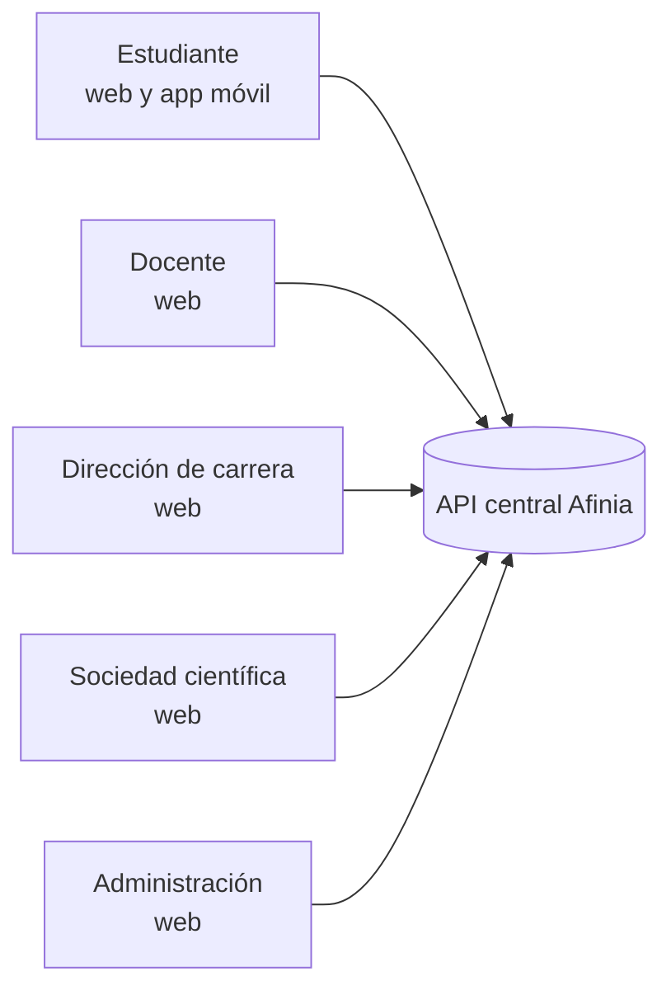
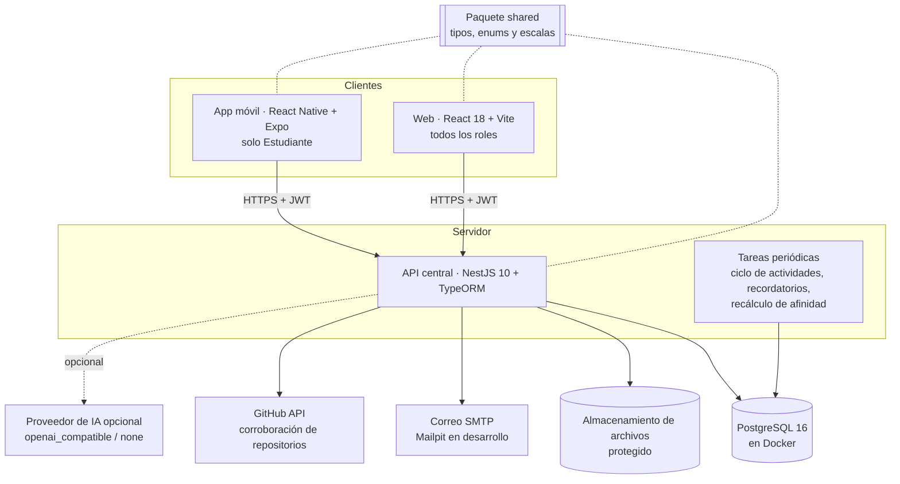
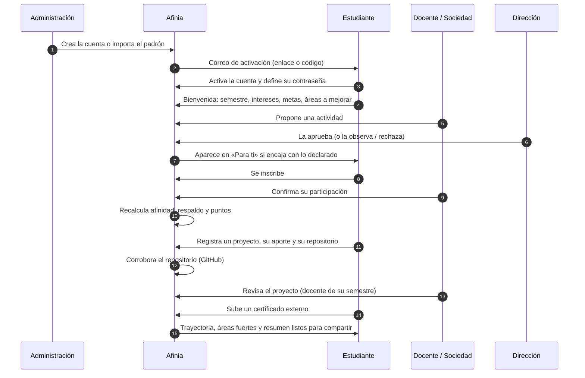
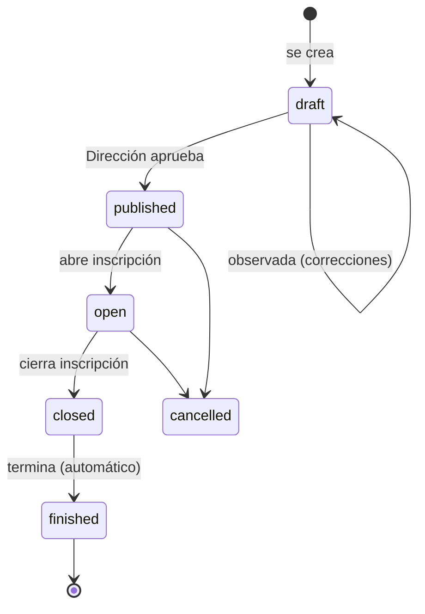

# Afinia — el proyecto completo, de principio a fin

**Sistema Multiplataforma para la Construcción del Perfil Estudiantil Dinámico**
Ingeniería en Sistemas Informáticos · Universidad Privada del Valle
Estado del documento: noviembre de 2026 (después del cierre V6 y del rediseño visual V7).

Este documento cuenta en un solo lugar qué es Afinia, para quién es, cómo está construido, cómo funciona
cada parte, cómo se instala, cómo se prueba y cómo llegó a su forma actual. Para el detalle de una versión
concreta hay que ir a sus documentos (lista al final).

---

## Índice

1. [Qué es Afinia y qué problema resuelve](#1-qué-es-afinia-y-qué-problema-resuelve)
2. [Principios que guían todo el sistema](#2-principios-que-guían-todo-el-sistema)
3. [Quién usa Afinia: los cinco roles](#3-quién-usa-afinia-los-cinco-roles)
4. [Arquitectura](#4-arquitectura)
5. [Organización del repositorio](#5-organización-del-repositorio)
6. [El recorrido completo de un estudiante](#6-el-recorrido-completo-de-un-estudiante)
7. [Cómo funciona cada módulo](#7-cómo-funciona-cada-módulo)
8. [Los dos motores: afinidad y recomendaciones](#8-los-dos-motores-afinidad-y-recomendaciones)
9. [La interfaz: web y app móvil](#9-la-interfaz-web-y-app-móvil)
10. [Seguridad y privacidad](#10-seguridad-y-privacidad)
11. [Base de datos y migraciones](#11-base-de-datos-y-migraciones)
12. [Puesta en marcha](#12-puesta-en-marcha)
13. [Pruebas y calidad](#13-pruebas-y-calidad)
14. [Historia del proyecto: de la V1 a la V7](#14-historia-del-proyecto-de-la-v1-a-la-v7)
15. [Lo que Afinia no hace, a propósito](#15-lo-que-afinia-no-hace-a-propósito)
16. [Glosario](#16-glosario)
17. [Dónde seguir leyendo](#17-dónde-seguir-leyendo)

---

## 1. Qué es Afinia y qué problema resuelve

### El problema

Lo que un estudiante de Sistemas hace fuera de las notas queda disperso: un certificado de un curso en un
correo, un proyecto en un repositorio, la participación en un taller en una lista de Excel de quien lo
organizó. Cuando hace falta mostrarlo (una beca, una práctica, un equipo de investigación), no hay un lugar
que lo reúna ni una forma de distinguir lo que **se afirma** de lo que **está respaldado**. A su vez, la
carrera no tiene una vista de en qué áreas se mueven sus estudiantes ni de cuánto participan.

### La solución

Afinia es una plataforma **complementaria**: no reemplaza al SIU, a Teams, a las notas ni a los certificados
oficiales. Construye el perfil de cada estudiante a partir de lo que **hizo y está respaldado**:

- **actividades** (talleres, charlas, retos) con participación **confirmada** por quien las organizó;
- **proyectos** con su repositorio, demo, integrantes y el **aporte** de cada uno, con un nivel de respaldo;
- **credenciales externas** (certificados de cursos, por ejemplo) corroboradas cuando es posible.

Con eso calcula, con reglas fijas y explicables:

- su **afinidad** por área tecnológica (en qué áreas tiene trayectoria comprobada);
- su **respaldo** (cuánto de lo que muestra está corroborado);
- su **trayectoria** y un **resumen** que solo afirma lo verificable.

Además, le **recomienda** actividades y recursos según lo que **quiere explorar o mejorar**, que no
necesariamente es lo que ya sabe.

---

## 2. Principios que guían todo el sistema

| Principio | Qué significa en la práctica |
|---|---|
| **Lo declarado orienta; lo respaldado demuestra** | Intereses y tecnologías declaradas guían las recomendaciones, pero **no suman afinidad**. La afinidad sale solo de actividades confirmadas, proyectos corroborados o revisados y certificados corroborados. |
| **Reglas deterministas, nunca IA que decida** | Afinidad, respaldo y recomendaciones son fórmulas con pesos fijos y documentados. Con los mismos datos, el resultado es siempre el mismo. La IA (opcional) solo **sugiere** textos. |
| **Explicable** | Cada número viene con su explicación: qué sumó, cuánto y qué se tuvo en cuenta pero **no** sumó. |
| **Descriptivo, no evaluativo** | Nada es una nota, un ranking ni una predicción de rendimiento. |
| **Complementario** | No sustituye procesos oficiales ni la comunicación institucional. No hay chat interno: los estudiantes comparten sus propios canales. |
| **Cuentas provisionadas** | No hay registro público. La carrera crea la cuenta (a mano o importando el padrón) y su titular la activa desde el correo. |
| **Privacidad por defecto** | El estudiante decide qué se ve de su perfil público. Docentes y Dirección ven una vista permitida, sin datos sensibles. Los agregados de analítica se ocultan si el grupo es demasiado chico. |

---

## 3. Quién usa Afinia: los cinco roles



| Rol | Dónde | Qué hace, en simple |
|---|---|---|
| **Estudiante** | Web y **app móvil** | Completa la bienvenida, arma su perfil (intereses, tecnologías, metas, disponibilidad y visibilidad), registra proyectos con su aporte, sube certificados, se inscribe en actividades, ve «Para ti», usa la biblioteca, guarda contactos por QR, postula a equipos, ve sus puntos e insignias y su resumen de trayectoria. |
| **Docente** | Web | Ve a los estudiantes **de sus semestres asignados** en un panel con pestañas (resumen, por semestre, estudiantes, proyectos, necesidades de equipo), revisa proyectos y respaldos, organiza actividades y confirma la asistencia, propone recursos y otorga puntos. |
| **Dirección de carrera** | Web | Ve lo que espera su decisión, aprueba, observa o rechaza actividades propuestas, revisa credenciales en casos excepcionales, consulta la analítica de la carrera (panorama, afinidad, participación, demanda, evolución), define criterios de puntos y la autonomía de cada docente. |
| **Sociedad científica** | Web | Propone actividades extracurriculares (las aprueba Dirección), gestiona inscritos y asistencia y mide el alcance con métricas filtrables. |
| **Administración** | Web | Provisiona cuentas e importa el padrón, gestiona roles, estados y el alcance de cada docente, mantiene los catálogos (áreas, tecnologías, categorías, recursos, gamificación) y consulta una auditoría legible. |

> **La app móvil es solo del Estudiante.** La API no emite sesión desde el móvil a otro rol. Los demás roles
> trabajan en la web, que se adapta al celular (desde la V7, con barra inferior tipo app).

---

## 4. Arquitectura



| Capa | Tecnología | Notas |
|---|---|---|
| API | NestJS 10, TypeScript, TypeORM 0.3 | Esquema **solo por migraciones**; Swagger opcional en `/api/docs`. |
| Base de datos | PostgreSQL 16 en Docker (`perfil_postgres`) | Base de desarrollo `perfil_estudiantil`; base aislada de pruebas `afinia_test`. |
| Web | React 18, Vite, React Router, framer-motion, Recharts, react-icons (Feather) | Una sola web para los cinco roles. |
| Móvil | React Native 0.81, Expo SDK 54, React Navigation | Mismos íconos (Feather) que la web. |
| Compartido | Paquete `shared/` | Enumeraciones, escalas del motor de afinidad, etiquetas y reglas comunes. |
| Autenticación | JWT de vida corta + refresh rotatorio | En la web el refresh viaja en cookie HttpOnly; en el móvil, en almacenamiento seguro. |
| Correo | Nodemailer (SMTP) o API de Brevo | Activación y recuperación; en desarrollo, a la consola o a Mailpit. En producción, Brevo. |
| Archivos | Disco local o Cloudflare R2 | Se elige con `STORAGE_DRIVER`; el bucket es privado y las descargas siguen pasando por la API. |
| IA | Puerto propio con proveedores `none` / `openai_compatible` | Con `none` todo funciona; la IA solo sugiere y nunca decide. |

---

## 5. Organización del repositorio

```
.
├── api/        API central NestJS
│   └── src/
│       ├── auth, identity, users, roles, access     → cuentas, activación, sesión, permisos y alcance docente
│       ├── onboarding, profiles, catalogs           → bienvenida, perfil, áreas y tecnologías
│       ├── activities, constancies, certificates    → actividades, inscripciones, constancias y credenciales
│       ├── projects, project-feedback, evidences    → proyectos, aporte, revisión docente y evidencias
│       ├── validation, storage                      → corroboración (repositorios, enlaces) y archivos protegidos
│       ├── affinity-recalc, backed-skills           → motor de afinidad, respaldo y tecnologías respaldadas
│       ├── recommendations, library                 → «Para ti» y biblioteca de recursos
│       ├── collaboration                            → contactos por QR, perfil público, equipos y necesidades
│       ├── gamification, trajectory                 → puntos, insignias, recompensas y trayectoria
│       ├── notifications, mail                      → avisos y correo
│       ├── reports, imports, audit, help, ai        → analítica, padrón, auditoría, ayuda y asistente
│       ├── entities/   (60 entidades)
│       └── database/migrations/   (81 migraciones)
├── web/        Frontend React (src/pages por rol: student, teacher, director, society, admin)
├── mobile/     App Expo del estudiante (src/screens/student)
├── shared/     Tipos y escalas compartidas (src/enums)
├── docker/     docker-compose de PostgreSQL y Mailpit
├── scripts/    Suites E2E por versión, entorno de pruebas aislado, k6, ZAP, Postman
├── pruebas-e2e/  Pruebas Playwright (Chromium, Firefox y WebKit)
├── pruebas/    Evidencia generada (capturas, reportes)
└── docs/       Documentación por versión
```

---

## 6. El recorrido completo de un estudiante



Paso a paso:

1. **Provisión.** Administración crea la cuenta (o importa el padrón con vista previa). Nadie se registra solo.
2. **Activación.** El titular recibe un correo con un enlace y un código (vigencia de 48 h, intentos limitados) y define su contraseña.
3. **Bienvenida.** Asistente de varios pasos: semestre, intereses, objetivos, áreas que quiere mejorar y tecnologías. Hasta completarla no se ven las pestañas (en la web y en el móvil).
4. **Perfil.** Cuatro pestañas: *Sobre mí*, *Intereses y objetivos*, *Disponibilidad* y *Visibilidad* (qué campos ve el público, foto, enlace y QR del perfil).
5. **Actividades.** Pestañas *Para ti*, *Todas*, *Inscritas*, *Guardadas* e *Historial*. Inscribirse, guardar o asistir no cambia el orden de las sugerencias (V6).
6. **Participación.** El organizador confirma quién participó; eso queda en la trayectoria y suma afinidad, respaldo y puntos según los criterios vigentes.
7. **Proyectos.** Se registran en borrador y se activan al cumplir lo mínimo. Llevan tecnologías, integrantes con su **rol y aporte**, repositorio, demo (solo https), imágenes y evidencias (hasta 5 archivos y 8 enlaces). El repositorio se corrobora; el docente puede revisarlo.
8. **Credenciales externas.** Se suben con emisor y enlace de verificación; se corroboran cuando es posible y, en casos excepcionales, se revisan a mano.
9. **Resultado.** El estudiante ve sus **áreas fuertes** con explicación, su **progreso** (puntos, insignias, recompensas) y un **resumen de trayectoria** que solo afirma lo verificable.

---

## 7. Cómo funciona cada módulo

### 7.1 Cuentas, sesión y permisos

- **Provisión e importación:** alta individual o importación del padrón con previsualización (filas nuevas, actualizaciones e inválidas) antes de aplicar.
- **Activación y recuperación:** enlace + código, con vigencias e intentos configurables.
- **Sesión:** JWT corto + refresh rotatorio. Cerrar sesión revoca de verdad el refresh.
- **Roles y alcance:** cada endpoint declara los roles permitidos. El docente opera solo sobre los estudiantes de **sus semestres asignados**. Desde la V6, cada responsable de una actividad tiene semestres propios, y la actividad debe quedar cubierta por ellos.
- **Autonomía docente (V5):** Dirección define, por docente y por módulo, si su revisión necesita aprobación o es directa.

### 7.2 Actividades



- Las proponen **docentes**, **sociedades** y **Administración**. Las de docentes y sociedades pasan por la **aprobación de Dirección** (salvo autonomía concedida).
- **Inscripción:** con cupo, se admite automáticamente por orden de solicitud con un bloqueo transaccional; si se llena, la API responde «actividad llena». Sin cupo, el organizador acepta.
- **Asistencia:** el organizador confirma o marca ausencia. La participación confirmada es la que cuenta.
- **Ciclo automático:** una tarea periódica pasa las actividades a «en curso» y «finalizada» según sus fechas; otra envía recordatorios.
- **Asistir no da insignia ni certificado (V6):** Afinia registra la participación; las constancias institucionales se muestran como «certificados institucionales recibidos».

### 7.3 Proyectos y respaldo

| Nivel de respaldo | Cuándo |
|---|---|
| **Declarado** | El estudiante lo cargó; nada lo corrobora todavía. |
| **Con respaldo** | Tiene evidencias (archivos, enlaces, imágenes). |
| **Corroborado** | Una fuente externa lo confirma (p. ej., el repositorio existe y es coherente). |
| **Revisado** | Un docente con alcance sobre el estudiante lo revisó. |
| **Señalado** | Hay una observación que impide contarlo. |

- Cada integrante declara su **rol** (del catálogo) y su **aporte**.
- Las evidencias de proyecto **no pasan por OCR** (V6): se guardan como evidencia, sin inferir el stack de una captura.
- **Galería de la carrera:** un proyecto aparece en «Proyectos de la carrera» solo con el **consentimiento** de sus integrantes. El enlace público no expone el repositorio.

### 7.4 Credenciales y constancias

- **Credenciales externas:** emisor, fecha, enlace de verificación y archivo. Se corroboran cuando el enlace lo permite; si no, Dirección o Administración hacen una revisión manual excepcional.
- **Constancias internas:** documentos de la carrera asociados a una participación. Refuerzan la trazabilidad del **mismo** evento, pero no crean un segundo evento de afinidad.
- **Estados de respaldo explicados (V6):** cada estado tiene una explicación en palabras. Los textos aclaran que Afinia no constituye certificación.

### 7.5 Colaboración

- **Contactos por QR:** cada estudiante tiene un perfil público con QR (se gestiona en *Mi perfil → Visibilidad*). Escanear un QR guarda el contacto.
- **Búsqueda de compañeros (V6)** dentro del alcance permitido.
- **Equipos y necesidades:** los equipos publican lo que buscan, los estudiantes del semestre postulan y el docente ve las necesidades de sus semestres. Los nombres de equipo pasan por un filtro de términos prohibidos.
- **Sin chat:** cada estudiante comparte sus canales (Teams, WhatsApp, LinkedIn, correo o un enlace).

### 7.6 Gamificación

- **Puntos** por criterios que define Dirección (con tope por actividad), puntos manuales de docentes y Dirección, **insignias** por hitos y **recompensas**.
- Desde la V6, asistir a una actividad no otorga insignia.
- Los puntos motivan; no son nota ni ranking público.

### 7.7 Avisos y correo

- **Centro de avisos** con contador de no leídos (en la web, campana; en el móvil, pestaña *Avisos* con insignia). Cada aviso lleva a su pantalla.
- **Correo:** activación, recuperación, recordatorios y avisos relevantes. La pantalla de diagnóstico del correo solo existe para Administración y no aparece en el menú (V6).

### 7.8 Biblioteca de recursos

Docentes proponen recursos; la carrera (Dirección y Administración) los gestiona y publica. Los estudiantes los consultan por área y tipo, los guardan como favoritos y los reciben sugeridos según sus áreas a mejorar.

### 7.9 Trayectoria y resumen

La **trayectoria** ordena en el tiempo lo hecho, con el nivel de respaldo de cada cosa. El **resumen de
trayectoria** (antes «CV») es un borrador informativo en el que el estudiante elige secciones e ítems; solo
afirma lo verificable.

### 7.10 Analítica y reportes

- **Docente:** resumen y reporte por semestre de sus estudiantes (intereses predominantes, tecnologías, perfiles incompletos, participación).
- **Dirección:** Panorama, Afinidad, Participación, Demanda y Evolución.
- **Sociedad:** métricas por periodo, categoría y área, con comparación contra el periodo anterior.
- Los agregados se ocultan si el grupo es menor a `ANALYTICS_MIN_GROUP_SIZE`.

### 7.11 Auditoría

Cada acción relevante queda registrada con actor, módulo, acción, fecha y resultado, en una vista legible para Administración.

### 7.12 Asistente de IA (opcional)

Ayuda a redactar descripciones y a sugerir tecnologías a partir de un texto. Tiene límite de caracteres, de tiempo y de pedidos por minuto. Con `AI_PROVIDER=none` el sistema funciona completo. **Nunca decide:** no calcula afinidad, no aprueba nada y no evalúa.

---

## 8. Los dos motores: afinidad y recomendaciones

### 8.1 Motor de afinidad (versión 5)

**Qué mide:** en qué áreas tecnológicas el estudiante tiene **trayectoria corroborada**.

**Qué suma y cuánto (por área):**

| Familia | Señal que suma | Puntos base | Tope por área |
|---|---|---|---|
| Actividades | Participación **confirmada** | 10 | 25 |
| Proyectos | Corroborado / revisado | 18 / 22 | 50 |
| Certificados | Corroborado | 15 | 25 |
| Declarado | Intereses, preferencias, tecnologías declaradas | **0** | 0 |

- **Rendimientos decrecientes:** la 1.ª actividad del área cuenta al 100 %, las siguientes al 70 %, 50 % y 30 %. En proyectos y certificados la escala es 100 %, 75 %, 50 % y 25 %. Las señales se ordenan de mayor a menor antes de aplicar la escala, así que el resultado es deterministo.
- **Puntaje:** `afinidad = redondeo(min(100, actividades + proyectos + certificados))`. Máximo 100 = 25 + 50 + 25.
- **Contexto explícito (V5):** cada experiencia suma solo en el área de **su contexto declarado**; las etiquetas de área por sí solas no puntúan.
- **Niveles:** **Inicial** 0–24 · **Media** 25–59 · **Alta** 60–100.
- **Explicación:** la pantalla muestra qué sumó, cuánto, y qué se tuvo en cuenta y **no** sumó (y por qué).
- **Respaldo:** escala paralela de 0 a 100 (actividades 20, proyectos 45, certificados 25, otras señales 10) que mide **cuánto está corroborado** lo que el estudiante muestra.

El recálculo se dispara cuando cambia algo relevante (una confirmación, una revisión, una corroboración) y también se ejecuta periódicamente.

### 8.2 Motor de recomendaciones («Para ti»)

**Qué hace:** ordena actividades, oportunidades y recursos según **lo que el estudiante declaró que quiere**.

| Señal | Peso |
|---|---|
| Intereses explícitos (áreas declaradas y texto libre) | 40 % |
| Áreas que quiere mejorar | 30 % |
| Tecnologías de interés o a mejorar | 15 % |
| Orientación confirmada | 10 % |
| Clics, «guardar», favoritos o inscribirse | **0 %** (V6) |

- El puntaje **solo ordena**: no es nota ni evaluación.
- Cada sugerencia dice **por qué** aparece, en palabras.
- Desde la V6 no existe «No me interesa» y guardar es solo un favorito: nada de eso altera el orden.

---

## 9. La interfaz: web y app móvil

### 9.1 Web

- **Página de inicio pública (V7):** animación de entrada con «marcos» de navegador y teléfono que se inclinan con el cursor y se separan al hacer scroll, palabras que rotan, cinta continua, contadores, una sección *Para quién es* con pestañas por rol, pasos con una línea que se dibuja al bajar, preguntas frecuentes y menú tipo hamburguesa en el teléfono. Con la opción «reducir movimiento» del sistema todo queda quieto.
- **Vista amable para Estudiante, Docente, Dirección y Sociedad (V7):**
  - **Saludo** con el nombre y el rol en el menú lateral.
  - **Menú agrupado** por lo que la persona quiere hacer (*Mi espacio*, *Descubrir*, *Con otros*, *Mi camino*; *Mi día a día*, *Mis estudiantes*; *Para decidir*, *La carrera*, *Seguimiento*; *Mi sociedad*), con una pista breve en cada opción.
  - **Inicio con saludo** y una grilla **«¿Qué quieres hacer?»** con accesos explicados en una línea.
  - **En el celular, barra inferior tipo app** con cuatro accesos del rol y **«Más»**, que abre el menú completo.
  - Administración conserva su panel de trabajo.
- **Accesibilidad:** diálogos con foco atrapado y cierre con Escape, tutorial de primera visita, centro de ayuda por rol, respeto de «reducir movimiento» y ningún desplazamiento horizontal a 375 px.

### 9.2 App móvil (Estudiante)

- Pestañas: **Inicio**, **Perfil**, **Actividades**, **Proyectos**, **Afinidad** y **Avisos**.
- Pantallas internas: intereses, tecnologías, credenciales y constancias, colaboración, progreso, trayectoria, biblioteca, detalle de proyecto y bienvenida.
- **V7:** el inicio replica al de la web: tarjeta de saludo con círculos que flotan y el avance del perfil, *Tu siguiente paso*, cifras, una grilla *¿Qué quieres hacer?*, *Tus áreas fuertes* y *Lo que ya cargaste*. También cambiaron las tarjetas y botones (más redondeados, con sombra suave bordó) y la barra inferior (pastilla en la pestaña activa).
- Si alguien de otro rol entra con una sesión antigua, ve qué tiene esperándole en la web.

---

## 10. Seguridad y privacidad

- **Contraseñas** con bcrypt. **Tokens** de activación y recuperación de un solo uso, con vigencia e intentos limitados.
- **Sesión:** JWT corto + refresh rotatorio (cookie HttpOnly, SameSite configurable en la web). El logout revoca.
- **Cabeceras y límites:** Helmet, compresión, CORS restringido y **rate limiting** (Throttler).
- **Validación** de toda entrada con DTOs (`class-validator`). Las claves desconocidas se descartan.
- **Archivos protegidos:** se sirven solo a quien tiene permiso, con el `Content-Type` correcto; las demos solo por https.
- **Control de acceso en la API, no en el menú:** ocultar un enlace nunca es la protección; cada endpoint valida rol y alcance.
- **Privacidad:** perfil público por campos elegidos por el estudiante, galería con consentimiento, agregados con tamaño mínimo de grupo y auditoría de acciones.
- **Verificación:** OWASP ZAP (escaneo activo sobre una base de desarrollo respaldada), SonarQube y revisión de dependencias en los cierres anteriores.

---

## 11. Base de datos y migraciones

- **PostgreSQL 16** en Docker; **60 entidades** y **81 migraciones** a la fecha.
- El esquema cambia **solo por migraciones aditivas**, sin `synchronize`. Las migraciones se aplican a la base de desarrollo y a la de pruebas.
- Grupos principales de tablas: usuarios, roles y tokens · perfiles, intereses, tecnologías y visibilidad · catálogos (áreas, tecnologías, categorías, recursos) · actividades, responsables (con semestres), inscripciones y constancias · proyectos, integrantes, evidencias, imágenes y revisiones · credenciales externas · afinidad, respaldo y pesos · recomendaciones y favoritos · contactos, equipos y necesidades · puntos, insignias y recompensas · avisos · auditoría.

---

## 12. Puesta en marcha

Requisitos: **Node 20+**, **npm**, **Docker Desktop** abierto y, para el móvil, **Expo Go** o un emulador.

```bash
cp .env.example .env
npm install
npm install --prefix web
npm install --prefix mobile

npm run db:up          # PostgreSQL en Docker
npm run db:wait
npm run shared:build
npm run api:migrate
npm run seed:populate  # datos de ejemplo
```

En tres terminales:

```bash
npm run api:dev        # http://localhost:3010/api
npm run web:dev        # http://localhost:5173
npm run mobile:start   # Expo (mismo Wi-Fi; o: npx expo start --tunnel)
```

Cuentas de ejemplo (después de `seed:populate`, contraseña `Univalle2026*`):

| Rol | Correo |
|---|---|
| Docente (semestres 1–4) | `carlos.perez@univalle.edu` |
| Dirección de carrera | `jorge.vargas@univalle.edu` |
| Sociedad científica | `lucia.fernandez@univalle.edu` |
| Estudiante | `ana.quispe@est.univalle.edu` |
| Administración | la que define el `.env` (`ADMIN_EMAIL` / `ADMIN_PASSWORD`) |

**Entorno de pruebas aislado** (no toca la base de desarrollo):

```bash
node scripts/pruebas/entorno.mjs api   # API en :3020 sobre afinia_test
node scripts/pruebas/entorno.mjs web   # web en :5180 contra :3020
```

> Arranque primero la API de desarrollo y espere su `/api/health`. Recién después levante la de pruebas:
> dos `nest start` a la vez compiten por la carpeta `dist`.

---

## 13. Pruebas y calidad

| Tipo | Herramienta | Comando |
|---|---|---|
| Unitarias (reglas puras: afinidad, recomendaciones, respaldo, transiciones) | Jest | `npm run test:unit` / `npm run pruebas:jest` |
| E2E de API por versión (cada comprobación cita su sección del contrato) | Node + HTTP | `npm run test:v2` … `npm run test:v6`, `npm run test:all` |
| E2E web | Playwright | `npm run test:web`, `npm run test:v6-web` |
| E2E web en 3 navegadores (con capturas) | Playwright Test | `npm run pruebas:playwright` |
| Colección de API | Postman / Newman | `npm run pruebas:postman` |
| Carga | k6 | `npm run pruebas:k6` |
| Seguridad | OWASP ZAP | `npm run pruebas:zap` |
| Calidad estática | SonarQube | `npm run pruebas:sonar` |

**Última regresión integral (cierre V6, 01/11/2026):** 23 suites anteriores con **2398 comprobaciones sin
fallos**, `e2e-v6` 98/98, `e2e-v6-web` 63/63, `e2e-web` 106/106, Jest 69/69, Newman 70/70 y Playwright 54/54
en Chromium, Firefox y WebKit. El detalle está en [`QA_V6_REGRESION.md`](qa/QA_V6_REGRESION.md).

El rediseño V7 y la preparación para el hosteo se verificaron con su propia corrida. El resultado está en
[`docs/qa/QA_HOSTING.md`](qa/QA_HOSTING.md).

---

## 14. Historia del proyecto: de la V1 a la V7

| Etapa | Qué aportó |
|---|---|
| **Avances 40 % → 70 %** | Base funcional por batches: identidad y seguridad, perfil y bienvenida, almacenamiento y validación, actividades, proyectos, afinidad, recomendaciones, colaboración, gamificación, reportes y endurecimiento. |
| **V2** (especificación maestra) | Cuentas provisionadas y activación, refresh en cookie, app móvil solo del Estudiante, ayuda y tutorial, navegación por rol, accesibilidad en el teléfono. |
| **V3 / V3.1** | Motor de afinidad V3 (solo lo corroborado suma), respaldo, trayectoria, currículo verificable, corroboración de repositorios, avisos, panel docente único con pestañas, analítica de Dirección. |
| **V3.2** (cierre) | Ciclo automático de actividades, afinidad por contexto, archivos protegidos, auditoría legible, menús por rol y diagnóstico de correo solo en modo técnico. |
| **V4 / V4.1** | Ajustes de producto: colaboración agrupada, biblioteca, aporte en proyectos y criterios de puntos. |
| **V5** | Afinidad V5 (contexto explícito), autonomía docente, «resumen de trayectoria» en lugar de CV, Afinia no certifica, política de revisión y ventana de asistencia. |
| **V6** | Responsables de actividad con semestres propios, duplicado seguro, admisión automática con cupo, aviso de cambios sin guardar, correo por rol, evidencias de proyecto sin OCR, límites de evidencias, galería con consentimiento, QR y foto en Visibilidad, recomendador sin señales de clic, búsqueda de compañeros, asistir sin insignia, estados de respaldo explicados y correo fuera del menú. |
| **V7** (rediseño visual) | Landing animada; vista amable para Estudiante, Docente, Dirección y Sociedad (saludo, menú en palabras simples, accesos explicados y barra inferior en el teléfono); app móvil alineada con la web. **No cambia ninguna funcionalidad.** |
| **Preparación para el hosteo** | Archivos en Cloudflare R2, correo por Brevo, imagen Docker, configuración de Railway y Cloudflare Pages, CI y guía de publicación. El comportamiento local no cambia. |

---

## 15. Lo que Afinia no hace, a propósito

- Predecir rendimiento, abandono o éxito profesional.
- Emitir certificados, constancias oficiales o acreditar competencias: registra participación y consulta proveedores.
- Reemplazar al SIU o a Teams, tener chat interno o permitir el registro público.
- Inferir el stack de un proyecto con OCR de capturas o recorriendo su demo.
- Dar un puntaje de «dominio» por habilidad.
- Dejar que la IA decida algo: solo sugiere.

---

## 16. Glosario

| Término | Significado |
|---|---|
| **Afinidad** | Puntaje de 0 a 100 por área, que mide la trayectoria **corroborada** en esa área. |
| **Respaldo** | Cuánto de lo que el estudiante muestra está corroborado (0 a 100). |
| **Declarado / Con respaldo / Corroborado / Revisado** | Niveles de confianza de un proyecto o credencial, de menor a mayor. |
| **Participación confirmada** | El organizador de la actividad confirmó que el estudiante participó. |
| **Alcance docente** | Los semestres asignados a un docente; solo opera sobre esos estudiantes. |
| **Para ti** | Lista de sugerencias ordenada por lo que el estudiante declaró querer. |
| **Resumen de trayectoria** | Borrador para compartir que solo afirma lo verificable. |
| **Padrón** | Lista institucional de estudiantes que se importa para provisionar cuentas. |
| **Entorno aislado** | API (:3020) y web (:5180) de pruebas sobre la base `afinia_test`. |

---

## 17. Dónde seguir leyendo

- [`README.md`](../README.md): puesta en marcha, variables de entorno y pruebas.
- [`QA_V6_REGRESION.md`](qa/QA_V6_REGRESION.md): la última regresión integral y la matriz GAP final.
- [`AFINIA_CONTRATO_UNICO_V6_CLAUDE_CODE_2026-10-30.md`](contratos/AFINIA_CONTRATO_UNICO_V6_CLAUDE_CODE_2026-10-30.md): el contrato vigente.
- [`docs/EL_SISTEMA_COMPLETO.md`](EL_SISTEMA_COMPLETO.md) y [`docs/AFINIA_FLUJO_COMPLETO_Y_MOTORES.md`](AFINIA_FLUJO_COMPLETO_Y_MOTORES.md): diagramas y motores en detalle.
- `docs/MATRIZ_TRAZABILIDAD_*`: requisitos → código → pruebas por versión.
- `docs/CAMBIOS_DOCUMENTO_GRADO_*`: qué ajustar en el documento de grado en cada versión.
