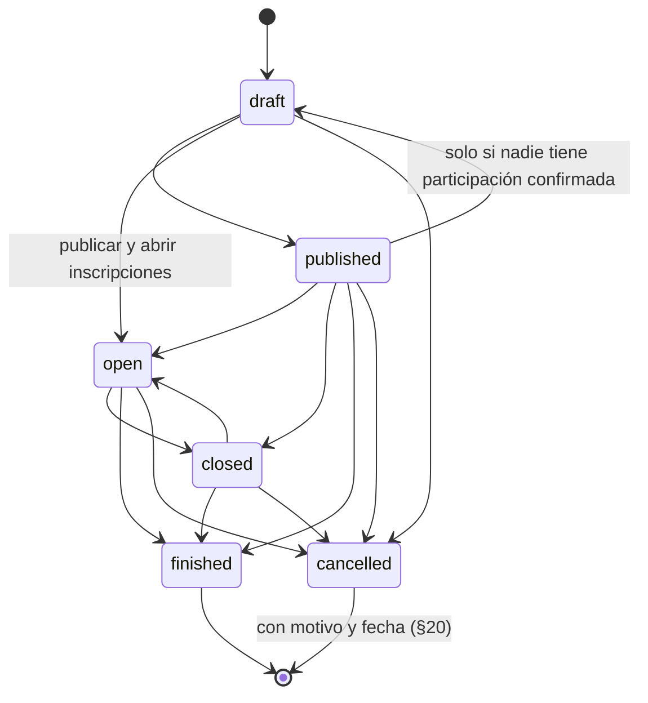
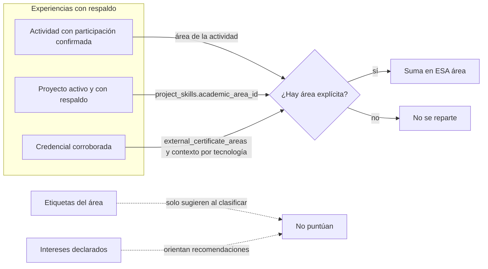
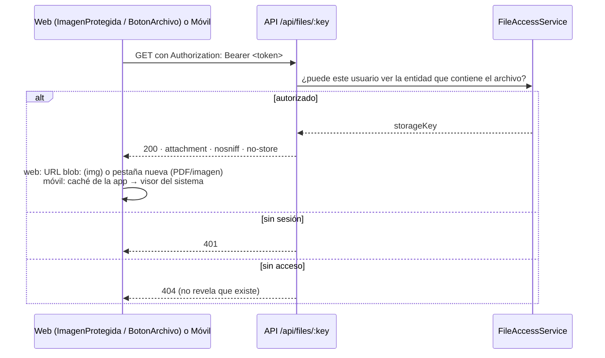
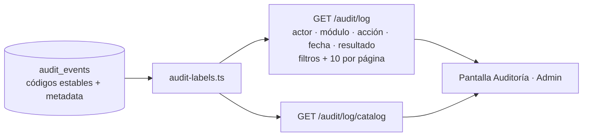
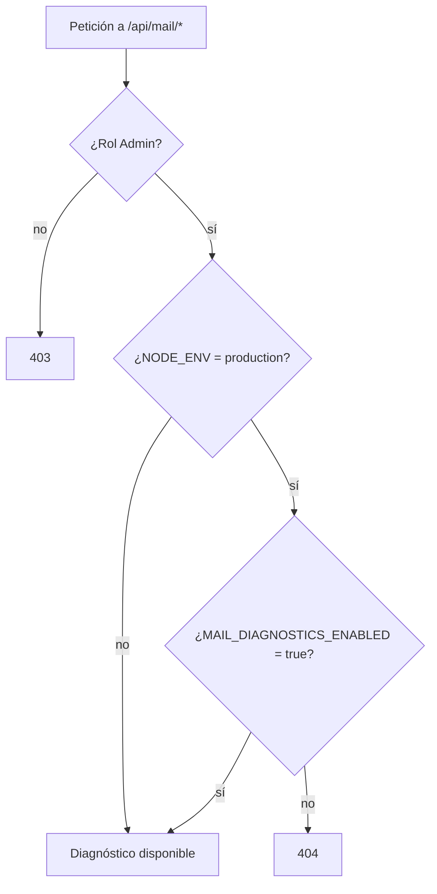

# Diagramas — Cierre V3.2

Este documento muestra solo lo que cambió en la V3.2. La arquitectura general, el modelo de datos base y el resto de los estados siguen en [`DIAGRAMAS_V3.md`](DIAGRAMAS_V3.md).

Los diagramas están en Mermaid. Se ven en GitHub y en VS Code. Para el documento de grado, se exportan con `npx @mermaid-js/mermaid-cli -i DIAGRAMAS_V3_2.md`.

## 1. Revisión de una actividad propuesta (§23–§26)

Las actividades de Docente o Sociedad pasan por Dirección. La que crea Dirección no necesita revisión (`not_required`).

```mermaid
stateDiagram-v2
    [*] --> SinEnviar: Docente o Sociedad crea (borrador privado)
    SinEnviar --> Pendiente: Enviar a revisión (exige el formulario completo)
    Pendiente --> SinEnviar: Retirar el envío (cancel-submission)
    Pendiente --> Observada: Dirección pide cambios
    Observada --> Pendiente: Corrige y reenvía
    Pendiente --> Aprobada: Dirección aprueba
    Pendiente --> Rechazada: Dirección rechaza (queda en la historia)
    Aprobada --> Aprobada: Solo Dirección ajusta (auditado); el creador recibe 409
    Rechazada --> [*]
```

- El borrador lo ven su creador y sus responsables; Dirección y Administración, solo una vez enviado. Para cualquier otro, también al cambiar el id en la URL, responde 404.

## 2. Ciclo de la actividad (`ACTIVITY_TRANSITIONS`, §21–§22)

El ciclo automático (`ACTIVITY_LIFECYCLE_INTERVAL_MS`, 60 s por omisión; 0 lo apaga) cierra las inscripciones de lo que ya empezó (`closed`) y da por finalizado lo que ya terminó (`finished`).

## 3. Afinidad V5: el área sale del contexto explícito (§11.5, §12.3)

- La habilidad React, con área principal «Desarrollo web» y secundaria «Móvil», suma solo en el área en que se usó en esa experiencia.
- Ya no se infiere un área por las etiquetas de una tecnología ni por coincidencias de texto con el nombre de un área.

## 4. Archivos protegidos en la web y el móvil (§27.1, §83)

Antes de la V3.2, `` y los enlaces «Abrir» no llevaban el token, apuntaban al origen de la web y recibían 401.

## 5. Auditoría legible (§59)

- El detalle técnico, como el código del evento, queda dentro del desplegable de cada fila.
- La metadata ya se guarda sin contraseñas, tokens ni códigos.

## 6. Superficie técnica del correo (§60)

En la web, el menú y la ruta existen solo en desarrollo o con `VITE_TECHNICAL_MODE=true`.
